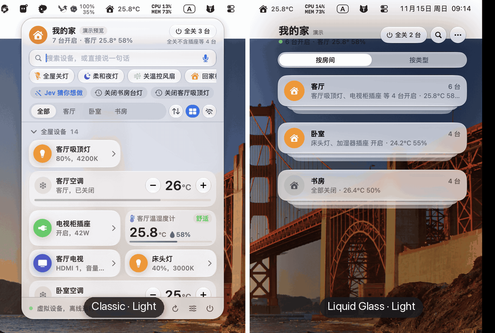
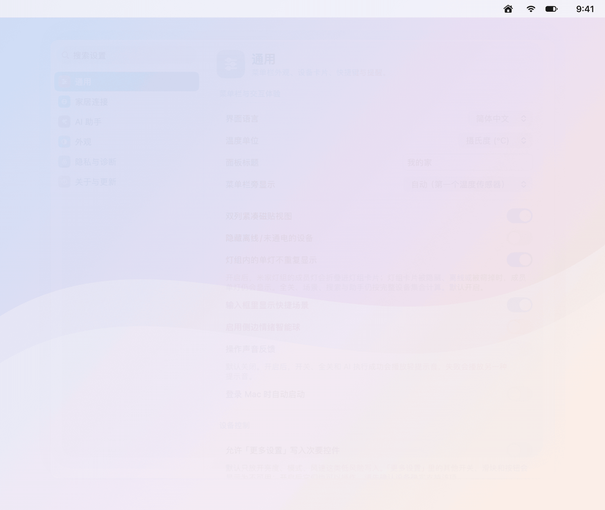
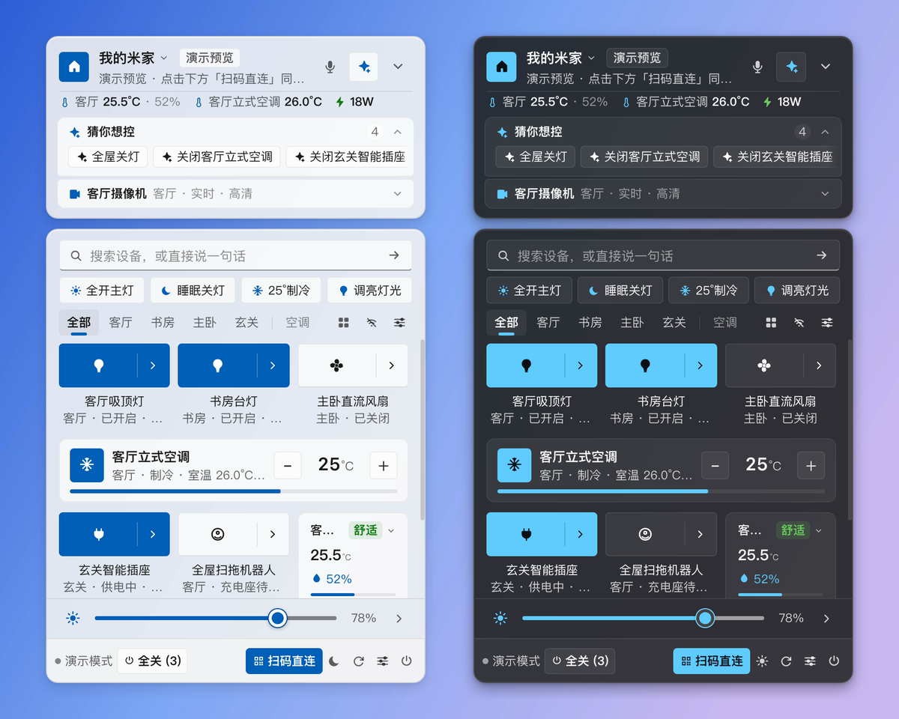

English | [简体中文](README.zh-CN.md)

<p align="center">
  <a href="https://trendshift.io/repositories/309141?utm_source=trendshift-badge&amp;utm_medium=badge&amp;utm_campaign=badge-trendshift-309141" target="_blank" rel="noopener noreferrer"></a>
  <a href="https://trendshift.io/repositories/309141?utm_source=trendshift-badge&amp;utm_medium=badge&amp;utm_campaign=badge-trendshift-309141" target="_blank" rel="noopener noreferrer"></a>
</p>

<p align="center">
  <picture>
    <source media="(prefers-color-scheme: dark)" srcset="docs/assets/logo-dark.svg">
    <source media="(prefers-color-scheme: light)" srcset="docs/assets/logo-light.svg">
    
  </picture>
</p>

<h1 align="center">MenuBarHome</h1>

<p align="center">
  <b>Run your whole home from your computer, without reaching for your phone.</b><br>
  A Mi Home control center that lives in the Mac menu bar, with a Windows 11 tray edition too.<br>
  Scan one QR code with the Mi Home app and you're connected. No Home Assistant setup required.
</p>

<p align="center">
  <a href="https://github.com/jryang2026-code/MenuBarHome/stargazers"></a>
  <a href="https://github.com/jryang2026-code/MenuBarHome/releases/latest"></a>
  
  
  
  
</p>

<p align="center">
  <a href="https://github.com/jryang2026-code/MenuBarHome/releases/latest"><b>Download latest</b></a> ·
  <a href="#quick-start">Install & Connect</a> ·
  <a href="#features--platform-matrix">Platform Comparison</a> ·
  <a href="#safety-privacy--limitations">Safety & Privacy</a> ·
  <a href="CHANGELOG.md">Changelog</a>
</p>

<p align="center">
  
</p>

<p align="center"><sub>Press <code>⌥M</code>, type <code>sftd</code> (the pinyin initials of 书房台灯, "study desk lamp"), and hit Return. Recorded in macOS demo mode with virtual devices; the interface shown is in Chinese.</sub></p>

> [!NOTE]
> **New name, new address:** as of 1.2.0, MenuBarMijia is called MenuBarHome and lives at [github.com/jryang2026-code/MenuBarHome](https://github.com/jryang2026-code/MenuBarHome). Version 1.1.7 and earlier can't pick up this update on their own, so install it by hand once. Your sign-in and settings carry over; afterwards, delete the old `MenuBarMijia` app (on Windows, uninstall the old version first).

> [!IMPORTANT]
> **Not affiliated with Xiaomi.** MenuBarHome is an independent open-source project, not an official Xiaomi or Mijia product, and is not affiliated with, endorsed by, or sponsored by Xiaomi Corporation or its affiliates. "Xiaomi", "Mijia", "Mi Home", and "米家" are trademarks of Xiaomi Corporation and its affiliates. The project uses these names only to describe compatibility with Xiaomi / Mijia devices; no endorsement is implied.

---

## Why You'll Want It

You're writing, coding, or on a call, and the light needs to go off. Normally that means unlocking your phone, finding the app, and digging through rooms. MenuBarHome turns it into one shortcut.

- **Scan and go.** Choose "Mi Cloud Connect" in Settings, scan the QR code on screen with the Mi Home app, and every room and device shows up. No Home Assistant, no token hunting. If you already run Home Assistant, you can connect that instead.
- **Keep your hands on the keyboard.** `⌥M` opens the panel. Start typing a device name, a room, or pinyin initials, and press Return to toggle. Arrow keys adjust brightness and temperature.
- **Hold to talk, let go to run it.** No wake word, no waiting for a reply. Everyday commands like switching, dimming, setting the temperature, or timers are understood on your Mac, with no AI key needed.
- **Undo the oops.** All Off leaves plugs, robot vacuums, and cameras alone by default. If you switched off something you needed, tap Undo and everything comes back.
- **Follows your Mac.** Lights off when you lock the screen, desk lamp on when you plug in a display, lighting set before a calendar meeting starts. Every rule starts switched off, so you choose what runs.
- **Native and quiet.** The macOS app is written in Swift with no bundled browser engine, and sits at about 0.1% CPU with the panel open and idle.

---

## 1.2.0: Rebuilt Inside and Out

### A new panel

Search now sits at the top, and the same box takes device names and spoken commands. Favorite devices are laid out as tiles, the AC can be nudged up or down right on its card, and room tabs, sorting, and the compact view are a click away. Light and dark follow the system, and on macOS 26 or later you can switch to the Liquid Glass theme.

<p align="center">
  
</p>

### Settings that feel like System Settings

A sidebar of categories with colored icons and grouped cards, laid out like the Mac's own System Settings. The search field understands Chinese and English keywords plus synonyms, and picking a result jumps straight to that setting and highlights it.

<p align="center">
  
</p>

### Hold to talk

Hold `⌥M` or the menu bar icon, say what you want, and let go. What you say appears in the search field as you speak and runs the moment you release. Everyday commands are parsed locally, so there's almost no wait; for trickier requests you can plug in an AI service of your choice.

<p align="center">
  
</p>

### All Off, with Undo

Heading out or going to bed? Hold All Off for 0.6 seconds and everything that's on in the current view switches off. Plugs, robot vacuums, and cameras sit it out by default (you can change that in Settings). An Undo button appears right after; one tap restores the way things were.

<p align="center">
  
</p>

### Windows 11, redesigned too

The tray app was redrawn in Windows 11's Fluent 2 style as two floating islands: home status, "For You" suggestions, and a camera glance on top; search, quick actions, and device tiles below. Keyboard search, the `Alt+M` shortcut, and light/dark appearance are all there.

<p align="center">
  
</p>

---

## What Else It Does

- **Works with a lot of devices.** Lights, ACs, fans, plugs, TVs, curtains, clothes airers, air purifiers, humidifiers, fridges, water heaters, washers and dryers, bath heaters, range hoods, robot vacuums, cameras, locks, and all sorts of sensors. Mi devices without a dedicated card still get a generic one.
- **Camera windows.** Click a camera for a pinned live view. Dual-lens models can switch lenses, and pan-tilt cameras turn when you drag the picture.
- **Climate trends and energy logs.** Sensors chart 24-hour and 7-day trends; plugs keep a daily energy log, and with your electricity rate entered you get a cost estimate.
- **For You suggestions.** Based on what you usually turn on and when, likely next actions are ready before you ask. Habits stay on your machine and can be reviewed or cleared anytime.
- **Multiple accounts, two sources.** Sign in to several Xiaomi accounts at once, or run Mi Home and Home Assistant side by side; the same physical device is merged automatically.
- **Safety alerts and a weekly report.** You get a notification when a high-power appliance has been running too long or a favorite device drops offline, and a weekly home health report shows which devices keep disconnecting and which plugs draw standby power.
- **Plugs into your tools.** Apple Shortcuts, `menumijia://` links, a Raycast extension, a command-line tool, and an MCP server, so AI tools like Claude and Cursor can check on and control your home without ever seeing your account credentials.

For what each platform supports, see the [platform comparison](#features--platform-matrix) below.

---

## Quick Start

### 1. Install

- **macOS:** macOS 14 (Sonoma) or later, Universal Binary for Apple Silicon and Intel.
- **Windows:** Windows 11 (64-bit).

**macOS · Homebrew**

```bash
brew tap jryang2026-code/tap
brew trust --cask jryang2026-code/tap/menubarhome
brew install --cask jryang2026-code/tap/menubarhome
```

**macOS · DMG**

Download the latest DMG from [GitHub Releases](https://github.com/jryang2026-code/MenuBarHome/releases/latest) and drag `MenuBarHome.app` into Applications.

> The project isn't enrolled in the paid Apple Developer Program, so the app isn't notarized. If macOS blocks the first launch, go to **System Settings → Privacy & Security**, scroll down, and click **Open Anyway**.

**Windows 11**

Download the `.exe` or `.msi` installer from [GitHub Releases](https://github.com/jryang2026-code/MenuBarHome/releases/latest).

> The installer isn't signed with a commercial Authenticode certificate. If SmartScreen says "Windows protected your PC", click **More info → Run anyway**. SHA-256 digests are published on every release if you'd like to verify the download.

### 2. Connect your home

Click the menu bar (or tray) icon to open the panel, open Settings `⚙️`, and pick one:

- **Mi Cloud Connect (recommended):** choose "Mi Cloud Connect", scan the QR code with the Mi Home app on your phone, and your homes, rooms, and devices sync in. CN, SG, DE, US, and RU servers are supported. On macOS you can add more accounts and see all their devices in one panel. If your sign-in is about to expire, the panel warns you 3 days ahead, and a quick re-scan in the panel renews it.
- **Home Assistant:** enter your instance address (for example `http://192.168.1.100:8123`; reverse-proxy subpaths work too) and a long-lived access token. macOS can also find Home Assistant on your local network. The token is kept in the macOS Keychain or Windows Credential Manager.<br>
  If macOS says "Local network connection blocked by macOS", allow MenuBarHome under **System Settings → Privacy & Security → Local Network**.
- **Demo mode:** try the whole interface with virtual devices, no account needed.

---

## Keyboard Shortcuts & Natural Commands

### Keyboard Navigation

`⌥M` opens the panel on macOS and `Alt+M` opens it on Windows. Typing to search, `↑`/`↓`, `Return`/`Space`, `→`/`←`, and `Esc` work on both platforms; `Tab` cycles room tabs on macOS.

| Shortcut | Action |
| :--- | :--- |
| `⌥M` / `Alt+M` | Toggle the MenuBarHome panel (macOS / Windows) |
| Type letters | Instant search by device name, room, or pinyin initials (e.g. `sftd`) |
| `↑` / `↓` | Navigate through search matches and device cards |
| `Return` / `Space` | Toggle the focused device; expand the detail drawer if not directly switchable |
| `→` / `←` | Press Right to open details; then use Left and Right to adjust light brightness, AC temperature, cover position, or volume (Windows also adjusts fan speed) |
| `Tab` | Switch between room tabs (macOS) |
| `Esc` | Clear search query, close drawer, or dismiss panel |

### Local Natural Language Commands

These phrases are parsed locally **without any AI API key** or cloud model tokens:

- **Power:** "turn off study light", "turn on living room ac", "turn off all lights"
- **Lighting presets:** "study light moonlight mode", "daylight mode"
- **Adjustments:** "dimmer", "brighter", "set bedroom light to 40%"
- **Climate & Fan:** "set ac to 24 degrees", "warmer", "fan natural wind"
- **Timers:** "in 10 minutes turn off study light", "cancel timer"
- **Undo:** "undo", "revert" (active for 10 minutes after any batch execution)

---

## Features & Platform Matrix

The macOS version is built natively in Swift 6, while the Windows 11 client is an independent implementation using Tauri v2 and TypeScript. Both share verified golden fixtures (`Tests/Fixtures/`) for protocol and intent matching, while respecting system platform differences.

<details>
<summary><b>Show the full comparison table</b></summary>

| Feature Area | macOS Native (14+) | Windows 11 Tray | Details |
| :--- | :---: | :---: | :--- |
| **Mi Home Direct QR Connect** | ✅ Supported | ✅ Supported | Scan with Mi Home app; supports CN, SG, DE, US, and RU regional servers; loads homes you own plus homes shared with your account |
| **Home Assistant Integration** | ✅ Supported | ✅ Supported | macOS keeps a persistent WebSocket event stream with LAN mDNS discovery; Windows fetches WebSocket snapshots and runs service calls per action. Both group `xiaomi_home` entities by physical device |
| **Keyboard Search & Control** | ✅ Supported | ✅ Supported | Search by device name, room, or pinyin initials. Arrow keys select and adjust devices. Enter toggles a result or runs a command |
| **Global Activation Hotkey** | ✅ `⌥M` (Customizable) | ✅ `Alt+M` (Customizable) | Windows 1.1.4 adds custom key recording with collision detection |
| **Voice Interaction** | ✅ Menu bar hold / Hotkey hold / Hands-free | ⚠️ Hands-free only | macOS supports native Speech frameworks; Windows uses WebView speech recognition |
| **Local Command Parsing** | ✅ Supported | ✅ Supported | Power, brightness, temp, fan speeds, and timers are parsed locally |
| **Optional AI Assistant** | ✅ Supported | ✅ Supported | Connect Jev, DeepSeek, Qwen, GLM, Ollama, or a custom endpoint with per-provider saved API keys; macOS adds an "Ask me when unsure" toggle with an adjustable threshold in advanced settings |
| **Proactive "For You" Suggestions** | ✅ Up to 4 chips | ✅ Up to 4 pills | Manual card actions train time-bucket and weekday/weekend habits with a 14-day decay half-life and next-action prediction (undo rolls them back; see [ADR-0009](docs/adr/0009-habit-ranking-algorithm.md)). Local picks appear immediately; a configured model refreshes the cache in the background. Homes with fewer executable actions show their actual count. |
| **GrokBall & Side Suggestions** | ✅ Native Canvas | — Not yet | On macOS, click the ball for up to four reversible device actions, drag to reposition it, or hold 0.5 seconds for voice input; neutral expressions use a black ball with white eyes that follow the pointer (static under Reduce Motion). Based on [TyCoding/grok-ball](https://github.com/TyCoding/grok-ball) (MIT). Windows surfaces proactive suggestions directly in the top notification island instead. |
| **Quick Actions & Scenes Strip** | ✅ 3 actions | ✅ 3 actions | Toggle in Settings — "Show Scenes Under the Input" on macOS (the pills open under the input when you click it), "Show top quick actions bar" on Windows. Both ship All Lights Off, Soft Night Light, and Sleep Climate Off, each shown only when the home has a device it can act on; Windows demo mode shows four sample actions instead. Home Assistant scenes are appended on both. On macOS, four or fewer pills stretch edge to edge and the rest scroll horizontally with a normal mouse wheel. |
| **All-Off & Instant Undo** | ✅ Supported | ✅ Supported | A 0.6s hold confirms the action; plugs and vacuums are excluded by default; reversible actions show an undo banner for 10–15s |
| **Mac Event Automation** | ✅ Supported | — Not yet | Triggers on lock, sleep, wake, external displays, camera/microphone use, power/battery, Wi-Fi, Focus, Calendar, and late-night use (all Mac-only signals off by default) |
| **Apple Shortcuts (App Intents)** | ✅ Supported (4 actions) | — Not yet | Toggle Device, Run Scene, Voice Command, Query Room Climate |
| **URL Scheme Control** | ✅ Supported | ✅ Supported | `menumijia://toggle` (plus `power`, `brightness`, `color-temp`, `temperature`, `fan`, `scene`, `ask`, `focus`) asks for confirmation by default; direct control can be enabled in settings, and Windows forwards links to the running tray instance |
| **Raycast Extension, Local CLI & MCP Server** | ✅ Supported | ✅ Supported | `raycast/`, `scripts/mijia`, and `scripts/mijia-mcp` read `raycast-snapshot.json` (`~/Library/Application Support/MenuBarMijia/` on macOS, `%LOCALAPPDATA%\MenuBarMijia\` on Windows) and control devices, scenes and quick actions through `menumijia://` links, so none holds credentials; MCP responses strip `bridgeToken`, and high-risk confirmation plus the lock-screen block still run in the app |
| **Sensor Trend Line Charts** | ✅ 24h / 7d trends | ✅ 24h / 7d trends | Both platforms chart temperature, humidity, PM2.5, or illuminance over 24 hours or 7 days with local bucketed history and cloud/HA backfill |
| **Smart Plug Energy Logs** | ✅ Supported | ✅ Supported | Both platforms count changes in cumulative hardware readings with daily ledgers and optional electricity tariff estimates; missing data is not estimated |
| **Mi Air Purifiers, Air Fresheners & Humidifiers** | ✅ Supported | ✅ Supported | Both platforms synthesize `air-purifier`, `air-fresh`, and `humidifier` specs: PM2.5, air quality, temp/humidity, filter life, and a 1–100% fan slider driving the favorite level |
| **Fridges & Kitchen Appliances** | ✅ Supported | ✅ Supported | Fridges expose per-chamber current/target temperature and modes (Manual, Smart, Holiday, Super Cool, Super Freeze). Kettles, water dispensers, cookers, air fryers, ovens, microwaves, and health pots show working status, temperature, and minutes remaining; models exposing `start-cook` / `pause` actions can be started and stopped |
| **Water Heaters** | ✅ Supported | ✅ Supported | MIoT water heaters become the shared appliance card: power, mode, target temperature with the spec's range and step, status, fault strip, remaining time, and no-argument start/pause actions, each shown only when the spec publishes it. Current water temperature is the main reading. Turning one on or raising its target asks first; turning it off is direct. Water heaters stay out of All Off by default |
| **HA Humidifiers, Water Heaters & Valves** | ✅ Supported | ✅ Supported | The Home Assistant channel now synthesizes `humidifier` (power, mode, target humidity and its built-in humidity reading), `water_heater` (the shared appliance card, with opening or hotter targets asking first) and `valve` (open / close; opening a water or gas valve asks first). Unclaimed `switch`, `select`, `number`, `button`, `sensor` and `binary_sensor` entities join 更多设置 with optimistic writes and undo on macOS (optimistic writes on Windows); `text` entities stay out |
| **Bath Heaters & Range Hoods** | ✅ Supported | ✅ Supported | MIoT bath heaters merge their PTC heat, fan speed, room reading and lamp into one appliance card: power, target temperature, the spec's mode list, fan level, light switch, and room temperature/humidity. Range hoods merge exhaust power, fan level and lamp. A companion light stays inside the card instead of becoming its own light card. Every control appears only when the model's spec publishes it |
| **Washers, Dryers & Dishwashers** | ✅ Supported | ✅ Supported | `washer`, `dryer`, `clothes-dryer` and `dishwasher` specs become the shared appliance card: programme list, the wash stage and minutes remaining on the card ("Washing · 42 min left"), fault strip, and no-argument start/pause/stop. Long programme lists scroll inside the drawer instead of stacking every option. Starting a wash asks first; pausing and stopping are direct. Actions that take arguments are ignored rather than failing the card |
| **Dehumidifiers, Blankets, Diffusers & Speakers** | ✅ Supported | ✅ Supported | Dehumidifiers become fan cards driven by their reported mode list plus their own temp/humidity reading, electric blankets become climate cards, aroma diffusers become switchable plugs, and speakers become media cards with volume, mute, play state, sleep mode, and TTS (TTS is macOS-only; Windows speaker cards carry volume, mute, play state and sleep mode) |
| **Locks & Presence Sensors** | ✅ Read-only cards | ✅ Read-only cards | Door locks report battery. A readable `door-state` or Home Assistant `lock` entity shows locked, unlocked, ajar, or jammed; otherwise the card says the lock status is unknown instead of “Guarding”. Motion/occupancy, contact, water-leak, illumination, and air-quality monitors synthesize as sensor cards. MIoT exposes no remote unlock, so locks stay status-only. On macOS, Mi gateways, routers, and repeaters get a generic card when their spec exposes a usable item; models with no spec or no usable item stay in the skipped list. |
| **Generic Fallback Cards** | ✅ Supported | ✅ Supported | Mi devices whose type has no dedicated card but still expose a usable control or reading get a generic card: name and room, up to two key readings, one low-risk main switch, and the rest under More Settings. Read-only devices say so. Locks, heating, and router configuration stay read-only by default; enabling advanced writes asks first. Generic cards stay out of All Off and assistant batches by default. Windows writes under More Settings are optimistic but not undoable |
| **Fish Tanks & Pet Feeders** | ✅ Supported | ✅ Supported | MIoT `fish-tank` and `pet-feeder` specs join the generic card on both platforms: the tile shows the main switch and water temperature (food level for a feeder), while More Settings highlights the pump switch and level, the light (mode, brightness), a portioned feeding action, filter life and the water-temperature alarm. Feeding asks for the portion and names today's total before it dispenses; pump states (not inserted, low water, blocked, fault) show as an inline alert. Vendor-private services and properties stay hidden. |
| **Camera Live View** | ✅ Supported | ✅ Supported | Click a card for a pinned live window: macOS uses HLS / HA snapshots and can switch between cameras in the same window; verified dual-lens Xiaomi models expose a main/second-lens picker. Windows ships a private P2P bridge (bundled helpers, SD/HD/Ultra quality). Xiaomi P2P, MJPEG and snapshot streams carry video only and the HUD labels them "Video only"; an HLS stream with an audio track gets a mute/unmute control (macOS) |
| **Layout Editing Resize** | ✅ Supported | ✅ Supported | Edit mode shows an iOS Control Center-style corner arc handle on each card's bottom-right: drag out/in to step half ↔ full ↔ panel, or tap it to cycle sizes |
| **Visual Look** | ✅ Classic / Liquid Glass themes | ✅ Windows 11 Fluent 2 flyout | macOS defaults to Classic anchored below the menu bar icon (four height choices) and adds Liquid Glass on macOS 26+. Windows uses a native Windows 11 Fluent 2 two-island flyout (`Win+N` notification island + `Win+A` Quick Settings capsule island) with taskbar-edge entrance and exit transitions. |
| **Curtains & Window Openers** | ✅ Travel state + 2% end snap | ✅ Travel state + 2% end snap | Both platforms show real opening/closing travel (including the vendor spellings `Dowm` / `Fallin` and `Up` / `Down`), snap parked positions within 2% of either end, and stop a moving card. Airers report height, so their MIoT position is inverted on both platforms. Opening a window opener or an airer asks first; a garage door asks in either direction |
| **Code Signing & Integrity** | ⚠️ Self-signed + Ed25519 updates | ⚠️ Unsigned installer + Ed25519 updates | Both platforms verify in-app update manifests with an offline Ed25519 key; macOS requires first-launch Gatekeeper approval and Windows shows a SmartScreen prompt |

</details>

---

## Raycast Extension, Local CLI & MCP Server

MenuBarHome can hand its device list to a companion without sharing any credential. Turn on **Settings → 通用 → 自动化与外部控制 → Raycast 集成** (**Settings → General → Automation & External Control → Raycast integration**) on macOS (or **Settings → All-Off & Updates → Raycast & Local CLI / MCP Integration** on Windows): the app writes `~/Library/Application Support/MenuBarMijia/raycast-snapshot.json` on macOS (mode `0600`) or `%LOCALAPPDATA%\MenuBarMijia\raycast-snapshot.json` on Windows with your devices, scenes, quick actions, environment readings, the last command result, and a random local bridge token. Links that carry the token skip the external-link confirmation prompt; high-risk devices still ask, and the lock-screen block still applies on both platforms. Turning the integration off deletes the file and revokes the token. The contract and the trade-offs behind it are in [ADR-0013](docs/adr/0013-raycast-companion-contract.md).

**Why you still see the old name.** The app is MenuBarHome, but the integration surface kept its original names so existing Raycast commands, Shortcuts, scripts and MCP configs keep working:

| You will see | What it is | Use this |
| :--- | :--- | :--- |
| `menumijia://…` | The URL scheme every companion sends. It is a compatibility contract ([ADR-0013](docs/adr/0013-raycast-companion-contract.md)), so it does not change | Keep `menumijia://` |
| `scripts/mijia`, `scripts/mijia-mcp` | The CLI and MCP server | `scripts/menubarhome` is the same CLI under the new name; `mijia` keeps working |
| `MenuBarMijia/` data folder, `MenuBarMijiaApp` process | The app's data directory and process name | Nothing to do; your sign-in and settings live there |
| MCP key `menubarmijia` | A label in your MCP client's config, and the server's reported name | Name it anything; the example below uses `menubarhome` |

<details>
<summary><b>How to use the CLI, MCP server, and Raycast extension</b></summary>

### Local CLI

`scripts/mijia` is a dependency-free Python 3 script. Keep MenuBarHome running while you use it.

| Command | What it does |
| :--- | :--- |
| `scripts/mijia list [--room 书房] [--json]` | Visible devices grouped by room, with online state and readings |
| `scripts/mijia status [--json]` | Connection, device counts, environment readings, and the last command's result |
| `scripts/mijia toggle 书房台灯` | Flip the primary switch by name, id, or pinyin initials (`sftd`) |
| `scripts/mijia on 客厅射灯` / `scripts/mijia off 客厅射灯` | Set an exact power state instead of flipping |
| `scripts/mijia brightness 书房台灯 60` | Set light brightness (`0`–`100`%) |
| `scripts/mijia color-temp 书房台灯 4000` | Set light colour temperature (`1000`–`20000` K) |
| `scripts/mijia temperature 书房空调 25` | Set target temperature (`-30`–`100` ℃) |
| `scripts/mijia fan 客厅风扇 --percent 60` / `--preset 自然风` | Set fan speed percentage (`1`–`100`%) or a reported preset mode |
| `scripts/mijia focus 书房台灯` | Reveal the device's room and detail drawer in the panel without actuating hardware |
| `scripts/mijia scene 观影模式` | Run a Home Assistant scene or a built-in quick action (全屋关灯, 一键全关, 撤销…) |
| `scripts/mijia ask "把客厅灯调到 40%"` | One natural-language command, with the app's own parsing and confirmation |
| `scripts/mijia mcp` (or `scripts/mijia-mcp`) | Run the local MCP server over stdio |

`scripts/menubarhome` runs the same program: `scripts/menubarhome list` is `scripts/mijia list`.

Exit codes: `0` success, `1` the app reported a failure, `2` local error (snapshot missing, unknown device, integration off), `3` no result in time. `--dry-run` prints the link with the token masked, `--no-wait` sends it without waiting, and `MENUBARMIJIA_SNAPSHOT_PATH` overrides the snapshot path.

### Local MCP Server (Claude Desktop / Claude Code / Cursor)

`scripts/mijia-mcp` (or `scripts/mijia mcp`) speaks MCP JSON-RPC 2.0 over stdio using only the Python 3 standard library. It exposes read-only resources (`mijia://status`, `mijia://devices`, `mijia://scenes`) and tools (`list_devices`, `get_home_status`, `toggle_device`, `set_device_power`, `set_light_brightness`, `set_light_color_temp`, `set_temperature`, `set_fan`, `run_scene`, `ask_home`, `focus_device`). The server uses `bridgeToken` internally to dispatch `menumijia://` links and strips `bridgeToken` from every MCP resource and tool response so it never enters the model's context.

```json
{
  "mcpServers": {
    "menubarhome": {
      "command": "/ABSOLUTE/PATH/TO/MenuBarHome/scripts/mijia-mcp"
    }
  }
}
```

### Raycast

`raycast/` is a standard Raycast extension with three commands: **Search Devices**, **Scenes & Quick Actions**, and **Ask MenuBarHome**. Import it with Raycast → Extensions → `+` → **Import Extension**, or run `cd raycast && npm ci && npm run dev` while Raycast is open. Power, brightness, colour temperature, thermostat target and fan speed are sent as exact values (`menumijia://power`, `brightness`, `color-temp`, `temperature`, `fan`), so a slider never flips a device by guessing its state; each command shows a toast with the app's result.

</details>

---

## Safety, Privacy & Limitations

### Know before you connect

- **Mi Cloud Connect uses an unofficial client API.** It is not an official Xiaomi integration. Xiaomi can rate-limit requests or flag an account (risk control) at any time, and this project cannot promise it won't happen. The app polls less when the panel is closed or the screen is locked to keep traffic low. If you'd rather not take that risk, connect Home Assistant with Xiaomi's official [xiaomi_home](https://github.com/XiaoMi/ha_xiaomi_home) integration instead.
- **You will need to scan again.** The app does not store the long-lived `passToken` and does not renew a sign-in silently ([ADR-0004](docs/adr/0004-no-pass-token-storage.md)). How long a sign-in lasts is decided by Xiaomi's server and is shown in Settings when it is known; the panel warns you 3 days before it ends, and re-scanning takes a few seconds.
- **The apps are not code-signed commercially.** macOS needs **Open Anyway** on first launch and Windows shows a SmartScreen prompt (see [Install](#1-install)).
- **Windows is not at feature parity.** Windows 11 only; voice is hands-free only (no hold-to-talk); one Xiaomi account; no Mac event automation, Apple Shortcuts, or GrokBall. See the [platform comparison](#features--platform-matrix).

### Safety and privacy

- Account credentials live only in the macOS Keychain or Windows Credential Manager, never in plain config files or logs.
- Turning on a heater, switching a plug, or starting a robot vacuum always asks first; turning them off happens right away.
- While your Mac is locked, manual control is refused by default, so nobody can play with your lights while you're away from the desk.
- Everyday commands are parsed on your machine. Only when you've set up an AI service and a command can't be understood locally does that command, with the relevant device details, go to the service you chose.
- In-app updates are verified against an Ed25519 signature whose private key is kept offline.

<details>
<summary><b>Full details: where credentials live, high-risk confirmations, lock screen, and revocation</b></summary>

MenuBarHome is an independent open-source project, not an official Xiaomi app. Mi Home cloud control needs an internet connection. You can connect your own Home Assistant instance on macOS or Windows.

### Where credentials live

| Secret | What is stored | Where |
| :--- | :--- | :--- |
| Xiaomi Home / Mijia | Signed-in account `userId`, `cUserId`, `ssecurity`, `serviceToken`, cloud region, and declared expiry (`passToken` is dropped on login; multi-account on macOS, single-account on Windows) | macOS Keychain (one generic-password item) or Windows Credential Manager (`mi_session`) |
| Home Assistant | The long-lived access token (the instance URL is not secret) | macOS Keychain or Windows Credential Manager (`ha_token`) |
| AI assistants | Per-provider API keys, plus non-secret imported-key labels, custom-endpoint bindings, and remembered cloud-consent endpoints | Per-provider API keys in macOS Keychain or Windows Credential Manager (`assistant_api_key_<preset>`); non-secret metadata in app preferences |
| LG webOS TV | The pairing client key issued by the TV | macOS Keychain |

macOS encrypts these Keychain items at rest and protects them with the login Keychain; MenuBarHome writes them with `kSecAttrAccessibleAfterFirstUnlockThisDeviceOnly`, so they are available after the first unlock but are never synced to iCloud or another Mac. Neither platform stores secrets in plain `UserDefaults`, WebView `localStorage`, or log files. macOS may ask for Keychain permission after an app update because the build signature changes; answering "Always Allow" covers later reads and writes.

On macOS, versions up to 1.0.6 could mirror credentials into plain `UserDefaults`; on first launch after upgrading, each legacy plaintext value is written into the Keychain and the plaintext key is deleted only after that write succeeds, leaving the old copy in place to retry if Keychain is unavailable. On Windows, upgrading from a legacy `localStorage` build strips secret fields and rewrites `localStorage` before persisting to Windows Credential Manager so a credential-store error never leaves plaintext tokens lingering in WebView storage (the in-memory session stays active for that run), and legacy single-slot `assistant_api_key` entries in Credential Manager migrate into their owning per-provider slot before the legacy entry is deleted.

### High-risk controls, lock screen, and revocation

Manual controls on high-risk devices ask for a second confirmation, not only AI-proposed actions: turning on a heater, switching a plug or camera, starting a vacuum, or turning a water heater on or hotter. Turning one of these off stays direct, so making the home safer never requires fighting a dialog. Door/window and gas-alarm sensors are read-only status cards in this app, so they cannot be actuated here at all. The confirmation table is shared across platforms (`Tests/Fixtures/confirmation_golden.json`, `Sources/MijiaCore/ModelActionPolicy.swift`).

On macOS, Settings → 隐私 / Privacy has **锁屏时禁止控制设备 / Block device control while locked**, on by default. While the Mac screen is locked, card/detail controls, `menumijia://` links, App Intents/Shortcuts, assistant commands, the safety notification's 立即关闭 / Turn Off Now action and 立即补执行 / Run Now on a missed timer are refused with a toast; timers that fire on schedule and Mac-event automation rules still run. The toggle is persisted locally and the lock state comes from the system's screen-lock notifications.

The same macOS Settings page has **退出并吊销令牌 / Sign Out & Revoke Tokens**, confirmed by a destructive dialog. It signs out every Xiaomi Home account, deletes the Home Assistant token and disconnects, and clears saved AI keys and cloud-consent records while keeping device names, room layout, and local history; you can also revoke one item at a time in its own section. On Windows, credentials and remembered cloud-AI consent endpoints can be cleared per service across the four-tab Settings sheet (clearing the HA token or a provider's API key deletes its Windows Credential Manager entry, and **AI & Habits** includes a button to revoke remembered cloud-AI consent endpoints).

On macOS, the Home Assistant token goes directly only to an `https` address or a local-network endpoint; for any other plain-`http` address (such as a public DDNS hostname), the panel explains that the token would travel unencrypted and connects only after you choose 仍然连接 / Connect Anyway (remembered per address and cleared by Sign Out & Revoke Tokens). On Windows, every new Home Assistant or custom AI origin requires approval in a native system dialog (`authorized-http-origins.json`), which adds an explicit plaintext-transmission warning whenever a non-local `http` origin would carry tokens or API keys.

Everyday commands are handled by local rules. You can also connect an AI service of your choice for more complex requests. The request includes your command, device and environment information, and any habit summary you have enabled. Manual card actions also train local time-bucket habit memories (used only for the "For You" suggestions); the habit learning toggle turns this off, learned entries can be reviewed and cleared, and undoing a banner rolls the matching records back. Speech recognition uses system services; on macOS, on-device-only recognition is available for supported languages and device, room, and scene names are passed as recognition hints.

To help prevent mistakes, risky actions such as turning on a heater, switching a plug, or starting a vacuum always wait for your confirmation, and low-confidence AI guesses wait as tap-to-run suggestions ("Ask me when unsure" is on by default on macOS). URL controls on macOS also ask first by default, with an option to enable direct control.

The macOS app is not yet notarized by Apple, so you may need to allow it in System Settings the first time; Windows may show a SmartScreen prompt. Both macOS and Windows verify in-app updates against an Ed25519-signed release manifest whose private signing key stays offline. See [ADR-0007](docs/adr/0007-lan-direct-deferred.md) for more on connection options.

Releases built by GitHub Actions carry build provenance attestations and SPDX SBOMs. See [verifying release artifacts](SECURITY.md#verifying-release-artifacts).

To report a vulnerability in private, follow [Security policy](SECURITY.md).

</details>

---

## Development & Architecture

- **Architecture:** The macOS version is written in pure Swift 6 with **no third-party Swift runtime dependencies**, adhering to strict concurrency rules. Core protocol handling and device synthesis live in `MijiaCore` with full headless test coverage. The Windows client is built with Tauri v2 (Rust + TypeScript + Vite).
- **Cross-Platform Consistency:** Both platforms run separate test suites against shared golden test fixtures in `Tests/Fixtures/` (intents, specs, regions, AI payloads) to prevent behavioral drift (see [ADR-0006](docs/adr/0006-dual-platform-implementation.md)).

### Local Build & Verification

```bash
# Run secret checks, linters, and Swift tests on macOS
bash scripts/check.sh

# Build, sign locally, and launch MenuBarHome.app
bash scripts/build_app.sh

# Build and test the Windows tray app
cd windows
npm install
npm test
npm run build
```

Please review [CODING_STANDARDS.md](CODING_STANDARDS.md) before submitting pull requests. Key domain concepts are documented in [GLOSSARY.md](GLOSSARY.md).

---

## Contributors

Thanks to everyone who has contributed features, fixes, and feedback:

- [@jryang2026-code](https://github.com/jryang2026-code) (一群小羊说) — Creator & maintainer
- [@almightyYantao](https://github.com/almightyYantao) (Alimighty.Yantao) — Multi-key Mesh switch split-device synthesis (GitHub #6, GitHub #7), multi-home switcher & light-group scene filtering (GitHub #8), visual skin system, inline climate module, drag-to-reorder layout & custom device groups (GitHub #9), macOS app bundle icon packaging (GitHub #10), panel drop-in animation, local device renaming & room-strip polish (GitHub #11), Windows feature parity and cross-platform UI fixes (GitHub #12), and redundant-write optimization for provider snapshots (GitHub #66)
- [@htx996](https://github.com/htx996) (han) — macOS status-item context menu with live/demo mode switching, dual-source status, and menu-safe click, hold-to-talk, and keyboard handling (GitHub #250)

## License & Acknowledgements

- **License:** Distributed under the [MIT License](LICENSE).
- **Third-Party Integrations:** This repository does not distribute third-party integrations. The optional Home Assistant scripts reference repositories: [xiaomi_home](https://github.com/XiaoMi/ha_xiaomi_home) and [midea_ac_lan](https://github.com/wuwentao/midea_ac_lan).
- **Trademarks:** "Xiaomi", "Mijia", and "Midea" are registered trademarks of their respective owners. Used here solely to indicate device compatibility.

Thanks to all contributors who have submitted PRs, reported issues, and helped refine the desktop smart home experience! If MenuBarHome helps you keep your hands on the keyboard, please give it a ⭐ Star on GitHub.

---

## 常见问题（FAQ） / Frequently Asked Questions

### How much memory and CPU does MenuBarHome use?

The macOS build is one native AppKit/SwiftUI process, with no bundled browser engine. Measured on 2026-11-07 with MenuBarHome 1.1.7 (426) on an Apple-silicon Mac (10 cores, macOS 27.0.1), with about a dozen devices configured, one of them a camera:

| State | RSS | CPU (one core) |
| --- | --- | --- |
| Idle, panel closed | 159 MB | 0.1% |
| Panel open, no interaction | 147 MB | 0.1% |
| Holding Option-M for voice input | 152 MB | 26% |

- **RSS** is the resident set from `ps`. Activity Monitor's Memory column (physical footprint) read about 146 MB for the loaded app.
- **CPU** is a share of one core, computed from CPU-time deltas across three sample windows (five seconds each by default). `ps %cpu` is a lifetime average and keeps reporting a busy period long after it ended, so the script does not use it as the measurement.
- Opening the panel reuses the same process, so RSS stays flat and CPU stays near zero when you do not interact.
- Voice input is the only state with noticeable CPU. `AVAudioEngine` streams the microphone and the speech framework transcribes it. The system's `corespeechd` does the recognition, and its CPU is not part of the app's number.
- Memory depends on what is connected. A camera stream, many MIoT device specs and large scenes all add memory.

### What about Windows 11?

The Windows build is Tauri v2 with WebView2. One host process runs the tray app, either `MenuBarHome.exe` from the installer or `menubarmijia-windows.exe` from a local Tauri build, and one or more `msedgewebview2.exe` processes render the UI. `scripts/measure_footprint.py` sums the host and its own renderer descendants, and ignores WebView2 processes that belong to other applications.

Windows 11 memory and CPU numbers are not in the table yet. They have to be taken on a Windows host. With the tray app running, run the same command there:

```powershell
python scripts\measure_footprint.py --state idle
python scripts\measure_footprint.py --state panel
python scripts\measure_footprint.py --state voice
```

### How long does the first open take with 20 or more devices?

| Platform | Devices | Synthesis (median) | Range | Runs |
| --- | --- | --- | --- | --- |
| macOS (MijiaCore) | 24 | 2.10 ms | 2.02–2.69 ms | 31 |
| Windows (TypeScript core) | 24 | 0.10 ms | 0.07–0.13 ms | 31 |

Both runs synthesize the same snapshot, 18 lights and 6 switches across six rooms. Device synthesis is a pure function and finishes in milliseconds, so a slow first open comes from the data fetch and view construction, not from synthesis itself.

### How do I reproduce these numbers?

`scripts/measure_footprint.py` samples the process that is already running. It never launches the app, and it cannot tell which state the app is in, so put the app in the state first:

```bash
# Idle: panel closed, app left alone for a minute
python3 scripts/measure_footprint.py --state idle

# Panel open: press Option-M, leave the panel open, then
python3 scripts/measure_footprint.py --state panel

# Voice: hold Option-M until the microphone indicator appears, and run this while it listens
python3 scripts/measure_footprint.py --state voice

# Machine-readable copy of the committed baseline
python3 scripts/measure_footprint.py --no-live --json
```

Live rows are marked `live` in the Source column. Without a running app the script prints the committed baseline and marks every row `recorded`. Quit any second copy of the app first. The script measures the first `MenuBarMijiaApp` it finds.

---
