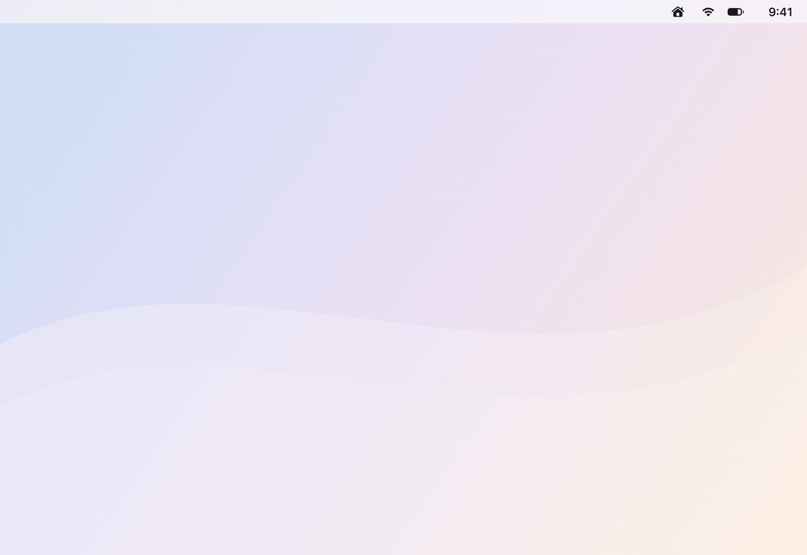
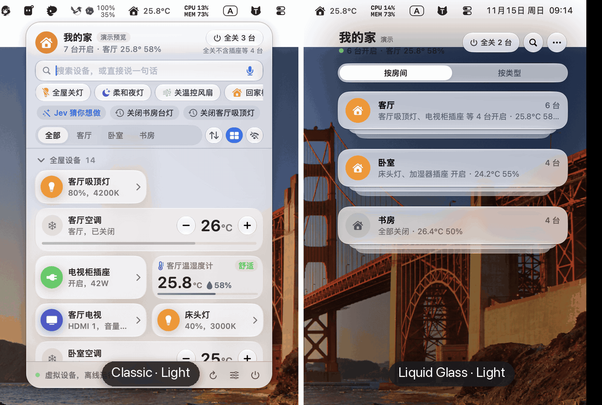
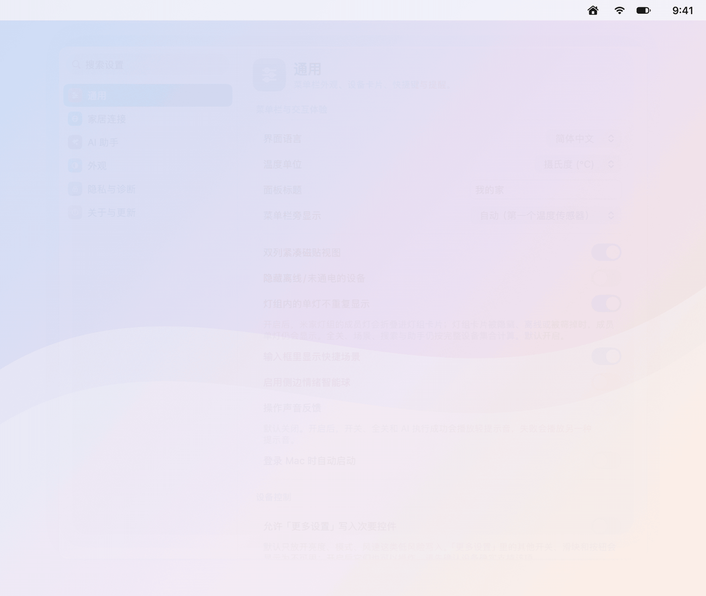
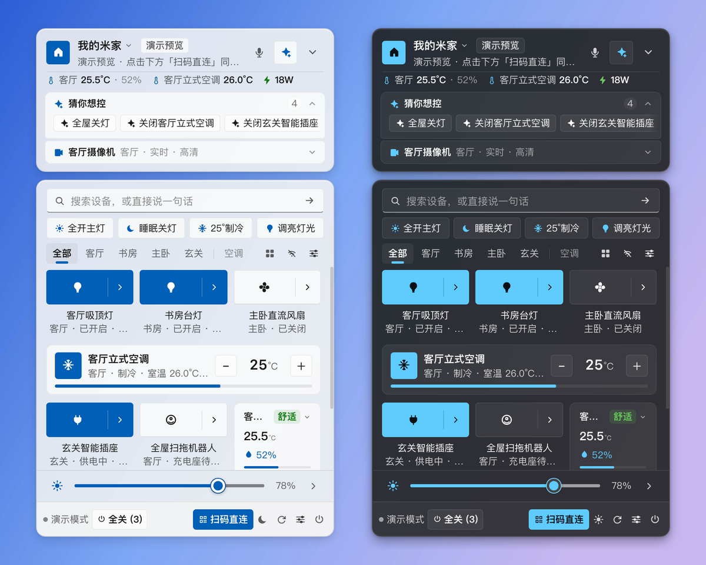

[English](README.md) | [简体中文](README.zh-CN.md) | Türkçe

<p align="center">
  <a href="https://trendshift.io/repositories/309141?utm_source=trendshift-badge&amp;utm_medium=badge&amp;utm_campaign=badge-trendshift-309141" target="_blank" rel="noopener noreferrer"></a>
  <a href="https://trendshift.io/repositories/309141?utm_source=trendshift-badge&amp;utm_medium=badge&amp;utm_campaign=badge-trendshift-309141" target="_blank" rel="noopener noreferrer"></a>
</p>

<p align="center">
  <picture>
    <source media="(prefers-color-scheme: dark)" srcset="docs/assets/logo-dark.svg">
    <source media="(prefers-color-scheme: light)" srcset="docs/assets/logo-light.svg">
    
  </picture>
</p>

<h1 align="center">MenuBarHome</h1>

<p align="center">
  <b>Telefonunuza uzanmadan tüm evinizi bilgisayarınızdan yönetin.</b><br>
  Mac menü çubuğunda yaşayan bir Mi Home kontrol merkezi, ayrıca Windows 11 sistem tepsisi sürümüyle.<br>
  Mi Home uygulamasıyla tek bir QR kod okutun, hemen bağlanın. Home Assistant kurulumu gerekmez.<br>
  <sub>Eski adıyla <b>MenuBarMijia</b>.</sub>
</p>

<p align="center">
  <a href="https://github.com/jryang2026-code/MenuBarHome/stargazers"></a>
  <a href="https://github.com/jryang2026-code/MenuBarHome/releases/latest"></a>
  
  
  
  
</p>

<p align="center">
  <a href="https://github.com/jryang2026-code/MenuBarHome/releases/latest"><b>Son sürümü indir</b></a> ·
  <a href="#hızlı-başlangıç">Kur ve Bağlan</a> ·
  <a href="docs/supported-devices.md">Cihazlarım çalışır mı?</a> ·
  <a href="docs/platform-matrix.md">Platform Karşılaştırması</a> ·
  <a href="#güvenlik-gizlilik-ve-sınırlamalar">Güvenlik ve Gizlilik</a> ·
  <a href="CHANGELOG.md">Değişiklik Günlüğü</a>
</p>

<p align="center">
  
</p>

<p align="center"><sub><code>⌥M</code> tuşlarına basın, <code>sftd</code> yazın (书房台灯, "çalışma masası lambası" pinyin baş harfleri) ve Return tuşuna basın. Sanal cihazlarla macOS demo modunda kaydedilmiştir; gösterilen arayüz Çincedir.</sub></p>

**Üç adım:** [kurun](#1-kurulum) (Homebrew, DMG veya Windows yükleyicisi) → [bağlanın](#2-evinizi-bağlayın) (tek bir QR kod okutun veya hesap olmadan Demo'yu deneyin) → `⌥M` (Windows'ta `Alt+M`) tuşlarına basın.

> [!NOTE]
> **Yeni ad, yeni adres:** 1.2.0 sürümünden itibaren MenuBarMijia artık MenuBarHome olarak adlandırılmaktadır ve [github.com/jryang2026-code/MenuBarHome](https://github.com/jryang2026-code/MenuBarHome) adresinde yer almaktadır. 1.1.7 ve önceki sürümler bu güncellemeyi kendiliğinden alamaz; bu nedenle bir kez elle kurun. Oturum açma bilgileriniz ve ayarlarınız taşınır; ardından eski `MenuBarMijia` uygulamasını silin (Windows'ta önce eski sürümü kaldırın).

> [!IMPORTANT]
> **Xiaomi ile bağlantılı değildir.** MenuBarHome bağımsız bir açık kaynak projesidir, resmî bir Xiaomi veya Mijia ürünü değildir ve Xiaomi Corporation veya bağlı kuruluşlarıyla ilişkili, onlar tarafından onaylanmış veya desteklenmiş değildir. "Xiaomi", "Mijia", "Mi Home" ve "米家", Xiaomi Corporation ve bağlı kuruluşlarının ticari markalarıdır. Proje bu adları yalnızca Xiaomi / Mijia cihazlarıyla uyumluluğu açıklamak için kullanır; herhangi bir onay ima edilmez.

---

## Neden İsteyeceksiniz

Yazı yazıyor, kodluyor veya bir görüşmedesiniz ve ışığın kapanması gerekiyor. Normalde bu, telefonunuzun kilidini açmak, uygulamayı bulmak ve odalar arasında gezinmek demektir. MenuBarHome bunu tek bir kısayola dönüştürür.

- **Okutun ve kullanın.** Ayarlar'da "Mi Cloud Connect" seçin, ekrandaki QR kodu Mi Home uygulamasıyla okutun; tüm odalar ve cihazlar hemen görünsün. Home Assistant yok, token arama yok. Zaten Home Assistant çalıştırıyorsanız bunun yerine onu da bağlayabilirsiniz.
- **Elleriniz klavyede kalsın.** `⌥M` paneli açar. Bir cihaz adı, oda veya pinyin baş harfleri yazmaya başlayın ve açıp kapatmak için Return tuşuna basın. Ok tuşları parlaklığı ve renk sıcaklığını ayarlar.
- **Konuşmak için basılı tutun, çalıştırmak için bırakın.** Uyandırma sözcüğü yok, yanıt beklemek yok. Açma/kapatma, kısma, renk sıcaklığı ayarlama veya zamanlayıcı gibi günlük komutlar yapay zekâ anahtarı gerektirmeden Mac'inizde anlaşılır.
- **Hataları geri alın.** Tümünü Kapat (All Off) varsayılan olarak prizlere, robot süpürgelere ve kameralara dokunmaz. İhtiyacınız olan bir şeyi kapattıysanız Geri Al'a dokunun, her şey geri gelsin.
- **Mac'inizi takip eder.** Ekranı kilitlediğinizde ışıklar kapanır, harici ekran taktığınızda masa lambası açılır, takvim toplantısı başlamadan önce aydınlatma ayarlanır. Her kural kapalı olarak başlar; neyin çalışacağını siz seçersiniz.
- **Yerel ve sessiz.** macOS uygulaması paketlenmiş tarayıcı motoru olmadan Swift ile yazılmıştır ve panel kapalıyken arka planda boştayken yaklaşık %1,2 CPU (~113 MB RSS) kullanır (bkz. [SSS](docs/faq.md)).

---

## Hızlı Başlangıç

### 1. Kurulum

- **macOS:** macOS 14 (Sonoma) veya üzeri, Apple Silicon ve Intel için Universal Binary.
- **Windows:** Windows 11 (64-bit).

**macOS · Homebrew**

```bash
brew tap jryang2026-code/tap
brew trust --cask jryang2026-code/tap/menubarhome
brew install --cask jryang2026-code/tap/menubarhome
```

**macOS · DMG**

[GitHub Releases](https://github.com/jryang2026-code/MenuBarHome/releases/latest) sayfasından `MenuBarHome-<version>.dmg` (örneğin `MenuBarHome-1.5.0.dmg`) dosyasını indirin ve `MenuBarHome.app` uygulamasını Applications klasörüne sürükleyin.

> Proje ücretli Apple Developer Program'a kayıtlı değildir, bu nedenle uygulama noter tasdikli (notarized) değildir. macOS Gatekeeper ilk açılışı engellerse:
> 1. `/Applications/MenuBarHome.app` uygulamasına çift tıklayın ve uyarı penceresini kapatmak için **Done** (veya **OK**) düğmesine tıklayın.
> 2. macOS 15 veya üzeri sürümlerde **System Settings → Privacy & Security** bölümünü açın ve Security kısmına kaydırın.
> 3. `MenuBarHome` hakkındaki mesajın yanındaki **Open Anyway** düğmesine tıklayın, onay penceresinde tekrar **Open Anyway** tıklayın ve Touch ID veya parolanızla doğrulayın.
> 4. **Alternatif:** Yine açılmazsa veya **Open Anyway** düğmesi görünmezse Terminal'de karantina özniteliğini temizleyin:
>    ```bash
>    xattr -dr com.apple.quarantine /Applications/MenuBarHome.app
>    ```

DMG indirmesini aynı sürümdeki `MenuBarHome-1.5.0.dmg.sha256` ile doğrulayın:

```bash
shasum -a 256 MenuBarHome-1.5.0.dmg
# Veya .sha256 dosyası aynı dizindeyse otomatik doğrulayın:
shasum -a 256 -c MenuBarHome-1.5.0.dmg.sha256
```

**Windows 11**

[GitHub Releases](https://github.com/jryang2026-code/MenuBarHome/releases/latest) sayfasından `MenuBarHome-<version>-windows-x64-setup.exe` (örneğin `MenuBarHome-1.5.0-windows-x64-setup.exe`) veya `MenuBarHome-<version>-windows-x64.msi` (örneğin `MenuBarHome-1.5.0-windows-x64.msi`) dosyasını indirin.

> Yükleyici ticari bir Authenticode sertifikasıyla imzalanmamıştır. Windows SmartScreen engellerse:
> 1. Mavi **Windows protected your PC** uyarısı göründüğünde **More info** bağlantısına tıklayın.
> 2. Kuruluma devam etmek için pencerenin altındaki **Run anyway** düğmesine tıklayın.

Windows yükleyicisini PowerShell'de sürüm sayfasındaki ilgili `.sha256` dosyasıyla doğrulayın:

```powershell
# EXE yükleyicisi için (MenuBarHome-1.5.0-windows-x64-setup.exe.sha256 ile karşılaştırın)
Get-FileHash -Algorithm SHA256 .\MenuBarHome-1.5.0-windows-x64-setup.exe

# MSI yükleyicisi için (MenuBarHome-1.5.0-windows-x64.msi.sha256 ile karşılaştırın)
Get-FileHash -Algorithm SHA256 .\MenuBarHome-1.5.0-windows-x64.msi
```

### 2. Evinizi bağlayın

Paneli açmak için menü çubuğu (veya sistem tepsisi) simgesine tıklayın, Ayarlar `⚙️` bölümünü açın ve birini seçin:

- **Mi Cloud Connect (önerilen):** "Mi Cloud Connect" seçeneğini seçin, telefonunuzdaki Mi Home uygulamasıyla QR kodu okutun; evleriniz, odalarınız ve cihazlarınız eşitlenir. CN, SG, DE, US ve RU sunucuları desteklenir. Hem macOS hem de Windows'ta birden fazla hesap ekleyebilir ve tüm cihazlarını tek bir panelde görebilirsiniz. Oturumunuzun süresi dolmak üzereyse panel sizi 3 gün önceden uyarır ve panelde hızlı bir yeniden tarama oturumu yeniler.
- **Home Assistant (diğer ekosistemler dâhil):** Örnek adresinizi (örneğin `http://192.168.1.100:8123`; ters proxy alt yolları da çalışır) ve uzun ömürlü bir erişim belirteci girin. Hem macOS hem de Windows yerel ağınızda Home Assistant'ı bulabilir. Belirteç macOS Keychain veya Windows Credential Manager içinde saklanır. **Ekosistem sınırı:** MenuBarHome doğrudan Mi Home ve Home Assistant'a (ayrıca isteğe bağlı yerel genel IP kameralara, DDC/CI ekranlara ve LAN TV köprüsüne) bağlanır; **Google Home, Apple HomeKit (HomeKit Device), Tuya, Aqara/Matter/Zigbee** ve diğer platformlardaki cihazlar Home Assistant birleştirmesi üzerinden sorunsuz biçimde entegre olur.<br>
  macOS "Local network connection blocked by macOS" derse, **System Settings → Privacy & Security → Local Network** altından MenuBarHome'a izin verin.
- **Demo modu:** Hesap gerekmeden sanal cihazlarla tüm arayüzü deneyin.

---

## Tura Çıkın

### Yeni bir panel

Arama artık en üstte yer alır ve aynı kutu cihaz adlarını, durum sorularını ve sözlü komutları kabul eder. Favori cihazlar kutucuklar hâlinde düzenlenir, klima doğrudan kartı üzerinden artırılıp azaltılabilir ve oda sekmeleri, oda otomatik grup kapsülleri, sıralama ile kompakt görünüm tek tık uzağınızdadır. Hızlı Eylemler ve "Sizin İçin" önerileri tek bir **Shortcuts** anahtarının (macOS'ta `⌘K`, Windows'ta `Ctrl+K`) arkasına katlanır, böylece ilk ekran sade kalır. Açık ve koyu tema sistemi izler ve macOS 26 veya üzeri sürümlerde Liquid Glass temasına geçebilirsiniz; macOS panelini açmak artık çalıştığınız uygulamayı karartmaz.

<p align="center">
  
</p>

### Sistem Ayarları gibi hissettiren Ayarlar

Mac'in kendi Sistem Ayarları gibi düzenlenmiş, renkli simgeler ve gruplanmış kartlar içeren bir kategori kenar çubuğu. Arama alanı Çince ve İngilizce anahtar sözcüklerin yanı sıra eş anlamlıları da anlar; bir sonuç seçmek doğrudan o ayara atlar ve onu vurgular.

<p align="center">
  
</p>

### Konuşmak için basılı tutun

`⌥M` tuşunu veya menü çubuğu simgesini basılı tutun, ne istediğinizi söyleyin ve bırakın. Söyledikleriniz siz konuşurken arama alanında görünür ve bıraktığınız anda çalışır. Günlük komutlar yerel olarak ayrıştırılır, bu nedenle neredeyse hiç bekleme olmaz; daha karmaşık istekler için seçtiğiniz bir yapay zekâ hizmetini bağlayabilirsiniz.

<p align="center">
  
</p>

### Geri Al özellikli Tümünü Kapat

Dışarı mı çıkıyorsunuz veya yatmaya mı gidiyorsunuz? Tümünü Kapat düğmesini 0,6 saniye basılı tutun; mevcut görünümde açık olan her şey kapanır. Prizler, robot süpürgeler ve kameralar varsayılan olarak hariç tutulur (bunu Ayarlar'dan değiştirebilirsiniz). Hemen ardından bir Geri Al düğmesi belirir; tek dokunuşla her şeyi eski hâline döndürür.

<p align="center">
  
</p>

### Windows 11 de yeniden tasarlandı

Sistem tepsisi uygulaması varsayılan olarak Classic iki sütunlu bölünmüş kutucuk panelini kullanır ve ayrıca bir Windows 11 Fluent 2 iki adalı açılır pencere sunar (üstte ev durumu, "Sizin İçin" önerileri ve kamera ön izlemesi; altta arama, hızlı eylemler ve cihaz kutucukları). Klavye araması, `Alt+M`, sistem vurgu renkleriyle yerel Mica/Acrylic arka planı (Windows 11 22H2+), bağımsız her zaman üstte kamera PiP penceresi ve açık/koyu görünüm tamamen mevcuttur.

<p align="center">
  
</p>

---

## Başka Neler Yapar

- **Çok sayıda cihazla çalışır.** Işıklar, klimalar, vantilatörler, prizler, TV'ler (MIoT TV'ler ve set üstü kutular dâhil), perdeler, çamaşır kurutma askıları, hava temizleyiciler, nemlendiriciler, buzdolapları, su ısıtıcıları, çamaşır ve kurutma makineleri, banyo ısıtıcıları, davlumbazlar, robot süpürgeler, hoparlörler (her iki platformda da Şu An Çalınıyor ve XiaoAI TTS/yönerge denetimleriyle), kameralar, kilitler ve her türlü sensör. Özel kartı olmayan Mi cihazları bile genel bir kart alır. [Kendi cihazlarınızı buradan kontrol edin.](docs/supported-devices.md)
- **TV'ler, Şu An Çalınıyor, Harici Monitörler (DDC/CI) ve İsteğe Bağlı Çok Markalı TV Köprüsü.** Home Assistant TV'leri/hoparlörleri ve Xiaomi MIoT TV'leri paylaşılan bir **Now Playing** görünümü (oynatma durumu, meta veriler, SHA-256 LRU önbellekli kimlik doğrulamalı aynı kaynaklı HA albüm kapağı ve yalnızca `canSeek` + `duration` + `position` bildirildiğinde gösterilen 2 sn geri sıçrama korumalı sürüklenebilir arama çubuğu) ile katlanabilir bir D-pad kumandası (Apple TV / Android TV / Sony Bravia / Roku / genel için ekosisteme uyarlanmış HA `remote.send_command` + doğrulanmış MIoT eylemleri) alır. Her iki platformda da Settings → General altında **External Display Control (DDC/CI)** (varsayılan olarak kapalı, kapalıyken sıfır arka plan trafiği: parlaklık, DP/HDMI/USB-C giriş değiştirme ve geri okunduğunda ses/sessize alma; donanım yazılımı güvenliği için `0xD6` kapatma kesinlikle yasaktır) ve isteğe bağlı süreç dışı **Multi-Brand TV Bridge** (`mbh-tv-bridge`, panel kapandığında kapanan ve zaten HA veya Mi Home üzerinden bağlı bir TV'yi asla ele geçirmeyen yalnızca LAN Go ikili dosyası) etkinleştirilebilir; varsayılan olarak **LG webOS** (SSAP + WoL), **Xiaomi / Redmi** (HTTP 6095) ve **Hisense** (yurt dışı VIDAA MQTT 3.1.1) desteklenir, diğer markalar deneysel bir anahtarın arkasındadır.
- **Cihaz İçi ve Ortama Duyarlı Yapay Zekâ.** Günlük komutlar (`0–100%` perdeler/panjurlar ve `1–100%` vantilatör hızı dâhil) pinyin/eşsesli eşleştirme ve 3 yönlü ıskalama tanılama ile yerel olarak ayrıştırılır; macOS ayrıca 3 tutarlı eşleşmeden sonra 0 ms ifade kısayolları öğrenir. Apple Intelligence etkin **macOS 26+** sistemlerde Settings → AI, tek tıkla varsayılan katılım, API anahtarsız bağlantı kontrolleri ve cihaz içi proaktif önerilerle **Apple Foundation Models** durum kartını açıkça gösterir. Hem macOS hem de Windows, yapay zekâ istemlerine ve "Sizin İçin" sıralamasına yalnızca sıkı biçimde denetlenen mantıksal masaüstü ortam sinyallerini (`inMeeting`, `externalDisplayConnected`, `focusActive`, `lateNightWork`, `mediaPlaying` — asla pencere başlıkları, takvim başlıkları veya Wi-Fi SSID'leri değil) besler. Windows sesli girişi, panele odaklı bir `Ctrl+M` anahtarı (iptal için `Esc`), ev sözlüğü sıcak sözcük son düzeltmesi ve fark ön izleme onayı ekler.
- **Kamera pencereleri, fotoğraf duvarı ve PiP.** Sabitlenmiş bir canlı görünüm için kameraya tıklayın (Windows'ta bağımsız her zaman üstte PiP, kapı zilleri için 3:4 dikey düzen, en fazla 2 sabitlenmiş anahtarla kapı zili/alarm olaylarında isteğe bağlı otomatik açılma geri sayımı ve akış tarafından desteklenen yerlerde yalnızca dinleme sesi). 2×2 fotoğraf duvarı son anlık görüntüleri ve 7 günlük kamera olay geçmişini tutar; çift lensli modeller lens değiştirebilir ve pan-tilt kameralar görüntüyü sürüklediğinizde döner. Xiaomi olmayan IP kameralar (RTSP, ONVIF, Hikvision ISAPI, Dahua, Tapo) Settings → advanced connections altında **salt okunur genel kameralar** olarak eklenebilir: yalnızca canlı görünüm ve PiP (PTZ, karşılıklı konuşma veya kamera ayarları yoktur), açıkça genel bir adrese izin vermediğiniz sürece yalnızca LAN veya `.local` ana bilgisayarları ve yapılandırma dosyalarında değil Keychain / Windows Credential Manager içinde saklanan parolalar.
- **İklim eğilimleri ve enerji günlükleri.** Sensörler doğrudan kart üzerinde 24 saatlik üzerine gelme mini grafiğinin yanı sıra tam 24 saatlik ve 7 günlük grafikler gösterir; prizler günlük enerji günlüğü tutar ve elektrik tarifenizi girdiğinizde maliyet tahmini alırsınız.
- **Modlar, oda grupları ve "Sizin İçin" önerileri.** Bir odanın mevcut cihaz durumlarını yerel bir **Mood** olarak kaydedin (en fazla 32) ve tek tıklamayla veya genel bir kısayol tuşuyla yeniden oynatın. Aynı türden iki veya daha fazla denetlenebilir cihaza sahip odalar otomatik grup kapsülleri gösterir. Genellikle neyi açtığınıza, ne zaman açtığınıza ve mevcut masaüstü ortam durumunuza göre "Sizin İçin" olası sonraki eylemleri öne çıkarır; alışkanlıklar makinenizde kalır ve istenildiği zaman incelenebilir veya temizlenebilir.
- **Birden fazla hesap, iki kaynak ve LAN öncelikli hız.** Aynı anda birkaç Xiaomi hesabında oturum açın veya Mi Home ile Home Assistant'ı yan yana çalıştırın; aynı fiziksel cihaz otomatik olarak birleştirilir. Uyumlu Wi-Fi Mi cihazları açık yazma onaylarıyla doğrudan LAN denetimini tercih eder (eski MIoT olmayan LAN cihazları için sorunsuzca Mi Cloud'a geri döner) ve macOS, salt okunur ulaşılabilirlik ipucu olarak LAN üzerinde bulutta çevrimdışı Xiaomi cihazlarını yoklar.
- **Bağlama duyarlı otomasyonlar, güvenlik uyarıları ve haftalık rapor.** Kurallar zamanlamalara, süregelen koşullara veya Mac ön plan uygulamalarına göre çalışabilir (macOS'ta tek tıkla Toplantı ve Film şablonlarıyla) ve bağlam geri yükleme, bir oturum sona erdiğinde önceki güç durumlarını otomatik olarak geri yükler. Etkileşimli güvenlik bildirimleri doğrudan uyarıdan bir cihazı kapatmanıza veya kapı zili canlı akışını görüntülemenize olanak tanır (ekran kilidiyle korunur) ve haftalık ev sağlığı raporu sık bağlantı kopmalarını ve bekleme gücü tüketimini vurgular.
- **Araçlarınıza bağlanır.** Özel genel kısayol tuşları (her iki platformda da en fazla 8 cihaz, sahne, hızlı eylem veya mod bağlaması; macOS'ta odak çalmayan HUD ile), Apple Shortcuts, `menumijia://` bağlantıları, bir Raycast uzantısı, paketlenmiş yerel CLI (`mijia doctor`) ve **MCP Server 2.0** (sıfır yer tutuculu Settings **Copy Config** ile paketlenmiş); böylece Claude ve Cursor gibi yapay zekâ araçları hesap kimlik bilgilerinizi hiç görmeden evinizi kontrol edebilir ve yönetebilir.

Her platformun neleri desteklediği için [platform karşılaştırmasına](docs/platform-matrix.md) bakın.

---

## Klavye Kısayolları ve Doğal Komutlar

### Klavye Gezintisi

`⌥M` macOS'ta ve `Alt+M` Windows'ta paneli açar; ayrıca her iki platformda da tekil cihazlara, sahnelere, hızlı eylemlere veya modlara en fazla 8 özel genel kısayol tuşu atayabilirsiniz. Yazarak arama, `↑`/`↓`, `Return`/`Space`, `→`/`←`, `Tab` (oda sekmeleri arasında geçiş), `⌘K` / `Ctrl+K` (Kısayollar çekmecesini aç/kapat) ve `Esc` her iki platformda da çalışır; `Ctrl+M` odaklı Windows panelinde sesli dinlemeyi açıp kapatır.

| Kısayol | Eylem |
| :--- | :--- |
| `⌥M` / `Alt+M` | MenuBarHome panelini aç/kapat (macOS / Windows) |
| `⌘K` / `Ctrl+K` | Kısayollar çekmecesini genişlet veya daralt (Hızlı Eylemler, Sahneler ve Sizin İçin) |
| Basılı tut `⌥M` / `Ctrl+M` | macOS'ta konuşmak için basılı tut; odaklı Windows panelinde eller serbest sesli dinlemeyi aç/kapat (`Esc` iptal eder) |
| Özel kısayol tuşları (en fazla 8) | Bağlı bir cihazı, sahneyi, hızlı eylemi veya modu genel olarak tetikle (yüksek riskli hedeflerde onayla) |
| Harf yazma | Cihaz adı, oda veya pinyin baş harflerine göre anında arama (ör. `sftd`) |
| `↑` / `↓` | Arama eşleşmeleri ve cihaz kartları arasında gezinme |
| `Return` / `Space` | Odaklı cihazı aç/kapat; doğrudan anahtarlanamıyorsa ayrıntı çekmecesini genişlet |
| `→` / `←` | Ayrıntıları açmak için Sağ ok tuşuna basın; ardından ışık parlaklığını, klima sıcaklığını, perde konumunu veya sesi ayarlamak için Sol ve Sağ tuşlarını kullanın (Windows vantilatör hızını da ayarlar) |
| `Tab` | Oda sekmeleri arasında geçiş yap (macOS ve Windows) |
| `Esc` | Arama sorgusunu temizle, sesli girişi iptal et, çekmeceyi kapat veya paneli gizle |

### Yerel Doğal Dil Komutları

Bu ifadeler **herhangi bir yapay zekâ API anahtarı** veya bulut model belirteci olmadan yerel olarak ayrıştırılır (pinyin/baş harf/eşsesli yedek eşleştirmesiyle):

- **Güç:** "turn off study light", "turn on living room ac", "turn off all lights"
- **Aydınlatma ön ayarları:** "study light moonlight mode", "daylight mode"
- **Ayarlamalar:** "dimmer", "brighter", "set bedroom light to 40%"
- **İklimlendirme, Vantilatör ve Perdeler:** "set ac to 24 degrees", "warmer", "fan natural wind", "set living room fan to 60%", "open living room curtain to 50%" (garaj kapıları, pencere açıcılar ve çamaşır kurutma askıları her zaman onay ister)
- **Durum sorguları:** "which lights are on?", "is the study lamp on?", "living room temperature" (mevcut cihaz durumundan yerel olarak yanıtlanır)
- **Zamanlayıcılar:** "in 10 minutes turn off study light", "cancel timer"
- **Geri Al:** "undo", "revert" (herhangi bir toplu yürütmeden sonra 10 dakika boyunca etkindir)

İki veya daha fazla cihaza ya da herhangi bir yüksek riskli cihaza dokunan komutlar, çalıştırılmadan önce onay için satır içi önceki → sonraki fark ön izlemesi gösterir.

---

## Platform Karşılaştırması

macOS yerel bir Swift 6 uygulamasıdır; Windows 11 ise ayrı bir Tauri v2 uygulamasıdır. Altın test fikstürlerini paylaşırlar ancak birebir aynı değildirler:

| Alan | macOS 14+ | Windows 11 |
| :--- | :---: | :---: |
| Mi Home QR bağlantısı | ✅ | ✅ |
| Home Assistant (HomeKit / Google Home / Tuya / Matter birleştirir) | ✅ | ✅ |
| Klavye araması ve genel kısayol tuşu | ✅ `⌥M` | ✅ `Alt+M` |
| Ses | ✅ konuşmak için basılı tut veya eller serbest | ⚠️ eller serbest (`Ctrl+M` + sıcak sözcük düzeltme) |
| Yerel komutlar ve yapay zekâ asistanı | ✅ + Apple Foundation Models (macOS 26+) | ✅ yerel kurallar + bulut / Ollama |
| Tümünü Kapat ve Geri Al | ✅ | ✅ |
| TV Şu An Çalınıyor, arama, kumanda ve isteğe bağlı TV köprüsü | ✅ | ✅ |
| Harici ekran denetimi (DDC/CI) | ✅ | ✅ |
| Kamera canlı görünüm | ✅ | ✅ |
| Salt okunur genel IP kameralar (RTSP/ONVIF/ISAPI/Dahua/Tapo) | ✅ | ✅ |
| Aynı anda birden fazla Xiaomi hesabı | ✅ | ✅ |
| Mi Home + Home Assistant çift kaynak | ✅ | ✅ |
| Olay otomasyonu | ✅ | ⚠️ kısmi |
| Apple Shortcuts | ✅ | — |
| İmzalı yükleyici | ⚠️ kendinden imzalı | ⚠️ imzasız |

Her yetenek ve durumunu içeren cihaz bazındaki tam tablo [docs/platform-matrix.md](docs/platform-matrix.md) dosyasında yer alır.

---

## Raycast Uzantısı, Yerel CLI ve MCP Sunucusu

MenuBarHome, herhangi bir kimlik bilgisi paylaşmadan cihaz listesini bir yardımcı araca aktarabilir. macOS'ta **Settings → 通用 → 自动化与外部控制 → 高级 → Raycast / CLI / MCP 集成** (**Settings → General → Automation & External Control → Advanced → Raycast / CLI / MCP integration**) veya Windows'ta **Settings → Safety & Alerts → Raycast / CLI / MCP integration** seçeneğini açın: uygulama macOS'ta `~/Library/Application Support/MenuBarMijia/raycast-snapshot.json` (`0600` modu) veya Windows'ta `%LOCALAPPDATA%\MenuBarMijia\raycast-snapshot.json` dosyasına cihazlarınızı, sahnelerinizi, hızlı eylemlerinizi, ortam ölçümlerinizi, arındırılmış otomasyon özetini, son komut sonucunu ve rastgele bir yerel köprü belirtecini yazar. Belirteci taşıyan bağlantılar harici bağlantı onay istemini atlar; yüksek riskli cihazlar yine onay ister ve kilit ekranı engeli her iki platformda da geçerli kalır. Entegrasyonu kapatmak dosyayı siler ve belirteci iptal eder. Sözleşme ve arkasındaki ödünleşimler [ADR-0013](docs/adr/0013-raycast-companion-contract.md) içinde yer alır.

Hem macOS uygulama paketi (`MenuBarHome.app/Contents/Resources/cli/`) hem de Windows yükleyicisi (`cli/` kaynakları) paket içinde `scripts/mijia` ve `scripts/mijia-mcp` araçlarını içerir. Ayarlar'da **Copy Config** düğmesine tıklamak, düzenlenecek hiçbir yer tutucu yol olmadan kurulu gerçek yolu otomatik olarak çözümler.

**Neden hâlâ eski adı görüyorsunuz?** Uygulama MenuBarHome'dur, ancak entegrasyon yüzeyi mevcut Raycast komutlarının, Kısayolların, betiklerin ve MCP yapılandırmalarının çalışmaya devam etmesi için özgün adlarını korumuştur:

| Göreceğiniz ad | Nedir | Bunu kullanın |
| :--- | :--- | :--- |
| `menumijia://…` | Her yardımcı aracın gönderdiği URL şeması. Bir uyumluluk sözleşmesidir ([ADR-0013](docs/adr/0013-raycast-companion-contract.md)), bu yüzden yardımcı araçlar bunu göndermeyi sürdürür | `menumijia://` kullanmaya devam edin; `menubarhome://` birebir takma ad olarak kabul edilir |
| `scripts/mijia`, `scripts/mijia-mcp` | Paketlenmiş CLI ve MCP sunucusu | `scripts/menubarhome` yeni ad altındaki aynı CLI'dır; `mijia` çalışmaya devam eder |
| `MenuBarMijia/` veri klasörü, `MenuBarMijiaApp` süreci | Uygulamanın veri dizini ve süreç adı | Yapılacak bir şey yok; oturum açma bilgileriniz ve ayarlarınız orada yaşar |
| MCP anahtarı `menubarmijia` | MCP istemcinizin yapılandırmasındaki bir etiket ve sunucunun bildirdiği ad | İstediğiniz gibi adlandırın; aşağıdaki örnek `menubarhome` kullanır |

<details>
<summary><b>CLI, MCP sunucusu ve Raycast uzantısı nasıl kullanılır</b></summary>

### Yerel CLI

`scripts/mijia`, bağımlılığı olmayan bir Python 3 betiğidir (uygulama içine paketlenmiştir veya depo kopyasından çalıştırılabilir). Kullanırken MenuBarHome'u çalışır durumda tutun.

| Komut | Ne yapar |
| :--- | :--- |
| `scripts/mijia doctor [--json]` | Tek satırlık sağlık kontrolü: yardımcı entegrasyon durumu, anlık görüntü güncelliği ve CLI/MCP yürütülebilir dosya yolları (`scripts/mijia mcp --doctor` ile aynı) |
| `scripts/mijia list [--room 书房] [--json]` | Çevrimiçi durum ve ölçümlerle birlikte odaya göre gruplanmış görünür cihazlar |
| `scripts/mijia list --format alfred [--room 书房]` | Alfred Script Filter JSON'u: cihaz başına bir öğe, ↵ gücünü açıp kapatır, ⌘ panelde gösterir |
| `scripts/mijia list --format swiftbar [--room 书房]` | SwiftBar / xbar eklenti metni: menü çubuğu başlığı, durumuyla birlikte cihaz başına bir tıklanabilir satır |
| `scripts/mijia status [--json]` | Bağlantı, cihaz sayıları, ortam ölçümleri ve son komutun sonucu |
| `scripts/mijia toggle 书房台灯` | Ad, kimlik veya pinyin baş harflerine (`sftd`) göre birincil anahtarı aç/kapat |
| `scripts/mijia on 客厅射灯` / `scripts/mijia off 客厅射灯` | Açıp kapatmak yerine kesin bir güç durumu ayarla |
| `scripts/mijia brightness 书房台灯 60` | Işık parlaklığını ayarla (`0`–`100`%) |
| `scripts/mijia color-temp 书房台灯 4000` | Işık renk sıcaklığını ayarla (`1000`–`20000` K) |
| `scripts/mijia temperature 书房空调 25` | Hedef sıcaklığı ayarla (`-30`–`100` ℃) |
| `scripts/mijia fan 客厅风扇 --percent 60` / `--preset 自然风` | Vantilatör hız yüzdesini (`1`–`100`%) veya bildirilen bir ön ayar modunu ayarla |
| `scripts/mijia cover-position 客厅窗帘 50` | Perde veya panjur konumunu ayarla (`0`–`100`%; garaj kapıları ve pencere açıcılar her zaman uygulama içinde onay gerektirir) |
| `scripts/mijia volume 客厅电视 35` / `mute 客厅电视 on` / `media-play-pause 客厅电视` | TV veya hoparlör ses düzeyini (`0`–`100`%), sessize alma durumunu ve oynat/duraklat işlevini denetle |
| `scripts/mijia focus 书房台灯` | Donanımı çalıştırmadan cihazın odasını ve ayrıntı çekmecesini panelde göster |
| `scripts/mijia scene 观影模式` | Bir Home Assistant sahnesi veya yerleşik bir hızlı eylem çalıştır (全屋关灯, 一键全关, 撤销…) |
| `scripts/mijia ask "把客厅灯调到 40%"` | Uygulamanın kendi ayrıştırma ve onayıyla tek bir doğal dil komutu |
| `scripts/mijia mcp` (veya `scripts/mijia-mcp`) | Yerel MCP Server 2.0'ı stdio üzerinden çalıştır |

`scripts/menubarhome` aynı programı çalıştırır: `scripts/menubarhome list`, `scripts/mijia list` ile aynıdır.

Çıkış kodları: `0` başarı, `1` uygulama bir hata bildirdi, `2` yerel hata (anlık görüntü eksik, bilinmeyen cihaz, entegrasyon kapalı), `3` zamanında sonuç yok. `--dry-run` bağlantıyı belirteç maskelenmiş olarak yazdırır, `--no-wait` beklemeden gönderir ve `MENUBARMIJIA_SNAPSHOT_PATH` anlık görüntü yolunu geçersiz kılar.

### Alfred ve SwiftBar

`--format alfred` ve `--format swiftbar`, `list` ile aynı salt okunur anlık görüntüyü işler: hiçbir şey yazılmaz ve ağ çağrısı yapılmaz. Her giriş bir `menumijia://` bağlantısı taşır; bu nedenle bir tıklama hâlâ uygulamanın harici bağlantı onayından, yüksek riskli cihaz onayından ve kilit ekranı engelinden geçer.

SwiftBar için eklenti klasörüne iki satırlık bir eklenti kaydedin, örneğin
`~/Library/Application Support/SwiftBar/plugins/menubarhome.1m.sh` (`1m` her dakika yeniler):

```sh
#!/bin/sh
exec /Applications/MenuBarHome.app/Contents/Resources/cli/mijia list --format swiftbar
```

Alfred için betiği `/Applications/MenuBarHome.app/Contents/Resources/cli/mijia list --format alfred` çalıştıran `mijia` anahtar sözcüklü bir **Script Filter** ekleyin, ardından seçilen `arg` değerinin açılması için bunu bir **Open URL** eylemine bağlayın. Her öğenin ⌘ çeşidi cihazı açıp kapatmak yerine panelde açar. `--icon /Applications/MenuBarHome.app`, uygulama başka bir yerde bulunduğunda öğe simgesini ayarlar; bu olmadan betik kurulu uygulamanın simgesini veya Alfred'in iş akışı simgesini kullanır.

Her iki biçim de tıpkı diğer tüm CLI komutları gibi bağlantılara yerel köprü belirtecini koyar: belirteç yalnızca genel "harici bir bağlantı bunu çalıştırmak istiyor" istemini atlar; uygulama yüksek riskli bir cihaz durum değiştirmeden önce hâlâ onay ister ve ekran kilitliyken denetimleri reddeder.

### Yerel MCP Server 2.0 (Claude Desktop / Claude Code / Cursor)

`scripts/mijia-mcp` (veya `scripts/mijia mcp`), yalnızca Python 3 standart kütüphanesini kullanarak stdio üzerinden MCP JSON-RPC 2.0 konuşur. **5 salt okunur kaynak** (`mijia://status`, `mijia://devices`, `mijia://scenes`, `mijia://sensors`, `mijia://automations`) ve **17 araç** sunar — 5 salt okunur (`list_devices`, `get_home_status`, `get_sensor_summary`, `get_automation_status`, `focus_device`) ve 12 denetim aracı (`toggle_device`, `set_device_power`, `set_light_brightness`, `set_light_color_temp`, `set_temperature`, `set_fan`, `set_cover_position`, `set_media_volume`, `set_media_mute`, `media_play_pause`, `run_scene`, `ask_home`). Sunucu `menumijia://` bağlantılarını göndermek için dahili olarak `bridgeToken` kullanır ve gizli verilerin modelin bağlamına asla girmemesi için her MCP kaynağı ve araç yanıtından `bridgeToken` ile işletim sistemi serbest metin dizelerini (takvim/pencere başlıkları, Wi-Fi SSID'leri) temizler.

Doğrudan kurulu `mijia-mcp` dosyanıza işaret eden yapıştırmaya hazır bir yapılandırmayı kopyalamak için Ayarlar içinde **Copy Config** düğmesine tıklayın (sıfır yer tutucu yol). Uygulama `/Applications` içindeyken macOS'ta şöyle görünür:

```json
{
  "mcpServers": {
    "menubarhome": {
      "command": "/Applications/MenuBarHome.app/Contents/Resources/cli/mijia-mcp"
    }
  }
}
```

Tek satırlık bir sağlık özeti için istediğiniz zaman `mijia doctor` (veya `mijia-mcp --doctor`) çalıştırın. Her denetim aracı `destructiveHint: true` taşır (ve `ask_home` ayrıca `openWorldHint: true` ayarlar), bu nedenle ek açıklamaları dikkate alan MCP istemcileri bir aracı çalıştırmadan önce sorar. Bir yapay zekâ oturumuna salt okunur erişim vermek için aynı girişe `--read-only` ekleyin (`"args": ["--read-only"]` veya `scripts/mijia mcp --read-only` çalıştırın): `tools/list` o zaman yalnızca 5 salt okunur aracı (`list_devices`, `get_home_status`, `get_sensor_summary`, `get_automation_status`, `focus_device`) duyurur ve herhangi bir denetim çağrısı bir cihaza dokunmak yerine bayrağı adlandıran bir hata olarak geri döner.

### Raycast

`raycast/`, üç görünüm komutuna (**Search Devices**, **Scenes & Quick Actions**, **Ask MenuBarHome**), genel bir kısayol tuşuna atayabileceğiniz üç `no-view` komutuna (**Toggle Device**, **Run Scene**, **All off** — önce onay ister) ve Raycast AI'da `@MenuBarHome` için üç yapay zekâ aracına (`list-devices`, `get-device-state`, `control-device`) sahip standart bir Raycast uzantısıdır. Raycast → Extensions → `+` → **Import Extension** ile içe aktarın veya Raycast açıkken `cd raycast && npm ci && npm run dev` çalıştırın. Güç, parlaklık, renk sıcaklığı, termostat hedefi ve vantilatör hızı kesin değerler (`menumijia://power`, `brightness`, `color-temp`, `temperature`, `fan`) olarak gönderilir, böylece bir kaydırıcı durumunu tahmin ederek bir cihazı asla tersine çevirmez; görünüm komutları uygulama çalışırken animasyonlu bir bildirim gösterir, ardından bunu sonuca günceller, `no-view` komutları bir HUD üzerinden bildirir ve `control-device` bağlantısını göndermeden önce Raycast'ten onay ister.

</details>

---

## Güvenlik, Gizlilik ve Sınırlamalar

### Bağlanmadan önce bilin

- **Mi Cloud Connect resmî olmayan bir istemci API'si kullanır.** Resmî bir Xiaomi entegrasyonu değildir. Xiaomi istediği zaman istekleri hız sınırına tabi tutabilir veya bir hesabı işaretleyebilir (risk denetimi) ve bu proje bunun olmayacağını garanti edemez. Uygulama panel kapalıyken veya ekran kilitliyken daha az yoklama yapar, üstel geri çekilme ile kullanıcı denetim yazmaları için hız sınırı kapasitesi ayırır ve uygun Wi-Fi cihazlarını önce doğrudan LAN miIO üzerinden yönlendirir (eski MIoT olmayan LAN cihazları için Mi Cloud'a geri döner). Bu riski almak istemiyorsanız bunun yerine Xiaomi'nin resmî [xiaomi_home](https://github.com/XiaoMi/ha_xiaomi_home) entegrasyonuyla Home Assistant bağlayın.
- **Tekrar tarama yapmanız gerekecektir.** Uygulama uzun ömürlü `passToken` değerini saklamaz ve oturumu sessizce yenilemez ([ADR-0004](docs/adr/0004-no-pass-token-storage.md)). Bir oturumun ne kadar süreceğine Xiaomi'nin sunucusu karar verir ve bilindiğinde Ayarlar'da gösterilir; panel bitiminden 3 gün önce sizi uyarır ve yeniden tarama birkaç saniye sürer.
- **Ekosistem kapsamı.** Doğrudan yerleşik bağlayıcılar Mi Home ve Home Assistant'tır (ayrıca isteğe bağlı yerel genel IP kameralar, DDC/CI ekranlar ve LAN çok markalı TV köprüsü). **Google Home, Apple HomeKit (HomeKit Device), Tuya, Aqara/Matter/Zigbee** ve diğer platformlar **Home Assistant** birleştirmesi üzerinden getirilir.
- **Uygulamalar ticari olarak kod imzalı değildir.** macOS ilk açılışta **Open Anyway** gerektirir ve Windows bir SmartScreen uyarısı gösterir (bkz. [Kurulum](#1-kurulum)).
- **Windows platform farkları.** Yalnızca Windows 11; ses eller serbest dikte kullanır (`Ctrl+M` aç/kapat + sıcak sözcük son düzeltme + fark ön izleme, konuşmak için basılı tutma yok); olay otomasyonu bağlam geri yüklemeyle kilit/kilit açma, güç/pil, ekran/askıya alma, kamera/mikrofon, Odak/tam ekran/sunum, Wi-Fi, zamanlamalar ve sensör kurallarını kapsar (Takvim, kapak kapalı uyku veya ön plan uygulaması tetikleyicileri yok); Apple Foundation Models veya Apple Shortcuts yok. Bkz. [platform karşılaştırması](#platform-karşılaştırması).

### Güvenlik ve gizlilik

- Hesap kimlik bilgileri düz yapılandırma dosyalarında veya günlüklerde değil, yalnızca macOS Keychain veya Windows Credential Manager içinde yaşar.
- Bir ısıtıcıyı açmak, bir prizi anahtarlamak veya bir robot süpürgeyi başlatmak her zaman önce onay ister; bunları kapatmak hemen gerçekleşir.
- Bilgisayarınız kilitliyken hem macOS hem de Windows'ta manuel denetim varsayılan olarak reddedilir, böylece siz masadan uzaktayken kimse ışıklarınızla oynayamaz.
- Günlük komutlar makinenizde ayrıştırılır (ve Apple Intelligence etkin macOS 26+ üzerinde karmaşık komutlar da Apple Foundation Models aracılığıyla cihaz içinde çalışabilir). Yalnızca bir bulut yapay zekâ hizmeti kurduğunuzda ve bir komut yerel olarak anlaşılamadığında o komut, ilgili cihaz ayrıntıları ve yalnızca mantıksal masaüstü ortam etiketleriyle birlikte seçtiğiniz hizmete gider.
- Uygulama içi güncellemeler, özel anahtarı çevrimdışı tutulan bir Ed25519 imzasına karşı doğrulanır.

<details>
<summary><b>Tam ayrıntılar: kimlik bilgilerinin nerede saklandığı, yüksek riskli onaylar, kilit ekranı ve iptal</b></summary>

MenuBarHome bağımsız bir açık kaynak projesidir, resmî bir Xiaomi uygulaması değildir. Mi Home bulut denetimi internet bağlantısı gerektirir. macOS veya Windows üzerinde kendi Home Assistant örneğinizi bağlayabilirsiniz.

### Kimlik bilgilerinin saklandığı yer

| Gizli veri | Ne saklanır | Nerede |
| :--- | :--- | :--- |
| Xiaomi Home / Mijia | Oturum açmış hesap `userId`, `cUserId`, `ssecurity`, `serviceToken`, bulut bölgesi ve bildirilen süre sonu (`passToken` girişte düşürülür; hem macOS hem de Windows'ta çoklu hesap) | macOS Keychain (tek generic-password öğesi) veya Windows Credential Manager (`mi_session` ve `mi_session_<slotId>`) |
| Home Assistant | Uzun ömürlü erişim belirteci (örnek URL'si gizli değildir) | macOS Keychain veya Windows Credential Manager (`ha_token`) |
| Yapay zekâ asistanları | Sağlayıcı başına API anahtarları, ayrıca gizli olmayan içe aktarılmış anahtar etiketleri, özel uç nokta bağlamaları ve hatırlanan bulut onay uç noktaları | macOS Keychain veya Windows Credential Manager içinde sağlayıcı başına API anahtarları (`assistant_api_key_<preset>`); uygulama tercihlerinde gizli olmayan meta veriler |
| Salt okunur genel kameralar | Kamera başına RTSP / ONVIF / ISAPI / Dahua / Tapo kimlik bilgileri (go2rtc'ye yalnızca bellekte verilir, asla `go2rtc.yaml` dosyasına yazılmaz) | macOS Keychain veya Windows Credential Manager (`generic-camera:<id>`) |
| LG webOS TV (yerleşik) | TV tarafından verilen eşleştirme istemci anahtarı | macOS Keychain |
| Çok markalı TV köprüsü (`mbh-tv-bridge`) | TV başına eşleştirme istemci anahtarları / köprü kimlik bilgileri (yalnızca çalışma zamanında enjekte edilir) | macOS Keychain (`tvBridge.cred.<nativeId>`) veya Windows Credential Manager (`tv-bridge:<id>`) |

macOS bu Keychain öğelerini beklemede şifreler ve oturum açma Keychain'i ile korur; MenuBarHome bunları `kSecAttrAccessibleAfterFirstUnlockThisDeviceOnly` ile yazar, böylece ilk kilit açmadan sonra kullanılabilirler ancak asla iCloud'a veya başka bir Mac'e eşitlenmezler. Her iki platform da gizli verileri düz `UserDefaults`, WebView `localStorage` veya günlük dosyalarında saklamaz. Derleme imzası değiştiği için macOS bir uygulama güncellemesinden sonra Keychain izni isteyebilir; "Always Allow" yanıtını vermek sonraki okuma ve yazmaları kapsar.

macOS'ta 1.0.6 sürümüne kadar olan sürümler kimlik bilgilerini düz `UserDefaults` içine yansıtabiliyordu; yükselttikten sonraki ilk açılışta her eski düz metin değeri Keychain'e yazılır ve düz metin anahtarı yalnızca bu yazma başarılı olduktan sonra silinir; Keychain kullanılamıyorsa yeniden denemek için eski kopya yerinde bırakılır. Windows'ta eski bir `localStorage` derlemesinden yükseltme yaparken, bir kimlik bilgisi deposu hatasının WebView depolamasında düz metin belirteçleri bırakmaması için Windows Credential Manager'a kalıcı olarak kaydetmeden önce gizli alanlar çıkarılır ve `localStorage` yeniden yazılır (bellek içi oturum o çalıştırma için etkin kalır) ve Credential Manager'daki eski tek yuvalı `assistant_api_key` girişleri, eski giriş silinmeden önce kendi sahip oldukları sağlayıcı yuvasına taşınır.

### Yüksek riskli denetimler, kilit ekranı ve iptal

Yüksek riskli cihazlardaki manuel denetimler yalnızca yapay zekâ tarafından önerilen eylemlerde değil, her zaman ikinci bir onay ister: bir ısıtıcıyı açmak, bir prizi veya kamerayı anahtarlamak, bir süpürgeyi başlatmak veya bir su ısıtıcısını açmak ya da daha sıcak yapmak (macOS'ta panel işaretçi denetimleri ayrıca 0,65 sn basılı tutma veya onaylamak için kaydır hareketi sunar, klavye ve VoiceOver ise açık onay uyarılarını korur). Bunlardan birini kapatmak doğrudan gerçekleşir, böylece evi daha güvenli hâle getirmek hiçbir zaman bir iletişim kutusuyla boğuşmayı gerektirmez. Kapı/pencere ve gaz alarmı sensörleri bu uygulamada salt okunur durum kartlarıdır, bu nedenle burada hiç çalıştırılamazlar. Onay tablosu platformlar arasında paylaşılır (`Tests/Fixtures/confirmation_golden.json`, `Sources/MijiaCore/ModelActionPolicy.swift`).

macOS'ta Settings → 隐私 / Privacy altında varsayılan olarak açık olan **锁屏时禁止控制设备 / Block device control while locked** ve **共享屏幕时隐藏面板与摄像机窗口 / Hide from screen sharing** (`NSWindow.sharingType = .none`) seçenekleri bulunur. Mac ekranı kilitliyken kart/ayrıntı denetimleri, özel kısayol tuşları, `menumijia://` bağlantıları, App Intents/Shortcuts, asistan komutları, güvenlik bildiriminin 立即关闭 / Turn Off Now eylemi ve kaçırılan bir zamanlayıcıdaki 立即补执行 / Run Now eylemi bir bildirimle reddedilir; zamanında tetiklenen zamanlayıcılar ve Mac olay otomasyon kuralları çalışmaya devam eder. Anahtar yerel olarak saklanır ve kilit durumu sistemin ekran kilidi bildirimlerinden gelir.

Aynı macOS Ayarlar sayfasında yıkıcı bir iletişim kutusuyla onaylanan **退出并吊销令牌 / Sign Out & Revoke Tokens** bulunur. Cihaz adlarını, oda düzenini ve yerel geçmişi korurken her Xiaomi Home hesabından çıkış yapar, Home Assistant belirtecini silip bağlantıyı keser ve kaydedilen yapay zekâ anahtarları ile bulut onay kayıtlarını temizler; ayrıca her bölümde birer birer de iptal edebilirsiniz. Windows'ta kimlik bilgileri ve hatırlanan bulut yapay zekâ onay uç noktaları ayarlar sayfasında hizmet başına temizlenebilir (HA belirtecini veya bir sağlayıcının API anahtarını temizlemek Windows Credential Manager girişini siler ve **AI & Habits**, hatırlanan bulut yapay zekâ onay uç noktalarını iptal etmek için bir düğme içerir).

macOS'ta Home Assistant belirteci yalnızca bir `https` adresine veya yerel ağ uç noktasına doğrudan gider; diğer herhangi bir düz `http` adresi (genel bir DDNS ana bilgisayar adı gibi) için panel, belirtecin şifrelenmeden iletileceğini açıklar ve yalnızca siz 仍然连接 / Connect Anyway seçtikten sonra bağlanır (adres başına hatırlanır ve Sign Out & Revoke Tokens ile temizlenir). Windows'ta her yeni Home Assistant veya özel yapay zekâ kaynağı yerel bir sistem iletişim kutusunda (`authorized-http-origins.json`) onay gerektirir; bu kutu yerel olmayan bir `http` kaynağı belirteçleri veya API anahtarlarını taşıyacağında açık bir düz metin iletim uyarısı ekler. Her iki platform da yasaklanmış adresleri reddetmek ve yerel düz metin uç noktalarını DNS yeniden bağlama (DNS rebinding) saldırılarına karşı korumak için bağlanmadan önce çözümlenen DNS yanıtlarını doğrular (macOS'ta `HAPlaintextConsent.validateConnectionAddress`, Windows'ta `PolicyAwareResolver`).

Günlük komutlar yerel kurallar tarafından işlenir. Daha karmaşık istekler için seçtiğiniz bir yapay zekâ hizmetini de bağlayabilirsiniz. İstek; komutunuzu, cihaz ve ortam bilgilerini ve etkinleştirdiğiniz herhangi bir alışkanlık özetini içerir. Manuel kart eylemleri de yerel zaman dilimi alışkanlık belleklerini eğitir (yalnızca "Sizin İçin" önerileri için kullanılır); alışkanlık öğrenme anahtarı bunu kapatır, öğrenilen girişler incelenebilir ve temizlenebilir ve bir başlığı geri almak eşleşen kayıtları geri sarar. Konuşma tanıma sistem hizmetlerini kullanır; macOS'ta desteklenen diller için yalnızca cihaz içi tanıma kullanılabilir ve cihaz, oda ve sahne adları tanıma ipuçları olarak iletilir.

Hataları önlemeye yardımcı olmak için ısıtıcıyı açmak, prizi anahtarlamak veya süpürgeyi başlatmak gibi riskli eylemler her zaman onayınızı bekler ve düşük güvenilirlikli yapay zekâ tahminleri çalıştırmak için dokun önerileri olarak bekler (macOS'ta "Emin olmadığında bana sor" varsayılan olarak açıktır). macOS'ta URL denetimleri de doğrudan denetimi etkinleştirme seçeneğiyle birlikte varsayılan olarak önce sorar.

macOS uygulaması henüz Apple tarafından noter tasdikli değildir, bu nedenle ilk seferde Sistem Ayarları'nda izin vermeniz gerekebilir; Windows bir SmartScreen uyarısı gösterebilir. Hem macOS hem de Windows, uygulama içi güncellemeleri özel imza anahtarı çevrimdışı kalan Ed25519 imzalı bir sürüm bildirimine göre doğrular. Bağlantı seçenekleri hakkında daha fazla bilgi için [ADR-0007](docs/adr/0007-lan-direct-deferred.md) belgesine bakın.

GitHub Actions tarafından oluşturulan sürümler derleme kaynağı kanıtları ve SPDX SBOM'lar taşır. Bkz. [sürüm yapıtlarını doğrulama](SECURITY.md#verifying-release-artifacts).

Bir güvenlik açığını gizli olarak bildirmek için [Güvenlik politikasını](SECURITY.md) izleyin.

</details>

---

## Geliştirme ve Mimari

- **Mimari:** macOS sürümü **hiçbir üçüncü taraf Swift çalışma zamanı bağımlılığı olmadan** katı eşzamanlılık kurallarına uyarak saf Swift 6 ile yazılmıştır. Çekirdek protokol işleme ve cihaz sentezi tam başsız test kapsamıyla `MijiaCore` içinde yer alır. Windows istemcisi Tauri v2 (Rust + TypeScript + Vite) ile oluşturulmuştur.
- **Platformlar Arası Tutarlılık:** Her iki platform da davranışsal sapmayı önlemek için `Tests/Fixtures/` içindeki paylaşılan altın test fikstürlerine (niyetler, özellikler, bölgeler, yapay zekâ yükleri) karşı ayrı test paketleri çalıştırır (bkz. [ADR-0006](docs/adr/0006-dual-platform-implementation.md)).

### Yerel Derleme ve Doğrulama

```bash
# macOS'ta gizli veri kontrollerini, linter'ları ve Swift testlerini çalıştırın
bash scripts/check.sh

# MenuBarHome.app uygulamasını derleyin, yerel olarak imzalayın ve başlatın
bash scripts/build_app.sh

# Windows sistem tepsisi uygulamasını derleyin ve test edin
cd windows
npm install
npm test
npm run build
```

Pull request göndermeden önce lütfen [CODING_STANDARDS.md](CODING_STANDARDS.md) dosyasını inceleyin. Temel alan kavramları [GLOSSARY.md](GLOSSARY.md) içinde belgelenmiştir.

---

## Katkıda Bulunanlar

Özellikler, düzeltmeler ve geri bildirimlerle katkıda bulunan herkese teşekkürler:

- [@jryang2026-code](https://github.com/jryang2026-code) (一群小羊说) — Oluşturucu ve bakımcı
- [@almightyYantao](https://github.com/almightyYantao) (Alimighty.Yantao) — Çok tuşlu Mesh anahtarı bölünmüş cihaz sentezi (GitHub #6, GitHub #7), çoklu ev değiştirici ve ışık grubu sahne filtreleme (GitHub #8), görsel tema sistemi, satır içi iklimlendirme modülü, sürükle-sırala düzeni ve özel cihaz grupları (GitHub #9), macOS uygulama paketi simge paketleme (GitHub #10), panel açılış animasyonu, yerel cihaz yeniden adlandırma ve oda şeridi cilası (GitHub #11), Windows özellik eşliği ve platformlar arası arayüz düzeltmeleri (GitHub #12) ve sağlayıcı anlık görüntüleri için gereksiz yazma optimizasyonu (GitHub #66)
- [@htx996](https://github.com/htx996) (han) — Canlı/demo modu değiştirmeli macOS durum öğesi bağlam menüsü, çift kaynak durumu ve menü güvenli tıklama, konuşmak için basılı tutma ve klavye işleme (GitHub #250)

## Lisans ve Teşekkürler

- **Lisans:** [MIT Lisansı](LICENSE) altında dağıtılmaktadır.
- **Üçüncü Taraf Entegrasyonları:** Bu depo üçüncü taraf entegrasyonları dağıtmaz. İsteğe bağlı Home Assistant betikleri şu depolara başvurur: [xiaomi_home](https://github.com/XiaoMi/ha_xiaomi_home) ve [midea_ac_lan](https://github.com/wuwentao/midea_ac_lan).
- **Ticari Markalar:** "Xiaomi", "Mijia" ve "Midea" ilgili sahiplerinin tescilli ticari markalarıdır. Burada yalnızca cihaz uyumluluğunu belirtmek amacıyla kullanılmıştır.

PR gönderen, sorun bildiren ve masaüstü akıllı ev deneyimini iyileştirmeye yardımcı olan tüm katkıda bulunanlara teşekkürler! MenuBarHome ellerinizi klavyede tutmanıza yardımcı oluyorsa lütfen GitHub'da ⭐ Star verin.

---

## SSS

- [macOS Gatekeeper veya Windows SmartScreen uygulamayı engellerse ne yapmalıyım ve indirmeyi nasıl doğrularım?](docs/faq.md#what-if-macos-gatekeeper-or-windows-smartscreen-blocks-the-app-and-how-do-i-verify-the-download)
- [Ne kadar bellek ve CPU kullanır ve bunu nasıl ölçerim?](docs/faq.md)
- [Windows 11 ne durumda?](docs/faq.md#what-about-windows-11)
