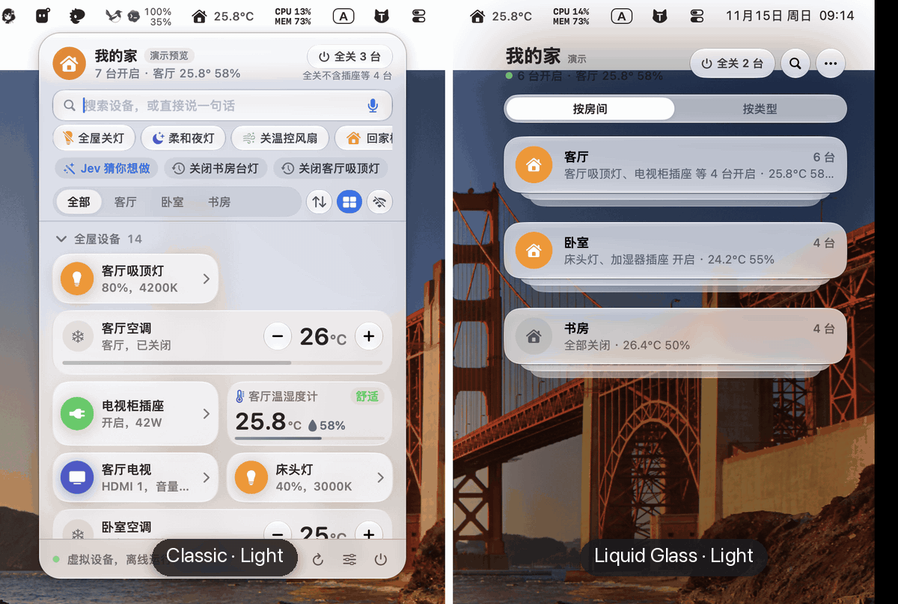
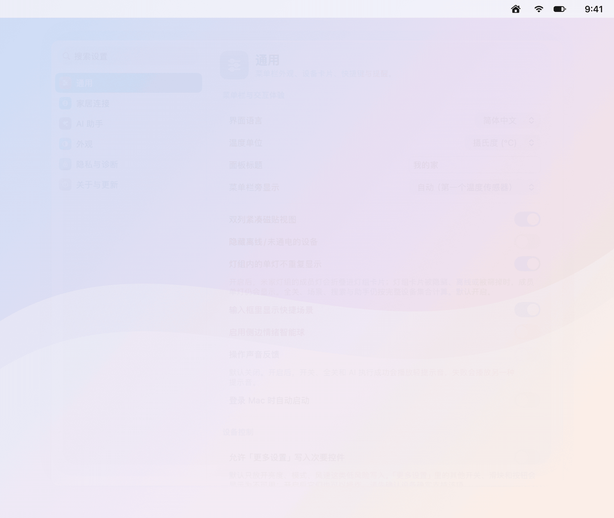
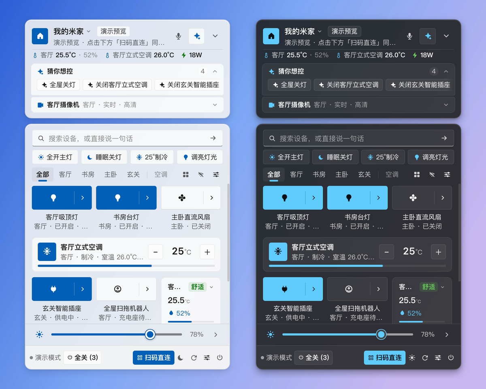

[English](README.md) | 简体中文

<p align="center">
  <a href="https://trendshift.io/repositories/309141?utm_source=trendshift-badge&amp;utm_medium=badge&amp;utm_campaign=badge-trendshift-309141" target="_blank" rel="noopener noreferrer"></a>
  <a href="https://trendshift.io/repositories/309141?utm_source=trendshift-badge&amp;utm_medium=badge&amp;utm_campaign=badge-trendshift-309141" target="_blank" rel="noopener noreferrer"></a>
</p>

<p align="center">
  <picture>
    <source media="(prefers-color-scheme: dark)" srcset="docs/assets/logo-dark.svg">
    <source media="(prefers-color-scheme: light)" srcset="docs/assets/logo-light.svg">
    
  </picture>
</p>

<h1 align="center">MenuBarHome</h1>

<p align="center">
  <b>不用掏手机，在电脑上就能管好整个家。</b><br>
  住在 Mac 菜单栏里的米家控制中心，也有 Windows 11 托盘版。<br>
  用米家 App 扫一下码就能连上，不必先搭 Home Assistant。
</p>

<p align="center">
  <a href="https://github.com/jryang2026-code/MenuBarHome/stargazers"></a>
  <a href="https://github.com/jryang2026-code/MenuBarHome/releases/latest"></a>
  
  
  
  
</p>

<p align="center">
  <a href="https://github.com/jryang2026-code/MenuBarHome/releases/latest"><b>下载最新版本</b></a> ·
  <a href="#快速开始">安装与连接</a> ·
  <a href="docs/platform-matrix.zh-CN.md">双端能力对照</a> ·
  <a href="#安全隐私与限制">安全与隐私</a> ·
  <a href="CHANGELOG.md">更新日志</a>
</p>

<p align="center">
  
</p>

<p align="center"><sub>按 <code>⌥M</code> 呼出面板，敲 <code>sftd</code>（书房台灯的拼音首字母），回车开灯。画面来自 macOS 演示模式，设备均为虚拟。</sub></p>

**三步上手：** [安装](#1-安装)（Homebrew、DMG，或 Windows 安装包）→ [连接](#2-连接你的家)（扫一个二维码，或先用不需要账号的演示模式）→ 按 `⌥M`（Windows 是 `Alt+M`）。

> [!NOTE]
> **改名与搬家：** 从 1.2.0 起，MenuBarMijia 改名为 MenuBarHome，仓库迁到 [github.com/jryang2026-code/MenuBarHome](https://github.com/jryang2026-code/MenuBarHome)。1.1.7 及更早版本收不到这次更新，请手动下载安装一次；登录和设置都会保留，装好后删掉旧的 `MenuBarMijia` 即可（Windows 请先卸载旧版）。

> [!IMPORTANT]
> **非小米官方产品，与小米无关联。** MenuBarHome 是独立开源项目，并非小米或米家官方客户端，与小米科技有限责任公司及其关联公司不存在隶属、合作、赞助或背书关系。「小米」「米家」「Xiaomi」「Mijia」「Mi Home」是小米科技有限责任公司及其关联公司的商标。本项目仅在说明与小米 / 米家设备的兼容性时使用这些名称，不暗示任何背书或认可。

---

## 为什么值得装一个

写代码、改稿子、开会的时候，想关个灯还得解锁手机、找 App、翻房间。MenuBarHome 把这件事缩短成一个快捷键。

- **扫码就能用。** 在设置里点「米家云端直连」，用手机米家 App 扫一下屏幕上的二维码，家里所有房间和设备就同步过来了。不用装 Home Assistant，不用抓 token。已经在用 Home Assistant 的，也能直接连。
- **手不离开键盘。** `⌥M` 呼出面板，直接打字找设备，名字、房间、拼音首字母都认。回车开关，方向键调亮度、调温度。
- **按住说话，松手就办。** 没有唤醒词，也不用等它回话。开关、调光、调温、定时这些常用说法在本机就能听懂，不填 AI Key 也能用。
- **关错了能撤销。** 「全关」默认放过插座、扫地机和摄像机；关完之后点一下「撤销」，刚才亮着的灯原样回来。
- **跟着你的 Mac 走。** 锁屏自动关灯，接上外接显示器打开台灯，日历里的会议快开始了就把灯调好。规则默认全关，开哪条由你决定。
- **原生、安静。** macOS 版用 Swift 写成，不带浏览器内核；面板开着不操作时 CPU 占用约 0.1%。

---

## 快速开始

### 1. 安装

- **macOS：** macOS 14 (Sonoma) 及以上，Apple Silicon 与 Intel 通用。
- **Windows：** Windows 11（64 位）。

**macOS · Homebrew**

```bash
brew tap jryang2026-code/tap
brew trust --cask jryang2026-code/tap/menubarhome
brew install --cask jryang2026-code/tap/menubarhome
```

**macOS · 下载 DMG**

从 [GitHub Releases](https://github.com/jryang2026-code/MenuBarHome/releases/latest) 下载最新的 DMG，把 `MenuBarHome.app` 拖进「应用程序」。

> 本项目没有加入付费的 Apple 开发者计划，安装包未经公证。第一次打开如果被拦下，到 **「系统设置 → 隐私与安全性」** 页面底部点 **「仍要打开」** 就好。

**Windows 11**

从 [GitHub Releases](https://github.com/jryang2026-code/MenuBarHome/releases/latest) 下载 `.exe` 或 `.msi` 安装包。

> 安装包没有商业代码签名证书。如果弹出「Windows 已保护你的电脑」，点 **「更多信息」→「仍要运行」**。每个版本的 SHA-256 都公布在 Releases 页面，可以自行核对。

### 2. 连接你的家

点菜单栏（或托盘）图标打开面板，进入设置 `⚙️`，三种方式任选：

- **米家云端直连（推荐）：** 选「米家云端直连」，用手机米家 App 扫屏幕上的二维码，确认后全屋的家庭、房间和设备自动同步。支持中国大陆、新加坡、德国、美国、俄罗斯服务器；macOS 上可以「添加账号」，把多个小米账号的设备合到一个面板里。登录快过期时会提前 3 天提醒，在面板里重新扫一次码就能续上。
- **Home Assistant：** 填上实例地址（如 `http://192.168.1.100:8123`，也支持反向代理子路径）和长期访问令牌即可；macOS 还能自动发现局域网里的 Home Assistant。令牌存进 macOS 钥匙串或 Windows 凭据管理器。<br>
  macOS 如果提示「局域网连接被系统拦截」，到 **「系统设置 → 隐私与安全性 → 本地网络」** 里允许 MenuBarHome。
- **演示模式：** 不登录任何账号，用一套虚拟设备先把界面玩一遍。

---

## 看一圈

### 新的面板

搜索框放到了最上面，找设备和说一句话都在这里。常用设备排成磁贴，空调可以直接在卡片上加减温度，房间切换、排序和紧凑视图都在手边。浅色、深色跟随系统；在 macOS 26 及更新的系统上，还可以换成「液态玻璃」主题。

<p align="center">
  
</p>

### 偏好设置换成了「系统设置」的样子

左侧分类、彩色图标、分组卡片，用起来和 Mac 自带的「系统设置」一样顺手。顶部的搜索框认中英文关键词和同义词，选中结果会直接跳过去，并把那一项高亮出来。

<p align="center">
  
</p>

### 按住说话

按住 `⌥M` 或菜单栏图标开口说，说完松手。听到的话会实时出现在搜索框里，松手立刻执行。常用指令在本机解析，几乎没有等待；说法复杂一些的，可以交给你自己配置的 AI 服务。

<p align="center">
  
</p>

### 一键全关，随时撤销

出门或睡前，按住「全关」0.6 秒，当前视图里亮着的设备一起关掉。插座、扫地机和摄像机默认不参与，可以在设置里改。关完会出现「撤销」，点一下就回到关之前的样子。

<p align="center">
  
</p>

### Windows 11 也换了新衣服

托盘版按 Windows 11 的 Fluent 2 风格重新设计成上下两座「浮岛」：上面是家庭状态、猜你想控和摄像机速览，下面是搜索、快捷动作和设备磁贴。键盘搜索、`Alt+M` 呼出、深浅色都有。

<p align="center">
  
</p>

---

## 还能做什么

- **能认的设备很多。** 灯、空调、风扇、插座、电视、窗帘、晾衣架、净化器、加湿器、冰箱、热水器、洗烘设备、浴霸、油烟机、扫地机、摄像机、门锁和各类传感器；没有专属卡片的米家设备，也会有一张通用卡。
- **摄像机小窗。** 点开卡片弹出置顶的实时画面，双摄机型可以切镜头，带云台的直接拖动画面转方向。
- **温湿度曲线和用电账本。** 传感器能看 24 小时 / 7 天趋势，插座按天记用电量，填上电价还能估算电费。
- **猜你想控。** 根据你平时什么时候开什么，把可能要做的操作提前摆出来。习惯只记在本机，随时可以查看和清空。
- **多账号、双数据源。** 可以同时登录多个米家账号，也可以让米家和 Home Assistant 一起工作，同一台设备会自动合并。
- **安全提醒和家庭周报。** 大功率电器开太久、常用设备突然掉线，都会弹通知提醒；每周还能生成一份家庭健康周报，看看哪些设备总掉线、哪些插座在偷偷耗电。
- **接进你的工具。** 支持 Apple 快捷指令、`menumijia://` 链接、Raycast 扩展、命令行和 MCP 服务，Claude、Cursor 这类 AI 工具也能查询和控制家里的设备，全程拿不到你的账号凭据。

两端各支持哪些能力，见[双端能力对照](docs/platform-matrix.zh-CN.md)。

---

## 常用操作与口令参考

### 键盘快捷操作

macOS 默认按 `⌥M` 呼出面板，Windows 默认按 `Alt+M`。打字盲搜、`↑`/`↓` 选择、`Return`/`Space` 开关或展开、`→`/`←` 调节参数与 `Esc` 返回双端通用；`Tab` 轮转房间标签适用于 macOS。

| 按键 | 功能 |
| :--- | :--- |
| `⌥M` / `Alt+M` | 全局呼出 / 收起控制面板（macOS / Windows） |
| 直接输入字母 | 搜索设备名称、房间或拼音首字母（如 `sftd` 匹配书房台灯） |
| `↑` / `↓` | 在搜索结果或设备卡片列表中切换光标 |
| `Return` / `Space` | 开关当前选中的设备；对不可直接开关的设备展开详情控制抽屉 |
| `→` / `←` | 右方向键展开详情；展开后用左右方向键调节灯光亮度、空调温度、窗帘位置或音量（Windows 另可调风速） |
| `Tab` | 在不同房间标签之间快速轮转切换（macOS） |
| `Esc` | 退出搜索输入、收起控制抽屉，或关闭面板 |

### 本地支持的常用自然语言口令

以下口令由本机规则引擎直接解析执行，**不需要配置云端 AI**，不消耗 API Token：

- **开关设备：** 「关客厅灯」「打开书房空调」「turn off all lights」
- **调节情景模式：** 「书房吸顶灯月光模式」「日光模式」「daylight mode」
- **微调亮度与色温：** 「再暗一点」「主卧灯调到 40%」「brighter」
- **温度与风速控制：** 「空调调到 26 度」「调高两度」「风扇开自然风」
- **延时定时执行：** 「10 分钟后关灯」「半小时后关空调」「取消定时」
- **撤销误操作：** 「撤销」「刚才那个撤销」（10 分钟内支持语音或快捷撤销）

---

## 双端能力对照

macOS 版是 Swift 6 原生应用，Windows 11 版是另一套 Tauri v2 实现。两端共用黄金测试集，但功能并不完全一致：

| 维度 | macOS 14+ | Windows 11 |
| :--- | :---: | :---: |
| 米家扫码直连 | ✅ | ✅ |
| Home Assistant | ✅ | ✅ |
| 键盘搜索与全局热键 | ✅ `⌥M` | ✅ `Alt+M` |
| 语音 | ✅ 按住说话或免提 | ⚠️ 仅免提 |
| 本地口令与可选 AI | ✅ | ✅ |
| 一键全关与撤销 | ✅ | ✅ |
| 摄像机实时画面 | ✅ | ✅ |
| 同时登录多个小米账号 | ✅ | — 仅一个账号 |
| Mac 事件自动化、快捷指令、GrokBall | ✅ | — |
| 签名安装包 | ⚠️ 自签名 | ⚠️ 未签名 |

逐项、逐设备品类的完整对照表见 [docs/platform-matrix.zh-CN.md](docs/platform-matrix.zh-CN.md)。

---

## Raycast 扩展、本地 CLI 与 MCP 服务

在 macOS 打开 **设置 → 通用 → 自动化与外部控制 → Raycast 集成**（或在 Windows 打开 **设置 → 全关与更新 → Raycast 与本地 CLI / MCP 集成**）后，应用会把设备、场景、快捷动作、环境读数、上一条命令结果和一个本机随机令牌写到 `~/Library/Application Support/MenuBarMijia/raycast-snapshot.json`（macOS，权限 `0600`）或 `%LOCALAPPDATA%\MenuBarMijia\raycast-snapshot.json`（Windows）。带令牌的 `menumijia://` 链接不再弹外部链接确认；双端的高风险设备仍会先问，锁屏拦截照旧。关闭该开关会立即删除文件并作废令牌，伴生端拿不到任何米家或 Home Assistant 凭据；契约与取舍见 [ADR-0013](docs/adr/0013-raycast-companion-contract.md)。

**为什么还能看到旧名字。** 应用叫 MenuBarHome，但对外的集成接口保留了原来的名字，这样已有的 Raycast 命令、快捷指令、脚本和 MCP 配置都不会失效：

| 你会看到 | 它是什么 | 该怎么用 |
| :--- | :--- | :--- |
| `menumijia://…` | 所有伴生工具发来的 URL scheme，是兼容契约（见 [ADR-0013](docs/adr/0013-raycast-companion-contract.md)），不会改 | 继续用 `menumijia://` |
| `scripts/mijia`、`scripts/mijia-mcp` | 命令行与 MCP 服务 | `scripts/menubarhome` 是同一个命令行的新名字，`mijia` 照常可用 |
| `MenuBarMijia/` 数据目录、`MenuBarMijiaApp` 进程 | 应用的数据目录与进程名 | 无需操作；你的登录和设置都在里面 |
| MCP 配置键 `menubarmijia` | MCP 客户端配置里的一个标签，也是服务端上报的名字 | 随便起名；下面的示例用 `menubarhome` |

<details>
<summary><b>命令行、MCP 服务与 Raycast 的具体用法</b></summary>

### 本地 CLI

`scripts/mijia` 是只依赖 Python 3 标准库的脚本，使用时保持 MenuBarHome 运行即可。

| 命令 | 作用 |
| :--- | :--- |
| `scripts/mijia list [--room 书房] [--json]` | 按房间列出面板里可见的设备、在线状态与读数 |
| `scripts/mijia status [--json]` | 连接状态、设备数量、环境读数与上一条命令的结果 |
| `scripts/mijia toggle 书房台灯` | 翻转主开关，支持设备名、ID 或拼音首字母（`sftd`） |
| `scripts/mijia on 客厅射灯` / `scripts/mijia off 客厅射灯` | 按目标状态开关，不再依赖当前状态 |
| `scripts/mijia brightness 书房台灯 60` | 按百分比调节灯光亮度（`0`–`100`%） |
| `scripts/mijia color-temp 书房台灯 4000` | 按开尔文调节灯光色温（`1000`–`20000` K） |
| `scripts/mijia temperature 书房空调 25` | 设定目标温度（`-30`–`100` ℃） |
| `scripts/mijia fan 客厅风扇 --percent 60` / `--preset 自然风` | 设定风速百分比（`1`–`100`%）或设备上报的档位 |
| `scripts/mijia focus 书房台灯` | 在面板中定位到设备所在房间并展开详情抽屉（不操作硬件） |
| `scripts/mijia scene 观影模式` | 执行 Home Assistant 场景或内置快捷动作（全屋关灯、一键全关、撤销……） |
| `scripts/mijia ask "把客厅灯调到 40%"` | 一句话指令，复用应用自己的解析与确认规则 |
| `scripts/mijia mcp`（或 `scripts/mijia-mcp`） | 以 stdio 方式运行本地 MCP 服务 |

`scripts/menubarhome` 运行的是同一个程序：`scripts/menubarhome list` 就是 `scripts/mijia list`。

退出码：`0` 成功；`1` 应用报告执行失败；`2` 本地错误（快照缺失、设备找不到、集成未开启）；`3` 等待结果超时。`--dry-run` 只打印链接（令牌打码），`--no-wait` 发完不等结果，`MENUBARMIJIA_SNAPSHOT_PATH` 可覆盖快照路径。

### 本地 MCP 服务（Claude Desktop / Claude Code / Cursor）

`scripts/mijia-mcp`（或 `scripts/mijia mcp`）仅用 Python 3 标准库实现 stdio JSON-RPC 2.0 MCP 服务，提供只读资源（`mijia://status`、`mijia://devices`、`mijia://scenes`）与结构化工具（`list_devices`、`get_home_status`、`toggle_device`、`set_device_power`、`set_light_brightness`、`set_light_color_temp`、`set_temperature`、`set_fan`、`run_scene`、`ask_home`、`focus_device`）。服务在进程内使用 `bridgeToken` 派发 `menumijia://` 链接，并从所有返回给模型的资源与工具结果中剥离 `bridgeToken`，不向模型暴露任何令牌或云端凭据。

```json
{
  "mcpServers": {
    "menubarhome": {
      "command": "/ABSOLUTE/PATH/TO/MenuBarHome/scripts/mijia-mcp"
    }
  }
}
```

### Raycast 扩展

`raycast/` 是标准 Raycast 扩展，提供三个命令：**搜索设备**、**场景与快捷动作**、**问 MenuBarHome**。在 Raycast 的扩展页按 `+` → **Import Extension** 选择 `raycast/` 即可，或在 Raycast 打开时运行 `cd raycast && npm ci && npm run dev`。开关、亮度、色温、目标温度与风速都按精确值下发（`menumijia://power`、`brightness`、`color-temp`、`temperature`、`fan`），滑条不会靠猜当前状态去翻转设备；每条命令都会用 toast 显示应用的执行结果。

</details>

---

## 安全、隐私与限制

### 连接之前请先知道

- **米家云端直连用的是非官方接口。** 它不是小米官方集成，小米随时可能限制请求频率或对账号做风控，本项目无法保证不会发生。面板关闭、锁屏时应用会降低轮询频率来减少请求量。如果你不想承担这个风险，请改用 Home Assistant，并接入小米官方的 [xiaomi_home](https://github.com/XiaoMi/ha_xiaomi_home) 集成。
- **会过期，需要重新扫码。** 应用不保存长期凭证 `passToken`，也不做静默续期（见 [ADR-0004](docs/adr/0004-no-pass-token-storage.md)）。登录能撑多久由小米服务器决定，拿到到期时间时会显示在设置里；到期前 3 天面板会提醒你，重新扫码只要几秒。
- **安装包没有商业代码签名。** macOS 首次启动需要点「仍要打开」，Windows 会弹 SmartScreen 提示（见[安装](#1-安装)）。
- **Windows 版功能还没追平。** 仅支持 Windows 11；语音只有免提模式（没有按住说话）；只能登录一个小米账号；没有 Mac 事件自动化、Apple 快捷指令和 GrokBall。详见[平台对比](#双端能力对照)。

### 安全与隐私

- 账号凭据只存在 macOS 钥匙串或 Windows 凭据管理器里，不写进明文配置，也不进日志。
- 打开电暖器、切换插座、启动扫地机这类操作一定会先问你；把它们关掉则直接执行。
- Mac 锁屏期间默认拒绝所有手动控制，离开座位也不怕被人乱点。
- 常用指令在本机解析。只有你配置了 AI 服务、而且这句话本机听不懂时，才会把指令和相关设备信息发给你选的服务。
- 应用内更新用 Ed25519 签名校验，签名私钥离线保存。

<details>
<summary><b>凭据存放、高风险确认、锁屏与吊销的完整说明</b></summary>

MenuBarHome 是独立开源项目，并非小米官方客户端。米家云直连需要联网；已有 Home Assistant 时，可在 macOS 或 Windows 上连接自己的实例。

### 凭据存放在哪

| 凭据 | 保存的内容 | 位置 |
| :--- | :--- | :--- |
| 米家 / Xiaomi Home | 已登录账号的 `userId`、`cUserId`、`ssecurity`、`serviceToken`、云端地区与声明的到期时间（登录时即丢弃 `passToken`；macOS 支持多账号，Windows 为单账号） | macOS 钥匙串（一条通用密码项）或 Windows 凭据管理器（`mi_session`） |
| Home Assistant | 长期访问令牌（实例地址不属于机密） | macOS 钥匙串或 Windows 凭据管理器（`ha_token`） |
| AI 助手 | 按服务商预设隔离保存的 API 密钥，以及非机密的导入来源标记、自定义端点绑定与已允许的云端授权地址 | 各服务商 API 密钥保存在 macOS 钥匙串或 Windows 凭据管理器（`assistant_api_key_<preset>`）；非机密元数据保存在应用偏好中 |
| LG webOS 电视 | 电视签发的配对客户端密钥 | macOS 钥匙串 |

macOS 会将这些钥匙串项加密保存，并由登录钥匙串保护；MenuBarHome 写入时使用 `kSecAttrAccessibleAfterFirstUnlockThisDeviceOnly`，首次解锁后可用，但不会同步到 iCloud 或另一台 Mac。双端都不会把这些机密写进明文 `UserDefaults`、WebView `localStorage` 或日志。macOS 更新后可能询问一次钥匙串授权（构建签名发生变化）；选择「始终允许」即可覆盖之后的读写。

macOS 上 1.0.6 及更早版本曾把凭据镜像到明文 `UserDefaults`；升级后首次启动时，每个旧明文值都会先写入钥匙串，写入成功后才删除对应明文键，钥匙串不可用时保留旧副本以便下次重试。Windows 上从早期 `localStorage` 版本升级时，会先剥离机密字段并重写 `localStorage`，再异步持久化到 Windows 凭据管理器，确保凭据管理器写入失败时也不会在 WebView 存储中残留明文令牌（当前进程内存会话继续保持可用）；凭据管理器中旧版单槽 `assistant_api_key` 也会先迁移到所属服务商分槽，确认写入成功后才删除旧条目。

### 高风险控制、锁屏与吊销

高风险设备的手动操作也需要二次确认，而不只是 AI 建议的操作：打开电暖器、切换插座或摄像机、启动扫地机，或打开热水器 / 调高热水器温度。关闭这些设备的操作保持直接执行，避免「想让家里更安全却先被弹窗拦住」。门窗与燃气报警在本应用中只是只读状态卡片，无法在这里被操作。确认规则在双端通过共享基线对齐（`Tests/Fixtures/confirmation_golden.json`、`Sources/MijiaCore/ModelActionPolicy.swift`）。

macOS 的设置 → 「隐私」中有 **「锁屏时禁止控制设备」**，默认开启。Mac 锁屏期间，卡片与详情控制、`menumijia://` 链接、快捷指令 / App Intent、助手命令、守护提醒通知的「立即关闭」以及「错过的定时」里的「立即补执行」都会被拒绝并提示；按时间自动触发的定时任务与 Mac 事件自动化规则仍然执行。开关保存在本机，锁屏状态来自系统的锁屏通知。

同一 macOS 设置页提供 **「退出并吊销令牌」**，需要先经过破坏性确认。它会退出全部米家账号、删除 Home Assistant 令牌并断开连接，同时清除已保存的 AI 密钥与云端授权记录，保留设备名称、房间布局与本地历史；也可在各分区单独吊销。Windows 端可在四栏偏好设置中按服务逐项清空凭据与授权记录（清空 HA 令牌或某服务商 API Key 会同步删除 Windows 凭据管理器中的对应条目，「AI 与习惯」页签提供一键撤销云端 AI 发送授权）。

macOS 上，Home Assistant 令牌只会直接发往 `https` 地址或局域网端点；其他明文 `http` 地址（例如公网 DDNS 域名）在连接前会先说明「令牌会以明文传输」，点击「仍然连接」后才会连接（按地址记住，可由「退出并吊销令牌」一并清空）。Windows 上，每个新增的 Home Assistant 或自定义 AI 来源都需在系统原生对话框中确认授权（写入 `authorized-http-origins.json`）；若非局域网地址使用明文 `http`，原生确认框会显式附带明文传输警告。

常用指令由本地规则处理。你也可以接入自己选择的 AI 服务，处理更复杂的说法；发送给服务的内容包括指令、设备及环境信息，以及你启用的习惯摘要。手动点卡片操作也会在本机学习时段习惯（只用于「猜你想控」推荐）；学习开关可随时关闭，已学内容可在设置中查看并一键清空，点击撤销横幅会同步回滚对应习惯记录。语音识别使用系统服务；macOS 上支持的语言可开启「语音只在本机识别」，并将设备名、房间名和场景名作为识别提示交给系统语音服务。

为了避免误操作，开启电暖器、切换插座或启动扫地机等高风险操作始终要求确认，AI 低把握度猜测则会作为待点击建议展示（macOS 设置中的「不确定时先问我」默认开启）。macOS 的 URL 控制默认也会先确认，可在设置中开启直控。

macOS 安装包尚未经过 Apple 公证，首次打开时可能需要在系统设置中允许；Windows 安装包可能触发 SmartScreen。双端应用内更新均使用离线保管私钥的 Ed25519 签名清单进行验签。更多连接方式说明见 [ADR-0007](docs/adr/0007-lan-direct-deferred.md)。

GitHub Actions 构建的正式发布产物附带构建溯源证明（build provenance）与 SPDX SBOM 清单，校验方式见 [SECURITY.md](SECURITY.md#verifying-release-artifacts)。

私下报告漏洞的步骤写在英文的 [Security policy](SECURITY.md)。

</details>

---

## 参与开发与技术架构

- **架构理念：** macOS 端为纯 Swift 6 开发，**运行时代码无第三方 Swift 依赖**，开启严格并发检查；核心协议解析与状态合成抽象为独立模块 `MijiaCore`（可脱离 UI 单独运行全量单元测试）。Windows 端基于 Tauri v2 (Rust + TypeScript + Vite) 构建独立托盘程序。
- **跨平台一致性保证：** 双端使用 `Tests/Fixtures/` 目录下的共享 Golden 语料（意图、规格书、区域、服务商测试数据）进行各自断言，确保解析规则不分叉（详见 [ADR-0006](docs/adr/0006-dual-platform-implementation.md)）。

### 本地构建与验证

```bash
# macOS 本地全量测试与代码门禁检查
bash scripts/check.sh

# 编译、打包并启动 macOS 本地构建
bash scripts/build_app.sh

# Windows 托盘版本地构建与测试
cd windows
npm install
npm test
npm run build
```

在提交 Pull Request 前，请先阅读 [CODING_STANDARDS.md](CODING_STANDARDS.md) 了解代码规范；项目领域概念见 [GLOSSARY.md](GLOSSARY.md)。

---

## 贡献者与致谢

感谢为 MenuBarHome 提交代码、修补协议细节与打磨交互体验的贡献者：

- [@jryang2026-code](https://github.com/jryang2026-code)（一群小羊说）— 项目发起与维护
- [@almightyYantao](https://github.com/almightyYantao)（Alimighty.Yantao）— 多键 Mesh 开关分键设备识别与合成（GitHub #6、GitHub #7）、米家多家庭切换与灯组情景过滤（GitHub #8）、多主题面板皮肤、空调/温湿度计独立模块、长按拖拽自由布局与自定义分组（GitHub #9）、macOS 应用图标打包集成（GitHub #10）、面板下落动画、本地设备重命名与房间栏细节打磨（GitHub #11）、Windows 功能对齐与跨端界面修复（GitHub #12），以及连接源快照的冗余写入优化（GitHub #66）
- [@htx996](https://github.com/htx996)（han）— macOS 菜单栏状态项右键菜单：实时连接 / 演示模式切换、双源连接状态展示，以及与长按语音、键盘操作互不干扰的点击处理（GitHub #250）

## 协议与致谢

- **开源协议：** 本项目采用 [MIT License](LICENSE) 开源。
- **第三方集成说明：** 本仓库不分发任何第三方官方组件。涉及 Home Assistant 模式下的 [xiaomi_home](https://github.com/XiaoMi/ha_xiaomi_home) 与 [midea_ac_lan](https://github.com/wuwentao/midea_ac_lan) 分别来自小米及其各自维护者，版权归各自作者所有。
- **商标声明：** 「小米」「米家」「Xiaomi」「Mijia」等为小米科技有限责任公司注册商标；「美的」为美的集团股份有限公司注册商标。本文档与本项目仅用于描述设备兼容性。

感谢所有为 MenuBarHome 提交代码、报告缺陷与改进建议的贡献者！如果这个小工具让你在工作时少掏了几次手机，欢迎在 GitHub 上点一个 ⭐ Star。

---

---

## 常见问题（FAQ）

- [占用多少内存和 CPU，怎么自己测？](docs/faq.zh-CN.md)
- [Windows 11 端占用如何？](docs/faq.zh-CN.md)
