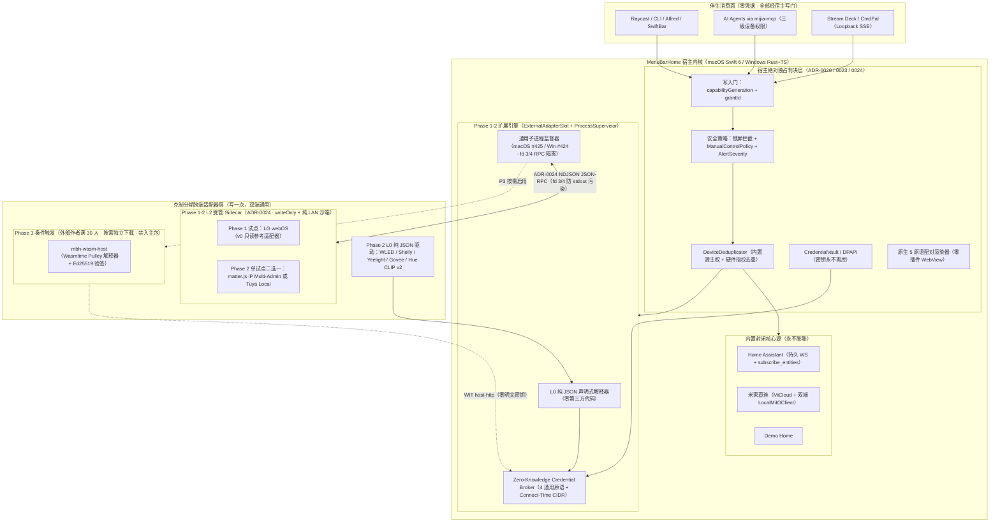

# MenuBarHome 全维度调研与下一步分级演进清单（最终总纲）

- **编纂角色**：第三波总架构师与演进路线图编纂官（`roadmap-architect`）
- **完成日期**：2026-11-24（调研快照锚定 `jryang2026-code/MenuBarHome` `main` 至 PR `#460`；入仓推库时 `main` 已同步至 `f5779a9`，执行前请以实时 `gh pr/issue list` 为准；**零业务源码改动、零 GitHub Issue 创建**）
- **综合依据**：整合第一波 10 份一线源码与口碑调研报告（`01`–`10`，累计深扒 35+ 开源仓库一手源码 + 21 个中外社区渠道）与第二波 2 份独立核验审计报告（`11-verify-tech-audit.md` 54 项源码抽检 + `12-verify-product-audit.md` 口碑复核与 24 项反膨胀裁决）。
- **权威覆写口径**：凡第一波报告与 `11`/`12` 核验裁决存在事实偏差或架构冲突处，**已 100% 按核验裁决强制覆写**（详见 §1.3 核验纠偏清单）。正文统一区分 `【本仓源码】`、`【标杆源码】`、`【实测事实】`、`【分析推断】` 与 `【远景设想】`。

---

## 一、执行摘要与战略总判

### 1.1 一句话定位与核心护城河

> **MenuBarHome 不是「低配版 Home Assistant」，也不是 24/7 常驻服务器；它是全球唯一把「macOS 原生 Swift 6 + Windows 11 Tauri 双端」「米家扫码免 HA 直连 + HA 双源自动去重」「桌面置顶盯摄像头 + 电脑上下文无痕联动」「硬核物理安全门（锁屏拦截 / 10s 撤销 / 高危单向确认 / 零凭据伴侣）」装进 380–440px 轻量菜单栏的桌面智能中枢。**

### 1.2 三个反常识核心发现（决定未来 6 个月成败）

1. **当前头号瓶颈不是「功能不够厚」，而是「供给过剩 vs 触达与信任断层」的极端剪刀差** `【实测事实】`
   - 仓库生产代码已达 **22.4 万行**（Swift 11.5 万 + TS 9.5 万 + Rust 1.3 万）、测试与黄金语料 **19.1 万行**，近 48 小时内狂合 **40+ 个高质量 PR**；但迁仓更名后新仓仅 **47★**、三版总装机下载仅 **378 次**、`Discussions` 为 **0**，且 21 个核心中外社区中有 **15 个处于零直接曝光**。
   - 最荒诞的「内鬼」竟在自家仓库：`README.md:130, 237-238`、`README.zh-CN.md:237-238` 与 `GLOSSARY.md:22` **至今仍把已支持多账号与双源融合的 Windows 端写成「仅一个账号」「无事件自动化」**，亲手劝退占真实下载量 **39.95%**（151/378）的 Windows 用户。**停下来花 1 小时修文案、速发 `v1.5.0`、启动零成本免费的 Windows SignPath 签名（`#12`）与回收历史 914★ 外部断链，转化杠杆率远超再闷头写 30 个功能 PR。**
2. **「原生大师级」与「廉价 AI 套壳」的分水岭，50% 在排版减法，另 50% 在窗口礼仪与传输底座** `【源码证实 + 分析推断】`
   - 社区差评（如「像 2345 网址导航」「AI 布局一个样」「唤醒卡死」「Windows 不像正经软件」）的根源，并不是缺 3D 平面图或刘海微动效，而是 4 处底盘硬伤：
     - Windows `network.rs:192` 每次请求重建 `reqwest::Client`、`home_assistant.rs:201` 每次操作新建阻塞 `tungstenite` 短连接且无本地 `LocalMiIOClient`（PR `#453` 仅 Part 1）；
     - 双端合盖唤醒 / Wi-Fi↔VPN 切换存在半开 TCP 最长 **120 秒假死**（`HomeProvider.swift:335, 448, 584` 无 `pong` 超时、`SystemActivityMonitor.swift:86` 漏检同满足态换网）；
     - macOS `MenuBarPanelController+Presentation.swift:75` 强行 `NSApp.activate` 把用户正在写代码的 IDE 标题栏变灰；
     - Windows 托盘存在 5 处 `tao`/`tray-icon` 底层缺陷（混合 DPI 跨屏截断、Win11 溢出区悬空、泄漏到 `Alt+Tab`、`StartupApproved` 自启失步、`/activate` 缺失前台权）。
3. **47★ 项目绝不能早产 40,000★ 项目的插件基建：克制收口胜过重型幻想** `【核验裁决】`
   - `yetone/magpie`（40.7k★）的真正精华是**「事实与判决分离」**与**「四层本地状态隔离」**，而非把无沙箱 Bun 或 `goja` 代码执行器搬进控制物理电器的桌面工具。
   - 本仓 `mbh-wasm-host` 进程外 WASM 沙箱虽在理论上破解了双端重写与 `ADR-0023` 冲突，但带 Cranelift JIT 的实测包体达 **18–28 MB/架构**（非 `08` 低估的 4–6 MB）且在未来 macOS 公证时引入 `allow-jit` 风险；在外部代码贡献者仅 3 人的当下强推 WASM/WIT 市场是典型过度设计。**先清 `#456`/`#438` + LG webOS 只读 Sidecar + L0 纯 JSON 声明式驱动 + 1 个数据验证过的 L2 试点，已能零膨胀吃下 95% 真实生态需求；`mbh-wasm-host`（优先 Pulley 解释器 + 按需下载）锁死在 P3 条件触发。**

### 1.3 与昨日 `2026-11-23-deep-dive` 净增量去重及核验纠偏落地表

> 避免把 `main` 已合入能力或昨日 16 份深潜报告的既有结论重复包装成「本轮新发现」，四象限严格分流如下（源自 `11-verify-tech-audit.md §二`）：

| 象限 | 代表事项 | 真实状态与承接关系 | 本总纲处置 |
| :--- | :--- | :--- | :--- |
| **Q1：HEAD 已合入** （剔除出路线图） | Win 多账号与双源融合（`v1.3.0`）、Win 进程内 WinRT Toast（`#433`）、自动隐藏任务栏补偿与设置窗深色标题栏（`#400`）、macOS `ProcessSupervisor`（`#425`）、5 档空闲轮询衰减与 `NSBackgroundActivityScheduler`（`#405/#406/#421/#454`）、门铃缩略图/静帧墙/米家云场景（`#408/#448/#450`）、`HomeAdapter` SPI HA 首家与 `ADR-0024` v0 契约（`#439/#452`）、**PR `#460` WidgetKit ad-hoc 证伪（2026-11-24 07:50Z 已合入）** | 已在 `main` 落地（仅部分未发版，积压在 `v1.4.0` 之后） | **全部剔除出开发清单**；通过 **P0-1 速发 `v1.5.0`** 与修正滞后 README 一次性释放给用户 |
| **Q2：既有 Open Issue / PR / Proposed ADR** （挂接原单推进） | **Windows 本地 miIO UDP 54321（在途 Open PR `#453` Part 1 + `#457`）**；**米家 `miIO.sub` 局域网推送（昨日 `R01` + `ADR-0025` Proposed + `#449`）**；**米家 `datasource: 1` 云缓存（昨日 `R01` + `#411`）**与离线 LAN 探测（`#412`）；`#456`（ADR-0024 4 项缺口）与 `#438`（米家接 `HomeAdapter`）；`#424`/`#447`/`#294`/`#442`/`#430`–`#432`/`#443`/`#445`/`#446`；`#11`（macOS 付费签名）与 `#12`（Win 免费 SignPath） | **非本轮首次发现**；`04` 漏检了 `#453`/`ADR-0025`/`#411` | **全部严格挂接原编号推进**，绝不另起炉灶；将免费 `#12` 与付费 `#11` 彻底解绑 |
| **Q3：昨日已研、本轮源码深化** | `StartupApproved\Run` 自启失步、`AllowSetForegroundWindow`（补齐 `#433` 漏掉的 `/activate` 路径）、macOS `.nonactivatingPanel`（本轮补出 5 条硬护栏）与 Tahoe WindowServer 日志抑制、Hue CLIP v2 / `matter.js` / `tuya-local` 协议选型二次互证 | 昨日 `R04`/`R05`/`R07`/`R10` 已提出方向，本轮落到精确行号与避坑护栏 | 直接融入 P0/P1/P2 可执行规格 |
| **Q4：本轮真正挖出的 9 大高价值净增量突破** | 1. **Windows Rust 传输层两处漏水实锤**（`network.rs:192` + `home_assistant.rs:201`）+ 双端 `subscribe_entities` 增量压缩（减流 60–80%） 2. **双端休眠/换网半开 TCP 120s 假死根治**（2.5s `pong` 探活 + macOS 网络拓扑指纹/DarkWake 区分 + Win32 IP Helper 三回调） 3. **推翻昨日 `R07:35` 误判**：`wry 0.57` 内置 `SetMemoryUsageTargetLevel(Low)` 立即可用不冻结 JS + `settings` 窗 `DestroyWhenIdle(60s)` 4. **Windows 托盘 5 处 `tao`/`tray-icon` 底层根因**（`SWP_ASYNCWINDOWPOS` 跨 DPI 漂移、溢出区 `rect` 悬空、缺 `WS_EX_TOOLWINDOW` 泄 `Alt+Tab`、`TRAY_ICON_SLOP_PX` 缩水、`/activate` 漏前台权） 5. **Per-Field `writeEpoch` 零回弹屏障 + 离线强制 `REVERT` + 单槽滑块邮箱 + 429 读写分账令牌桶 + Win 15s 磁滞** 6. **Connect-Time 防 DNS Rebinding + 消除 Win JS 明文持密 + Job Object 硬配额** 7. **ADR-0024 四大架构净增量**：Scrypted **fd 3/4 RPC 隔离**、L0 零代码声明式驱动、Zero-Knowledge Credential Broker 4 原语、Vicinae 5 原语原生 SDUI（+ 远期按需 Pulley `mbh-wasm-host`） 8. **体验与协议微观突破**：macOS `.glassEffect` `if let tint` View Identity 防雷、45s 两级延迟卸载、Win 120Hz CSS `linear()`、go2rtc 小米 `audio=0` 探测提速、`MiotSpec` `status=all` + 多语言词库、SonoffLAN 100ms 排插写合并、开会 Context Stack 无痕还原 9. **产品与分发剪刀差诊断**：自黑 README 止血 + 免费 SignPath `#12` 解绑 + 21 渠道传播断层冷启动独立轨道 | **本轮蜂群核心增量资产** | 作为 P0–P2 主干骨架与 Track D 独立轨道落地 |

**本总纲已强制执行的 7 项硬纠偏（源自 `11` & `12`）**：
1. 纠偏 `09:17` 幻觉：Windows 现状**并无** DWM Acrylic 背景（`panelPrefs.ts:25` 与 `src-tauri` 0 命中实证），按 `settings` 先上 Mica、Classic 去 16px 留白上 `DWMSBT_TRANSIENTWINDOW`、Fluent 双岛禁盲开分主题治理。
2. 剔除 `07:186, 253` 的 `SetProcessWorkingSetSize(-1, -1)` 反模式；标清 `tauri 2.12.4` `TrayIconBuilder` **未透传** `with_guid` 且未签名 EXE 下 `NIF_GUID` 仍绑定路径；标清 `TrySuspend` 与移除 `tauri.conf.json:28`（非 L27）`backgroundThrottling: "disabled"` 强依赖定时/告警下沉 Rust。
3. 永久剔除 `08` 提议的桌面「Virtual HAP / Matter Bridge」（违反 `.out-of-scope/`）；修正 `mbh-wasm-host` 实际体积为 18–28 MB/架构并强压至 P3（须按需独立下载 + Ed25519 验签 + 优先 Pulley 解释器防 `allow-jit`）；标注 WidgetKit `Blocked by #11`。
4. 强制捆绑 macOS `.nonactivatingPanel` 5 条硬护栏（默认非激活 + 文本输入按需 `NSApp.activate()`、`acceptsFirstMouse`+`sendEvent` 首击补 `makeKey()`、`didResignKey` 4 类豁免等），并将动态 `.regular` Dock 降为 P2 可选；升级 `10` E8、`.nonactivatingPanel`、L2/L3 高危微交互为**必须走 PR**。
5. 修正统计小误差：Open Issues 为 **28 条**（非 30，含 2 PRs 且 `#460` 已合入）；零直接曝光渠道为 **15/21**（非 14/20）；`yetone/magpie` *"Bun plugins have host privileges"* 原句归属官方文档而非 `host.js:29-40`。
6. 严格按 `12` 裁决否决 MCP `goja` `run_code`、380px 平面图抛送、刘海绑定 HUD、独立 `Alt+Space` 大窗、双端程序化微声效合成器与本地 NVR，并给「此刻焦点带 / 悬浮球 / 屏幕采光同步 / PC→HA 回传」套上默认关闭或独立插件护栏。
7. 增设「分发、文档防自黑与口碑冷启动独立轨道（Track D）」，把修 README + 发 `v1.5.0` + 启动 `#12` 放进 P0 第一批。

---

## 二、多渠道真实口碑、同赛道痛点与破局回应

> 严守 `02` 与 `12` 证据边界：严格隔离 **Part A（针对 MenuBarHome / MenuBarMijia 的直接证据）** 与 **Part B（同赛道桌面控家社区痛点）**，绝不把竞品社区呼声冒充本品既有投诉。

### 2.1 数据水位全景（2026-11-24 `gh api` 独立复核）

- **历史峰值 vs 迁仓现状**：原仓 `jryang1997/MenuBarMijia`（2026-10-15 建仓）凭阮一峰周刊 #417、X 爆贴（`@geekbb` 52.1K 浏览、`@GitHub_Daily`）在账号被封前达 **914★ / 57 Forks / 14 Releases**；迁仓更名后的 `jryang2026-code/MenuBarHome` 当前为 **47★ / 8 Forks / 126 Issues（Open 28）/ 332 PRs（Open 1: `#453`）/ 0 Discussions** `【实测事实】`。
- **双端真实装机结构（v1.2.0–v1.4.0 Releases 资产实测，已剔除校验/清单文件）**：
  - `v1.2.0`: macOS `.dmg` 107 vs Win `.exe+.msi` 81（Win 43.1%）
  - `v1.3.0`: macOS `.dmg` 86 vs Win `.exe+.msi` 44（Win 33.8%）
  - `v1.4.0`（2 天）: macOS `.dmg` 34 vs Win `.exe+.msi` 26（Win 43.3%）
  - **三版总计**：macOS **227** vs Windows **151**（总计仅 **378 次**，**Windows 占比 39.95%**；`.update.json` 拉取量仅 v1.3=36 / v1.4=23） `【实测事实】`。
- **21 个全渠道覆盖审计**：仅 **6 个渠道**存在直接讨论/收录（GitHub、X/Twitter、小红书、B 站 `BV1sj4F61Eqz`、阮一峰周刊 #417、网易号/CSDN/GitCode 旧名评测）；其余 **15 个高转化核心社区全部零直接曝光**（V2EX、少数派、知乎、什么值得买、瀚思彼岸、恩山、Linux.do、酷安、掘金、微信公众号公开索引、Reddit 5 大子版块、Hacker News、Product Hunt、MacRumors、AlternativeTo） `【实测事实】`。
- **竞品需求热度侧证**：`huanyuejue/MiHome-Windows` 已达 **845★**（至今缺摄像头与 MCP）；直接复用本仓 `MijiaCore` 的衍生项目 `iPocket-APP/MijiaLAN` 凭 Apple Developer ID 公证，仅 `v0.1.0` 单版即获 **217 次下载**（187★）；macOS 竞品 `nickustinov/itsyhome-macos` 达 **1,018★** `【实测事实】`。赛道需求极旺，MenuBarHome 是因断链、未签名与文档滞后把现成红利拱手让人。

### 2.2 Part A（直接评价）vs Part B（同赛道痛点）严格分区对照

| 维度 | Part A：MenuBarHome / MenuBarMijia 直接用户证据（100% 实证） | Part B：同赛道社区高共鸣证据（仅作增量灵感，非本品投诉） |
| :--- | :--- | :--- |
| **核心护城河 / 赞誉** | ①「免 HA 扫码直连，不用打断思路掏手机」（X `@geekbb` 52.1K 浏览、`@starkljm`）； ② 拼音首字母键盘盲搜 + 本地 0-token 解析 + **10s Undo 撤销**（`@GitHub_Daily`、网易号「Undo 是最贴心的设计」）； ③ `MijiaCore` 底层质量被 `MijiaLAN`（187★）直接 vendor 复用； ④ 外部贡献者愿提硬核 PR（`#58` 8 连摄像头改、`#208` 空闲 CPU、`#209` 生效时段） | 桌面端卡在「手机 App 麻烦」与「部署 HA 劝退九成人」的黄金缝隙（SMZDM `a826r0g6`、知乎 `23283243002`）；官方 HA Companion 启动耗时 25s+、Apple Home 打开慢且易误触门锁（Reddit `1g4vrdy`、HN `#46967898`） |
| **高频痛点 / 卸载诱因** | ① **同步成功但 0 设备**（改名迁移 + 异常静默：`#67`、`#76` `MrBuer-Mumu`、小红书 `Hodgen`，v1.3+ 已补自检）； ② **旧版 UI 杂乱**（「像 2345 网址导航」「AI 布局一个样」，`#27` / X `@itshanrw`/`@jasmine961203`）； ③ **高风险误伤日常开灯**（`#104` `@Chjs_css`，v1.3+ 已补标灯豁免）； ④ **品类不全卸载**（`#30` 小红书 `zydmxlm`「空调新风不能用」）； ⑤ **未签名劝退 + 改名断链**（网易号加粗预警 Gatekeeper/SmartScreen；B 站观众误认「已存档」；第三方镜像 `azsummer` 被下载 49 次）； ⑥ **质疑价值**（X `@tuolaji2024`「用了两天卸载，不如喊小爱」） | ① **Top 1 桌面看监控是装机分水岭**（SMZDM、V2EX `#1249821`/`#1097994`、`MiHome-Windows` `#17/#30/#32` 密集催更；进阶诉求：画面内钉关联灯按钮、侦测自动弹窗、3:4 竖屏门铃、**防抢蓝牙耳机 HFP 编码** `Itsyhome #123`）； ② **单设备独立全局热键**（`MiHome-Windows #39`、`Home Panel`）与 Stream Deck/SSE（`Itsyhome` HN 高赞）； ③ **菜单栏多实体读数**（`HassTray`）与 Win 悬浮挂件（`MiHome-Windows #19/#22/#42`）； ④ **PC 传感器回传 HA**（`Deskmate`、`HASS Connect`）与按 Wi-Fi 切家（`#24`）； ⑤ **2026 新信任危机**：中外社区高度警惕「Vibe-coded 野生未签名软件」（Reddit `1wonbk8`/`1x96xi4`）与米家扫码 `70036` 风控（SMZDM 劝开小号、查明文 `auth.json`） |

### 2.3 正面回应 4 大尖锐灵魂拷问

#### 拷问 1：「用了两天卸载了，不如直接喊小爱 / 手机方便」（X `@tuolaji2024`）
- **大实话**：独居、允许出声、只需单次开关一盏灯时，喊音箱确实比任何电脑软件更快。绝不要拿「开关灯比喊小爱快」做主卖点。
- **桌面端 4 张手机与音箱永远偷不走的王牌**：
  1. **静音精准操控**：深夜怕吵家人、开会连麦、打团战时不能喊也不能低头解锁手机；`⌥M` 拼音盲搜或**单设备全局热键 1 步盲操**，静音精准到 1% 亮度 / 0.5°C 温度。
  2. **桌面置顶盯监控**：小爱无屏、手机锁屏；免 HA 直连的米家摄像头置顶小窗 + 门铃弹窗 + 画面内顺手开玄关灯，是全中文社区最渴望而小米官方长期缺席的第一刚需（`MiHome-Windows` 845★ 至今缺失）。
  3. **电脑上下文自动联动 + 状态栈无痕还原**：电脑天然知道你在开摄像头/开麦开会、接外显、全屏游戏、锁屏。做到「开会自动开补光灯 + 暂停扫地机，**散会精确恢复开会前原亮度与清扫状态**」，就从「遥控器」进化成卸不掉的「办公桌环境管家」。
  4. **极客工作流闭环**：写代码、跑 Claude/Cursor Agent 或按 Stream Deck 时，经零凭据 CLI / Raycast / MCP 无缝联动。

#### 拷问 2：「像 2345 网址导航 / AI 布局一个样」（X `@itshanrw` / `@jasmine961203` / `#27`）
- **病根诊断**：只换 macOS 26 Liquid Glass 材质治不了 AI 味。根因是 4 件事：① 首屏堆砌 6–8 层水平横条（摘要+通知+为你推荐+场景+房间+搜索+网格+底栏）；② 缺乏中性克制基底（Win 端甚至硬编码蓝色不跟系统强调色）；③ 开关态控件平权且常用调光必须展开抽屉；④ 窗口礼仪破功（macOS 呼出把 IDE 变灰、展开生硬闪跳；Win 进 `Alt+Tab`、跨屏截断）。
- **5 条美学减法铁律**：
  1. **首屏强制 ≤3 视觉层级**：顶部融合搜索/口令栏 + 设备网格 + 仅异常/活跃时浮现的 1 行条件摘要；`For You` 与快捷场景收敛折叠，绝不再默认叠加新常驻区块。
  2. **关态退让 + 原地微控**：借鉴 `lovelace-mushroom`（关机藏控件）与 `Bubble-Card`（1% 防误熄灯钳位 + 原地变形子滑块），关闭态低存在感、开启态语义微光，80% 高频调光/调温 0 展开完成。
  3. **90% 中性玻璃/黑白灰 + 活跃主语义色 + 唯一告警红**：Win 端接入真实 `UISettings` 系统强调色与双注册表托盘图标。
  4. **窗口级零打扰**：macOS 切 `.nonactivatingPanel`（带 5 护栏）+ 200ms 顶边平滑伸缩；Win 补 `WS_EX_TOOLWINDOW` + `DWMWA_CLOAK` + 120Hz `CSS linear()` 弹簧。
  5. **界面清零工程师黑话**：用中文产品名与自然状态词替换「Miot 直连」「英文型号码」。

#### 拷问 3：「Windows 占 39.95% 下载量却背着残血口碑 + 双端未签名拦截」
- **裁决：绝对 P0，排在一切新协议、插件化与炫技交互之前！**
- **三步止血**：
  1. **1 小时清除自家「黑粉」**：立即更新 `README.md:130,237-238`、`README.zh-CN.md:237-238`、`GLOSSARY.md:22`，删掉过时的「Windows 仅单账号 / 无事件自动化」描述，补 1 张 Windows 11 实机 GIF 与双端对等能力表。
  2. **清零 Windows 四大硬伤**：传输层补 `reqwest` 连接池 + 持久异步 HA WS + 完结 `#453` 本地 miIO；托盘修混合 DPI / 溢出区 / `Alt+Tab` / `StartupApproved` / `/activate`；内存先吃零风险 `SetMemoryUsageTargetLevel(Low)` + `settings` 空闲销毁；摄像机升级独立置顶 PiP 副窗 + 补摄像头/麦克风/全屏触发源。
  3. **把 `#12` 与 `#11` 彻底拆账**：**Windows SignPath Foundation（`#12`）对 MIT 开源项目 \$0 免费**，立刻列为 P0 启动申请，零现金支出直接消灭 40% Windows 用户的 SmartScreen 拦路虎；macOS Apple Developer ID（`#11`, \$99/年）尊重维护者预算拍板，未购入前明确冻结 WidgetKit/ControlWidget（标 `Blocked by #11`），并用公开 CI 构建 + SHA256 + 19 万行测试 + 零遥测声明建立信任背书。

#### 拷问 4：「迁仓断层 + 15 个高转化大社区零曝光」
- **冷酷算账**：48 小时合入 40+ PR 仅增 3★，获客管道已断。必须设立与工程并行的 **Track D（分发、文档与口碑冷启动轨道）**（注：所有对外发帖与提交 PR 严守全局红线，**先备可审查草稿，经作者明确授权后发出**）：
  1. 回收 914★ 历史断链（向 `awesome-mac`、Scoop 中文源、OpenSourceDex 提改链 PR；在 `azsummer` 镜像与 B 站 `BV1sj4F61Eqz` 温和澄清）；
  2. 立刻封版发布 **`v1.5.0`** 释放 40+ PR 红利；
  3. 激活 GitHub Discussions 3 个置顶帖（迁移公告 / 设备指纹互助 / 用户生态投票）；
  4. 建立反「Vibe-Coding 野生工具」透明安全卡片；
  5. 中文 4 大零曝光社区精准首秀（V2EX / 少数派 / 什么值得买 / 瀚思彼岸）；
  6. 待 `v1.5.0` + SignPath `#12` + 英文演示就绪后错峰登陆 Reddit / Show HN / Product Hunt / AlternativeTo。

---

## 三、跨领域源码深潜精华地图（三层扒皮压缩版）

> 以下提炼自 10 份报告实读的 35+ 开源仓库一手源码，每条均已由 `11-verify-tech-audit.md` 交叉抽检核验。

### 3.1 智能家居中枢与多厂商协议（18 仓实证）

| 源码原理（`repo:path#symbol`） | 核心工程机制（`【标杆源码】`） | 对 MenuBarHome 的精准迁移落点 |
| :--- | :--- | :--- |
| `ha-core:homeassistant/helpers/update_coordinator.py#DataUpdateCoordinator` & `debounce.py#Debouncer` | 监听器引用计数驱动轮询（零订阅即停）、单调时钟 + 0.05–0.5s 抖动、推送到达即重置兜底定时（`async_set_updated_data` L686）、边沿日志消断网刷屏、Leading+Trailing 合批防抖 | `PollingPolicy` + `MiCloudProvider` / Windows 轮询调度；未来推送到达直接后移兜底轮询防推拉撞车与 429 |
| `ha-core:homeassistant/helpers/device_registry.py#DeviceEntry` (L750-782) & `_deleted_devices` (L2757-2800) | **HA 正废弃跨集成共享 Composite Device 退回单归属**（防卸载残骸）；`_deleted_devices` 孤儿墓碑表在删除重连后按 `identifiers`/`connections` 自动还原用户改名与房间 | 印证本仓 ADR-0008/0024「存储按 `sourceScope` 隔离、仅视图层纯函数去重」完全正确；在 `CanonicalDeviceRegistry` 引入 30 天墓碑恢复偏好 |
| `openhab-core:...AutoUpdateManager.java` (L180-183) + `iobroker:...stateChangeRouter.ts` (L88, 198) + `zigbee2mqtt:lib/extension/receive.ts` (L49-65) | `case REVERT:` 探测关联硬件全离线时立刻发出回滚预测弹回 UI；ioBroker 用 `ack: false`（意图）vs `ack: true`（硬件真值）一旗厘清；Z2M 新写到来立即清旧防抖缓冲 | `HomeStore+ControlWrite.swift` & `optimisticLock.ts`：引入离线即时 `REVERT` + 区分待确认/真值态 + 写前清旧防抖 |
| `zhc:src/lib/{modernExtend,exposes,generateDefinition}.ts` + `src/index.ts#MODELS_INDEX` | 57 个垂直切片原语支撑 4000+ 设备；3-bit 能力掩码（`STATE/SET/GET`）与断言 **`diagnostic` 绝不可带 `SET`**；懒加载索引 + 未知设备吐出候选源码 | 强化 `Shared/deviceProfiles.json` + `scripts/check_device_rules.py` 诊断只读不变量；一键反馈附带脱敏候选规则草稿 |
| `scrypted:server/src/plugin/runtime/python-worker.ts` (L105, L128-129) + `homebridge:src/childBridgeService.ts` (L362-388, L470-480, L565-618) + `iobroker:...instanceStarter.ts` (L194, L224) | **专辟 `stdio[3]`/`stdio[4]` 隔离二进制 RPC** 彻底免疫第三方 C/Python 库 `stdout` 污染；Homebridge 5 分钟稳定期复位 + 子桥重启后自动重放订阅 + 单飞 Promise 合并；ioBroker 内存帽与版本黑名单 | **直接加固 ADR-0024 运行时**：规划 fd 3/4（或 SDK 劫持 stdout）防协议假死；子进程重启自动重放 `events.subscribe`；加入内存硬帽与远端 `blocklist.json` |
| `ha_xiaomi_home:...miot/{miot_cloud,miot_spec,miot_lan}.py` + `hass-xiaomi-miot:...core/{miot_spec,device_customizes}.py` | 读属性 `datasource: 1` 云缓存 + 200ms/150 项批量聚合窗（防刷爆设备）；`spec_add/filter/modify` 四层声明式补丁 + 官方多语言；`instances?status=all`（`released` 优先回退 `debug`）；`pid in [0,8,12,23]` 过滤 LAN + 120s/10 次翻滚抖动抑制 | 挂接 `#411` 实测 `datasource: 1`；立刻切 `MiotSpec.swift:356` 至 `status=all` + 双端共享 `specPatches.json` + 多语言缓存（**严守 `const.py:5-15` 许可红线，绝不借用其代码与 `OAUTH2_CLIENT_ID`**） |
| `tuya-local:...{device.py,helpers/device_config.py,const.py}` + `localtuya:...pytuya/__init__.py` | 涂鸦 v3.1–v3.5（3.4+ 3-Way 会话协商、3.5 AES-GCM `0x6699`）；1,790 份 YAML 模板打分引擎（`product_id` 101 分 > DP 覆盖率）与声明式变换管线（scale/mask/invert/conditions） | 若 P2 试点 Tuya Local，采用纯声明式模板引擎 + 合规获取 `local_key`（**严禁借用 HA 的 `TUYA_CLIENT_ID = "HA_3y9q4ak7g4ephrvke"`**） |
| `SonoffLAN:...core/ewelink/{__init__,local,cloud}.py` | **LAN 1s 短超时无缝切云** + 同 `sequence` 去重；多路开关 **100ms `send_bulk` 合并写**防打重启 ESP 单片机；HTTP 8081 `ECONNRESET` 10×100ms 重试；云本地交叉探活 | 双端 `LocalMiIOClient` 与排插/多键全关借鉴 100ms 合并写与 1s 断尾切云仲裁范式 |
| `aiohue:aiohue/v2/{__init__,controllers/events}.py` + `go2rtc:pkg/xiaomi/miss/producer.go` (L55-99) + `internal/streams/add_consumer.go` | Hue 桥端并发 ≤3 限流 + SSE `last-event-id` 续传 + 规避 SSE 僵死半开；**go2rtc 小米 MISS `probe()` 在 `audio=0` 时拿到视频 SPS/VPS 即 `break` 跳过等音频包**；多协议原生 `DirectionSendonly` 双向对讲与 `RequestKeyframe()` | 静音摄像机预览立加 `&audio=0` 提速首帧；复用于 P2 通用 RTSP/ONVIF 摄像机与 Hue CLIP v2 适配器 |

### 3.2 macOS & Windows 双端菜单栏 / 托盘工艺（12 开源仓 + 10 商业标杆实证）

| 平台 | 标杆源码锚点（`【标杆源码】`） | 核心隐形工程原理 | MenuBarHome 精准映射与核验护栏 |
| :--- | :--- | :--- | :--- |
| **macOS** | `Maccy/FloatingPanel.swift` (L25-45, L85-113) + `Ice/UI/IceBar/IceBar.swift` (L31, L227-229) | `.nonactivatingPanel` + `orderFrontRegardless()` + `makeKey()` 不抢前台 IDE 焦点；`allowsToolTipsWhenApplicationIsInactive = true` + `acceptsFirstMouse -> true` 防吞首击；顶边锚定 `newOrigin.y += (h_old - h_new)` 200ms `NSAnimationContext` 高度插值 | 改造 `MenuBarPanelController+Presentation.swift:75, 345, 358`；**强制捆绑 `11` §3 冲突 4 的 5 条护栏**：文本/搜索/CJK IME 按需 `NSApp.activate()`、`sendEvent` 首击补 `makeKey()`（复用 `CameraLivePanelController.swift:962` 实证）、`didResignKey` 豁免语音/菜单/摄像机/高危 `NSAlert` |
| **macOS** | `stats/Stats/helpers.swift#suppressStatusBarTilingConstraintUpdates` (L384-403) + `Maccy/Views/ListItemView.swift` (L125-130) + `KeyHandlingView.swift` (L82-110) + `NavigationManager.swift` (L75-88) | macOS 26 Tahoe 防雷：无背景透明行加 `.white.opacity(0.001)` 保 `.onHover`、`NSStatusBarWindow` 抑制 `_CGXPackagesSetWindowConstraints` 日志风暴；键鼠悬停互斥状态机；检测 `NSPanelViewBridge` 放行系统 Emoji 面板 | 修复 `ThemeAndMotion.swift:647-651, 683-687` `.glassEffect` `if let tint` View Identity 分叉；`HotkeyAndNotificationManager.swift:480` 补 `NSPanelViewBridge` 防护；引入 `PanelInputMode` 防键鼠抢焦；Settings 动态 `.regular` Dock 降为 P2 可选 |
| **macOS** | `stats/Kit/module/popup.swift` (L165-179) + `boring.notch/.../BoringNotchSkyLightWindow.swift` (L88-94) | `windowWillMove` 一拖即钉（Tear-off）屏蔽失焦收起；`window.sharingType = .none` 在共享屏幕/录屏时彻底隐身 | `MenuBarPanelController` 增加 Tear-off 钉住与隐私设置「投屏隐藏面板与摄像机窗口」 |
| **Windows** | `tao-0.37.1:platform_impl/windows/window.rs` (L212, L238, L1543-1552) + `EarTrumpet/Extensions/WindowExtensions.cs` + `FlyoutWindow.xaml.cs` (L24-40) | 实锤 `tao` `set_outer_position` 带 `SWP_ASYNCWINDOWPOS`、`set_inner_size` 读旧屏 DPI、`set_skip_taskbar` 仅调 `DeleteTab` 不加 `WS_EX_TOOLWINDOW`；EarTrumpet 用同步 `SetWindowPos` 原子定位 + `WS_EX_TOOLWINDOW` 去 `Alt+Tab` + `DWMWA_CLOAK` 零闪帧 | `window.rs#position_popover` 改按目标屏 `scale_factor` 预算物理宽高 + 同步 `SetWindowPos` + `ScaleFactorChanged` 二次夹紧；补 `WS_EX_TOOLWINDOW` 与 `DWMWA_CLOAK`；`companion.rs:407` 对 `/activate` 统一补 `AllowSetForegroundWindow` |
| **Windows** | `tray-icon-0.25.1:src/{lib.rs:226-243, windows/mod.rs:412,645}` + `EcoPaste:src-tauri/src/{window/lifecycle/mod.rs:41-60, autostart/windows.rs:7-40}` + `wry-0.57.0:src/webview2/mod.rs:1825-1834` | `TrayIconEvent::Click.rect` 落在 `work` 内判定为 Win11 溢出托盘并退回任务栏角落；`EcoPaste` 次级窗 `DestroyWhenIdle(60s)` + `StartupApproved\Run` 同步 + `--autostart`；`wry 0.57` 已内置 `SetMemoryUsageTargetLevel(Low)` 不冻结 JS | **核验纠偏落地**：① **严禁** `SetProcessWorkingSetSize(-1,-1)`；② `tauri 2.12.4` 未透传 `with_guid` 且无签名时 `NIF_GUID` 仍绑路径，待 `#12` 与上游/crate 通道解决；③ P1 立即启用 `Low` + `settings` 空闲销毁；P2 下沉 Rust 后再启 `TrySuspend` |
| **Windows** | `window-vibrancy:src/windows.rs` (L62-95) + `FluentFlyout:Utils/WindowsThemeDetector.cs` (L14-58) + `twinkle-tray:src/electron.js` (L2490-2531, L4777) | Win11 22621+ `DWMSBT_MAINWINDOW` (Mica) / `DWMSBT_TRANSIENTWINDOW` (Acrylic，隐藏必清 `DWMSBT_NONE`)；双注册表区分 `AppsUseLightTheme` 与 `SystemUsesLightTheme`；`UISettings` 强调色与 7 级色阶；悬停托盘预热刷新 | **核验纠偏落地**：`settings` 窗先上真 Mica；Classic 主题去 16px 留白切原生 `shadow: true` + `DWMSBT_TRANSIENTWINDOW`；**Fluent 双岛单 HWND 严禁盲开 DWM Acrylic**；全界面接入真实系统强调色与双主题托盘图标 |

### 3.3 UI 交互与动效工程（7 桌面家居仓 + 11 跨行业设计标杆实证）

| 源码原理（`repo:path#symbol`） | 核心微交互工艺（`【标杆源码】`） | MenuBarHome 精准落地与克制边界 |
| :--- | :--- | :--- |
| `lovelace-mushroom:src/cards/{light,climate}-card/*.ts` | 单控件槽轮切（不拉高卡片、不弹大抽屉）、`collapsible_controls` 关机自动折叠操作行、`hvac_action` 图标角标区分设定模式与压机实际工况、11 段真实黑体色温梯度 | 双端主卡片落实「关态退让 + 原地微控」与空调真实工况微标，把首屏压回 ≤3 视觉层级 |
| `Bubble-Card:src/components/{slider/changes.js,sub-button/types/slider/index.js,slider/drag-click.js}` + `cards/climate/create.js` | **灯光 1% 钳位防误熄灯**（拖到底 = 夜灯、单击 = 关灯）；**原地变形子滑块** + 捕获态全局点击拦截（点外只关滑块不误触他卡）；**空调 700ms 连点合并** + 越界微抖；`setTimeout(0)` 吞拖动后 click 兼容触控板；双 rAF 瞬时落位防开窗滑块从 0 爬行 | 仅应用于灯/空调/窗帘/高危 4 类高频卡；配套 **250ms 静默窗**（局域网不闪转圈，>250ms 才现微流光）+ 失败 360ms `ErrorShake` 回滚；Windows 用 **CSS `linear()` 32–48 点烘焙**取代 `motionSpring.ts:20` 17 帧折线（**明确砍掉程序化微声效合成器**，保留 macOS 触觉矩阵） |
| `itsyhome-macos:macOSBridge/{CameraPanelManager,GroupMenuItem+StateManagement,History/SparklineView}.swift` | 门铃/移动侦测静默起流后右上角自动置顶弹出 + 倒计时（手动操作即取消）+ 记住每台镜头位置尺寸；AutoGroups 同类群控 + **`HueMath.circularMean` 色相圆均值** + 窗帘 60s 忽略窗；Sparkline `numericMinRange = 5` 防 1° 锯齿 + `.activeAlways` 非激活悬停读数 | Windows 摄像机从面板内 sheet 升级为**独立可拖出置顶 PiP 副窗口**；实况小窗内钉选 1–2 个关联开关按钮；双端核查杜绝抢占蓝牙耳机 HFP 编码（`Itsyhome #123` 教训）+ 3:4 竖屏门铃适配 |
| `home-assistant/iOS:Sources/Shared/API/Webhook/Sensors/{InputOutputDeviceSensor,FrontmostAppSensor}.swift` + `HASS.Agent:Managers/NotificationManager.cs` | CoreMediaIO + CoreAudio 同时监听 `.allDevices` 与 `.processObjectList` 防漏边沿；`FrontmostAppSensor` 感知前台会议/观影进程；WinRT `AppNotificationBuilder` 通知内嵌抓拍图与直接操作按钮 | 驱动 P1 **「桌面即传感器 2.0」Context Stack（开会前快照→编排→散会无痕复原）**，Windows 用零轮询注册表 `CapabilityAccessManager` + `SHQueryUserNotificationState` 对齐；可交互通知复用宿主锁屏安全门 |

### 3.4 系统效率、高可靠同步与安全内核（7 仓实证 + SLA 量化预算）

| 源码原理（`repo:path#symbol`） | 本仓现网暗伤（`【本仓源码】`） | 升级架构与量化验收目标（`【工程预算，待真机实测校验】`） |
| :--- | :--- | :--- |
| `tailscale:net/netmon/{netmon.go,netmon_darwin.go,netmon_windows.go}` + `ha-js-ws:lib/{socket,connection,states}.ts` + `ha-ios:HAAPI.swift` | macOS `HomeProvider.swift:335,448,584,715` 缺 `pong` 超时、120s 假死、离家 10s 死循环、`SystemActivityMonitor.swift:86` 漏检同满足态换网；Win `home_assistant.rs:201` 阻塞短连、`network.rs:192` 每次新建 `reqwest::Client` | **半开 TCP 恢复**：120s → **≤ 1.5–3.0s**（2.5s `ping/pong` 超时 + 10s 握手超时 + macOS 过滤 `awdl/llw` 网络指纹与 10min DarkWake 区分 + Win32 IP Helper 三回调）； **Win 传输提速**：全局池化 `reqwest::Client`（降延 80–250ms）+ 持久异步 `tokio-tungstenite`（控制 P95 **≤ 50ms**）+ 双端 `subscribe_entities` 增量压缩（减流 **60–80%**） |
| `MonitorControl:OtherDisplay.swift:380-419` + `OptimisticField` 扩展 | `HomeStore+ControlWrite.swift:1216` 纯 280ms 尾随防抖；`OptimisticField.swift:62-76` 纯 3s TTL 锁会被跨窗迟到慢轮询覆写回弹；`dualSourceProvider.ts:1156` Win 缺 15s 磁滞 | **乐观回弹率 → 0%**：Per-Field 单调 `writeEpoch` + `pollCapturedEpoch` 严格丢弃屏障；滑块单槽覆盖邮箱（LAN Leading+100ms / Cloud Single-Flight）；按账号 429 读写分账令牌桶（40% 预留写）+ `Retry-After`/Full Jitter；Win 补 `QueryUnbiasedInterruptTime` 15s 磁滞 |
| `wry-0.57.0:webview2/mod.rs:1825` + `clash-verge-rev:lightweight.rs:17-266` + `CodexBar:MemoryPressureMonitor.swift` | macOS 每次关窗冷毁视图树无内存压力回收；Win 后台 WebView2 常驻 ~120–220MB | **后台空闲内存**：macOS 45s 温热卸载 + 内存压力回调 → **≤ 15–25 MB**（45s 内重开 `<16ms`）；Win P1 `Low` + `settings` 销毁 → **≤ 60–95 MB**；Win P2 下沉 Rust 解锁 `TrySuspend` → **≤ 35–55 MB**（轻量销毁模式 **12–20 MB**，空闲 CPU `< 0.05%`） |
| `tauri:crates/tauri-utils/src/acl/` + Connect-Time Resolver + OS 沙箱 | Win `credentials.rs:122` 明文返 JS；`network.rs:397` / `HAPlaintextConsent.swift:12` 字符串判局域网存在 DNS Rebinding TOCTOU；`job_object.rs` 无 CPU/RAM/进程帽 | **零泄密纵深防线**：双端 Connect-Time CIDR 校验；Win Job Object 补 128MB/20% CPU/2 进程硬限；P2 下沉 Rust 彻底消除 JS 持明文凭据；外置适配器按协议分流「零知识 Broker / `writeOnly`+纯 LAN OS 沙箱」+ `grantId` 一次性写令牌 |

---

## 四、Magpie 插件化深度解构与 MenuBarHome 多平台演进蓝图

### 4.1 彻底厘清「Magpie」与本仓 `ADR-0023`/`ADR-0024` 的衔接

1. **唯一主标杆：`yetone/magpie`（40.7k★，Go 跨平台菜单栏 AI 网关）** `【本仓源码 + 标杆源码】`
   - **真正要抄的 4 条核心哲学**：
     1. **两套体系解耦**：编译期内置能力模块 `pluginrt`（`Requires`/`Provides` DAG、`InUse` 引用计数守卫、两阶段事务收敛 + 严格逆序 `OnDispose` 回滚，`internal/pluginrt/pluginrt.go:35-288`）与第三方外部插件严格分离——直接强化本仓 `ADR-0023`（`Shared/capability-manifest.json`）。
     2. **「事实 / 判决」绝对分离**：插件只上报客观事实（设备、能力、读数、健康、配对步骤），宿主独占路由、写入门、危险分级、二次确认、锁屏拦截、告警严重度与凭据库——已由本仓 `ADR-0024` v0 正式固化。
     3. **四层本地状态隔离**：用户意图（`plugins.json`）/ 锁定态含权限哈希（`plugins.lock.json`）/ 版本隔离产物与失败 3 次自动回滚（`store/<id>/<ver>/`）/ 私有数据与冷启快照缓存（`data/` + `cache/`）。
     4. **严格槽位与无秘密只读约束**：`internal/plugin/page.go:84-108` 明确禁止任何 UI 槽位读取凭据。
   - **必须规避的 Magpie 反模式**：`yetone/magpie` 官方文档（`usemagpie.ai/docs/plugins`）明言 *"Bun plugins have host privileges; install trusted code."*（注：`11` 已纠偏该原句出自官方文档而非 `host.js:29-40`），其无沙箱、无网络白名单、无签名模型**绝不可直接照搬到控制门锁/插座/阀门的 MenuBarHome**；其面向百级开发工具的 `goja` `run_code` 子进程亦对家庭 1–5 设备场景属过度设计（按 `12` 否决）。
2. **次级补充借鉴**：
   - **`Blinue/Magpie`（16.5k★，Windows 超分工具）**：`MagpieFX` 单文件 `//!PARAMETER` 元注解自动映射 UI 范围/步长（赋能 L0 驱动参数声明），以及 `Profile(pathRule/AUMID/classNameRule)`（`src/Magpie/Profile.h:76-125`）赋能桌面情境自动化匹配。
   - **`Vicinae`（`figura/tsapi.fig:76-132`）**：零 WebView 原生 SDUI 思想——适配器仅返回 5 种受限配置步骤 JSON（`form` / `qr` / `actionWait` / `oauthExternal` / `complete`），由 macOS SwiftUI Liquid Glass 与 Windows Fluent 2 各自渲染 100% 原生配对弹窗，彻底守住 `ADR-0024 §9.4` 永不嵌入插件 HTML/WebView 红线。
   - **`Zed`（`crates/extension_host/src/wasm_host.rs:659-686` & `http-client.wit`）**：宿主中介 HTTP 代理（`host-http`）+ 能力双门禁，为 L0/v1 零知识凭据代理提供蓝本。

### 4.2 MenuBarHome 克制演进插件架构图（Mermaid）

### 4.3 克制分期实施路线与凭据安全硬分流

> 严格执行 `11-verify-tech-audit.md §三 冲突 3 & 冲突 5` 与 `12-verify-product-audit.md` 反膨胀裁决：

1. **Phase 1（底座收口与首个只读闭环，P2 前半）**：
   - 清完 `#456`（修复 `adapterManifest.schema.json` 4 项缺口，强制 `inputType: "secret"` 必带 `writeOnly: true`）、`#438`（米家接入 `HomeAdapter` SPI + Windows `HomeProvider` 补齐）与 `#424`（Windows 通用 Rust `supervisor.rs`）。
   - 将历史旁路 **LG webOS** 抽离为首个 ADR-0024 v0 **只读参考 Sidecar**，端到端打通双端 `ExternalAdapterSlot`、`sourceScope = adapter:<id>`、硬件去重与崩溃熔断。
   - **传输加固**：采纳 Scrypted 经验规划 **fd 3/4 专用 RPC 通道**（或官方 SDK 入口劫持 stdout 至 stderr），彻底隔离第三方库调试输出污染 JSON-RPC；采纳 Homebridge 机制，子进程崩溃重启后自动重放 `events.subscribe`。
   - **凭据模型**：v0 维持 `ADR-0024 §6.3` 最小契约不变，不提前引入重型 Broker。
2. **Phase 2（L0 零代码扩张 + v1 受控写入 + 数据驱动单试点，P2 后半）**：
   - **L0 声明式纯 JSON 驱动解释器**：双端各 ~500 行薄解释器（受限 JSONPath + 封闭转换器 + 黄金语料测试），无脚本、无新进程，一次配置双端吃下 **WLED / Shelly Gen2 / Yeelight / Govee / Philips Hue CLIP v2**；同步落地 Magpie 式四层本地目录（`plugins.json`/`plugins.lock.json`/`store/`/`data/`）。
   - **凭据安全按协议传输形态硬分流**：
     - **HTTP / REST / SSE 类适配器（L0 与未来 L1）**：启用 **Zero-Knowledge Credential Broker**——宿主仅提供 **4 个协议无关通用原语**（`Bearer` / `Header` / `Query` 槽位代填 + 通用 `HMAC-SHA256` 签名），严禁把厂商私有业务拉回宿主，配合 Connect-Time CIDR 与域名白名单，插件永不接触明文密钥。
     - **私有二进制长连接局域网 Sidecar（L2：Tuya TCP 6668 / Matter CASE / miIO UDP / Sonoff）**：走 `writeOnly: true` 托管注入 + **强制无外网权限门禁**（Manifest 必为 `internet: []` 且 `lan: true`，OS 沙箱 macOS Seatbelt / Windows Restricted Token 或 AppContainer 硬阻断外网出口），将静态密钥封死在局域网内。
   - **ADR-0024 v1 增量能力**：开放受控写入 `control.execute`（强制携带宿主写入门签发的 10–30s 一次性 `grantId` + `capabilityGeneration`）+ Vicinae 式 5 原语原生 SDUI 配对向导。
   - **L2 重型生态严控「单试点二选一」**：先经 GitHub Discussions 摸底真实用户占比，再在 **`matter.js` 纯 IPv6 Multi-Admin 二级控制器** 与 **`Tuya Local`（YAML 模板引擎）** 中择一试点，绝不同步铺摊。
3. **Phase 3（生态起量后条件触发，P3，12 个月内禁早产）**：
   - **触发门槛**：外部插件作者达到 **≥30 人**，或 L0 纯 JSON + L2 Sidecar 暴露出明显维护/内存瓶颈。
   - **`mbh-wasm-host` 硬架构约束**：① **绝不打进主 DMG/MSI/NSIS 安装包**（Cranelift 全量实测 18–28 MB/架构），仅在安装首个 L1 插件时按需独立下载；② 100% 复用 `ADR-0005` 离线 Ed25519 公钥 + SHA-256 验签；③ **优先采用 Wasmtime Pulley 字节码解释器**（缩体积至 ~5–10 MB 且 **零 macOS `allow-jit` 公证风险**），独立 CI workflow 产出 4 架构产物；④ 同步上线三级签名目录（Official / Verified / Community 默认只读）与远端 `blocklist.json` 熔断下架。

### 4.4 多厂商协议接入可行性 × 覆盖价值总矩阵（含红线禁区）

| 优先级 | 厂商 / 协议 | 家庭覆盖价值（中 / 国际） | 认证与配网摩擦 | 本地通信形态 | 合规 / 封号风险 | 接入层级归属 | 明确裁决与避坑要点 |
| :---: | :--- | :--- | :--- | :--- | :--- | :--- | :--- |
| **P0** | **米家直连进阶** | 中 **★★★★★** / 国际 ★★★☆ | 极低（扫码已内置） | 本地拉（双端 UDP 54321）+ 云兜底（`datasource:1`）；`miIO.sub` 推按 `#449` 评估 | 中（非官方 RC4 云；**严禁借用 `ha_xiaomi_home` 代码与 `OAUTH2_CLIENT_ID`**） | 宿主内置 | 收口 `#453` 补齐 Win LAN；切 `status=all` + 共享 `specPatches.json` + 官方多语言 |
| **P0** | **Home Assistant** | 中极客 ★★★★ / 国际 **★★★★★** | 低（mDNS + 长期令牌） | 本地推（双端持久 WS + `subscribe_entities`） | **无**（官方开放 API） | 宿主内置 | Win 改持久 WS + `#294` mDNS；借 HA 稳健覆盖米家中枢网关、Z2M 与长尾白电 |
| **P2-L0** | **WLED + Shelly Gen2/3** | 桌搭 ★★★★ / 国际 ★★★★ | 极低（mDNS 零注册） | 本地推/拉（JSON-RPC / HTTP / WS） | **无**（开放协议） | L0 纯 JSON 驱动 | 首批 L0 零代码样板，零维护税验证跨端能力 |
| **P2-L0** | **Yeelight + Govee (LAN)** | 桌搭照明 **★★★★☆** / 国际 ★★★★ | 低（App 开局域网） | 本地（TCP 55443 / UDP 4001-4003） | **无**（官方局域网模式） | L0 驱动 / 轻量适配 | 桌面挂灯/氛围灯带爆款；注意新款 Yeelight BLE Mesh 无 LAN |
| **P2-L0** | **Philips Hue CLIP v2** | 中 ★★★ / 国际 **★★★★★** | 低（mDNS + 按桥物理键） | 本地推（HTTPS SSE） | **无**（官方开放 CLIP v2） | L0 驱动 + Broker | 国际口碑标杆；须限并发 ≤3 并监听系统网切防 SSE 半开僵死 |
| **P2-L2** | **Matter（IPv6 Multi-Admin）** | 未来增量 **★★★★★** | 中（粘贴 11 位配对码） | 本地推（IPv6 CASE 加密订阅） | **无**（CSA 开放标准） | L2 Sidecar（`matter.js`） | **与 Tuya Local 二选一试点**；一次吃下 Aqara M3 / SwitchBot Hub / Tapo 网关；**绝不做 PC BLE/Thread 一级配网**；UI 需检 IPv6 `fe80::` |
| **P2-L2** | **涂鸦 Tuya Local** | 中国白牌 **★★★★★** / 国际 **★★★★★** | 中高（取 `local_key`） | 需拉 Key + 本地 TCP 6668 推（v3.1–v3.5 AES-GCM） | **红线**：**严禁盗用 HA `TUYA_CLIENT_ID`** | L2 Sidecar + YAML 模板 | **与 Matter 二选一试点**；合规取 Key（自有 IoT 一次拉取持久化或导 `tinytuya` JSON）+ 纯 LAN 无外网沙箱 + 复用 MIT 模板思路 |
| **P2-扩展** | **通用摄像机（RTSP / ONVIF / 海康 / 大华 / Tapo）** | 中 **★★★★☆** / 国际 ★★★★ | 中（输入局域网账密 / ONVIF） | 本地直拉（复用内置 `go2rtc`） | 低（萤石需开局域网 RTSP） | 宿主 `go2rtc` 高级入口 | 零包体增量；收纳于高级连接不污染小白首启；坚持子码流预览 + Codec-Copy 优先 |
| **P2/P3** | **Aqara / SwitchBot / Tapo** | 全屋 **★★★★★** | 中 | 优先走 **Matter Bridge** 或 HA | Aqara 云偏 B 端；Tapo KLAP 偶改握手 | 优先经 Matter / HA | 不逆向绿米私有云/网关；SwitchBot 无 Hub 时可在 P3 走官方 Cloud v1.1 + Broker |
| **P3** | **易微联 Sonoff / 格力 / 美的 / 博联** | 中国大家电 **★★★★☆** | 格力纯 LAN 低；美居云拉 Key 中高 | 格力 UDP 7000；美的 TCP；Sonoff mDNS TXT+8081 | 美的云登录偶有风控；Sonoff 防 406 顶号 | 社区 L2 适配器 / 交 HA | 优先借 HA 覆盖；格力纯 LAN 空调为 P3 高价值社区试点 |
| **红线禁区** | **`XiaoMi/ha_xiaomi_home` 源码与 OAuth2 / 中枢证书接口** | — | — | — | **极高（明文禁止非 HA 软件使用）** | **永久禁止** | `const.py:5-15` + `ADR-0014` 红线；仅允许净室借鉴通用局域网机制 |
| **红线禁区** | **HomeKit HAP 独立直连** | 苹果 ★★★★ | 高（单控制器互斥） | 本地 ChaCha20-Poly1305 | 低，但产品逻辑死胡同 | **明确不做** | `ADR-0017`；会逼用户从 Apple Home 解绑；改走 HA 或 Matter Multi-Admin |
| **红线禁区** | **华为鸿蒙 HiLink / 海尔智家纯云逆向 / 小度 / 天猫精灵** | — | 极高 | 封闭纯云 / 强反爬 | **极高（海尔曾起诉下架插件）** | **明确不做** | 严禁投入逆向；海尔由 HA 间接覆盖，华为等开放 Matter |
| **红线禁区** | **桌面 Virtual HAP / Matter Bridge** | — | — | — | 违背 `.out-of-scope/` | **永久否决** | 笔记本合盖休眠全屋 Apple Home 变红无响应 + 引爆米家云 429 |

---

## 五、下一步推进清单（分轻重缓急，暂不入 Issue）

### 5.1 四维 ROI 客观排序标尺与 `AGENTS.md` 交付分流

- **排序模型（源自 `12` §4.1）**：按 **U（止血转化度）× D（桌面不可替代护城河）× F（高频日常体感）× E（低维护税系数）** 客观定级——先修断链、文档自黑、免费签名、传输漏水与窗口礼仪（P0），再打透桌面传感器状态栈、盯摄像头与卡片手感（P1），再经用户投票推进插件化与 Rust 内核统一（P2），高成本重基建全部锁死条件触发（P3）。
- **交付通道（严守 `AGENTS.md`）**：
  - **快车道 `main`**：文案、文档、样式微调、局部无风险 UI/测试补充（推前跑对应 `check.sh`，推后核 CI 全绿）。
  - **必须走 PR**（checks 全绿 + ≤2 轮 Codex Review 合入）：命中 5 类高风险面——① 凭据/钥匙串/网络边界；② 设备控制写入/安全策略；③ 数据迁移/跨源去重/黄金语料；④ 自更新/签名；⑤ 跨平台契约/打包链路（含 `11` 补标升级的 Windows E8、macOS `.nonactivatingPanel`、L2/L3 高危微交互）。

---

### 5.2 P0：立即止血、信任底座与发布清仓（1–2 周）

| 编号 | 事项 | 来源标注 | 目标平台 | 解决痛点 | 本仓落点与前置依赖 | 标杆源码参考 | `AGENTS.md` 交付通道 |
| :---: | :--- | :---: | :---: | :--- | :--- | :--- | :--- |
| **P0-1** | **1h 清除 README/GLOSSARY 自黑 Windows 文案 + 补 Win11 实机 GIF + 速发 `v1.5.0`** | 净新（`12` 提权） | 双端 / 文档 | 停止亲手劝退 39.95% Win 用户；一次性把近 48h 积压的 40+ 已合入 PR 送到终端用户手中 | `README.md:130,237-238`、`README.zh-CN.md:237-238`、`GLOSSARY.md:22`、`docs/platform-matrix.md`、`CHANGELOG.md`（发版整理，无前置） | 自身 `HEAD` 源码实证 + `12` 转化漏斗审计 | 文案快车道 `main`；发版按 `release.sh` 流程 |
| **P0-2** | **拆分双端签名账本：立即启动 \$0 免费 Windows SignPath 申请（`#12`），明示 `#11` 与 WidgetKit 冻结边界** | 已有 `#12`/`#11` + 净新拆账 | Windows（主）/ macOS（文档） | 零现金成本干掉 40% Win 用户 SmartScreen 拦截并缓解「野生 AI 客户端」戒心；杜绝在无 Developer ID 时白耗 WidgetKit 工时 | GitHub 开源签名申请（`#12`）+ `.github/workflows/` 签名集成；README 增补透明构建/SHA256/零遥测背书；标注 WidgetKit `Blocked by #11` | `iPocket-APP/MijiaLAN` 公证下载转化实证 + `PR #460` 实测 | 人工合规申请；CI 打包变更 **必走 PR** |
| **P0-3** | **Windows Rust 传输层两处漏水根治 + 双端 HA `subscribe_entities` 增量压缩** | 净新（`10` 实锤） | Windows（主）+ macOS | 根治 Win 每次请求丢连接池/TLS 握手、HA 每次操作新建阻塞短连（150–400ms → <35ms）且无实时推送；双端降流 60–80% | `windows/src-tauri/src/network.rs:192`（全局池化 `LazyLock<reqwest::Client>`）、`home_assistant.rs:201-268,485-526`（持久异步 `tokio-tungstenite`）；`Sources/MijiaCore/HomeProvider.swift` 切 `subscribe_entities` | `home-assistant-js-websocket:lib/{socket.ts:142,states.ts:134-164}` | **必走 PR**（网络传输边界） |
| **P0-4** | **双端休眠唤醒 / Wi-Fi↔VPN 切换半开 TCP 120s 假死斩杀** | 净新（`10` 实锤） | 双端 | 终结笔记本合盖唤醒或切换 Wi-Fi/VPN 后最长卡死 2 分钟与离家每 10s 无效重连耗电 | macOS：`HomeProvider.swift:335,448,584,715`（2.5s `ping/pong` 超时、10s 握手硬超时、离家分段退避至 300s、休眠停 ping）+ `SystemActivityMonitor.swift:86`（过滤 `awdl/llw` 网络拓扑指纹 + 10min DarkWake 区分）；Win：新增 `network_monitor.rs` 注册 Win32 IP Helper 三回调 | `tailscale:net/netmon/{netmon.go:35,netmon_darwin.go:134,netmon_windows.go:69-91}` + `ha-ios:HAAPI.swift:70` + `ha-js-ws:connection.ts:489` | **必走 PR**（网络传输边界） |
| **P0-5** | **Windows 补完米家局域网直连（`#453` Part 2）+ 双端 `MiotSpec` `status=all` 与共享 `specPatches.json` / 多语言词库** | 已有 `#453`/`#457` + 净新（`04`） | 双端 | 结束 Win 100% 米家云轮询高延迟与 429 重灾区；大幅提升冷门空调/新风覆盖率与中文可读性（直击 `#30` 卸载原因） | 推进合入 Open PR `#453`（Part 1 Rust）并补 Part 2 TS 混合路由 + `#457` 显式写确认；`MiotSpec.swift:356` 与 Win 同构切 `status=all` + 新增 `Shared/specPatches.json` + 缓存官方 `multiLanguage` + 按 `pid in [0,8,12,23]` 过滤 LAN | `hass-xiaomi-miot:core/{miot_spec.py:315,device_customizes.py}` + `ha_xiaomi_home:miot/miot_spec.py`（净室借鉴） | **必走 PR**（控制写入与跨端契约） |
| **P0-6** | **Windows 托盘 5 处底层 `tao`/`tray-icon` 硬伤清零** | 净新 + 昨日深化（`07`/`11`） | Windows | 根治混合 DPI 跨屏截断、Win11 溢出区悬空、`Alt+Tab` 泄漏、高分屏容差缩水、二次双击不聚焦与任务管理器自启失步 | `window.rs#position_popover`（目标屏 scale 预算 + 同步 `SetWindowPos` + `ScaleFactorChanged` 二次夹紧、`WS_EX_TOOLWINDOW` + `DWMWA_CLOAK`、`rect` 命中取代 `TRAY_ICON_SLOP_PX=36`）；`main.rs:365` 透传 `Click.rect` 判溢出区；`companion.rs:407` 全路径 `AllowSetForegroundWindow`；`desktop_shell.rs:118` 读写 `StartupApproved\Run` + `--autostart`（**注：`NIF_GUID` 因 `tauri 2.12.4` 未透传且未签名仍绑路径，留待 `#12` 后处理**） | `EarTrumpet:FlyoutWindow.xaml.cs:24-40`、`WindowExtensions.cs:12` + `EcoPaste:autostart/windows.rs:7-40` + `tao-0.37.1:window.rs:212,1543` | **必走 PR**（窗口宿主、单实例 IPC 与自启注册表） |
| **P0-7** | **macOS 面板零抢焦 `.nonactivatingPanel`（强制 5 护栏）+ 平滑伸缩 + 45s 延迟卸载 + Tahoe 防雷** | 昨日深化 + 净新（`06`/`10`/`11`） | macOS | 呼出控制中心不再把前台 IDE/视频变灰、展开抽屉底边零闪跳、连续开合 `<16ms`、后台压至 15–25MB、杜绝 macOS 26 玻璃闪烁与透明悬停失效 | `MenuBarPanelController+Presentation.swift:75,162,345,358`（`.nonactivatingPanel` 默认非激活 + **5 护栏**：文本/CJK IME 按需 `NSApp.activate()`、`PanelHostingView.acceptsFirstMouse` + `sendEvent` 首击补 `makeKey()`、`didResignKey` 4 类豁免；顶边锚定 200ms 动画；45s 温热卸载 + `DispatchSourceMemoryPressure`）；`ThemeAndMotion.swift:647,683` 修复 `if let tint` 单分支锁死 View Identity + 透明行 `.white.opacity(0.001)` | `Maccy:FloatingPanel.swift:25-113`、`ListItemView.swift:125` + `Ice:IceBar.swift:31,227` + `CameraLivePanelController.swift:962`（本仓先例） | **必走 PR**（触及焦点、全局快捷键与高危确认弹窗，跑完整快照与键盘测试） |
| **P0-8** | **双端 Per-Field `writeEpoch` 零回弹屏障 + 离线即时 `REVERT` + Win 15s 双源磁滞 + `datasource: 1` 真机验证** | 净新（`03`/`10`）+ 已有 `#411`/`#412` | 双端 | 将跨 3s TTL 慢轮询引发的 UI 开关回弹降至 0%；离线点击瞬间弹回不造假开；消除 Win Wi-Fi 漫游瞬断卡片翻转；降米家云 429 | `OptimisticField.swift:62-76`、`HomeStore+ControlWrite.swift`、`optimisticLock.ts`、`sourceEpoch.ts` 增加 `writeEpoch` 与 `pollCapturedEpoch` 屏障；`dualSourceProvider.ts:1156` 补 `QueryUnbiasedInterruptTime` 15s 磁滞；挂接 `#411`/`#412` 真机实测 `datasource: 1`（+ 200ms/150 聚合）与离线 LAN 探测 | `openhab-core:AutoUpdateManager.java:180` + `iobroker:stateChangeRouter.ts:88` + `zigbee2mqtt:receive.ts:49` + `ha_xiaomi_home:miot_cloud.py:781` | **必走 PR**（控制写入、去重状态机与黄金语料） |
| **P0-9** | **双端微缺口清尾（`#442` 等 6 项小单收口）** | 已有 `#442`/`#305`/`#420`/`#429`/`#451`/`#455` | 双端 | 消灭 `miot_coverage_golden.json` 最后 1 条 `windowsDivergences`（macOS `buildTV`）；过滤只读共享账号误写；补齐细节一致性 | `Shared/deviceClaims.json:19-20` + macOS `MiotSynthesizer`（`#442`）；`#305` 只读共享账号写过滤；`#420`/`#429`/`#451`/`#455` 小收口 | 本仓现有 Windows `TvSpec` 与 Open Issues | `#305` **必走 PR**（控制写入）；其余 **快车道 `main`** |

---

### 5.3 P1：护城河固化、手感跃升与桌面不可替代性（1–2 个月）

| 编号 | 事项 | 来源标注 | 目标平台 | 解决痛点 | 本仓落点与前置依赖 | 标杆源码参考 | `AGENTS.md` 交付通道 |
| :---: | :--- | :---: | :---: | :--- | :--- | :--- | :--- |
| **P1-1** | **「桌面即传感器 2.0」最小闭环：Context Stack 状态栈无痕还原 + 双端系统事件补齐** | 净新（`09`/`05`）+ 已有 `#430`–`#432`/`#443` | 双端 | 打造手机/小爱偷不走的终极护城河：开会开灯暂停扫地机，**散会精确还原进入前原状**（尊重人工中途接管），绝不把夜灯错误全关黑 | `AutomationRule.swift` / `AutomationEngine.swift` / Windows 自动化新增多参数动作与 Context Stack 快照；Win `system_events.rs` 补 `CapabilityAccessManager` 零轮询摄像头/麦克风监听与 `SHQueryUserNotificationState` 全屏探测；macOS 补 `FrontmostApp` + 开会/观影开箱模板 + 收口 `#430`/`#431`/`#432`/`#443` | `ha-ios:InputOutputDeviceSensor.swift:121`、`FrontmostAppSensor.swift:45` + `FluentFlyout:VolumeMixerWindow.xaml.cs:65` + `Blinue/Magpie:Profile.h:76` | **必走 PR**（后台自动控制写入与策略） |
| **P1-2** | **摄像机「桌面盯屏」第一王牌强化** | 净新（`02`/`04`/`05`/`09`）+ 已有 `#424`/`#447`/`#445`/`#446` | 双端（重补 Win） | 把中文社区第一装机诱因做到断层领先：边工作边盯门铃/宠物、画面里顺手开灯、首帧更快且**不把蓝牙耳机打成糊音 HFP** | Win `window.rs` / `cameraLive.ts` 升级**独立可拖出置顶 PiP 副窗**；双端支持门铃/告警自动右上角弹出（带倒计时、手动交互即取消）+ 实况小窗钉选 1–2 个关联开关按钮 + 3:4 竖屏门铃比例 + 静音预览 URL 加 `&audio=0` + 核查音频会话防抢蓝牙 HFP；收口 Win `#424`（建成通用 `supervisor.rs` 供 P2 复用）/`#447` 静帧墙/`#445`/`#446` | `go2rtc:pkg/xiaomi/miss/producer.go:55-99` + `itsyhome-macos:CameraPanelManager.swift:178-305` + `Itsyhome #123` 避坑 | **必走 PR**（子进程监督、窗体与控制写入） |
| **P1-3** | **首屏 ≤3 层级美学减法 + 高频卡片零展开微交互 + L2/L3 零弹窗安全确认** | 净新（`05`/`09`/`12`） | 双端 | 根除「像 2345 网址导航」堆砌感；把 80% 调光/调温从展开抽屉压成 1 步；用原位环形长按取代打断心流的高危弹窗（**砍掉程序化微声效，保留 macOS 触觉**） | 收敛主面板首屏至 ≤3 层（折叠 `For You`/快捷条）；灯卡加 **1% 钳位防误熄灯** + 原地变形子滑块/单槽切换 + 悬停滚轮微调 + 可选 `LightSpec.hsColor` 紧凑光毯；空调加 **700ms 连点合并** + `hvac_action` 工况微标 + 双向温差轨；双端加 250ms 静默窗 + 流光 + `ErrorShake` 回滚 + Win 120Hz CSS `linear()` 取代 `motionSpring.ts:20` 17 帧折线；L2 高危原位 0.65s 环形长按 & L3 滑轨解锁（复用 `ManualControlPolicy` 与键盘/VoiceOver 兜底） | `Bubble-Card:changes.js:206,330`、`sub-button/slider/index.js:97`、`climate/create.js:108` + `lovelace-mushroom:light-card.ts:208`、`climate-card.ts:255` | 纯样式/弹簧/静态减法 **快车道 `main`**；L2/L3 高危确认与 `LightSpec` 跨端模型 **必走 PR** |
| **P1-4** | **Windows 真原生材质分主题升级 + 真实系统强调色 + WebView2 零风险 L1+L2 瘦身** | 净新（`07`/`10`/`11`） | Windows | 告别「CSS 假毛玻璃 + 硬编码蓝色 + 后台白吃双 WebView2 内存」，让 Win 端第一眼即达原生 Win11 质感（**严禁 `SetProcessWorkingSetSize(-1,-1)`，严禁对 Fluent 双岛盲开 DWM Acrylic**） | `window.rs#open_settings_window` 启用 `DWMSBT_MAINWINDOW`（Mica，Build ≥ 22621）；Classic 主题去 16px 外投影留白切 `shadow: true` + `DWMWCP_ROUND` + `DWMSBT_TRANSIENTWINDOW`（隐藏必清 `DWMSBT_NONE`）；新建 `win_theme.rs` 读 `UISettings` 强调色 + 双注册表区分 `AppsUseLightTheme`/`SystemUsesLightTheme` 托盘图标；启用 `ScrollBarStyle::FluentOverlay`；启用 `wry 0.57` `SetMemoryUsageTargetLevel(Low)`（隐藏 5–30s 触发、`TrayIconEvent::Enter` 恢复 `Normal`）+ `settings` 窗 `DestroyWhenIdle(60s)` + 首帧 `panel-ready` 防白屏握手 | `window-vibrancy:src/windows.rs:62-95` + `FluentFlyout:WindowsThemeDetector.cs:14-58` + `twinkle-tray:electron.js:2490,4777` + `EcoPaste:window/lifecycle/mod.rs:41-60` + `wry-0.57.0:webview2/mod.rs:1825` | **必走 PR**（按 `11` 裁决 E8 触及窗口生命周期与后台告警存活） |
| **P1-5** | **滑块单槽覆盖邮箱 + 429 读写分账令牌桶 + 100ms 排插合并写 + macOS UDP Socket 复用** | 净新（`04`/`06`/`07`/`10`） | 双端 | 拖动滑块跟手零积压；米家云限流时后台轮询绝不饿死手动开关；多键排插全关不打重启单片机；macOS 局域网轮询零对象重建 | `HomeStore+ControlWrite.swift` / `liquidGlassSlider.ts` 改单槽邮箱（LAN Leading+100ms / Cloud Single-Flight，高危设备禁 Leading）；`MiCloudProvider.swift` / `pollingPolicy.ts` 按账号设 429 双层令牌桶（40% 预留写）+ 解析 `Retry-After` + Full Jitter；多路并发写加 100ms 合并窗；macOS `LocalMiIOClient.swift:95` 改单共享 BSD UDP Socket + `DualSourceHomeProvider.swift:96` 补 `leeway: .milliseconds(200)` | `MonitorControl:OtherDisplay.swift:380-419` + `twinkle-tray:electron.js:3220-3270` + `SonoffLAN:core/ewelink/__init__.py:156-176` + `stats:Repeater.swift:43` | **必走 PR**（控制写入管线与网络限流） |
| **P1-6** | **单设备/单场景全局热键（1 步盲操）+ 通用无刘海盲操微 HUD + 投屏防窥 + macOS 键鼠细节打磨** | 净新（`02`/`05`/`06`/`12`） | 双端 | 把最高频 2–3 台设备从 3 步压成 1 键盲操；开会共享屏幕隐身面板与监控防社死；消除 macOS 键鼠悬停抢焦与 Emoji 面板冲突 | 双端支持绑定单设备/场景全局热键（带冲突检测、复用锁屏与高危门）；极简不抢焦点角标胶囊 HUD（覆盖 100% 屏幕，不绑刘海）；macOS 投屏防窥开关（`sharingType = .none`）、Tear-off 拖出钉住、`PanelInputMode` 键鼠防抢焦、`HotkeyAndNotificationManager.swift:480` 补 `NSPanelViewBridge` Emoji 面板防护；Win 托盘右键菜单分组加常用场景直达 | `itsyhome-macos:HotkeyManager.swift` + `boring.notch:BoringNotchSkyLightWindow.swift:88` + `stats:popup.swift:165` + `Maccy:NavigationManager.swift:75`、`KeyHandlingView.swift:82` | 热键与安全门 **必走 PR**；局部交互细节 **快车道 `main`** |
| **P1-7** | **跨源「捕获当前为氛围（Capture Mood）」+ 房间自动同类群控 + 面板内自然语言差异预览 + 可交互通知 + Win HA mDNS 发现** | 净新（`05`/`09`/`12`）+ 已有 `#294` | 双端 | 跨米家+HA 一键保存舒适灯光空调组合（单生态竞品做不到）；减少逐个点选；消除 AI 误控多设备的心理恐惧；拉齐 Win HA 发现体验 | 本地 JSON 氛围快照（支持跨源混编与热键）；房间顶自动同类聚合胶囊（`HueMath.circularMean` 色相圆均值 + 窗帘 60s 忽略窗）；现有 `omnibar` 下方渲染多设备/高危差异预览卡（**不另起 `Alt+Space` 大窗**）；双端可交互系统通知（复用锁屏策略）；传感器悬停 Sparkline；收口 Win `#294` HA mDNS 自动发现 | `Homey Moods` + `itsyhome-macos:MenuBuilder.swift:135`、`GroupMenuItem+StateManagement.swift:114`、`SparklineView.swift:16` + `HASS.Agent:NotificationManager.cs:101` | 跨源写场景、差异执行与 `#294` **必走 PR**；纯 Sparkline 展示 **快车道 `main`** |
| **P1-8** | **纵深安全底座与防误删保护：Connect-Time 防 DNS Rebinding + Win Job Object 硬配额 + 30 天墓碑恢复** | 净新（`03`/`10`） | 双端 | 堵死 DNS Rebinding 横向探测本机 `go2rtc`/内网路由器漏洞；防子进程 OOM/烧机拖垮系统；重连账号不再丢失置顶/排序偏好 | Win `network.rs:397` 挂自定义 `PolicyAwareResolver` + `.no_proxy()` 校验连接后真实 CIDR；macOS `HAPlaintextConsent.swift:12` 改 `getaddrinfo` + IP Pinning + TLS SNI；Win `job_object.rs` 补 128MB/进程、20% CPU、活动进程=2 硬限；双端 `CanonicalDeviceRegistry` 加 30 天孤儿墓碑与 `.bak` 滚动落盘 | `ha-core:device_registry.py:2757-2800` + `homebridge:bridgeService.ts:417-481` + `10` §4.3/§4.5 实证 | **必走 PR**（网络安全边界与数据迁移） |

---

### 5.4 P2：插件化破圈、多厂商扩张与双端内核统一（2–4 个月）

> **前置门禁**：仅在 P0 全部闭环、P1 核心落地且 **Track D-2 GitHub Discussions 真实用户占比投票** 产出数据后启动重投入项。

| 编号 | 事项 | 来源标注 | 目标平台 | 解决痛点 | 本仓落点与前置依赖 | 标杆源码参考 | `AGENTS.md` 交付通道 |
| :---: | :--- | :---: | :---: | :--- | :--- | :--- | :--- |
| **P2-1** | **ADR-0024 v0 收口 + LG webOS 抽离为首个只读参考 Sidecar + fd 3/4 RPC 隔离** | 已有 `#456`/`#438` + 净新（`03`/`08`） | 双端 | 消灭 LG 电视绕开 `HomeProvider` 历史特例，端到端跑通 ADR-0024 v0 双端真运行时，彻底杜绝第三方库 stdout 日志打挂 JSON-RPC | 依赖 `P1-2`（Win 通用 `supervisor.rs` `#424`）；清完 `#456` 4 项缺口与 `#438`（米家接 `HomeAdapter` + Win `HomeProvider`）；双端实现 `ExternalAdapterSlot` + fd 3/4 专用 RPC 通道 + 重启自动重放 `events.subscribe`；抽离 `LGWebOSClient.swift` 为首个只读 Sidecar | `scrypted:python-worker.ts:105,128` + `homebridge:childBridgeService.ts:362,470` + `yetone/magpie:pluginrt.go:221` | **必走 PR**（跨平台适配器契约与多源去重） |
| **P2-2** | **L0 声明式纯 JSON 驱动引擎 + Zero-Knowledge Credential Broker（4 通用原语）** | 净新（`04`/`08`/`10`） | 双端 | 零双端重写税、零第三方代码、零明文密钥暴露，低成本一口气吃下 **WLED / Shelly Gen2 / Yeelight / Govee / Philips Hue CLIP v2** 五大桌搭高频生态 | 新增 `Shared/l0Driver.schema.json` 与双端各 ~500 行薄解释器（受限 JSONPath + 封闭转换器）；宿主提供 4 个协议无关 Broker 原语（`Bearer`/`Header`/`Query` 槽位替换 + 通用 `HMAC-SHA256`）配合 Connect-Time CIDR；落地 Magpie 式四层本地目录（`plugins.json`/`plugins.lock.json`/`store/`/`data/`） | `yetone/magpie:internal/plugin/` + `zed:http-client.wit:1-45` + `aiohue:v2/controllers/events.py` + `zhc:exposes.ts:92` | **必走 PR**（凭据 Broker、网络边界与跨端契约） |
| **P2-3** | **ADR-0024 v1 受控写入与 5 原语原生 SDUI + L2 重型生态「单试点二选一」** | 净新（`04`/`08`/`10`/`12`） | 双端 | 开放受控写能力且保持 100% 原生零 WebView 配对向导；数据驱动精准破圈非米家/非 HA 大盘（绝不摊大饼） | 发布 ADR-0024 v1 协议（`control.execute` + 一次性 `grantId` + `capabilityGeneration` + Vicinae 5 原语 `auth.step`）；强制 L2 二进制 LAN 适配器 `internet: []` + macOS Seatbelt / Win Restricted Token 无外网沙箱；**依据 Discussions 投票结果在 `matter.js` IPv6 Multi-Admin 与 `Tuya Local`（YAML 模板引擎）中二选一试点** | `vicinae:figura/tsapi.fig:76-132` + `python-matter-server:device_controller.py:587` / `tuya-local:device_config.py:138` + `tauri:acl/capability.rs` | **必走 PR**（控制写入、沙箱安全与跨端契约） |
| **P2-4** | **通用摄像机接入（RTSP / ONVIF / 海康 ISAPI / 大华 / Tapo）** | 净新（`04`/`12`） | 双端 | 复用内置 `go2rtc` 近乎零包体增量，拿下非米家安防摄像头大盘；收纳于「高级连接」绝不污染小白首启引导 | 扩展双端摄像机配置与 `go2rtc` 源生成（支持 ONVIF 自动探测、子码流预览 / 主码流放大、Codec-Copy 优先、`#keyframe=pli`） | `go2rtc:pkg/{rtsp/keyframe.go,tapo/backchannel.go,isapi/backchannel.go}` + `scrypted:ffmpeg-to-wrtc.ts:95` | **必走 PR**（网络、流媒体与凭据存储） |
| **P2-5** | **Windows 核心后台状态与凭据签名下沉 Rust Tokio → 解锁 `TrySuspend` 与彻底消除 JS 明文持密** | 净新 + 昨日深化（`07`/`10`/`11`） | Windows | 根除 `credentials.rs:122` 向 WebView2 暴露明文密钥的 XSS 风险；彻底解绑 `tauri.conf.json:28` `"backgroundThrottling": "disabled"`，将后台内存压至 **35–55 MB**（可选轻量销毁模式 **12–20 MB**、CPU **0.00%**） | 将 `ScheduledCommand`、安全告警轮询、云端刷新与 RC4/HA/AI 认证签名从 `appLifecycle.ts:1539` 迁入 Rust `tokio` 内核；废弃 `secure_store_get` 明文回传；启用 `ICoreWebView2_3::TrySuspendAsync()`（隐藏 15m）与可选 `destroy_main_window()`（隐藏 2h，配 `background_color` 防白屏重建） | `clash-verge-rev:core/lightweight.rs:17-266`、`utils/resolve/window.rs:47-119` + `10` §2.2/§4.2 | **必走 PR**（凭据隔离、定时安全与双端架构大改） |
| **P2-6** | **N 源确定性去重图谱 + Read-Only Overlay 属性补全 + HA 内外网 Happy Eyeballs + 统一局域网发现总线** | 净新（`03`/`10`） | 双端 | 容纳 3..N 源确定性去重不乱序；允许副源按白名单补全电池/滤芯/功率/P2P 实况流（Write-Owner 仍单源独占）；出门/回家 1s 无感切 HA 内外网；单一 mDNS/SSDP 监听控并发 ≤6 防打挂路由器 | 升级 `DeviceDeduplicator.swift:47` & `dualSourceProvider.ts` 为 N 源 Union-Find（MAC/`did`/Matter 键）+ 只读白名单 Overlay；HA 支持 `internalURL`+`externalURL` 300ms 抢跑切换；宿主统一持有 mDNS/SSDP 发现分发总线 | `ha-core:helpers/discovery_flow.py:38-142` + `ha-ios:ServerPriority.swift:25` + `10` §3.4 | **必走 PR**（跨源去重契约与网络传输） |
| **P2-7** | **伴生生态深化 + 可选细节：MCP 单设备三级权限 + Loopback SSE + `#437` Raycast Store + 可选 Dock 切回 + 跟踪 `NIF_GUID`** | 净新（`02`/`05`/`06`/`07`）+ 已有 `#437` | 双端 | 补齐极客护城河（AI Agent 精细隔离、Stream Deck/PowerToys CmdPal 零轮询实时同步）；解决签名后跨更新丢托盘钉选 | `scripts/mijia-mcp` 与宿主新增单设备三级 AI 可见性（读写/只读/隐藏）；沿用 `bridgeToken` 暴露只读 Loopback SSE (`GET /events`)；收口 `#437` 上架 Raycast Store；macOS Settings 动态 `.regular` Dock 做成默认关闭的可选项（严格过滤隐形窗防残留）；Win 随 `#12` 落地后通过 Tauri 上游升级或底层封装接入固定 `NIF_GUID` | `HomeBar` 3 级 MCP 权限 + `itsyhome-macos:WebhookServer+SSE.swift:22` + `Ice:AppDelegate.swift:62` + `tray-icon-0.25.1:lib.rs:226` | **必走 PR**（伴生安全边界与权限控制） |

---

### 5.5 P3：前瞻实验田与高想象力探索（生态起量后 / 严格条件触发）

| 编号 | 事项 | 来源标注 | 触发硬门禁 / 前置依赖 | 目标平台 | 核心落点与防膨胀约束 | `AGENTS.md` 交付通道 |
| :---: | :--- | :---: | :--- | :---: | :--- | :--- |
| **P3-1** | **共享进程外 WASM/WIT 沙箱 `mbh-wasm-host` + 三级签名插件目录与 `blocklist.json`** | 净新（`08`/`11`/`12` 纠偏） | **外部插件作者 ≥30 人或 L0+L2 遇显著瓶颈（12 个月内禁早产）** | 双端共享单一 Rust 二进制 | **严禁打进主安装包**（Cranelift 实测 18–28MB/架构）；强制按需独立下载 + `ADR-0005` Ed25519/SHA-256 验签 + **优先 Wasmtime Pulley 字节码解释器**（~5–10MB 且零 macOS `allow-jit` 公证风险）；独立 CI workflow 构建 4 架构产物 + 权限扩张重确认 | **必走 PR**（打包、验签与沙箱契约） |
| **P3-2** | **macOS WidgetKit 桌面小组件 & macOS 26 `ControlWidget` 控制中心控件** | 已有 `#11`/`#460` | **`Blocked by #11`**（须购入 Apple Developer ID 签名公证；PR `#460` 已实证 `chronod` 驱逐 ad-hoc `.appex`） | macOS | 解冻后借鉴 `ha-ios:WidgetAreasView.swift` 原地分页与 `ControlRefreshDelay.swift` 2s 防闪回 | **必走 PR**（代码签名与打包链） |
| **P3-3** | **屏幕采光同步插件（Desktop Ambilight，GPU ScreenCaptureKit / DXGI）** | 净新（`09`/`12` 隔离） | P2 插件体系稳定后 | 双端 | **必须作为独立可选插件/按需授权模块，主包默认零「屏幕录制」权限声明**（防吓跑 70% 普通用户）；GPU 降采样 3×3 色块 CPU <1% | **必走 PR**（系统采集权限与新能力开关） |
| **P3-4** | **电脑传感器反向回传 HA（PC → HA）+ 默认关闭的高级视觉层** | 净新（`02`/`05`/`09`/`12`） | P1-1 桌面传感闭环完成 | 双端 | PC→HA 回传作为 HA 下**默认关闭**开关、逐字段勾选（严禁默认上报前台 App）；「此刻 (Now)」焦点带与 Win 悬浮 Mini-Pill **默认全部关闭**且与现有 `For You` 互斥合并 | **必走 PR**（隐私外发与状态开关） |
| **P3-5** | **米家 `miIO.sub` 局域网主动推送 + 老设备 `miio2miot` 纯 JSON 桥接 + 格力/美的/Sonoff 社区适配器** | 已有 `ADR-0025`/`#449` + 净新（`04`） | 真机固件覆盖率与功耗压测通过（`#449`） | 双端 | 严格遵循 `ADR-0025` 审慎评估 `miIO.sub`（`MDID` 探测 + `MSUB/PUB/0xFE` + 5s 去重 + ACK + 120s 抖动抑制）；老款非 MIoT 走纯 JSON 映射；格力 UDP 7000 纯 LAN 空调优先社区试点 | **必走 PR**（网络推送与协议适配） |
| **P3-6** | **Zero-Code AI Driver Forge + 虚拟复合设备只读 Mixin + 脱敏设备指纹一键反馈飞轮** | 净新（`04`/`08`） | P2-2 L0 声明式驱动引擎上线 | 双端 | 贴厂商 API 文档/脱敏抓包由 AI 生成 `l0Driver.schema.json` + 本地静态校验 + Dry-Run 预览；仅允许纯只读计算 Mixin（如阶梯电价折算/卧室舒适度合卡）；诊断页一键导出脱敏 Raw Spec/DP 助力社区秒补模板 | **必走 PR**（契约与安全门禁） |

---

### 5.6 独立轨道（Track D）：分发、文档防自黑与口碑冷启动（与 P0–P1 同步执行）

> **核心纪律**：所有对外 PR、发帖、评论均严格遵守全局红线——**先准备可审查草稿，经维护者明确授权后再发出**。

| 编号 | 动作 | 目标与杠杆 | 具体执行内容 | 时机 | 授权与通道 |
| :---: | :--- | :--- | :--- | :---: | :--- |
| **D-1** | **建立发版文档同步防脱节纪律** | 根治 AI 高速迭代期「自家 README 自黑」顽疾 | 在 `P0-1` 修正文案与补 Win11 GIF 后，将「核对 `README.md`/`README.zh-CN.md`/`platform-matrix.md`/`GLOSSARY.md` 与首屏动图」写入发版 Checklist 刚性门禁 | 立即（同 `P0-1`） | 快车道 `main` |
| **D-2** | **速发 `v1.5.0` + 激活 GitHub Discussions 摸底真实用户画像** | 释放 40+ PR 价值；用数据结束拍脑袋猜需求 | 封版发布 `v1.5.0`；在已开启但 0 帖的 Discussions 建 3 个置顶帖：① 迁仓公告与排障；② 设备脱敏指纹适配互助；③ **「纯米家无 HA vs 重度 HA 用户占比 & P2 新平台投票（Matter vs 涂鸦 vs Hue）」** | 第 1 周 | Release 流程 + 作者发布 Discussions |
| **D-3** | **回收 914★ 历史外部断链** | 立刻接回阮一峰周刊/`@geekbb` 带来的持续搜索长尾 | 起草链接迁移 PR（`jryang1997/MenuBarMijia` → `jryang2026-code/MenuBarHome`）提交至 `awesome-mac`、Scoop 中文源（`lzwme/scoop-proxy-cn`、`kkzzhizhou/scoop-apps`）、OpenSourceDex；在 `azsummer/menubarmijia-cloudbuild` 与 B 站 `BV1sj4F61Eqz` 评论区温和澄清迁仓与新版进展 | 第 1–2 周 | **对外操作：草稿经作者授权后发出** |
| **D-4** | **反「Vibe-Coding 怀疑潮」透明信任卡片 + WinGet 官方源** | 击穿 2026 中外社区对野生 AI 工具的心理防线 | README 顶部显眼呈现 4 张硬核底牌：① MIT 全开源零遥测；② Keychain/DPAPI 加密且不存 `passToken`；③ 19.1 万行测试与黄金语料 + GitHub Actions 公开构建 + Ed25519 自更新验签；④ Windows SignPath 签名（`#12` 获批后挂徽章）+ 提交 **WinGet 官方清单** | 第 2–4 周 | README 快车道；WinGet **经作者授权提交** |
| **D-5** | **中文 4 大零曝光高转化社区精准首秀** | 填补 V2EX/少数派/SMZDM/瀚思彼岸 0 声量空白 | 围绕「静音办公控家 · 免 HA 桌面盯摄像头 · 开会无痕布光」三板斧备稿：① V2EX `/go/create`（回应 `#1249821` 痛点）；② 少数派 & 什么值得买工作流实测文；③ 瀚思彼岸 HA 极速轻面板对比贴 | `v1.5.0` 发布后 | **对外操作：经作者审查授权发布** |
| **D-6** | **国际社区错峰打爆** | 拿下海外 HA + Windows 原生托盘十年空白红利 | 待 `v1.5.0` + SignPath `#12` + 英文实机 GIF 就绪后，错峰发布 **Reddit（`r/homeassistant`, `r/macapps`）**、**Show HN**、**Product Hunt**、**AlternativeTo**，主打「MIT 免费无订阅 · 零遥测 · 原生 Swift + Win11 双端 · 内置安全锁屏门与零凭据 MCP」 | P0 闭环 + `#12` 落地后 | **对外操作：经作者审查授权发布** |

---

### 5.7 明确否决与反膨胀红线区（永久不做 / 严格禁止项）

| 编号 | 被否决 / 禁止方案 | 原提案来源 | 铁血裁决理由（核验实证） |
| :---: | :--- | :---: | :--- |
| **NO-1** | **桌面 Virtual HAP / Matter Bridge（反向将米家桥入 Apple Home/Siri）** | `08` §4.1/§7.2/§8#7 | **直接撞穿 `.out-of-scope/direct-matter-bridge.md` 与 `always-on-bridge-and-mobile-app.md`**！笔记本合盖休眠即全屋 Apple Home 变红「无响应」，强保活轮询还会引爆米家云 429/70036 封号。 |
| **NO-2** | **Windows `SetProcessWorkingSetSize(-1, -1)` / `EmptyWorkingSet` 常规降内存** | `07` §3.2/§4 P1-1 | `10` & `11` 明确判为反模式：仅把热页强刷到页面文件、不降真实 Commit Charge，反致点开托盘首帧硬缺页掉帧卡顿。 |
| **NO-3** | **对当前 Windows Fluent 双岛单 HWND 盲开 DWM `DWMSBT_TRANSIENTWINDOW`** | `09` 误述现状 / `07` 风险警告 | DWM 覆盖整块矩形 HWND，会把 16px 外阴影留白和上下岛 10px 透明缝糊成毛玻璃砖块；Win10/Win11 22000 更严禁对可拖动窗用旧版 SWCA Acrylic（严重掉帧）。 |
| **NO-4** | **MCP Hub 内嵌独立进程 `goja` 沙箱 `run_code` 代码执行器** | `08` §1.1/§8#2 | 生搬硬套 `yetone/magpie` 百工具开发网关方案；家庭控家 99% 仅涉 1–5 台设备，现有 `mijia-mcp` 批处理命令足矣，另养 JS 沙箱子进程与审计面性价比为负。 |
| **NO-5** | **380px 空间微缩平面图 + Sonos 式「拖拽抛送 (Drag-to-Throw)」** | `09` §4 范式五#1 | Dribbble 概念片，真实家庭零留存：手工维护户型门槛高、跨房设备参数异构，查哪屋亮灯用房间高亮清晰 10 倍、成本低 20 倍。 |
| **NO-6** | **强绑定 MacBook 刘海的 Notch Live Micro-HUD** | `09` §4 范式三#1 | 40% Win 用户 + 大量外接屏合盖 Mac 用户无刘海，且与 `Alcove`/`boring.notch`/`Bartender` 抢像素撞车；统一改用无刘海绑定的普通角标盲操微 HUD。 |
| **NO-7** | **独立浮空 `Alt+Space` / `Option+Space` 520px 命令中枢大窗** | `09` §4 范式四#1 | 与 Raycast / Alfred / PowerToys Run / Spotlight 黄金热键死磕撞车，且增双端窗口维护税；仅把「自然语言差异预览卡」吸收进现有面板 `omnibar`。 |
| **NO-8** | **双端程序化微声效合成器（Web Audio / AVAudioEngine）** | `09` §3.4 | 与「开会/深夜静音控家」核心场景背道而驰，且开启音频输出上下文易诱发蓝牙耳机采样率波动或杂音（`Itsyhome #123` 前车之鉴）；保留 macOS 触觉即可。 |
| **NO-9** | **本地 NVR 录像存储 / 端侧视觉 AI 识别** | 生态外延 | 彻底违背轻量托盘定位，笔记本功耗与磁盘无法承受，交由 NAS / Scrypted / Frigate。 |
| **NO-10** | **借用 `ha_xiaomi_home` 源码与 `OAUTH2_CLIENT_ID`、盗用涂鸦 HA `TUYA_CLIENT_ID`、逆向华为鸿蒙/海尔纯云** | 法务与合规红线 | 明确许可禁令与高风控封号风险（`const.py:5-15`、`tuya-local/const.py:22`、`ADR-0014`）；绝不越线。 |
| **NO-11** | **高危确认「按设备不再询问」后门 / 宿主进程内跑第三方代码或 WebView / 换用 `tauri-plugin-positioner`** | 本仓既定红线 | 违反 `00-SUMMARY.md §五`、`ADR-0023`/`ADR-0024`；`positioner` 源码实证有 4 处多屏与工作区硬伤，远不如本仓 `placement.rs`。 |

---

## 六、天马行空创意集市（三栏裁决矩阵）

> 既保留 10 份报告中最具桌面端想象力的灵光，又逐条给齐工程代价与防膨胀护栏，避免创意沦为膨胀灾难。

| 创意名称 | 核心想象与桌面专属魅力 | 工程代价估算 | 防膨胀护栏与实施要点 | 裁决归属 |
| :--- | :--- | :---: | :--- | :---: |
| **1. 开会状态栈快照与无痕还原（Context Stack）** | 摄像头/麦克风开启时先拍受影响设备快照，叠加开补光灯 + 暂停扫地机 + 门外勿扰灯；**散会防抖 10s 后精确弹栈复原原亮度与清扫态**，人工中途改过则自动剔除不覆盖 | 中（双端规则扩展 + Win 注册表推送） | 仅针对被该情境触达的设备做轻量内存/本地快照；严格剥离番茄钟与屏幕采色，先做开会/观影 2 个开箱模板 | 🟢 **可进主核（P1-1）** |
| **2. 桌面即传感器 2.0（零轮询感知矩阵）** | 补齐 Windows 摄像头/麦克风（`CapabilityAccessManager` 零轮询）+ 全屏游戏/PPT（`SHQueryUserNotificationState`）+ macOS `FrontmostApp`，让电脑上下文成为手机永远没有的自动化引擎 | 中（Rust/Swift 系统 API） | 纯本地触发、零云端上传、用户白名单可控；动作端 100% 走宿主安全写入门与锁屏策略 | 🟢 **可进主核（P1-1）** |
| **3. 跨源「捕获当前为氛围（Capture Mood）」** | 手动把米家台灯 + HA 空调 + 窗帘调到最舒服状态后一键「存为氛围」，本地生成跨品牌组合场景并可绑单键热键 | 低（纯 JSON 快照 + 复用批量写与 10s Undo） | 仅存本地轻量场景快照，绝不扩张为 Node-RED 式复杂可视化流编排器 | 🟢 **可进主核（P1-7）** |
| **4. 面板内自然语言「先看后发」差异预览 + 条件临时定时** | 输入「等会开完把书房灯调到 30%、空调开 25°」，在现有 `omnibar` 下方即时渲染逐项可勾选的差异预览卡，支持绑定桌面事件的一次性条件定时 | 中（扩展 `LocalIntentParser` + `ScheduledCommand`） | **绝不另起 `Alt+Space` 独立大窗**；高危项自动套用宿主确认门，过期定时遵循不静默补发铁律 | 🟢 **可进主核（P1-7）** |
| **5. 摄像机悬停静帧窥视 + 小窗内钉选关联按钮** | 悬停 350ms 旁侧窥视最近事件静帧/热流；点开置顶小窗时底部自带 1–2 个关联开关（看门口顺手亮玄关灯） | 低–中（复用已有事件库与 `go2rtc`） | 悬停窥视**严禁冷启新 P2P 会话**，仅复用热流或已有静帧；关联按钮沿用高危二次确认 | 🟢 **可进主核（P1-2）** |
| **6. 菜单栏活体信息徽章 & Windows 动态托盘图标 / 桌面 Mini-Pill** | 顶栏小房子按开灯数点亮微光点、紧凑等宽显示实时温湿度/功率微柱、告警破例红脉冲；Win 动态 32×32 RGBA 图标与可选 110×28px 边缘悬浮胶囊 | 低–中（复用 `MenuBarWidthStabilizer` / `tray.set_icon`） | 平时保持 100% Template 黑白克制；多实体 Pin 与 Win 悬浮 Mini-Pill **默认全部关闭**，避免桌面杂乱 | 🟡 **必作开关（默认关，P1/P3）** |
| **7. 情境自适应「此刻 (Now)」动态焦点带** | 面板顶部按「桌面上下文 + 时段习惯 + 异常活跃」自动浮出 3–5 张带微因标签（`开会中`/`已开 4h`）的卡片，打开会话内冻结排序防误点 | 中（扩展 `PanelPrioritySnapshot`） | **铁律：默认关闭**，且必须与现有 `For You` 推荐区块**互斥合并**，严禁首屏同时堆两套推荐带复发「2345 导航病」 | 🟡 **必作开关（默认关，P3-4）** |
| **8. 屏幕采光同步插件（Desktop Ambilight）** | ScreenCaptureKit + Metal / DXGI + D3D11 GPU 降采样 3×3 主色块，10–25Hz 局域网同步书桌灯带/屏幕挂灯（CPU <1%） | 中高（双端 GPU 管线 + 低延迟 UDP） | **严禁进主包！** 主包必须保持零「屏幕录制」权限声明，仅作为独立可选插件与单独显式授权项 | 🟡 **必作独立插件（P3-3）** |
| **9. AI MCP 按设备三级权限中枢** | 让 Claude/Cursor/Antigravity 经统一零凭据 `mijia-mcp` 控家，支持按设备设「读写 / 只读 / 对 AI 隐藏」，高危请求弹宿主审批胶囊 | 低–中（扩展 `ADR-0013` + `mijia-mcp`） | 全部写入回流宿主安全门 + 锁屏拦截，超时默认拒绝；**绝不内嵌 `goja` `run_code` 子进程** | 🟡 **必作伴生扩展（P2-7）** |
| **10. Zero-Code AI Driver Forge（贴文档秒生 L0 驱动）** | 粘贴小众局域网设备 REST API 文档或一条脱敏 `curl`，AI 直接产出 `l0Driver.schema.json`，经本地静态校验 + Dry-Run 预览双端即刻长出原生卡片 | 中（强依赖 P2-2 L0 解释器与 Schema 校验器） | 纯数据 L0、默认只读试跑、高危写由宿主锁死；未完成 P2-2 前不立项 | 🟡 **必作插件工具（P3-6）** |
| **11. 虚拟复合设备 Mixin（只读计算装饰器）** | 订阅已有多个设备只读状态，合成「卧室舒适度总控卡」或「插座阶梯电价今日 ¥3.42」装饰层，零外网权限 | 中（依赖 P2/P3 插件扩展面） | 仅允许纯计算只读 Mixin，无任何直接写控制权限 | 🟡 **必作插件能力（P3-6）** |
| **12. PC 传感器反向回传 HA（免装 HASS.Agent / HA Companion）** | 把本机锁屏、摄像头/麦克风、外接显示器、电源状态直接同步给 HA，省掉用户再常驻一套后台进程 | 低–中（复用 P1-1 已有事件源） | **默认关闭**，仅面向已连 HA 用户，逐字段显式勾选，严禁默认外发「前台打开的 App」 | 🟡 **必作开关（默认关，P3-4）** |
| **13. 虚拟 HAP/Matter 桥、380px 平面图抛送、刘海 HUD、`Alt+Space` 大窗、程序化微声效** | — | 高维护税 / 架构冲突 | 分别触碰 `.out-of-scope/`、Dribbble 零留存、热键/刘海撞车、静音场景矛盾与 HFP 音频风险 | 🔴 **明确否决（NO-1/4/5/6/7/8）** |

---

## 七、需作者拍板的关键战略决策点（5 题）

1. **双端代码签名预算拆解（`#12` vs `#11`）**
   - **背景**：11-23 曾整体暂缓代码签名，但 `12` 实证两项成本截然不同——Windows SignPath Foundation（`#12`）对 MIT 开源项目 **\$0 免费**，可立刻消除 40% Windows 用户的 SmartScreen 拦截；macOS Apple Developer ID（`#11`）为 **\$99/年**（影响 Gatekeeper 公证、官方 Homebrew Cask 与 WidgetKit/ControlWidget，PR `#460` 已证伪 ad-hoc 路径）。
   - **待拍板**：是否批准 **① 立刻将免费 `#12` 提为 P0 启动申请**；**② `#11` 继续保持暂缓（同步彻底冻结 WidgetKit，标 `Blocked by #11`），还是重新评估投入 \$99/年？**
2. **`v1.5.0` 立即发版与 Track D 外部冷启动动作授权**
   - **背景**：`main` 距 `v1.4.0` 已积压 40+ PR，`README` 仍在自黑 Windows，历史 914★ 外部链接全部 404，15 个高转化社区零曝光。
   - **待拍板**：是否批准 **① 立刻做 1 小时 README/GLOSSARY 纠偏并封版发布 `v1.5.0`**；**② 授权后续起草 `awesome-mac`/Scoop 断链回收 PR 草稿、激活 GitHub Discussions 三大置顶帖，以及 V2EX/少数派/瀚思彼岸技术贴草稿（均经您逐篇审阅后再发出）？**
3. **P2 首个 L2 重型协议生态试点选型策略**
   - **背景**：P2 阶段在 L0 纯 JSON 吃下 WLED/Shelly/Yeelight/Govee/Hue 后，重型多厂商生态收敛为 **`matter.js` 纯 IPv6 Multi-Admin**（覆盖 Aqara M3/SwitchBot/Tapo 等现代桥接）与 **`Tuya Local`**（覆盖国内海量白牌）二选一，避免同步铺摊造成维护灾难。
   - **待拍板**：是否同意 **先经 Discussions 置顶投票摸底「纯米家无 HA vs 重度 HA 用户占比」再数据定夺**，还是您已有明确偏好的首个试点方向？
4. **Windows Fluent 双岛主题的真材质取舍**
   - **背景**：`11` 核验推翻了 `09` 误述，实证 Windows 当前无 DWM 模糊；`settings` 窗上真 Mica 与 Classic 主题去 16px 留白上 `DWMSBT_TRANSIENTWINDOW` 均平滑可行，但 Fluent 上下双岛单 HWND 盲开 DWM 会把 10px 岛间缝隙糊成毛玻璃砖块。
   - **待拍板**：对 Windows Fluent 主题，是否认可 **「P1 保留双岛 CSS 表面 + 接入真实系统强调色与双注册表托盘图标；Classic 主题先上真 Acrylic；双岛真 Acrylic（双 HWND 联动或单岛切换项）留待后续评估」**？
5. **Windows 后台状态机下沉 Rust Tokio 的排期节奏**
   - **背景**：P0–P1 不动核心架构即可通过 `reqwest` 池化 + 持久 HA WS + `#453` 本地 miIO + WebView2 `SetMemoryUsageTargetLevel(Low)` + `settings` 窗 `DestroyWhenIdle(60s)` 拿到 80% 体感红利；而彻底消除 WebView2 JS 持明文凭据（`credentials.rs:122`）及解锁 `TrySuspend`（压至 12–55MB）需要把定时/安全告警/凭据签名全量迁入 Rust Tokio（大工程 L）。
   - **待拍板**：是否认可 **「P0–P1 先吃尽零大重构红利，将 Rust 业务内核大迁徙稳健排入 P2-5」**？

---

## 八、全部 12 份底层分项报告索引

### 第二波：独立核验与裁决审计报告（最高覆写权威）
1. [11-verify-tech-audit.md](./11-verify-tech-audit.md) — **技术与源码事实核验审计**（54 项本仓与外部仓源码抽检、7 条覆写纠偏表、6 大跨报告冲突裁决、与昨日深潜四象限净增量去重）
2. [12-verify-product-audit.md](./12-verify-product-audit.md) — **产品价值、口碑复核与反膨胀边界裁决**（全量 GitHub API/竞品下载独立复核、24 项反膨胀红线、4 大灵魂拷问破局、Top 10 排序纠偏与 4 大产品盲区补齐）

### 第一波：10 份一线源码与全渠道分项调研报告
3. [01-menubarhome-baseline.md](./01-menubarhome-baseline.md) — **本仓基线与 Magpie 线索深度审计**（22.4 万行代码全景、双端功能矩阵、Top 8 架构瓶颈、28 Open Issues 摸底、`yetone/magpie` 实锤溯源）
4. [02-community-feedback.md](./02-community-feedback.md) — **全渠道用户口碑与同赛道痛点挖掘**（21 个中外渠道审计、Part A 直接反馈 vs Part B 同赛道证据、双端下载量实证与传播断层分析）
5. [03-smarthome-ecosystems.md](./03-smarthome-ecosystems.md) — **开源智能家居中枢与桥接引擎源码深潜**（HA Core / Z2M+ZHC / Homebridge / Matterbridge / Scrypted / openHAB / ioBroker 8 仓三层扒皮）
6. [04-vendor-protocols-coverage.md](./04-vendor-protocols-coverage.md) — **多厂商协议与设备覆盖面源码深潜**（米家 / 涂鸦 / SonoffLAN / Hue / HomeKit / Matter / go2rtc 10 仓扒皮与 18 生态可行性矩阵）
7. [05-smarthome-desktop-clients.md](./05-smarthome-desktop-clients.md) — **智能家居桌面端与顶级卡片库源码剖析**（Mushroom / Bubble-Card / Itsyhome / HA iOS / HASS.Agent / HA Taskbar / Raycast HA 7 仓 + 大厂横评）
8. [06-menubar-macos-masters.md](./06-menubar-macos-masters.md) — **macOS 顶级菜单栏工程与体验深潜**（Ice / Stats / MonitorControl / Maccy / boring.notch 5 开源仓 + 10 款商业标杆 + macOS 26 Tahoe 防雷）
9. [07-tray-windows-tauri.md](./07-tray-windows-tauri.md) — **Windows 顶级托盘与 Tauri v2 工程深潜**（EarTrumpet / twinkle-tray / FluentFlyout / EcoPaste / clash-verge-rev / window-vibrancy / positioner + `wry`/`tao`/`tray-icon` 底层扒皮）
10. [08-plugin-architecture-magpie.md](./08-plugin-architecture-magpie.md) — **插件化架构与 Magpie 思路深潜蓝图**（`yetone/magpie` / `Blinue/Magpie` / Zed WASM+WIT / Vicinae / Stream Deck / Antigravity Bundle 对比与 L0–L3 协议草案）
11. [09-ux-ui-motion-vision.md](./09-ux-ui-motion-vision.md) — **UI/UX 工艺、120Hz 动效工程与前瞻产品范式**（11 行业标杆转译、高频控件微交互与桌面传感范式（配套动效代码草案保留于调研本地临时目录，未随纯文档入仓））
12. [10-efficiency-reliability-architecture.md](./10-efficiency-reliability-architecture.md) — **系统效率、高可靠状态同步与插件安全边界**（Tailscale / ha-js-ws / HA iOS / wry / clash-verge-rev / MonitorControl / Tauri ACL 7 仓实证 + 量化 SLA 预算与压测脚本）

---

### 本次综合编纂验证与边界说明

- **已执行核验**：100% 完整精读全部 12 份底层调研与核验报告（含超 46KB 分段补读），逐条对照核查 5 条硬性覆写规则、Mermaid 语法规范（无 HTML 标签、含括号标签全双引号包裹）与全部 12 份报告 `file:///` 绝对路径链接；全程未修改 `MenuBarHome-main` 仓库任何文件，未创建任何 GitHub Issue。
- **未覆盖与真机必测项**：所有性能预算（macOS Physical Footprint、Windows `SetMemoryUsageTargetLevel(Low)` / `TrySuspend` 实测降幅、macOS 26 `.nonactivatingPanel` 下 Liquid Glass 与 CJK IME 交互、Wasmtime Pulley 实测包体）及 `datasource: 1` / `miIO.sub` 真机固件兼容性均保留为实施阶段真机必测验证项。
- **主产物路径**：[00-MASTER-ROADMAP.md](./00-MASTER-ROADMAP.md)
