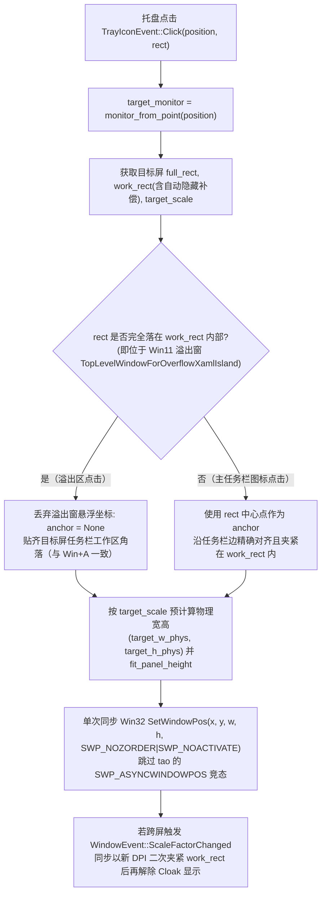

# Windows 顶级托盘应用与 Tauri v2 工程深潜报告（源码三层扒皮）

> **调研角色**：`tray-windows-tauri`（Windows 顶级托盘应用与 Tauri v2 工程深潜员）  
> **目标基线**：`MenuBarHome` Windows 端（`windows/src-tauri/` + `windows/src/`，锁文件实测版本 `tauri 2.12.4` / `wry 0.57.0` / `tao 0.37.1` / `tray-icon 0.25.1` / `webview2-com 0.39.1`）  
> **证据准则**：本文所有源码级结论均基于本地浅克隆源码与本机 Cargo 缓存源码逐行核验，严格标注 `repo/path#symbol (L行号)`，并显式区分「源码证实」与「分析推断 / 工程方案」。

---

## 一、执行摘要与 MenuBarHome 现状精准诊断

通过对 **7 个开源标杆仓库**（原生三杰 `EarTrumpet` / `twinkle-tray` / `FluentFlyout` + Tauri v2 实战与官方底层 `EcoPaste` / `clash-verge-rev` / `window-vibrancy` / `tauri-apps/plugins-workspace`）以及 **MenuBarHome 当前 `windows/` 与底层 `tauri/wry/tao/tray-icon` 源码** 的三层扒皮，得出核心判断：

**MenuBarHome 当前 Windows 端的基础工程素质已明显高于社区绝大多数 Tauri 托盘应用**（例如已自研纯整数物理像素排版引擎 `placement.rs`、实现了 EarTrumpet 风格的自动隐藏任务栏工作区补偿、构建了带空间+时间双因子的 `PanelVisibilityState` 失焦防二次点击状态机、实现了基于 `PowerRegisterSuspendResumeNotification` 的电源/熄屏事件通道与 Named Mutex 单实例转发）。

但对照 Windows 原生第一梯队与高星 Tauri v2 标杆，**当前仍存在 8 个隐蔽但直接影响口碑的源码级硬伤/缺口**：

| 序号 | 问题域 | MenuBarHome 现状（源码证实） | 真实用户体感缺陷 | 对标标杆与根治路径 |
| :--- | :--- | :--- | :--- | :--- |
| **1** | **多屏混合 DPI 漂移** | `window.rs#position_popover` (L746-790) 先读旧屏 `outer_size()` 算坐标，再异步 `set_position`（底层 `tao` 用 `SWP_ASYNCWINDOWPOS`） | 100% 屏 ↔ 150% 屏跨屏点托盘时，先按旧 DPI 定位再触发 `WM_DPICHANGED` 放大，右侧/底部截断出屏 | `EarTrumpet` / `FluentFlyout#MonitorUtil`：按目标屏 `scale_factor()` 预计算物理尺寸 + 单次同步 `SetWindowPos` + `ScaleFactorChanged` 二次夹紧 |
| **2** | **Win11 托盘折叠区悬空** | `main.rs#L365-380` 丢弃了 `TrayIconEvent::Click.rect`；`placement.rs#beside_icon_vertically` (L343) 直接在点击点 `y` 上方开窗 | 图标被折叠进 Win11 溢出区（`TopLevelWindowForOverflowXamlIsland`）时，点击后溢出窗消失，面板悬空在屏幕中间留 80–150px 断层 | `tray-icon 0.25.1` 已回传 `rect`：判定 `rect` 若落在 `work` 内部（非任务栏带）即视为溢出区点击，退回贴齐任务栏工作区角落 |
| **3** | **WebView2 后台常驻内存偏高** | `tauri.conf.json#L28` 设 `"backgroundThrottling": "disabled"`；`main` 与 `settings` 均无低内存目标/挂起/空闲销毁机制 | 常驻后台吃 120–180MB+ 内存且隐藏后不降频；开过一次设置窗若未销毁常驻双 WebView2 | `EcoPaste#WindowLifecycleManager` + `clash-verge-rev#lightweight` + `wry 0.57#set_memory_usage_level`：分级瘦身（Dormant 低内存态 + 设置窗空闲销毁 + 可选轻量模式） |
| **4** | **Alt+Tab / 任务栏泄漏 & 首帧闪烁** | 仅靠 `skipTaskbar: true`（源码证实 `tao#set_skip_taskbar` L1543 只调 `ITaskbarList::DeleteTab`，未设 `WS_EX_TOOLWINDOW`）；未用 `DWMWA_CLOAK` | 面板打开时污染 `Alt+Tab` / `Win+Tab`；`explorer.exe` 重启或久驻后面板可能冒出任务栏按钮；冷启偶现残帧 | `EarTrumpet#FlyoutWindow.Initialize` (L37) & `#Cloak` (L24)：加 `WS_EX_TOOLWINDOW` 去 `WS_EX_APPWINDOW`，配合 `DWMWA_CLOAK` 隐藏期屏蔽合成 |
| **5** | **Win11 材质与强调色脱节** | `panelPrefs.ts#L25` 仅用 CSS 半透明模拟（无真模糊）；`styles.css#L24` 硬编码 `--win-accent: #60cdff/#005fb8`；仅监听 `prefers-color-scheme` | 与 Win11 原生 `Win+A` 亚克力/云母质感明显割裂，不跟随系统强调色；自定义主题（深任务栏+浅应用）下托盘图标对比度失配 | `window-vibrancy` + `EarTrumpet#Themes.Manager` + `twinkle-tray#getAccentColors` + `FluentFlyout#WindowsThemeDetector` |
| **6** | **更新后托盘被系统重新折叠** | `main.rs#L333` 未给 `TrayIconBuilder` 设固定 `guid`（`NIF_GUID`）；`window.rs#return_focus_to_tray` (L338) 被迫穷举 `uID 1..=8` | 每次自动更新替换 EXE，Win11 忘记用户"始终显示在任务栏"的钉选偏好，重新塞回折叠区 | `tray-icon 0.25.1#apply_guid` (L638-650)：Release 安装版绑定固定 `NIF_GUID`，同时彻底消除 `uID` 猜测循环 |
| **7** | **失焦/二次点击与单实例聚焦暗坑** | `window.rs#L6` 容差 `TRAY_ICON_SLOP_PX = 36` 未随 DPI 缩放；`companion.rs#L407` 仅 Toast URL 调 `AllowSetForegroundWindow` | 4K 200% 屏容差缩水一半（仅 18 DIP）；二次启动 App（`/activate`）被 Windows 前台锁拦截只闪任务栏不聚焦 | 用 `TrayIconEvent.rect` 精确命中替代像素容差；所有 `/activate` 与 `open-url` 转发均先 `AllowSetForegroundWindow(pid)` |
| **8** | **开机自启与任务管理器失步** | `desktop_shell.rs#has_run_registry_entry` (L118) 只查 `HKCU\...\Run`，不查/不清理 `Explorer\StartupApproved\Run`，未传 `--autostart` | 用户在任务管理器禁用自启后，App 内仍显示「已开启」，反复开关也无法重新生效 | `EcoPaste#autostart/windows.rs` (L8-141)：同步读写 `StartupApproved\Run` + 传入 `--autostart` 静默参数区分手动二次启动 |

---

## 二、标杆项目源码三层扒皮（核心原理与技术证据）

> 本节按「表层交互体验 → 中层架构状态机 → 底层 Win32 / DWM / COM API」三层拆解已深读源码的 7 个标杆仓库 + 3 个 Tauri 运行时 crate，并附轻量常驻工具横向参照。

### 2.1 原生标杆 1：`File-New-Project/EarTrumpet`（Windows 托盘 Flyout 黄金标准）

`EarTrumpet` 是 Windows 社区公认最接近甚至超越系统原生 `Win+A` 手感的托盘面板（C# / WPF + 大量 Win32 P/Invoke）。

1. **任务栏四边检测 + 自动隐藏补偿（`WindowsTaskbar.cs` + `FlyoutWindow.xaml.cs`）**
   - **源码证实**：`EarTrumpet/Interop/Helpers/WindowsTaskbar.cs#WindowsTaskbar.Current` (L34-80) 先调用 `SHAppBarMessage(ABM_GETTASKBARPOS, ref appBarData)` 获取任务栏停靠边（`ABE_LEFT/TOP/RIGHT/BOTTOM`）与物理矩形；仅在 API 失败时降级用 `GetWindowRect(FindWindow("Shell_TrayWnd", null))` 与 `Screen.Bounds` 比对推断。同时以 `SHAppBarMessage(ABM_GETSTATE)` 检查 `ABS_AUTOHIDE`。
   - **关键补偿逻辑**：`EarTrumpet/UI/Views/FlyoutWindow.xaml.cs#PositionWindowRelativeToTaskbar` (L128-162) 指出自动隐藏任务栏开启时，`WorkingArea` 等于全屏 `Bounds`，因此仅当 `WorkingArea` 某条边"侵入"任务栏区域时才向内回缩，**绝不向外扩张覆盖其他已停靠的 AppBar**（MenuBarHome 的 `placement.rs#inset_work_area_for_autohide_taskbar` 已借鉴此思想）。
   - **Win11 间距与原子定位**：L169-203 在 Win11 上施加 `12 * this.DpiX()` / `12 * this.DpiY()` 的悬浮边距，适配 RTL `FlowDirection`，最后调用 `WindowExtensions.SetWindowPos`（`EarTrumpet/Extensions/WindowExtensions.cs#SetWindowPos` L12-15）：`User32.SetWindowPos(hwnd, 0, left, top, width, height, SWP_NOZORDER | SWP_NOACTIVATE)` 一次性原子更新坐标与宽高。

2. **零闪烁显隐与「从任务栏背后滑出」黑魔法（`DWMWA_CLOAK` + Z-Order 编排）**
   - **源码证实**：
     - `EarTrumpet/UI/Views/FlyoutWindow.xaml.cs#Initialize` (L32-40)：构造时 `Show(); Hide();` 预热 WPF 渲染树，随即 `this.ApplyExtendedWindowStyle(User32.WS_EX_TOOLWINDOW)` 彻底屏蔽 `Alt+Tab` 与任务栏按钮；`SourceInitialized` (L24-28) 立刻调用 `this.Cloak()`（`DwmSetWindowAttribute(hwnd, DWMWA_CLOAK, 1)`）与 `this.EnableRoundedCornersIfApplicable()`（`DWMWA_WINDOW_CORNER_PREFERENCE = DWMWCP_ROUND`）。
     - `EarTrumpet/UI/Helpers/WindowAnimationLibrary.cs#BeginFlyoutEntranceAnimation` (L16-122)：进场时**先设 `window.Topmost = false`、`window.Activate()`、再调用 `BringTaskbarToFront()`（`SetForegroundWindow(Shell_TrayWnd)`）**，将窗口临时压在任务栏下方，解除 `Cloak(false)` 后执行 `130ms QuinticEase EaseOut`（偏移 `25px`）+ `140ms` 淡入（`0.8 -> 1.0`），动画完成回调里再切回 `window.Topmost = true; window.Focus(); SetForegroundWindow(hwnd)`！这正是它看起来"像系统原生一样从任务栏边缘丝滑升起"的秘密。
     - `FlyoutWindow.xaml.cs#EnableAcrylicIfApplicable` (L206-218)：进入 `Closing_Stage1` / `Hidden` 时立即 `Cloak()` + `AccentPolicyLibrary.DisableAcrylic(this)`，防止隐藏态的透明窗口在桌面残留幽灵亚克力色块。

3. **六态状态机 + Win11 XAML 任务栏双击去重（`FlyoutViewModel.cs` + `ShellNotifyIcon.cs`）**
   - **源码证实**：
     - `EarTrumpet/UI/ViewModels/FlyoutViewModel.cs#ChangeState` (L235-274) 与 `_deBounceTimer` (L53-54)：严格验证状态流转 `NotLoaded -> Hidden -> Opening -> Open -> Closing_Stage1 -> Closing_Stage2 (300ms 冷却) -> Hidden`。`OnDeactivated` (L375-382) 在 `Opening` 期间直接忽略失焦；若在 `Opening` 中收到显式关闭则置 `_closedDuringOpen = true` 延迟到 `Open` 态执行。
     - `EarTrumpet/UI/Helpers/ShellNotifyIcon.cs#CallbackMsgWndProc` (L178-210)：注册 `NOTIFYICON_VERSION_4`（L139），明确注释 Windows 11 Build 22533+ 的 XAML Island 任务栏存在**一次点击触发双发 `NIN_SELECT` / `WM_LBUTTONUP`** 的系统 Bug，通过单次自重置布尔 `HasAlreadyProcessedButtonUp`（L60-73, L187-191）吞掉重复事件；同时原生处理 `NIN_KEYSELECT`（`Win+B` 键盘呼出）、Esc 关闭后调 `NIM_SETFOCUS` 还焦点给托盘（L87-95）、以及悬浮在 `Shell_NotifyIconGetRect` 内时挂 `WM_INPUT` 原始滚轮事件直接调节音量（L167-175, L238-266）！

4. **系统主题、强调色与动效开关实时跟随（`Themes/Manager.cs` + `SystemSettings.cs`）**
   - **源码证实**：`EarTrumpet/UI/Themes/Manager.cs#WndProc` (L77-105) 用一个隐藏 `Win32Window` 监听 `WM_DWMCOLORIZATIONCOLORCHANGED (0x320)`、`WM_DWMCOMPOSITIONCHANGED (0x31E)`、`WM_THEMECHANGED (0x31A)`、`WM_SETTINGCHANGE (0x1A)`（过滤 `"ImmersiveColorSet"` / `"WindowsThemeElement"` / `"WindowMetrics"`），经 `250ms` 防抖后统一广播刷新；`DataModel/SystemSettings.cs` (L10-18) 严格区分 `AppsUseLightTheme`（应用浅色）与 `SystemUsesLightTheme`（任务栏/系统壳浅色）、`EnableTransparency`、`ColorPrevalence`，且在 Win11 通过 WinRT `new UISettings().AnimationsEnabled` 读取全局动画偏好。

---

### 2.2 原生/Web 混合标杆 2：`xanderfrangos/twinkle-tray`（硬件滑块实时控制托盘神作）

`twinkle-tray` 用 Electron + React 控制真实外部硬件（显示器 DDC/CI & WMI 亮度/对比度/音量），与 MenuBarHome「Web 技术栈 + 控真实异步硬件（米家/HA 灯光亮度/色温/空调）」在工程问题上**高度同构**。

1. **硬件滑块「首帧立即响应 + 尾帧绝不丢失 + 队列覆写」三段节流（`src/electron.js`）**
   - **源码证实**：`twinkle-tray/src/electron.js#updateBrightnessThrottle` (L3220-3256) 与 `#flushBrightnessThrottle` (L3258-3270) 为每个 `(deviceId, vcpKey)` 维护独立槽位 `{ lastTime, pending, timeout }`：
     - **Leading（首帧零延迟）**：若无待发定时器且 `now >= lastTime + updateInterval`，立即下发硬件指令并更新 `lastTime`。
     - **Coalescing（拖动中覆写）**：节流窗口内新值直接覆盖 `state.pending`，绝不排队堆积。
     - **Trailing（松手必达）**：窗口到期由 `flushBrightnessThrottle` 刷出最后一次 `pending`，确保滑块最终停留位置与硬件 100% 一致。
   - **并发排他期的指令去重与代次校验**：`monitorsThread.send` (L265-282) 在全量设备刷新期间暂存写命令，若队列已有相同 `queuedCommandTarget`（L223-230）则直接**原地替换旧命令并 resolve 旧 Promise**，防止调用方挂死；刷新完成后校验 `command.generation !== monitorRefreshGeneration` (L206) 抛弃过时目标。
   - **滚轮微调体验**：`twinkle-tray/src/components/Slider.jsx#handleWheel` (L14-17) 支持光标悬停在滑块行直接滚动滚轮步进调节；`electron.js#L760-780` 支持悬停托盘图标直接滚轮调全局亮度并短暂暂停后台轮询（`pauseMonitorUpdates()`）避免 UI 抖动回弹。

2. **WebView/Chromium 内存压榨与悬停预热（`src/electron.js`）**
   - **源码证实**：
     - 进程启动参数（L68-73）：`--js-flags="--expose_gc --max-old-space-size=128"`、`--disable-http-cache`、`--wm-window-animations-disabled`；窗口配置（L3964-3985）：`backgroundThrottling: true`、`spellcheck: false`、`webgl: false`、`enableWebSQL: false`、`v8CacheOptions: "none"`。
     - **悬停预热（Eager Pre-refresh）**：`createTray` (L4777-4793) 监听 `tray.on('mouse-move')`（500ms 节流），当用户鼠标滑过托盘图标准备点击前，提前触发 `tryEagerUpdate(false)` 与 `sendToAllWindows('panel-unsleep')`，把网络/硬件查询延迟藏在用户点击前的 150–300ms 移动时间内！

3. **系统强调色 7 级色阶 + 区分任务栏浅深色图标 + 电源唤醒恢复**
   - **源码证实**：
     - `getAccentColors` (L2499-2531)：读取系统强调色后，用 HSL 亮度钳位 `[40%, 60%]` 保证对比度，派生 `accent / lighter / light / medium / mediumDark / dark / transparent` 7 级色阶注入 CSS 变量。
     - `getTrayIconPath` (L2490-2497)：明确依据 `lastTheme.SystemUsesLightTheme`（而非 `AppsUseLightTheme`）切换 `light/` 与 `dark/` 托盘图标。
     - `createPanel` (L4061-4151)：挂钩 `WM_DISPLAYCHANGE (0x7E)` 与 `WM_POWERBROADCAST (0x218)` 的 `GUID_SESSION_USER_PRESENCE`（`data === 2` 熄屏空闲时立刻取消待执行硬件操作，`data === 0` 唤醒时触发 `handleMetricsChange` 恢复设备状态）。
     - `repositionPanel` (L4299-4305)：兼容第三方任务栏修改器（如 Windhawk 单屏自动隐藏），直接比对 `bounds.height === workArea.height` 判断任务栏当前是否真占据空间。

---

### 2.3 Win11 美学标杆 3：`unchihugo/FluentFlyout`（Win11 Fluent / Mica / Acrylic 范式）

1. **主题联动亚克力与非抢焦置顶窗口（`WindowBlurHelper.cs` + `WindowHelper.cs`）**
   - **源码证实**：`FluentFlyoutWPF/Classes/WindowBlurHelper.cs#EnableBlur` (L21-59) 按当前深浅主题动态切换底色（Light `0xF3F3F3` / Dark `0x202020`）与透明度（默认 `175/255`，约 68%），调用 `SetWindowCompositionAttribute(WCA_ACCENT_POLICY, ACCENT_ENABLE_ACRYLICBLURBEHIND)`；隐藏/关闭时调用 `DisableBlur` 释放合成资源。
   - **全屏游戏防打扰与零抢焦**：`FluentFlyoutWPF/Classes/WindowHelper.cs#SetNoActivate` (L54-69) 施加 `WS_EX_NOACTIVATE`，`SetTopmost` / `SetVisibility` / `SetPosition` 全部带 `SWP_NOACTIVATE`；`VolumeMixerWindow.xaml.cs#ShowFlyout` (L65-66) 先通过 `FullscreenDetector.IsFullscreenApplicationRunning()` 检测全屏应用再决定是否弹出。
2. **自定义双模式主题探测 + 精准每屏 DPI 查询**
   - **源码证实**：`Classes/Utils/WindowsThemeDetector.cs#GetWindowsTheme` (L14-58) 明确指出很多框架 API 在 Windows「自定义主题（系统深色 + 应用浅色）」下返回错误值，必须分别直读注册表 `HKCU\Software\Microsoft\Windows\CurrentVersion\Themes\Personalize` 下的 `AppsUseLightTheme`（决定面板浅深）与 `SystemUsesLightTheme`（决定托盘图标黑白，见 `ThemeManager.cs#UpdateTrayIcon` L107-111）。
   - `Classes/Utils/MonitorUtil.cs#GetMonitorInfoInternal` (L33-64)：直接用 `GetMonitorInfo` + `GetDpiForMonitor(MDT_EFFECTIVE_DPI)` 逐屏独立换算 DIP，彻底绕开 WPF/框架跨屏 DPI 缓存失准。

---

### 2.4 Tauri v2 实战标杆 4：`EcoPasteHub/EcoPaste`（WebView2 声明式生命周期与 Windows 工程细节天花板）

`EcoPaste` 是目前中文社区工程完成度极高的 Tauri v2 托盘常驻标杆，其 `src-tauri/src/` 中多项设计几乎可直接平移到 MenuBarHome：

1. **多窗口分级生命周期与空闲自动销毁（`window/lifecycle/mod.rs` + `descriptor.rs`）**
   - **源码证实**：`EcoPaste/src-tauri/src/window/lifecycle/mod.rs` (L41-60, L235-272, L480-677) 与 `descriptor.rs` (L24-101) 构建了八态声明式管理器 `WindowLifecycleManager`：
     - **`RetainPolicy::Permanent`（主托盘弹窗）**：隐藏后进入 `HiddenWarm`，`5 秒`（`CLIPBOARD_DORMANT_SECS`）后若 `generation` 代次未变则进入 `Dormant`，向前端广播 `window://lifecycle` 暂停非必要渲染与定时刷新，兼顾**热窗瞬开**与低占用。
     - **`RetainPolicy::DestroyWhenIdle`（设置页/更新页/引导页/预览页等次级窗）**：隐藏后进入 `HiddenWarm`，空闲满 `60 秒`（`DEFAULT_IDLE_DESTROY_SECS`，可配 `5s..24h`）进入 `DestroyPending`，发 `window://before-destroy` 给前端 `500ms` 宽限期（支持 `dirty_owners` 未保存草稿阻断与带超时上限的 `KeepaliveLease` 保活租约），到期复核代次无误后落盘几何并调用 **`window.destroy()`**（绕过 `CloseRequested` 拦截彻底释放 WebView2 进程树）！再次打开时通过 `descriptor.build` 透明重建，且用 `PENDING_PREFERENCE_HIGHLIGHT`（`window/mod.rs` L37-38）解决重建异步丢失定位锚点的竞态。
2. **Windows 物理像素外部点击钩子与焦点保护（`window/windows.rs` + `mouse/windows.rs`）**
   - **源码证实**：`EcoPaste/src-tauri/src/mouse/windows.rs#hook_proc` (L65-128) 在弹窗可见时按需拉起独立消息泵线程安装 `WH_MOUSE_LL`，隐藏时 `PostThreadMessageW(tid, WM_QUIT)` 立即卸载（后台零钩子开销）；命中判定全程使用**纯物理像素**（`MSLLHOOKSTRUCT.pt` vs `outer_position/outer_size`），并特别注释避免逻辑像素 1px 舍入误判，且优先关浮层右键菜单而不连带关闭主窗。
   - `window/windows.rs#set_clipboard_window_editing` (L37-68)：默认 `set_focusable(false)` 零抢焦，仅输入框聚焦时暂升 `set_focusable(true)` 并保存/还原 `PRE_EDIT_FOREGROUND_HWND`。
3. **开机自启的 `StartupApproved` 坑治理 + 多实例静默启动过滤（`autostart/windows.rs` + `lib.rs`）**
   - **源码证实**：`EcoPaste/src-tauri/src/autostart/windows.rs` (L7-141) 完美处理了 Windows 自启三大暗坑：① 同时检查/清理 `HKCU` 与 `HKLM` 的 `Run` 键（防双启动项）；② 显式清理 `Explorer\StartupApproved\Run` 禁用标记；③ 注入 `AUTO_LAUNCH_ARG` 启动参数，配合 `lib.rs#L65-69` 在单实例回调里忽略自启重复拉起，避免登录时意外弹出设置窗。
4. **Release 日志卫生与 NSIS 安装体验（`lib.rs` + `tauri.windows.conf.json`）**
   - **源码证实**：`lib.rs` (L28-40) 仅在 `debug_assertions` 启用 `Stdout`/`Webview` 日志目标，注释直指 Windows Release 无控制台时 `Stdout` 缓冲区阻塞风险；`tauri.windows.conf.json` 配置 NSIS `installMode: "both"`（兼容用户级免 UAC 与机器级安装）、`displayLanguageSelector: true`、中英双语。

---

### 2.5 Tauri v2 实战标杆 5：`clash-verge-rev/clash-verge-rev`（轻量模式零 WebView2 常驻范式）

1. **轻量模式（Lightweight Mode）彻底回收 WebView2（`core/lightweight.rs` + `utils/window_manager.rs`）**
   - **源码证实**：`clash-verge-rev/src-tauri/src/core/lightweight.rs` (L17-266) 用 `AtomicU8` 三态 CAS 状态机（`Normal / In / Exiting`）+ `tokio::select!` 可取消定时器（默认隐藏后 10 分钟或静默自启时立刻触发），在 `entry_lightweight_mode` (L150-161) 中调用 `WindowManager::destroy_main_window()`（`window.destroy()`），让所有核心后台逻辑（代理、托盘菜单、快捷键、定时器）纯靠 Rust 运行，**WebView2 进程树完全归零**（实测常驻内存压至 ~15–25MB）；用户点击托盘时再走 `exit_lightweight_mode` 按需重建。
2. **重建 WebView2 零白屏闪烁技法（`utils/resolve/window.rs`）**
   - **源码证实**：`clash-verge-rev/src-tauri/src/utils/resolve/window.rs#build_new_window` (L47-119) 组合四步消除 WebView2 冷建白屏：① 建窗前用 `dark_light::detect()` 读系统主题；② `.background_color(DARK/LIGHT)` 预染 `CoreWebView2Controller2::DefaultBackgroundColor`；③ `.initialization_script(...)` 在首帧前把主题类与底色写入 DOM；④ `.visible(false)` + `.on_page_load(PageLoadEvent::Finished)` 完成后才 `window.show()`，同时 `.general_autofill_enabled(false)` 关闭无用浏览器服务。
3. **托盘防抖 + 前台窗口 Z-Order 破锁（`core/tray/mod.rs` + `utils/window_manager.rs`）**
   - **源码证实**：`core/tray/mod.rs` (L41, L448-454) 使用 `300ms` 限流器防双击误触；动态更新托盘菜单通过 `run_on_main_thread` + `oneshot` 保证线程安全；按运行态切换 3 套托盘图标（`Common`/`SysProxy`/`Tun`）。`utils/window_manager.rs#activate_window` (L217-225) 在 Windows 激活窗口后执行 `set_always_on_top(true)` → `set_always_on_top(false)` 突破前台锁；`core/autostart.rs` (L12-18) 展示管理员提权场景用计划任务 `schtasks` 替代 `HKCU\Run`。

---

### 2.6 Tauri 官方底座深潜：`window-vibrancy` / `plugins-workspace` / `wry 0.57` / `tao 0.37` / `tray-icon 0.25`

本轮直接核验了 MenuBarHome 锁文件实际链接的底层源码，揭开了 4 个社区极易踩坑的真相：

1. **`window-vibrancy/src/windows.rs` 的 Windows 版本分水岭与避坑**
   - **源码证实**：`window-vibrancy/src/windows.rs` (L62-161, L219-291)：
     - **Build ≥ 22523（Win11 22H2+）**：走官方 `DwmSetWindowAttribute(hwnd, DWMWA_SYSTEMBACKDROP_TYPE, ...)`: `DWMSBT_MAINWINDOW` (Mica)、`DWMSBT_TRANSIENTWINDOW` (Acrylic)、`DWMSBT_TABBEDWINDOW` (Mica Alt)，硬件合成流畅无拖动卡顿。
     - **Build 22000–22522（Win11 21H2）**：仅支持未公开 `DWMWA_MICA_EFFECT (1029)`；若调用旧版 `SetWindowCompositionAttribute(ACCENT_ENABLE_ACRYLICBLURBEHIND)`，crate 注释（`lib.rs` L87-92）明确警告 **Win10 1903+ 与 Win11 22000 拖动/缩放会严重卡顿**！且 SWCA 亚克力要求 `alpha >= 1`（`windows.rs` L233-236，`alpha == 0` 会失效）。
   - **与 MenuBarHome 双岛布局的冲突警告**：DWM `DWMWA_SYSTEMBACKDROP_TYPE` 涂满整个矩形 HWND（只受 `DWMWA_WINDOW_CORNER_PREFERENCE` 裁切），且要求无边框窗口开启 `DwmExtendFrameIntoClientArea(-1)`（Tauri 的 `shadow: true` 会自动处理，见 `tao` L249 `undecorated_with_shadows()`）。MenuBarHome 当前 `main` 窗口外圈有 `16px` 透明投影留白（`#app { padding: 16px }`）且 Fluent 主题含上下两岛 `10px` 透明缝隙，**不可直接对现有单 HWND 盲开 `apply_acrylic`/`apply_mica`**，必须按第四节方案做结构适配！

2. **为什么绝不能用 `tauri-plugin-positioner` 替代 MenuBarHome 现有的 `placement.rs`**
   - **源码证实**：`plugins-workspace/plugins/positioner/src/ext.rs` 存在 4 处硬伤：① L113 使用全屏 `monitor.size()` 而非 `work_area()`，无视任务栏与其他停靠条；② L191 读取移动前的 `window.outer_size()`，跨不同 DPI 屏幕必错位；③ L248 / L318 用 `if y < 0` 判断顶部溢出而非 `y < monitor_position.y`，副屏位于主屏上方（负坐标）或下方（正坐标）时完全失效；④ 无自动隐藏任务栏和溢出托盘处理。MenuBarHome 自研的 `placement.rs` 架构方向完全正确，只需补齐混合 DPI 与溢出区两处边界。

3. **MenuBarHome 已链接的 `tray-icon 0.25.1` / `wry 0.57.0` / `tao 0.37.1` 隐藏能力与暗坑**
   - **`tray-icon 0.25.1`**（`src/platform_impl/windows/mod.rs`）：
     - ✅ 已内置 `TaskbarCreated` (`S_U_TASKBAR_RESTART`, L53-54, L155, L371-381) 并调 `ChangeWindowMessageFilterEx(MSGFLT_ALLOW)`，Explorer 崩溃重启会自动恢复托盘图标；
     - ✅ 已支持 `NIF_GUID`（`apply_guid`, L638-650），固定 GUID 可让 Win11 记住"始终显示在任务栏"跨更新不丢失；
     - ✅ `TrayIconEvent::Click` 已回传 `rect`（`Shell_NotifyIconGetRect`, L412-415），可直接拿来做溢出区检测与精确命中；
     - ⚠️ 未设 `NOTIFYICON_VERSION_4`，不支持 `Win+B` 键盘 `NIN_KEYSELECT`（如需键盘无障碍呼出可依赖全局快捷键或后续上游补丁）。
   - **`wry 0.57.0`**（`src/webview2/mod.rs`）：
     - ✅ 已原生封装 `set_memory_usage_level(MemoryUsageLevel::Low)` → `ICoreWebView2_19::SetMemoryUsageTargetLevel(1)`（L1825-1834），且 `tauri 2.12.4` 通过 `window.with_webview(|wv| wv.controller())` 直接暴露 `ICoreWebView2Controller`（`tauri-2.12.4/src/webview/mod.rs` L184），零新增 crate 即可调 `ICoreWebView2_19::SetMemoryUsageTargetLevel` 与 `ICoreWebView2_3::TrySuspend`；
     - ✅ 支持 `ScrollBarStyle::FluentOverlay`（L344）原生 Win11 细覆盖滚动条与 `additional_browser_args`（L300-333）。
   - **`tao 0.37.1`**（`src/platform_impl/windows/window.rs`）：
     - ❌ `set_outer_position` 强制带 `SWP_ASYNCWINDOWPOS`（L212），`set_inner_size` 使用旧屏 `self.scale_factor()`（L238）——这是 Tauri v2 跨不同 DPI 屏幕移动弹窗漂移的直接根因；
     - ❌ `set_skip_taskbar(true)` 只调 `ITaskbarList::DeleteTab(hwnd)`（L1543-1552），**不加 `WS_EX_TOOLWINDOW`**——导致弹窗出现在 `Alt+Tab` 列表，且 `explorer.exe` 重启后任务栏按钮复活（`tray-icon` L130 与 `single-instance` L264 的官方注释均亲证此 Win32 现象）。

### 2.7 Windows 轻量化常驻工具生态横向参照（公开架构资料）

| 工具 | 技术栈 | 空闲常驻内存（公开社区实测区间） | 关键可借鉴模式 | 对 MenuBarHome 的启示 |
| :--- | :--- | :--- | :--- | :--- |
| **TrafficMonitor** | 纯 C++ Win32 | 10–30 MB | 无托管运行时、任务栏内嵌/悬浮窗低频采样 | 常驻状态机与后台轮询/推送应尽量留在 Rust 侧，而非绑定 WebView2 生命周期 |
| **QuickLook** | C++ 钩子 + C# WPF + 按需 WebView2 | 50–100 MB（空闲） | 后台仅驻留轻量触发器，WebView2/解码器按需创建、关闭即释放 | 次级重窗（设置/摄像机/诊断）务必 `DestroyWhenIdle`，用完即还内存 |
| **Flow Launcher** | C# WPF + 多语言插件 | 150–300 MB（插件热驻留） | 热驻留换取 <50ms 瞬开，但失控插件导致内存膨胀 | 主托盘面板追求瞬开可用热窗 + `MemoryUsageLevel::Low` 折中，不能放任插件无限驻留 |
| **PowerToys (Awake / Command Palette)** | C++ / C# / WinUI 3 多进程 Runner | 整套 500MB–1GB+；单模块 150–200MB | 统一 Runner 托管独立模块进程，但多进程 UI 开销大 | MenuBarHome 坚持单 Rust 宿主 + 单共享 WebView2 环境（严禁为每卡片/插件开新 WebView2） |

---

## 三、七大专项痛点深度攻关机制

### 3.1 多屏混合 DPI 精准锚定与 Win11 托盘折叠区（溢出托盘）根治

- **根治点 1（混合 DPI 不漂移）**：彻底杜绝在 `position_popover` 中用旧屏 `window.outer_size()` 参与目标屏定位；改由 Rust 记录当前期望的逻辑尺寸 `(logical_w, logical_h)`，乘以目标屏 `target_monitor.scale_factor()` 直接算出目标物理宽高，用同步 `SetWindowPos` 一次落地，并在 `WindowEvent::ScaleFactorChanged` 监听里对可见弹窗做兜底夹紧。
- **根治点 2（溢出托盘不悬空）**：Windows 11 22H2+ 将溢出区重构为 XAML Island（`TopLevelWindowForOverflowXamlIsland` + `DesktopWindowContentBridge`），它悬浮在工作区内部（`rect.bottom <= work.bottom()`）。用户点击其中图标瞬间，溢出窗会立刻关闭，若按 `rect.top - win_h` 锚定，面板会诡异地悬空在任务栏上方 100px 处。利用 `tray-icon` 已返回的 `rect`（配合判断 `rect` 中心是否在 `work` 内且远离任务栏边缘 > 4px），自动退回 `anchor = None` 贴齐任务栏角落，既自然又不依赖易变的 XAML 内部类名。

### 3.2 WebView2 后台常驻内存瘦身（三级渐进式架构）

| 级别 | 触发时机 | 底层机制 | 内存收益（工程估算，待实机压测校准） | 唤醒延迟 | 对 JS 定时器/自动化的影响 |
| :--- | :--- | :--- | :--- | :--- | :--- |
| **L1：热窗休眠态（Dormant）** | 主窗隐藏 5s 后 | ① `ICoreWebView2_19::SetMemoryUsageTargetLevel(LOW)`（WebView2 ≥ 114）；② 对主进程调用 `SetProcessWorkingSetSize(-1, -1)`；③ 移除 `tauri.conf.json` 的 `backgroundThrottling: "disabled"`（待 L3 解耦或改为条件控制）；④ `TrayIconEvent::Enter` 提前恢复 `NORMAL` | 隐藏态工作集显著回落（常见实测可降 35%–55%） | **< 20ms（瞬开）** | JS 定时器与 WebSocket **继续存活**（`LOW` 仅收缩缓存与工作集，不冻结 JS） |
| **L2：次级窗空闲销毁** | `settings` 窗关闭/隐藏 60s 后 | 复刻 `EcoPaste#WindowLifecycleManager`：`HiddenWarm -> DestroyPending (500ms) -> window.destroy()`，配 `generation` 防竞态与 `dirty_owners` 未保存表单保护 | 彻底回收第二 WebView2 实例（省 60–120MB） | 重开 `settings` 约 180–350ms（完全可接受） | 无影响（设置变更已落盘并同步主窗） |
| **L3：可选深度休眠 / 轻量模式** | 用户开启"极简后台"且无纯前端定时任务 / 隐藏超 10 分钟 | 方案 A：`ICoreWebView2_3::TrySuspend()` 冻结渲染进程（类似 Edge 睡眠标签页）；方案 B：`clash-verge-rev` 式 `window.destroy()` + `background_color` 预染防白屏重建 | 方案 A 降至 ~35–55MB；方案 B 降至 **~15–25MB（纯 Rust）** | 方案 A ~50–120ms；方案 B ~250–450ms | 须先将 `ScheduledCommand` 与核心 HA/米家后台轮询下沉至 Rust（`appLifecycle.ts` 现状定时器仍在前端，**不可盲目直接 `TrySuspend`**） |

> **关键风险提示（源码证实）**：MenuBarHome 当前 `windows/src/ui/appLifecycle.ts#startTimerLoop` (L1539-1600) 在 WebView2 前端运行定时任务（`processScheduledCommands`）、安全告警轮询（`tickSafetyHealthAndAutomation`）与设备后台刷新，这正是当初 `tauri.conf.json#L28` 设 `"backgroundThrottling": "disabled"` 的原因。因此 **L1（`SetMemoryUsageTargetLevel::Low`）+ L2（`settings` 窗 `DestroyWhenIdle`）+ 启动裁剪（禁拼写/自动填充/非必要浏览器特性）可立即安全上线**；而移除 `backgroundThrottling: "disabled"` 或启用 L3 `TrySuspend`/`destroy`，必须先将定时执行器下沉到 Rust `tokio` 运行时（或仅在无定时任务/未开事件自动化时动态挂起）！

### 3.3 无边框圆角与真 Win11 Mica / Acrylic 材质切换

MenuBarHome 当前有两套面板外观（`panelTheme.ts`）：**Classic（单圆角卡片 440px，圆角 22px）** 与 **Fluent（上下双岛 380px，圆角 12px，中间 10px 透明缝）**，且为了 CSS 投影在 `#app` 四周留了 `16px` 透明内边距。必须正视 Win32 DWM 的物理边界：

- **DWM 物理边界（源码与官方文档证实）**：`DWMWA_SYSTEMBACKDROP_TYPE`（Win11 22621+ `DWMSBT_TRANSIENTWINDOW` 亚克力 / `DWMSBT_MAINWINDOW` 云母）由桌面窗口管理器直接渲染在 **整个 HWND 客户端矩形** 上，仅按 `DWMWA_WINDOW_CORNER_PREFERENCE`（`DWMWCP_ROUND` 8px / `DWMWCP_ROUNDSMALL` 4px）倒角，**不会识别 CSS 的 `16px` padding 或双岛间 `10px` 缝隙**。如果直接对现有 `main` HWND 调用 `apply_acrylic`，会在面板外圈与双岛缝隙里糊出一整块毛玻璃方块。
- **精准落地双方案**：
  1. **立即可落地的原生 Mica（`settings` 独立设置窗口）**：`window.rs#open_settings_window` (L1075-1095) 是标准带标题栏窗口，将 `.transparent(true)` 配合 `DWMWA_USE_IMMERSIVE_DARK_MODE` + `DWMWA_SYSTEMBACKDROP_TYPE = DWMSBT_MAINWINDOW`（Build ≥ 22621 走 `window-vibrancy` / `windows-sys`），同时检查注册表 `EnableTransparency == 1`，立刻获得纯正 Win11 系统设置质感。
  2. **主托盘面板真 Acrylic（架构二选一）**：
     - **推荐方案（单面原生壳，适配 Classic 与单岛 Fluent）**：取消 `#app` 的 `16px` CSS 阴影外边距，启用 Tauri `shadow: true`（由 DWM 绘制原生零开销投影）+ `DWMWA_WINDOW_CORNER_PREFERENCE = DWMWCP_ROUND` + Win11 22621+ `DWMSBT_TRANSIENTWINDOW`（隐藏时置回 `DWMSBT_NONE` 防幽灵色块，遵循 EarTrumpet 铁律）；Fluent 顶部通知区改用内嵌分隔线或半透明内卡片而非透明镂空缝。
     - **保留物理双岛方案**：参考 `FluentFlyout`（`MainWindow` + `VolumeMixerWindow` 独立悬浮协同），将上岛（摘要/告警/摄像机）与下岛（设备网格）拆为两个联动 HWND（共享同一 WebView2 进程池），各自独立享有 `DWMSBT_TRANSIENTWINDOW` + `DWMWCP_ROUND` + 原生投影（工程复杂度较高，作为二期选项）。
  3. **Win10 / 低版本降级铁律**：绝不在 Win10 1903+ 或 Win11 22000 启用旧版 `SetWindowCompositionAttribute(ACCENT_ENABLE_ACRYLICBLURBEHIND)` 于可拖动窗口（`window-vibrancy` 源码证实会导致拖动严重掉帧），低版本或 `EnableTransparency == 0` 时平滑回退到现有高不透明度纯色表面。

### 3.4 失焦自动隐藏防托盘二次点击闪现（把 MenuBarHome 已有好设计打磨到极致）

MenuBarHome 在 `window.rs#PanelVisibilityState` (L35-168) 已建立比 `EarTrumpet` 纯 `300ms` 冷却更精细的「`FocusLossMark` + `TrayPressMark` 空间-时间状态机」，但源码审计发现 **3 处可补强的边界**：
1. **高分屏容差缩水**：`TRAY_ICON_SLOP_PX = 36`（L6）是固定物理像素，在 200%–250% DPI 4K 屏上仅折合 14–18 DIP，鼠标略微抖动即判定失效导致面板闪现重开。**修复**：`TrayIconEvent::Click` 已含 `rect`，直接判定 `focus_loss.cursor` 是否落在 `rect`（外扩 `8 * scale` 物理像素）内，彻底脱离硬编码像素。
2. **Win11 XAML 任务栏偶发双发 `WM_LBUTTONUP`**：如 `EarTrumpet/UI/Helpers/ShellNotifyIcon.cs` (L184-191) 实录，Win11 22533+ XAML 任务栏存在极短间隔（<30ms）双发抬起事件的系统缺陷；建议在 `decide_tray_release` 中对连续 `Present` 动作加 `50ms` 硬件抖动护栏，避免刚展示就被幽灵二次抬起关闭。
3. **打开态非抢焦/零闪烁细节**：补充 `DWMWA_CLOAK` 配合 `show()`/`hide()`（`EarTrumpet#Cloak`），在首次展示与切屏重定位完成前保持 Cloak，彻底杜绝半透明窗口在旧坐标一闪而过的视觉抖动；且为全局快捷键/提醒弹窗接入 `SHQueryUserNotificationState` 全屏独占检测（对标 `FluentFlyout#FullscreenDetector`），不打断全屏游戏或演示。

### 3.5 系统深浅主题、强调色与托盘图标实时联动

MenuBarHome 当前仅在前端用 `matchMedia("(prefers-color-scheme: light)")`（`app.ts` L2508）跟随应用深浅色，完全忽略了 Windows 特有的三项视觉变量：
1. **系统强调色实时注入**：通过已引入的 `windows` crate（`UI_ViewManagement` feature → `UISettings::GetColorValue`）读取 `Accent` / `AccentLight2` / `AccentLight3` / `AccentDark1`，动态下发并覆写 `--win-accent` / `--win-accent-hover` / `--win-accent-pressed`，自动按 WCAG 对比度决定 `--win-text-on-accent`（黑字或白字）。
2. **双注册表分离（应用主题 vs 任务栏主题）**：遵循 `EarTrumpet#SystemSettings` 与 `FluentFlyout#WindowsThemeDetector`，独立读取 `AppsUseLightTheme`（控制面板浅/深）与 `SystemUsesLightTheme`（控制托盘单色图标白/黑），解决 Windows 11 默认「深色任务栏 + 浅色应用」自定义组合下图标看不清的顽疾。
3. **零轮询变更监听**：用一个轻量隐藏 Win32 消息窗（类似 `EarTrumpet#Themes.Manager`）或注册表 `RegNotifyChangeKeyValue` 监听 `WM_DWMCOLORIZATIONCOLORCHANGED`、`WM_SETTINGCHANGE("ImmersiveColorSet")` 与 `Themes\Personalize` 变化，250ms 防抖后同步刷新托盘图标、DWM 暗色属性与前端 CSS 变量。

### 3.6 滑块实时控硬件的丝滑防抖与乐观锁协同

对比 `twinkle-tray` 的硬件控制管道，建议将 MenuBarHome 亮度/色温/窗帘开合等连续滑块升级为：
- **Per-Target Leading + Trailing 节流器**：按 `(deviceId, property)` 隔离槽位（120–180ms 窗口适配云端 RTT，局域网 HA 可缩短至 60–80ms），首帧即发、拖动中只保留最新值、松手必刷尾帧；
- **滚轮直调**：给 `.cc-liquid-slider` 增加 `wheel` 监听（单格步进 + `preventDefault` 防滚动容器抖动），桌面鼠标党不拖也能微调；
- **后台刷新避让期**：拖动滑块期间暂停对应设备的后台覆盖渲染，松手后保留短乐观保护窗（与现有 `optimisticLock.ts` 协同）防旧轮询数据回弹。

### 3.7 安装、开机自启、单实例聚焦与托盘右键菜单打磨

1. **固定 `NIF_GUID` 保托盘钉选**：在 Release 构建中为 `TrayIconBuilder` 设置固定 UUID（Dev 与 Release 使用不同 GUID 或仅 Release 启用，避免 Windows `NotifyIconSettings` 缓存开发目录 EXE 路径冲突），让用户的"始终显示在任务栏"偏好跨版本更新永久保留；同时 `return_focus_to_tray` 直接用该 GUID 调 `Shell_NotifyIconW(NIM_SETFOCUS)`，删掉 `1..=8` 猜测循环。
2. **开机自启闭环修复**：`desktop_shell.rs#get_launch_at_login` 同步检查 `Explorer\StartupApproved\Run` 字节首位（偶数为启用、奇数为任务管理器已禁用）；`set_launch_at_login(true)` 在写 `HKCU\...\Run` 时附加 `--autostart` 参数并删除 `StartupApproved` 中的禁用键值；`companion.rs` 对带 `--autostart` 的第二实例静默退出不弹窗（复刻 `EcoPaste#lib.rs` L67）。
3. **单实例激活聚焦修复**：`companion.rs#forward_to_primary_instance` (L406-413) 去掉 `startup_url.and_then(parse_toast_activation).is_some()` 限制，改为**只要 `endpoint.pid != 0` 且处于转发激活路径就调用 `AllowSetForegroundWindow(endpoint.pid)`**，解决桌面/开始菜单二次点击图标无法把面板带到前台的隐蔽问题。
4. **托盘右键菜单与滚动条质感**：
   - `main.rs#build_tray_menu` (L143-156) 升级为分组菜单（使用 `PredefinedMenuItem::separator`）：`打开/隐藏控制中心 (Alt+M)` | `常用场景` 子菜单（2–3 个置顶场景直达，无需开窗！） / `全部关闭…` | `外观与轻量模式`（`CheckMenuItem`） / `设置…` | `有新版本…` / `重启应用` / `退出 MenuBarHome`。
   - 启用 WebView2 原生 `ScrollBarStyle::FluentOverlay`（通过 `WebviewWindowBuilder` / `wry 0.57`），替代粗糙的自绘滚动条体验；NSIS 安装器补齐 `displayLanguageSelector: true` 与 `installMode: "both"`（兼容免管理员安装）。

---

## 四、可直接落地到 MenuBarHome `windows/` 的工程改进蓝图

以下蓝图按 **ROI 与架构依赖** 排定 P0 / P1 / P2 三阶段，全部精确映射到 `windows/` 现有模块与符号：

### 阶段 P0（高 ROI、低风险、立即可修的体验硬伤）

| 任务项 | 目标文件与符号 | 具体改动要点 | 验证方式 |
| :--- | :--- | :--- | :--- |
| **P0-1 混合 DPI 原子定位** | `windows/src-tauri/src/window.rs#position_popover`、`#set_panel_geometry`、`main.rs#setup` | 记录逻辑尺寸 `(logical_w, logical_h)`，按目标屏 `monitor.scale_factor()` 算物理尺寸，用同步 Win32 `SetWindowPos(hwnd, 0, x, y, w, h, SWP_NOZORDER \| SWP_NOACTIVATE)` 替代 `set_size` + `set_position` 分步异步调用；监听 `WindowEvent::ScaleFactorChanged` 对可见窗口二次夹紧 | 双屏 100%+150% 跨屏点托盘与切主题，验证零裁切零跳变 |
| **P0-2 Win11 溢出托盘锚定修复** | `windows/src-tauri/src/main.rs#L365-380`、`window.rs#position_popover`、`placement.rs#place` | `on_tray_icon_event` 透传 `TrayIconEvent::Click.rect`；新增纯函数 `is_overflow_tray_rect(work, rect, edge)`（若 `rect` 完全在 `work` 内且距任务栏边 > 4px 则判定为溢出窗），命中时传 `anchor = None` 贴齐工作区角 | 将图标拖入 Win11 `^` 溢出区后点击，验证面板紧贴任务栏角无悬空断层；补充 `placement.rs` 单测 |
| **P0-3 `WS_EX_TOOLWINDOW` + `DWMWA_CLOAK` + 单实例前台权** | `windows/src-tauri/src/window.rs`、`main.rs#setup`、`companion.rs#forward_to_primary_instance` (L407) | 启动时为 `main` HWND 加 `WS_EX_TOOLWINDOW` 去 `WS_EX_APPWINDOW`；冷启与隐藏时套 `DWMWA_CLOAK` 防闪帧；`companion.rs` 对所有转发路径统一调用 `AllowSetForegroundWindow(endpoint.pid)` | `Alt+Tab` / `Win+Tab` 不出现面板；重启 `explorer.exe` 不冒任务栏按钮；二次双击 EXE 立刻聚焦面板 |
| **P0-4 开机自启 `StartupApproved` 修复 & `NIF_GUID`** | `windows/src-tauri/src/desktop_shell.rs#has_run_registry_entry`、`#apply_run_registry_entry`、`main.rs#L333`、`window.rs#return_focus_to_tray` | 读写 `HKCU\...\Explorer\StartupApproved\Run` 并附 `--autostart` 参数；Release 版给 `TrayIconBuilder` 设固定 `with_guid(...)`；`return_focus_to_tray` 直用 GUID 告别 `1..=8` 探测；`TRAY_ICON_SLOP_PX` 改为 `rect` 命中检测 | 任务管理器禁用自启后验证设置页状态准确且重开即生效；覆盖安装新包验证托盘钉选保留 |

### 阶段 P1（Win11 原生美学升级与立即可用的 WebView2 内存瘦身）

| 任务项 | 目标文件与符号 | 具体改动要点 | 验证方式 |
| :--- | :--- | :--- | :--- |
| **P1-1 WebView2 L1+L2 内存瘦身** | `windows/src-tauri/src/window.rs`、`Cargo.toml`（无需新增大依赖，复用现有 `webview2-com` / `windows-sys`） | ① 主窗隐藏 5s 后进入 Dormant：通过 `with_webview` 调 `ICoreWebView2_19::SetMemoryUsageTargetLevel(LOW)` + `SetProcessWorkingSetSize(-1, -1)`；`TrayIconEvent::Enter` 或 `present` 时切回 `NORMAL`；② `settings` 窗引入 `EcoPaste` 式 `DestroyWhenIdle (60s)` 状态机（含 `generation` 与 `before-destroy` 保护）；③ 禁用 `general_autofill_enabled(false)` | 任务管理器实测隐藏 1 分钟后 WebView2 工作集降幅，及设置窗关闭 60s 后子进程彻底消失 |
| **P1-2 真 Win11 系统强调色 + 双主题托盘图标 + Mica 设置窗** | 新建 `windows/src-tauri/src/win_theme.rs`、`window.rs#open_settings_window`、`styles.css`、`app.ts` | ① `UISettings::GetColorValue` 读取系统强调色并下发 CSS 变量（覆写硬编码 `#60cdff/#005fb8`）；② 区分 `SystemUsesLightTheme` 切换深/浅托盘图标与 `AppsUseLightTheme` 切换面板浅深；③ `settings` 窗开启真 `DWMWA_SYSTEMBACKDROP_TYPE = DWMSBT_MAINWINDOW`（Mica）；④ 用隐藏消息窗监听 `WM_DWMCOLORIZATIONCOLORCHANGED` & `WM_SETTINGCHANGE` 250ms 防抖推送 | 实时修改 Win11 个性化主题/强调色/自定义混搭主题，验证面板强调色、设置窗 Mica 与托盘图标毫秒级同步 |
| **P1-3 主面板真 Acrylic 选项 & Fluent 滚动条** | `windows/src-tauri/tauri.conf.json`、`window.rs`、`styles.css` | 针对单面壳（Classic 及可选单岛 Fluent）去 16px 外投影留白，切为 `shadow: true` + `DWMWA_WINDOW_CORNER_PREFERENCE = DWMWCP_ROUND` + Win11 22621+ `DWMSBT_TRANSIENTWINDOW`（隐藏前清为 `DWMSBT_NONE`）；按 `EnableTransparency` 自动降级纯色；开启 `ScrollBarStyle::FluentOverlay` | Win11 23H2/24H2 与关闭透明效果模式下对比无黑边、无残影、拖动零卡顿 |
| **P1-4 滑块节流 + 悬停预热 + 右键菜单升级** | `windows/src/ui/liquidGlassSlider.ts`、`bindEvents.ts`、`main.rs#build_tray_menu` | 滑块补齐 per-target leading+trailing 节流与滚轮微调；`TrayIconEvent::Enter` 触发轻量预热刷新（5s 冷却，对标 `twinkle-tray#tryEagerUpdate`）；托盘右键菜单增加常用场景直达子菜单与分隔线分组 | 连续快拖亮度/色温滑块检查发包频率与最终落点 100% 一致 |

### 阶段 P2（中长期架构演进：逼近纯原生常驻水准）

1. **后台核心态下沉 Rust + 可选「极简常驻 / 轻量模式」（对标 `clash-verge-rev`）**
   - 将 `ScheduledCommand` 定时触发器与 HA WebSocket / 米家后台保活轮询逐步迁入 Rust `tokio`（`windows/src-tauri/src/` 已有 `home_assistant.rs` 骨架），解绑对前端 JS `startTimerLoop` 的强依赖。
   - 解绑后即可移除 `tauri.conf.json` 的 `"backgroundThrottling": "disabled"`，并为重视内存的用户提供可选「空闲 10 分钟进入极简后台」：调用 `ICoreWebView2_3::TrySuspend()` 或 `window.destroy()` + `background_color` 预染按需重建，将静默常驻内存压至 **15–30 MB** 级。
2. **原生键盘无障碍 + 全屏防打扰**
   - 在 `system_events.rs` 补充 `SHQueryUserNotificationState` 封装，供主动建议/告警弹窗避让全屏游戏与演示；跟踪 `tray-icon` 上游 `NOTIFYICON_VERSION_4` 支持以补全 `Win+B` 键盘呼出。

---

## 五、源码引用索引（核验清单）

- **MenuBarHome 基线**：`windows/src-tauri/tauri.conf.json`、`windows/src-tauri/Cargo.toml`、`windows/src-tauri/Cargo.lock`、`windows/src-tauri/src/main.rs`、`window.rs`、`placement.rs`、`desktop_shell.rs`、`companion.rs`、`system_events.rs`、`windows/src/ui/app.ts`、`appLifecycle.ts`、`panelTheme.ts`、`panelPrefs.ts`、`liquidGlassSlider.ts`、`styles.css`
- **EarTrumpet**：`EarTrumpet/Interop/Helpers/WindowsTaskbar.cs`、`UI/Views/FlyoutWindow.xaml.cs`、`UI/Helpers/ShellNotifyIcon.cs`、`UI/Helpers/WindowAnimationLibrary.cs`、`UI/ViewModels/FlyoutViewModel.cs`、`Extensions/WindowExtensions.cs`、`Interop/Helpers/AccentPolicyLibrary.cs`、`UI/Themes/Manager.cs`、`DataModel/SystemSettings.cs`、`Interop/Helpers/ImmersiveSystemColors.cs`
- **twinkle-tray**：`src/electron.js`（L2460-2565, L3190-3350, L3940-4165, L4235-4620, L4765-4920）、`src/components/Slider.jsx`
- **FluentFlyout**：`FluentFlyoutWPF/Classes/WindowBlurHelper.cs`、`WindowHelper.cs`、`ThemeManager.cs`、`Utils/WindowsThemeDetector.cs`、`Utils/MonitorUtil.cs`、`Windows/VolumeMixerWindow.xaml.cs`、`MainWindow.xaml.cs`
- **EcoPaste**：`src-tauri/src/window/lifecycle/mod.rs`、`window/lifecycle/descriptor.rs`、`window/mod.rs`、`window/windows.rs`、`window/position.rs`、`mouse/windows.rs`、`tray/mod.rs`、`autostart/windows.rs`、`lib.rs`、`tauri.conf.json`、`tauri.windows.conf.json`
- **clash-verge-rev**：`src-tauri/src/core/lightweight.rs`、`core/tray/mod.rs`、`core/autostart.rs`、`utils/window_manager.rs`、`utils/resolve/window.rs`
- **Tauri 官方插件与运行时源码**：`window-vibrancy/src/{lib,windows}.rs`、`plugins-workspace/plugins/{positioner/src/ext.rs, single-instance/src/platform_impl/windows.rs, autostart/src/lib.rs}`、`tray-icon-0.25.1/src/platform_impl/windows/mod.rs`、`wry-0.57.0/src/webview2/mod.rs`、`tao-0.37.1/src/platform_impl/windows/window.rs`、`tauri-2.12.4/src/{window,webview}/mod.rs`
