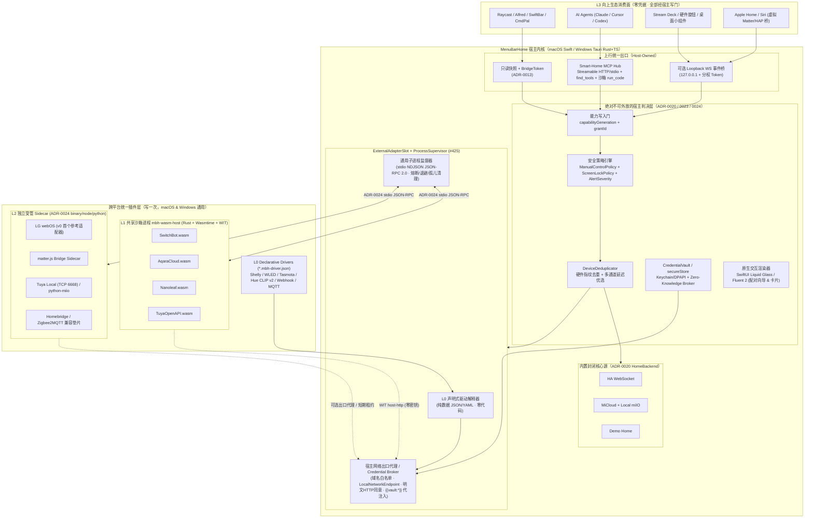
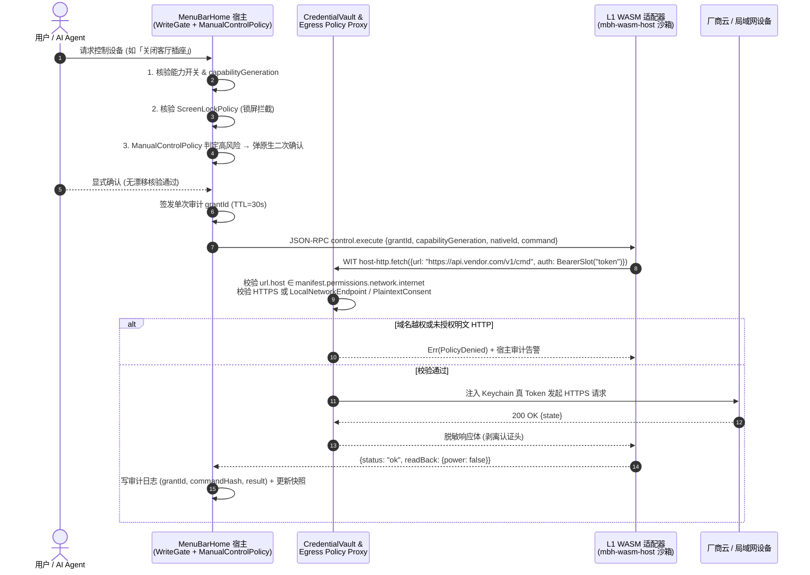

# MenuBarHome 插件化架构与 Magpie 思路深潜蓝图

> **角色**：插件化架构与 Magpie 思路深潜首席架构师（源码三层扒皮）  
> **调研日期**：2026-11-24  
> **本仓基线**：`<repo-root>`（含已合入的 `ADR-0020`、`ADR-0023`、`HomeAdapter.swift` #439、`ProcessSupervisor.swift` #425，以及今日 PR #452 合入的 `ADR-0024` Proposed 与 `Shared/adapterManifest.schema.json`）  
> **增量定位声明**：本仓昨日（2026-11-23）已沉淀 `docs/research/2026-11-23-deep-dive/` 中的 `02`（智能家居进程隔离）、`03`（数据驱动设备库）、`12`（Magpie 插件机制）、`13`（桌面扩展生态）四份基础调研。本报告**不重复已完结基线**，而是：① 彻底厘清「Magpie」三个同名体系并补齐 `yetone/magpie` 今日 HEAD 中尚未被昨日报告覆盖的 **MCP Router + 沙箱 `run_code`** 机制；② 补全昨日缺失的 **Zed（WASM + WIT）**、**Vicinae（开源原生 Raycast SDUI）**、**Blinue/MagpieFX**、**Antigravity Composite Bundle** 与 **HashiCorp `go-plugin` / Extism** 三层源码剖析；③ 直面 MenuBarHome **Swift + Tauri(Rust/TS) 双端平行维护** 与 **ADR-0024 §6.3 静态密钥透传缺口**，提出可落地且具前瞻性的 **L0–L3 分层混合插件内核与双向生态蓝图**。  
> **口径标注**：`【源码】` = 本轮直接克隆并核对行号的一手代码；`【本仓】` = MenuBarHome 仓库真实源码/ADR；`【检索】` = 权威公开文档/检索；`【推断】` = 架构推演与方案设计。

---

## 0. 执行摘要（直报结论）

1. **「Magpie 插件化」已 100% 实锤指向 `yetone/magpie`**（40.7k★，Go 菜单栏 AI 多模型聚合网关，非 Windows 超分工具 `Blinue/Magpie`，亦非 Antigravity 插件包；详见 §1 三者厘清表）。它之所以能在菜单栏形态下快速长出 **127+ 社区插件**，核心不在于「把 JS 塞进进程」，而在于三点：① **两套体系解耦**（官方模块化 `pluginrt` vs 第三方 OpenCode 插件）；② **事实与判决彻底分离**（插件只报设备/模型/登录/健康事实，路由/额度/回退/UI/安全全归宿主）；③ **极致的开发者与运维体验**（npm/GitHub/本地目录一键装、意图与 lockfile 分离、内容寻址缓存与回滚、向上聚合的 **MCP Router + 沙箱 Code Mode**）【源码：`yetone/magpie@851694a`】。
2. **不能直接照搬 Magpie 的 Bun 执行面，但可以「降维超越」它**：`yetone/magpie` 的 Bun 子进程插件享有完整宿主用户权限（官方明言 *"Bun plugins have host privileges; install trusted code"*），无网络白名单、无代码签名【源码：`yetone/magpie:internal/plugin/host.js:29-40`】。而 MenuBarHome 控制的是门锁、阀门、插座等**物理执行器**，且已立下 `ADR-0020` / `ADR-0023` / `ADR-0024` 铁律（宿主进程内零第三方代码、写入门/确认/锁屏/告警严重度/凭据永归宿主）。
3. **解决「macOS Swift vs Windows Rust/TS 双端重写适配器」+「ADR-0024 静态 API Key 泄露」的最优架构是【L0 声明式驱动 + L1 共享进程外 WASM/WIT 沙箱 + L2 ADR-0024 全功能 Sidecar + L3 双向智能家居内核】**：
   - **L0 声明式驱动包（纯 JSON/YAML，零代码）**：覆盖 60%–80% 的 HTTP/REST/MQTT/JSON-RPC 局域网设备（Shelly、WLED、Tasmota、Hue CLIP v2、Govee 等），双端仅维护薄解释器 + 黄金语料。
   - **L1 进程外统一 WASM/WIT 沙箱（突破性设计！）**：用一个独立的轻量 Rust 监督子进程 **`mbh-wasm-host`**（内嵌 Wasmtime + WIT，约 4–6 MB）同时服务 macOS Swift 与 Windows Tauri，经 ADR-0024 stdio JSON-RPC 与宿主通信。**一举解决三大死结**：① 不往 macOS Swift 主进程引入任何第三方运行时（严守 ADR-0003/0023）；② 双端运行**同一份 Wasmtime 引擎与同一份 `.wasm` 插件**，零运行环境依赖（无需用户装 Node/Python/Bun）；③ 借 Zed 的 **Host-Mediated HTTP + 凭据占位符代注入（`{{vault:api_key}}`）** 根治 ADR-0024 §6.3 的静态密钥外泄问题【推断】。
   - **L2 全功能进程外 Sidecar（延续 ADR-0024 v0 → v1）**：面向长连接/UDP/mDNS/BLE 或直接复用庞大外部生态（`matter.js`、`zigbee2mqtt`、`python-miio`、LG webOS、Homebridge 插件垫片）的适配器，由 `ProcessSupervisor` 监督并受 Ed25519 签名与出口代理约束。
   - **L3 向上双向生态中枢**：MenuBarHome 既是「向下装载多平台插件的宿主」，又是「向上提供统一安全门控的 **Smart-Home MCP Hub（含 Magpie 式沙箱 `run_code` 批编排）+ 虚拟 Matter/HAP 桥 + Raycast/CmdPal/Stream Deck 实时源**」。

---

## 1. 厘清「Magpie」：三大同名插件体系完整对照（杜绝张冠李戴）

社区与本机环境中存在三个与「Magpie」或当前工作宿主强相关的插件架构。经本轮 GitHub 检索（`gh search repos magpie --sort stars`）与本仓基线核验，三者定位与可借鉴资产严格区分如下：

| 维度 | A. **`yetone/magpie`**（40,734★）**<br>【用户真实所指 · 核心主标杆】** | B. **`Blinue/Magpie`**（16,561★）<br>【同名 Windows 超分神器 · 次级灵感】 | C. **Antigravity 插件束体系**<br>【当前 Agent 宿主生态 · 复合打包灵感】 |
| :--- | :--- | :--- | :--- |
| **源码/规范锚点** | `yetone/magpie@851694a`（2026-11-24）<br>`magpie-community/plugins`（127 插件） | `Blinue/Magpie@cf322e5`（2026-11-24）<br>`src/Magpie.Core/`、`docs/MagpieFX.md` | `~/.gemini/antigravity/builtin/skills/plugin/SKILL.md`、`agy-customizations/SKILL.md` |
| **产品形态** | 跨平台（macOS/Win/Linux）**菜单栏/托盘** AI 模型聚合与 MCP 路由网关（Go） | Windows 10/11 窗口实时超分与全屏缩放工具（C++/WinRT/D3D11/HLSL） | AI 编程代理客户端的命名空间扩展打包与市场体系 |
| **插件架构核心** | **双体系 + 三执行面 + 向上 MCP Hub**：<br>1. 内置 `pluginrt`（Go 编译期模块化、`Requires/Provides`、`InUse`、逆序 `OnDispose`）<br>2. 外部 OpenCode 插件：Bun 24-RPC 子进程 / 内嵌 `moejs` / 沙箱 `iframe`<br>3. 上行 MCP Router + `goja` 子进程 `run_code` | **声明式单文件 DSL + 三段解耦管线 + Profile 规则引擎**：<br>1. **MagpieFX v4**（`.hlsl` 内嵌 `//!MAGPIE EFFECT` / `//!PARAMETER` / `//!PASS` 元数据自动生成 UI 与 Shader DAG）<br>2. 捕获（`FrameSourceBase`）→ 特效（`EffectDrawer`）→ 呈现（`Presenter`）解耦<br>3. `Profile` 按 `(isPackaged, pathRule/AUMID, classNameRule)` 自动匹配规则 | **原子复合包 + 渐进式披露**：<br>1. `plugin.json` 打包 `skills/` + `rules/` + `agents/` + `hooks.json` + `mcp_config.json`，单开关原子启停<br>2. Progressive Disclosure（按需加载正文防上下文爆炸）<br>3. 宿主独占 `0600` 原子配置、`<plugin-card>` 市场卡片、目录名作稳定主键 |
| **安全隔离层级** | Bun 面**无沙箱**（同用户权限，靠审核与下架）；`iframe` 面强 CSP；`run_code` 独立进程 `goja` 零 I/O 沙箱 | HLSL 着色器仅运行于 GPU 管线，无法触及 OS 文件/网络；本地 `.hlsl` 编译缓存 | RPC 写状态收口在 Language Server，子进程禁止直接篡改 `config.json`；权限授权归宿主 |
| **对 MenuBarHome 的核心借鉴** | **核心骨架蓝本**：事实/判决分离、`AsyncLocalStorage` 账号作用域、流控 RPC、意图/锁文件/缓存分离、市场分级与下架、**MCP Hub + `run_code`** | ① **L0 声明式参数元注解**（`//!PARAMETER` 自动映射 UI 范围/步长）<br>② **上下文 Profile 规则匹配**（前台窗口/应用/专注模式 → 自动触发家居灯光/静音场景） | **Smart-Home Pack 复合包形态**：将「设备驱动 + `deviceProfiles` 覆盖 + 自然语言同义词 + 自动化蓝图 + MCP 描述」打包为单一原子开关单元 |

### 1.1 `yetone/magpie` 三层源码深潜增量发现（补全昨日 R12 盲区）

昨日 `12-magpie-plugin-model.md` 已详拆 `host.js`（Bun 24-RPC）与 `registry.json`。本轮直接核验 `yetone/magpie@851694a` 源码，额外挖出三处对 MenuBarHome 极具战略价值的设计：

1. **第一层（内置模块化 `pluginrt` 源码验证）**：
   - `internal/pluginrt/pluginrt.go:35-82` 定义 `Manifest`：`ID`、`API`（caret 范围 `"^1"`）、`Requires`/`Provides`（服务级 DAG 依赖，核心预置 `Core = ["settings","providers","gateway","window"]`）、`Essential`、**`InUse func() (int, error)`**（只要用户创建了依赖该能力的资源，或探查出错即保守视作 `InUse`，防止关闭开关导致后台规则变「幽灵」）、`Apply(*Ctx)`、`SetAt`（设置页深链定位）与 `Settings` 结构体反射 Schema（`SchemaOf`，支持 `title`/`description`/`enum`/`min`/`max`）。
   - `Runtime.Reconcile(on, config)`（`pluginrt.go:221-288`）采用**两阶段事务收敛**：先递归计算所有被关闭或依赖被关闭服务的插件，按应用顺序**严格逆序执行 `OnDispose`**（单个 disposer panic 仅记日志不阻塞后续清理）；再按字典序循环激活依赖就绪的插件，单个失败进入 `Failed` 状态并自动回滚其已注册服务。配合 `TestPluginsImportOnlyCore` 静态守卫保证「核心不 import 插件、插件间不互 import、仅通过 `Provide/Service` 通信」【源码：`yetone/magpie:internal/pluginrt/pluginrt.go:1-11,221-300`、`docs/subsystems/plugin-runtime.md:23-36`】。
   - **对照 MenuBarHome**：本仓 `ADR-0023` 已有 `Shared/capability-manifest.json` + `CapabilityReferenceEngine`，但在运行时缺少 `pluginrt` 的「逆序 `OnDispose` 自动资源回收」与「模块失败自回滚隔离」。
2. **第二层（Page/Panel/Action 槽位治理）**：
   - `internal/plugin/page.go:21-108` 将 UI 扩展严格拆为 `PageSpec`（独立页面，可替换白名单内置页 `Replaceable = ["sessions","library","routing","usage"]`）、`PanelSpec`（仅允许嵌入 `PanelSlots = ["agents","usage","settings","provider"]`，上限 8 个）和 `ActionSpec`（仅允许注入 `ActionMenus = ["provider","agent"]`，上限 8 个，且点击时**只透传行 ID 与名称，不透传任何敏感数据**）。权限枚举死锁为 `PageReads = ["usage:summary", "usage:day", "providers:list"]`（注释明确 *"None of them carries a secret"*）【源码：`yetone/magpie:internal/plugin/page.go:84-108`】。
3. **第三层（全新发现：MCP Router + 独立子进程沙箱 `run_code`）**：
   - `docs/subsystems/mcp-router.md:3-25` 揭示了 Magpie 的**向上生态杀手锏**：它把所有内置工具、插件工具与用户外部 MCP Server 聚合成**单一 Streamable HTTP 网关 `/mcp/magpie/hub/<agent>`**，并解决三大工程痛点：
     - **Tools on Demand（按需工具发现 + CJK 分词）**：工具总数 >10 时自动收敛为 `find_tools` + `call_tool`，内置中/日/韩无空格脚本边界切分与停用字剔除（解决「帮我截个图」「把书房灯调暖」等中文自然语言匹配失败），大幅节省 LLM 上下文【源码：`docs/subsystems/mcp-router.md:14`】。
     - **Code Mode（独立子进程零权限 `goja` 沙箱）**：`internal/coderun/helper.go:19-140` 通过自启动隐藏子命令 `magpie run-code-helper`，在**无文件、无网络、无进程、无环境变量、无 `require`/`import`** 的 `goja` 解释器中执行 AI 编写的 `async` 编排脚本；脚本内调用 `tools.<name>(args)` 时通过 stdin/stdout NDJSON 回调宿主，由宿主统一过权限/额度/日志门禁；并发上限 8、总调用上限 100、总超时 50s（+2s 强杀）、堆内存增长超 512MB 自动退出（exit 3）【源码：`internal/coderun/helper.go:58-140`、`docs/subsystems/mcp-router.md:15`】。
     - **调用方分层隔离（`HereOnly` / `Keyed` / `nativeHeld`）与防环头（`X-Magpie-Router`）**：远端调用或网页 Origin 永远无法触发本机敏感能力；有限权限 Key 无法触发本地可执行程序【源码：`docs/subsystems/mcp-router.md:20,25,47-48`】。

### 1.2 `Blinue/Magpie` 三层源码深潜（声明式 DSL 与上下文规则匹配）

- **第一层（架构定位）**：通过 `FrameSourceBase`（`GraphicsCapture` / `DesktopDuplication` / `DWM` / `GDI` 帧捕获抽象，`src/Magpie.Core/FrameSourceBase.h:20-52`）→ `EffectDrawer`（多 Pass 计算着色器链）→ `AdaptivePresenter` / `CompSwapchainPresenter`（合成呈现）实现完全解耦的图像处理流水线【源码】。
- **第二层（MagpieFX v4 声明式元注解 DSL）**：`src/Magpie.Core/EffectCompiler.cpp:17-200` 与 `docs/MagpieFX.md:3-137` 展示了一套极优雅的「单文件即插件」规范——以 `//!` 注释前缀声明版本（`//!VERSION 4`）、能力特性（`//!CAPABILITY FP16`）、**UI 自动绑定参数**（`//!PARAMETER` + `//!LABEL` + `//!DEFAULT` + `//!MIN` + `//!MAX` + `//!STEP`）、资源拓扑（`//!TEXTURE`、`//!PASS`、`//!IN`/`//!OUT`），宿主编译为字节码并经 `EffectCacheManager` 缓存。
- **第三层（`Profile` 规则匹配引擎）**：`src/Magpie/Profile.h:76-125` 与 `ProfileService.cpp` 按 `(isPackaged, pathRule/AUMID, classNameRule)` 将前台窗口精准绑定到整套缩放/帧率/光标策略【源码】。
- **对 MenuBarHome 的独特启发**：菜单栏/托盘智能家居天然具备「桌面上下文感知」优势！完全可以设计一套 **Magpie-Style 桌面情境 Profile 插件规则**（按前台应用/窗口类名/摄像头麦克风占用/专注模式自动匹配家居灯光、补光灯、门外提示灯与静音策略），并用 `//!PARAMETER` 式强约束元信息统一渲染参数滑块。

---

## 2. 业界顶级跨平台插件体系源码三层扒皮

为补齐本仓昨日调研（偏重 Homebridge/ioBroker/HA/Scrypted）的盲区，本轮重点扒皮四个代表「现代桌面插件最高工程水准」的代码库：

### 2.1 Zed Extensions（`zed-industries/zed@168964e`）：WASM + WIT 能力沙箱标杆

| 层级 | 核心机制与一手源码证据 |
| :--- | :--- |
| **第一层：打包与分发** | 每个扩展由 `extension.toml`（`ExtensionManifest`，声明 `id`/`version`/`schema_version`/`capabilities`/`language_servers`/`context_servers` 等）+ 单个跨平台 `extension.wasm` 组成；用户端**零运行时依赖**，一次编译横跨 macOS ARM64/x86_64、Windows 与 Linux【源码：`crates/extension/src/extension_manifest.rs:88-127`、`crates/extension_host/src/wasm_host.rs:858-881`】。 |
| **第二层：强类型 WIT 契约与多版本共存** | 使用 WebAssembly Component Model（WIT），通过 `wasmtime::component::bindgen!` 自动生成异步宿主/客体绑定。最惊艳的是其 **10 代 ABI 并行兼容架构**（`wit/since_v0.0.1` 至 `since_v0.8.0`）：加载前先用 `wasmparser` 扫描整个字节流的自定义段 `zed:api-version`（6 字节大端 `u16×3`，防止畸形字节码触发 Wasmtime panic），按版本路由至对应 Linker【源码：`crates/extension_host/src/wasm_host.rs:659-665,818-855`、`crates/extension_host/src/wasm_host/wit/since_v0_8_0.rs:35-73`】。 |
| **第三层：真能力沙箱与双重门禁** | 1. **文件系统铁笼**：`build_wasi_ctx` 仅 `preopened_dir` 扩展专属 `work_dir`；所有宿主代写路径必须经过 `writeable_path_from_extension` 做词法归一化 + 最近存在祖先符号链接 `canonicalize` + `starts_with(&extension_work_dir)` 校验，彻底堵死 `../` 与符号链接逃逸【源码：`wasm_host.rs:741-815`】。<br>2. **防死循环抢占**：开启 Wasmtime **Epoch Interruption**（`store.set_epoch_deadline(1)` + `epoch_deadline_async_yield_and_update(1)`），即使恶意插件写 `loop {}` 也不会锁死宿主事件循环【源码：`wasm_host.rs:684-686`】。<br>3. **宿主中介 HTTP 与流式句柄**：插件没有原生 TCP/UDP Socket，所有网络请求必须调用 WIT `http-client::fetch` / `fetch-stream`（流对象以不透明 `Resource<ExtensionHttpResponseStream>` 存于宿主 `ResourceTable`，按 8KB 块拉取），完全受宿主 `http_client` 代理、重定向策略与审计控制【源码：`wit/since_v0.8.0/http-client.wit:1-67`、`wit/since_v0_8_0.rs:640-755`】。<br>4. **双重能力授权（`CapabilityGranter`）**：敏感能力（`process:exec`、`download_file`、`npm:install`）同时校验 **Manifest 静态声明**（`self.manifest.allow_exec`）与 **宿主策略授权表**（`self.granted_capabilities`），缺一即 `bail!` 拒绝【源码：`crates/extension/src/capabilities.rs:14-20`、`crates/extension_host/src/capability_granter.rs:23-84`、`wit/since_v0_8_0.rs:899-918`】。 |

> **对 MenuBarHome 的致命启发**：Zed 证明了 **「宿主中介 HTTP（Host-Mediated HTTP）+ 能力门禁」** 是解决插件网络越权与凭据隔离的终极武器。如果 MenuBarHome 让 L1 WASM 适配器只能通过宿主 WIT `host-http` 发起网络请求，宿主便可在发包瞬间：① 强制校验目标域名是否在 `permissions.network.internet` 白名单或 `LocalNetworkEndpoint` 合法局域网段内；② 强制执行 `HAPlaintextConsent`；③ **直接在 HTTP Header / Query / Body 模板中代填 Keychain 凭据或代做 HMAC 签名**，插件进程从头到尾**永远摸不到用户的真实 API Key / Token**！【推断】

### 2.2 Vicinae（`vicinaehq/vicinae@e1cdf59`）& Raycast & Stream Deck SDK：原生 SDUI 与极致 DX

| 体系 | 三层核心机制与一手源码证据 | 对 MenuBarHome 的启示 |
| :--- | :--- | :--- |
| **Vicinae**（开源 C++/Qt Raycast 兼容宿主） | 1. **预热进程池消除冷启动**：`figura/manager-extension.fig:1-58` 明确注释 *"the worker is already provisioned but waiting for the manager to initialize it with extension info (to avoid cold starts)"*，由 Manager 通过 `Lifecycle.launch(LaunchEventData)` 投递模式（`View`/`NoView`/`Tool`）、偏好、能力位与工作目录【源码】。<br>2. **声明式原生 SDUI（零 WebView！）**：扩展侧运行 TypeScript + 自定义 React Reconciler，将组件树序列化为 JSON 调用 `service UI { fn render(json: string); fn showToast(...); fn confirmAlert(ConfirmAlertPayload); }`，由 C++/Qt 原生渲染列表/表单/详情与带 `Destructive` 样式的原生确认框【源码：`figura/tsapi.fig:110-132,76-92`】。<br>3. **精细系统服务分权**：`Application`、`WindowManagement`、`Clipboard(concealed: bool)`、`Storage`、`FileSearch` 全部以强类型 IDL 暴露，避免插件越界调用 OS API【源码：`figura/tsapi.fig:1-250`】。 | **不开放 HTML/WebView，也能拥有丰富配对/配置向导！** MenuBarHome 严禁插件内嵌 WebView（ADR-0024 §9.4），但可借鉴 Vicinae `UI.render` + HA `ConfigFlow` 状态机：适配器仅返回受限的**配置步骤 JSON**（表单/二维码/按键等待提示/设备多选列表），由 macOS SwiftUI Liquid Glass 与 Windows Fluent 2 各自渲染 100% 原生弹窗！ |
| **Raycast Extensions** | 单一受托管 Node 子进程 + 每扩展独立 **V8 Isolate** 内存隔离；`package.json` 一体化声明 `preferences`（含 `password` 加密项）、`view`/`no-view`/`menu-bar`、`ai.tools`、`ai.skills`、`ai.mcp`；官方 Store 强制 `package-lock.json`、截图与 `ray lint`【本仓：`docs/research/2026-11-23-deep-dive/13-desktop-extension-ecosystems.md:38-52`】。 | **开发者体验（DX）标杆**：一份 `menubarhome-plugin.json` 同时声明平台能力、配置项、AI 工具语义与本地化文案；提供 `mbh plugin dev` 热重载 + 脱敏回放夹具测试，降低社区适配门槛。 |
| **Elgato Stream Deck SDK**（`elgatosf/streamdeck@650a5df`） | 语言无关的本地 `ws://127.0.0.1:<port>` 进程外隔离 + `.sdPlugin` 自包含包 + CLI 脚手架（`create`/`dev`/`link`/`validate`/`pack`/`restart`）【源码：`packages/cli/src/commands/*`】；前端 Property Inspector 与后台逻辑分离。 | CLI 工具链极佳（`mbh-adapter init / validate / replay / pack / sign`），且其本地 WS 长连接模型正是 MenuBarHome 未来 L3 硬件控制面（旋钮调光、按键实时亮灭）的理想参考。 |

### 2.3 进程外 Sidecar 协议家族（Homebridge Child Bridge / HashiCorp `go-plugin` / LSP / MCP）

| 维度 | `yetone/magpie` Bun Host | Homebridge Child Bridge (`@bd22b19`) | HashiCorp `go-plugin` | MenuBarHome `ADR-0024` v0 |
| :--- | :--- | :--- | :--- | :--- |
| **传输与帧** | stdio NDJSON + `credit` 512KB 流控窗口 + `abort` | Node IPC (`READY/LOAD/START/ONLINE/PORT_REQUEST`) | gRPC over UDS / Named Pipe + Protobuf + mTLS | stdio NDJSON JSON-RPC 2.0（单帧上限 8MiB，`stderr` 脱敏日志） |
| **进程模型** | 所有 Bun 插件共享 1 个子进程（RSS >512MB 平滑换新） | 按桥 1 进程（`child_process.fork`）；父进程集中分配外部端口防冲突 | 每 Provider 1 独立二进制进程（如 Terraform Provider） | 每适配器 1 独立受管子进程，复用 `ProcessSupervisor`（#425） |
| **熔断与自愈** | 连续崩溃回退上一版 Bun；单插件加载 20s 局部失败 | 5min 稳定复位；`maxRestarts=4` 熔断；`10s*n` 退避 | 健康检查 + 主进程退出自动回收子进程 | 120s 内 5 次失败熔断；`min(jitter(1s*2^n), 60s)` 退避；300s 稳定复位；PID+Path+StartTime+UID 防误杀 |
| **多语言生态兼容** | 绑定 JS/TS（兼容 OpenCode & Pi 包） | 绑定 Node.js | 任意支持 gRPC 语言，但须多架构原生编译分发 | 语言无关（`binary`/`node`/`python`），可直接封装 `matter.js` / `python-miio` / `tuya` |
| **短板** | 共享进程内无安全隔离；无代码签名 | 依赖 Node 环境；无网络出口沙箱 | Protobuf+gRPC 对轻量桌面 App 依赖偏重；跨架构二进制签名维护成本高 | v0 仅只读；静态 API Key 仍需经 stdin 明文注入子进程（§6.3 已承认该取舍） |

### 2.4 声明式驱动层（`zigbee-herdsman-converters@ed29f80` + `zwave-js` + MenuBarHome `ADR-0011`）

- **`zigbee-herdsman-converters`**：通过 `modernExtend`（能力片段组合）+ 13 种封闭 `exposes` 联合类型 + 344 张 `tuyaDatapoints` `[dpId, prop, namedConverter]` 映射表 + 全语料不变量测试（`checks.test.ts`），支撑了 **559 个厂商、5,332 个型号**；且同一份 `exposes` 同时驱动 Web UI 与 Home Assistant Discovery（**一份声明、多端投影**）【源码 + 本仓 `03-data-driven-device-definitions.md:21-90`】。
- **`zwave-js`**：用纯 JSON + `$import` 继承 + 仅 4 个变量、无任意求值的 `$if` 迷你条件 DSL 覆盖 **2,409 份设备文件 / 18,373 个参数**，证明「极简无副作用 JSON DSL」完全可以在双端零风险解释执行。
- **MenuBarHome 现状**：已有双端逐字节一致的 `deviceProfiles.json`（281 行）与 `fallbackSpecs.json`（729 行），以及 `Shared/deviceLabels.json` / `Shared/deviceClaims.json`【本仓：`docs/feature-map.md:8`】。但目前只服务于 MIoT/HA，**尚未扩展为跨协议的 L0 通用声明式平台驱动引擎**（如直接描述任意 REST/HTTP/MQTT/Webhook 局域网设备）！

---

## 3. 核心难题破局：Swift + Tauri(Rust/TS) 双端如何「一次适配、双端通用」？

MenuBarHome 最大的工程制约写在 `ADR-0006`：**macOS 核心是纯 Swift (`MijiaCore`)，Windows 核心是 Rust (`src-tauri`) + TypeScript (`windows/src/core`)**。如果每接入一个新家居平台（Philips Hue、Aqara、Tuya Local、SwitchBot、Yeelight、Shelly、Matter、Govee、Tesla 等），都要在 Swift 和 TS 各写一套协议栈、状态机、登录流与单测，双端漂移（如历史上电视卡片认领差异 `#442`）将呈指数级恶化。

### 3.1 四种跨端插件执行路线深度对比

| 评估维度 | 路线 A：**声明式配置驱动（L0 Spec-Driven）** | 路线 B：**宿主内嵌 JS 引擎（JSC / QuickJS / V8）** | 路线 C：**WASM / WASI / WIT 沙箱（经共享进程外 `mbh-wasm-host`）** | 路线 D：**全进程外 JSON-RPC / MCP Sidecar（ADR-0024）** |
| :--- | :--- | :--- | :--- | :--- |
| **双端共享率** | **100%**（一份 JSON/YAML 双端共读，薄解释器各自 ~500 行 + 黄金语料锁定） | ~85%（插件 JS 共享，但 macOS `JavaScriptCore` vs Win `rquickjs`/WebView2 宿主绑定 API、定时/网络行为易漂移） | **99%**（单份 `.wasm` 双端通用，且**共用同一个 Rust `mbh-wasm-host` 二进制**，彻底消除双端引擎差异！） | **95%**（协议 100% 共享；但 `binary` 需编 4 架构，`node`/`python` 依赖用户环境或随包分发运行时） |
| **合规性（ADR-0003/0020/0023）** | ✅ 完全合规（纯数据，无第三方代码执行） | ❌ **严重冲突**（第三方代码进入 Swift/Rust 主进程，冲击公证签名与内存安全） | ✅ **完全合规**（`mbh-wasm-host` 跑在**独立子进程**，Swift 主进程零第三方代码、零 C-FFI 依赖！） | ✅ 完全合规（ADR-0024 原生路线） |
| **安全沙箱强度** | ⭐⭐⭐⭐⭐ 最高（图灵不完备，零任意代码，全走宿主网络/凭据层） | ⭐⭐ 弱（JSC/QuickJS 同进程，易受引擎漏洞/OOM/死循环拖垮主 App） | ⭐⭐⭐⭐⭐ **极高（双重防御）**：WASM 线性内存 + WASI 零目录越界 + Epoch 防死循环 + **宿主代发 HTTP/代注密钥** + OS 子进程崩溃隔离 | ⭐⭐⭐ 中（OS 崩溃隔离强，但子进程默认继承用户 FS/网络权限，需额外 OS 沙箱或出口代理；静态密钥可见） |
| **包体与空闲内存开销** | 几乎为 0（<50 KB） | macOS 0 MB（系统自带 JSC）；Win +2–4 MB（QuickJS） | `mbh-wasm-host` 按需下载或内置 ~4–6 MB；多插件共享 1 进程，空闲 ~8–15 MB；单插件 `.wasm` 仅 50–400 KB | 原生二进制轻（5–15 MB/进程）；Node/Bun/Python 每进程常驻 30–80 MB，多插件叠加内存高 |
| **协议表达力边界** | 仅覆盖无状态/简单状态 HTTP REST、JSON-RPC、Webhook、MQTT 模板 | 覆盖 HTTP/WS/复杂加密计算；难以直接跑原生 UDP/mDNS/BLE/C++ SDK | 覆盖 90% 云端 API、复杂签名（HMAC/AES/RC4）、OAuth、局域网 HTTP/SSE/WS；**不擅长**原始 UDP 组播、BLE、长生命周期 `matter.js` | **100% 全能**：UDP 54321、mDNS/SSDP、BLE、TCP 长连（Tuya 6668）、`matter.js`、`python-miio`、`zigbee2mqtt`、RTSP |
| **插件开发者门槛（DX）** | 极低（甚至可由 AI 根据厂商文档秒生成） | 极低（JS/TS 直接写） | 中低（Rust / Go / AssemblyScript / TypeScript via Javy / ComponentizeJS 编成 `.wasm`） | 低（可用 Python/Node/Go/Rust 任意已有开源库快速套壳） |

### 3.2 为什么「进程外共享 `mbh-wasm-host`」是 MenuBarHome 的架构神来之笔？

昨日 `12-magpie-plugin-model.md §11 #3` 曾认为 WASM 会冲突 ADR-0023（因为把 Wasmtime 嵌进 Swift 主进程违背「进程内零第三方代码」且带来繁重的 Swift C-FFI 与包体负担；实测纯 Swift 的 `WasmKit` 虽无需 JIT，但目前对 WASI Preview 2 / Component Model WIT 支持尚不完整【检索：`swiftwasm/WasmKit`】）。

**但只要换一个维度思考——把 Wasmtime 放到进程外！**
MenuBarHome Windows 端本就有成熟 Rust 工具链（`windows/src-tauri`），macOS 端已有 `ProcessSupervisor.swift` 与 `ADR-0024` stdio JSON-RPC 2.0 协议！我们可以用一个独立的极简 Rust CLI 工程（`tools/mbh-wasm-host/`，跨平台编出 `darwin-arm64`/`darwin-x86_64`/`win-x64`/`win-arm64` 四个按需下载或随包组件）：
1. **对外形态**：在 macOS Swift 和 Windows Tauri 眼里，`mbh-wasm-host` 就是一个标准的 **ADR-0024 进程外子进程**，共用同一套 `ProcessSupervisor` 熔断、心跳、退避重启与孤儿清理！
2. **对内形态**：`mbh-wasm-host` 内部用 **Wasmtime + WIT（仿 Zed `WasmHost`）** 装载多个轻量的 `.wasm` 平台插件，并由宿主通过 **Zero-Knowledge Credential Broker** 拦截所有 `host-http` 请求完成域名白名单校验、局域网安全校验与密钥代注入！
3. **收益最大化**：
   - **零双端重复**：macOS 与 Windows 共享同一个 Rust 沙箱运行时与同一份 `.wasm` 插件；
   - **零进程内污染**：macOS `MijiaCore` 保持 100% 纯 `Foundation`（ADR-0003）与进程内零三方代码（ADR-0023）；
   - **零内存爆炸**：10 个小平台插件（Hue、Shelly、SwitchBot、Nanoleaf、Govee、Yeelight、特斯拉、电价等）共享一个 `mbh-wasm-host` 进程（各自独立 Wasmtime `Store` 内存墙 + Epoch CPU 隔离），总常驻内存仅 ~15–25 MB，远低于拉起 10 个 Node/Python 进程（>400 MB）！

---

## 4. MenuBarHome 四层混合插件架构总蓝图（L0 / L1 / L2 + L3 双向中枢）

### 4.1 整体架构图（Mermaid）



### 4.2 四层职责边界与选型分流准则

| 层级 | 插件格式与执行载体 | 适用平台/场景举例 | 凭据模型 | 能否写控制 | 与既有 ADR 关系 |
| :--- | :--- | :--- | :--- | :--- | :--- |
| **内置核心** | Swift + TS 原生编译（`HomeBackend` 封闭三值） | Home Assistant、米家云+局域网 miIO、Demo | 宿主 `CredentialVault` 直用 | 是（全功能） | 完全遵循 ADR-0020 / 0023 |
| **L0 声明式驱动** | `*.mbh-driver.json`（纯数据模板 + 受限转换器字典，无脚本） | Shelly Gen2 RPC、WLED JSON、Tasmota HTTP、Hue CLIP v2、Govee HTTP、NAS/UPS REST、自定义 Webhook | **Zero-Knowledge**：模板写 `{{vault:token}}`，宿主发请求时代填，零代码接触凭据 | v1 起经宿主写入门受控支持 | 零冲突（ADR-0011 `deviceProfiles.json` 理念自然延伸） |
| **L1 WASM/WIT 沙箱** | 单文件 `*.wasm`（Rust/Go/TS 编译）跑在共享进程外 `mbh-wasm-host` | SwitchBot、Aqara API、Yeelight HTTP/SSE、Nanoleaf、Sonoff Cloud、Tesla/EV、家庭电价/空气质量 | **Zero-Knowledge**：WIT `host-http` 拦截并代注 `{{vault:*}}` 或代做 `host-crypto::hmac_with_secret` | 阶段 2（v1）起经 `grantId` 写入门支持 | 零冲突（进程外子进程承载，完全满足 ADR-0023 零进程内三方代码） |
| **L2 全功能 Sidecar** | 独立 OS 子进程（`binary` / `node` / `python`），走 ADR-0024 stdio JSON-RPC | **首个参考：LG webOS**；进阶：`matter.js`、Tuya Local TCP 6668、Aqara LANLink UDP、`zigbee2mqtt` 桥、Homebridge 垫片 | 优先上游强制过期短期租约（`oauthAccess`/`lanToken`）；静态密钥走宿主出口代理或 `writeOnly` 诚实隔离 | 阶段 1 只读（v0）；阶段 2 可写（v1） | 直接承接并演进 `ADR-0024`（Proposed） |
| **L3 向上中枢** | MenuBarHome 作为 MCP Hub + 伴生桥 + 虚拟 Matter/HAP 桥 | Claude/Cursor/Raycast AI、PowerToys CmdPal、Stream Deck、Apple Home/Siri | 零凭据投影 + 分权只读/控制令牌 + `HereOnly` 本地边界 | 全部强制经宿主写入门 + 锁屏 + 二次确认 | 直接延伸 `ADR-0013` 与 `scripts/mijia-mcp` |

---

## 5. 深度安全边界设计（严守 MenuBarHome 五大安全红线）

MenuBarHome 控制的是现实世界的物理开关、门锁、水气阀与大功率插座，安全设计必须**远严于 `yetone/magpie`**：

### 5.1 零知识凭据代理（Zero-Knowledge Credential Broker）—— 根治 ADR-0024 §6.3 缺口

`ADR-0024 §6.3` 曾坦言：对于仅接受永不过期静态 API Key 的厂商，v0 只能经 `stdin` 把原始密钥交给子进程，若适配器被入侵则存在静态密钥外泄风险。

**本架构在 L0 与 L1 层彻底根除该问题，并在 L2 层提供可选加固**：
- 插件永远只能获得宿主分配的**不透明凭据槽名（Secret Slot ID）**，例如 `vault:api_key`、`vault:app_secret`，永不接触明文；
- 插件发起网络请求时，将占位符写入 Header/Query 或请求宿主签名原语（如 `AuthTransform::Bearer("api_key")`、`AuthTransform::HmacSha256 { secret_slot: "app_secret", canonical_fields: [...] }`）；
- 宿主在**核验目标 Host 命中 `permissions.network.internet` 白名单**（防止插件把密钥占位符发送到攻击者域名 `evil.com`！）且**通过 `LocalNetworkEndpoint` / `HAPlaintextConsent` 检查**后，才在进程内从 Keychain / Windows DPAPI 取出明文注入 HTTP 请求，并在响应返回给插件前剥离敏感回显头。



### 5.2 宿主独占判决矩阵（延续并强化 ADR-0024）

| 安全边界 | 插件/适配器权限 | 宿主强制不变量（不可覆盖） |
| :--- | :--- | :--- |
| **危险等级与二次确认** | Manifest 与事件中严禁出现 `riskLevel`、`requiresConfirmation`、`bypassConfirmation` 等 25 个黑名单键（`Shared/adapterManifest.schema.json:19-45`）【本仓】 | 唯一由宿主 `ManualControlPolicy` 按 `DeviceKind`（插座/阀门/开窗器/车库门/加热家电/未知通用卡）与设备事实属性派生 |
| **控制写入门与防重放** | 无入站控制监听口；只接受宿主发出的封闭 `DeviceCommand` 动词 | 必须依次通过：`capabilityWriteRejection` → `ScreenLockPolicy` → `ManualControlPolicy` → 携带 `grantId` + `capabilityGeneration` 下发；代次过期零副作用拒绝 |
| **生命安全告警** | 仅上报客观事实 `safetySignals`（`leak`/`smoke`/`gas`/`lock` + `evidence`），禁带 `severity`/`suppress` | 强制进入宿主唯一 `AlertSeverity` 表（`leak/smoke/gas` 固定最高级穿透专注模式）；面板隐藏传感器展示时宿主仍维持只读 safety lease（ADR-0023 第 4 条） |
| **跨源设备去重主权** | 仅上报客观硬件键 `identity{dids, macAddresses, uniqueIds}` 与命名空间内 `nativeId` | 全局 canonical ID 归宿主 `DeviceDeduplicator`；内置源（HA/米家）与外部只读适配器撞车时内置源保底优先，多通道可写入时由宿主按延迟/用户 pin 路由 |
| **网络出口与明文同意** | 必须静态声明精确域名列表 `permissions.network.internet` 与布尔 `permissions.network.lan` | L0/L1 由宿主 HTTP 代理 100% 强制拦截；L2 在 macOS/Win 逐步启用本地出口代理或 OS 沙箱规则；非局域网明文 HTTP 强制触发 `HAPlaintextConsent` 同款确认 |
| **供应链、签名与权限扩张** | 复用 `ADR-0005` Ed25519 公钥对 `manifest + artifact sha256 + permissions` 签名 | 市场分三级：**官方签名 / 社区验证签名 / 本地开发未签名（需显式开开发者开关）**；**插件升级若扩大网络域名、开启 `lan` 或申请写权限，挂起更新并强制用户重新授权**；支持远端 `blocklist.json` 不发版熔断下架 |

### 5.3 借鉴 `yetone/magpie` 的四层本地状态隔离（双端一致）

将 `yetone/magpie` 经 127 个高频迭代插件验证的本地目录分层【源码：`yetone/magpie:internal/plugin/`】直接引入 MenuBarHome（macOS `~/Library/Application Support/MenuBarMijia/plugins/`，Windows `%LOCALAPPDATA%\MenuBarMijia\plugins\`）：
1. **用户意图层（`plugins.json`）**：仅存用户想装的 `adapterId`、版本约束（`@stable` / 固定版 / 本地路径）、启停状态与用户非敏感选项。
2. **精确安装态（`plugins.lock.json`）**：记录精确版本、产物 `sha256`、Ed25519 签名摘要与**用户已授权的权限快照哈希**（升级时与新 manifest 权限比对，扩张即拦）。
3. **版本隔离产物库（`store/<adapterId>/<version>/`）**：升级写入新目录并保留 `previous` 版本，启动失败 3 次自动无感回滚至上一好版本（复用 Magpie `lastgood` 思路）。
4. **私有数据与状态缓存（`data/<adapterId>/`、`cache/adapter-snapshots.json`）**：子进程工作目录锁死在各自 `data/`；启动秒开先渲染上次设备快照，后台异步拉起适配器。

---

## 6. 关键协议与清单草案（可直接进入 ADR-0025/0026 评审）

### 6.1 L0 声明式驱动草案（`shelly-gen2.mbh-driver.json` —— 零代码跨双端）

借鉴 `Blinue/MagpieFX` 参数元信息、`zigbee-herdsman-converters` 封闭 `valueConverter` 与 `zwave-js` 极简模板，双端解释器只需支持**受限 JSONPath + 封闭转换器枚举 + `{{vault:*}}` 占位符**，绝不引入 `eval`：

```jsonc
{
  "driverSchemaVersion": 1,
  "adapterId": "org.menubarhome.driver.shelly-gen2",
  "tier": "L0-declarative",
  "name": { "zh": "Shelly Gen2 局域网设备", "en": "Shelly Gen2 LAN" },
  "version": "1.0.0",
  "discovery": {
    "modes": ["lanMdns"],
    "mdns": ["_shelly._tcp"]
  },
  "permissions": {
    "network": { "internet": [], "lan": true }
  },
  "auth": [
    {
      "id": "digest",
      "type": "apiKey",
      "label": { "zh": "设备管理密码（可选）", "en": "Device Password (Optional)" },
      "prompts": [
        { "key": "host", "inputType": "url", "writeOnly": false },
        { "key": "password", "inputType": "secret", "writeOnly": true }
      ]
    }
  ],
  "transport": {
    "kind": "httpJson",
    "baseUrl": "{{config.host}}",
    "authStrategy": { "type": "httpDigestOptional", "username": "admin", "passwordSlot": "vault:password" },
    "pollIntervalSec": 15
  },
  "endpoints": {
    "identify": { "method": "GET", "path": "/rpc/Shelly.GetDeviceInfo" },
    "snapshot": { "method": "GET", "path": "/rpc/Shelly.GetStatus" }
  },
  "deviceProjection": {
    "nativeId": "$.identify.id",
    "identity": { "macAddresses": ["$.identify.mac"], "uniqueIds": ["shelly:{{$.identify.id}}"] },
    "name": "$.identify.name",
    "model": "$.identify.model",
    "kind": "plug",
    "capabilities": {
      "power": {
        "read": { "path": "$.snapshot['switch:0'].output", "converter": "toBool" },
        "write": {
          "method": "POST",
          "path": "/rpc/Switch.Set",
          "body": { "id": 0, "on": "{{cmd.on}}" }
        }
      }
    },
    "readings": [
      { "key": "power", "path": "$.snapshot['switch:0'].apower", "converter": "toFloat", "unit": "W" },
      { "key": "energy", "path": "$.snapshot['switch:0'].aenergy.total", "converter": "div1000", "unit": "kWh" },
      { "key": "temperature", "path": "$.snapshot['switch:0'].temperature.tC", "converter": "toFloat", "unit": "°C" }
    ]
  }
}
```

### 6.2 L1 沙箱适配器 WIT 契约草案（`menubarhome:adapter@1.0.0`）

直接吸收 Zed `since_v0.8.0` 的 `Resource`、`http-client`、`CapabilityGranter` 与 Zero-Knowledge Credential Broker：

```wit
package menubarhome:adapter@1.0.0;

interface host-http {
    enum http-method { get, post, put, patch, delete }

    /// 零知识凭据注入方式：插件只传槽名，宿主验白名单后代填真密钥
    variant auth-injection {
        none,
        bearer-slot(string),
        header-slot(tuple<string, string>),        // (header-name, secret-slot)
        query-slot(tuple<string, string>),         // (query-key, secret-slot)
        hmac-sha256-header(hmac-signing-spec),     // 宿主代算厂商 API 签名（如 SwitchBot/Tuya）
    }

    record hmac-signing-spec {
        secret-slot: string,
        payload-to-sign: list<u8>,
        output-header: string,
        encoding: string,                          // "hex-lower" | "hex-upper" | "base64"
    }

    record http-request {
        method: http-method,
        url: string,                               // 宿主强制校验域名 ∈ permissions.network.internet 或合规 LAN
        headers: list<tuple<string, string>>,
        body: option<list<u8>>,
        auth: auth-injection,
        timeout-ms: u32,
    }

    record http-response {
        status: u16,
        headers: list<tuple<string, string>>,      // 宿主自动剥离 Set-Cookie / Authorization 等回显
        body: list<u8>,
    }

    fetch: func(req: http-request) -> result<http-response, string>;
}

interface host-kv {
    /// 隔离在适配器私有缓存槽内的非敏感键值存储（禁止存密钥）
    get: func(key: string) -> option<list<u8>>;
    set: func(key: string, val: list<u8>) -> result<_, string>;
}

interface host-log {
    enum level { debug, info, warn, error }
    emit: func(lvl: level, msg: string);
}

world smart-home-adapter {
    import host-http;
    import host-kv;
    import host-log;

    /// 导出统一事实面（JSON 序列化对齐 ADR-0024 DeviceDescriptor 与黄金语料）
    export initialize: func(config-json: string, locale: string) -> result<string, string>;
    export auth-step: func(flow-id: string, input-json: string) -> result<string, string>;
    export snapshot: func(cursor: option<string>) -> result<string, string>;
    export poll-delta: func(cursor: option<string>) -> result<string, string>;
    /// 仅在 v1+ 宿主写入门签发 grantId 后被调用
    export execute: func(grant-id: string, native-id: string, command-json: string) -> result<string, string>;
}
```

### 6.3 L2 ADR-0024 v0 → v1 增量契约演进（写控制 + 原生 SDUI 配对流）

基于今日已合入的 `ADR-0024`（Proposed），v1 协议仅做向后兼容的**增量加法**（先清完 `#456` 的 4 个审查项）：

1. **受控写入（`control.execute`，对齐 ADR-0024 §3.3）**：
   ```jsonc
   // Host -> Adapter (已过写入门、锁屏、高风险二次确认)
   {
     "jsonrpc": "2.0", "id": 42, "method": "control.execute",
     "params": {
       "grantId": "grt_01JD9W8X...",
       "capabilityGeneration": 17,
       "nativeId": "hue:light:12",
       "command": { "verb": "setBrightness", "percent": 65 }, // 仅限宿主封闭 DeviceCommand 词表
       "idempotencyKey": "idem_88412",
       "timeoutMs": 15000
     }
   }
   // Adapter -> Host
   {
     "jsonrpc": "2.0", "id": 42,
     "result": { "status": "ok", "readBack": { "online": true, "power": true, "brightness": 65 } }
   }
   ```
2. **原生状态机配对向导（`auth.step`，借鉴 HA `ConfigFlow` + Vicinae `UI.render`）**：
   避免 WebView XSS，仅支持 5 种受限原语 `stepType`：`"form"`（字段数组，密文标 `writeOnly: true`直入宿主 Vault）、`"qr"`（宿主绘制二维码）、`"actionWait"`（如「请按下 Hue 桥接器物理按钮」+ 轮询进度条）、`"oauthExternal"`（宿主拉起系统浏览器 + 回调）、`"complete"`。macOS 用 SwiftUI Sheet、Windows 用 Fluent 2 Dialog 统一渲染！

### 6.4 复合插件包 `plugin.json` 形态（融合 Antigravity Bundle + Magpie `package.json`）

一个高级社区包（如 `menubarhome-pack-aqara`）可作为单一原子单元，同时交付：
- `adapter`：L0 JSON 或 L1 `.wasm` 或 L2 sidecar 清单；
- `deviceProfiles`：该品牌长尾型号的形状覆盖与读数高亮规则（同 `Shared/deviceProfiles.json`）；
- `intentSynonyms`：中英文语音/口令别名词典（如「床头灯带」「窗帘伴侣」）；
- `blueprints`：声明式桌面联动模板（如「开视频会议 → 开补光灯」）；
- `signature`：Ed25519 覆盖整个包内容与权限集的离线签名。

---

## 7. 双端共享策略与分阶段演进路线（Phase 1 → Phase 3）

### 7.1 如何在工程上锁死 macOS (Swift) 与 Windows (Tauri Rust+TS) 一致性？

| 共享资产 | 存放位置与机制 | 双端消费方式 | 门禁保证 |
| :--- | :--- | :--- | :--- |
| **协议 Schema 与黄金语料** | `Shared/adapterManifest.schema.json` + `Shared/l0Driver.schema.json` + `Tests/Fixtures/adapter-protocol/` | Swift `MijiaCore`（纯 Foundation）与 TS `windows/src/core/` 各自解码校验 | `scripts/check_adapter_protocol.py` + 双端 CI 黄金语料测试 |
| **L0 声明式驱动库** | `Shared/drivers/*.mbh-driver.json`（及用户目录扩展） | Swift 与 TS 各维护 ~500 行薄解释器，共用同一套封闭 `valueConverter` 字典 | 录制脱敏厂商 HTTP 响应为 Fixtures，双端 CI 100% 重放比对 |
| **L1 WASM 沙箱引擎** | 独立 Rust crate `tools/mbh-wasm-host/`（产出跨平台单文件二进制） | **双端零重写**：macOS `ProcessSupervisor` 与 Windows Tauri Rust `Command` 启动**同一套 Rust 引擎**，经 ADR-0024 stdio JSON-RPC 交互 | `cargo test` 单处测试覆盖双端 WIT 沙箱与 `host-http` 策略 |
| **L2 进程监督器** | macOS `Sources/MijiaCore/ProcessSupervisor.swift`（已有 #425）；Windows `windows/src-tauri/src/supervisor.rs`（#424 同构落地） | 状态机参数（5 次/120s 熔断、300s 稳定复位、指数抖动退避）双端参数一致 | 共享状态机黄金序列用例 |

### 7.2 分阶段演进路线（紧密衔接当前仓库真实进度）

#### **Phase 1：夯实底座 + 跑通 L0 声明式与 ADR-0024 v0 只读闭环（1–2 个月，低风险高回报）**
- **前置收口**：先合入 `#456`（修复 `adapterManifest.schema.json` `secret` 强制 `writeOnly: true` 等 4 项评审项）与 `#438`（米家接通内置 `HomeAdapter` SPI + Windows `HomeProvider` 补齐 `snapshot`/`subscribe`），并落地 `#424`（Windows `ProcessSupervisor` 同构实现）。
- **L2 v0 首个只读参考适配器**：将历史特例 **LG webOS** 抽离为首个 ADR-0024 v0 只读进程外适配器，端到端验证双端 `ExternalAdapterSlot`、`sourceScope = adapter:<id>`、`DeviceDeduplicator` 硬件去重与崩溃熔断，顺手消灭 LG 绕开 `HomeProvider` 的技术债。
- **L0 声明式驱动引擎 v1（只读先行）**：双端实现纯数据 `L0` 解释器 + `Zero-Knowledge {{vault:*}}` 占位符注入，附带 3 个高人气局域网模板（**Shelly Gen2 / WLED / Tasmota HTTP**），零新进程、零安全隐患立刻验证「一次声明、双端生效」。
- **内置能力 `pluginrt` 轻量增强**：为 `Shared/capability-manifest.json` 补齐 Magpie 式 `InUse` 运行时引用计数展示与设置页「连接行」统一信息架构。

#### **Phase 2：开放受控写入（ADR-0024 v1）+ 落地统一 L1 WASM 沙箱（2–4 个月，架构跃迁）**
- **ADR-0024 v1（受控写 + 原生 SDUI 配对流）**：发布 v1 协议 ADR，补齐 `control.execute`（强制 `grantId` + `capabilityGeneration` + 封闭 `DeviceCommand`）、`auth.step` 原生 5 原语配对向导与审计日志落盘。
- **`mbh-wasm-host` 正式上线（L1 核心里程碑）**：基于 Rust `wasmtime` + WIT 实现共享进程外 WASM 沙箱与 `host-http` 零知识凭据代注/代签（`BearerSlot` / `HmacSha256`），推出 **SwitchBot / Philips Hue CLIP v2 / Nanoleaf** 首批单 `.wasm` 跨端适配器。
- **生态桥接与签名门禁**：复用 `ADR-0005` Ed25519 密钥链实现插件包签名验签、**升级权限扩张二次确认弹窗**与远端 `blocklist.json`；发布首个 L2 重型生态桥（**`matter.js` Sidecar** 或 **Tuya Local**）。
- **L3 升级 Smart-Home MCP Hub**：在现有 `scripts/mijia-mcp` 基础上演进本地 Streamable HTTP MCP 路由，支持所有 L0/L1/L2 接入设备自动投影、分权只读/控制令牌与 CJK `find_tools`。

#### **Phase 3：开放社区插件市场 + AI 原生驱动工坊 + 双向智能家居内核（4–9 个月，生态起飞）**
- **三级插件市场（仿 Magpie `registry.json` + 强签名升级版）**：
  - Tier 1 **官方签名（Official）**；Tier 2 **社区人工审核 + CI 夹具回放 + 签名（Verified）**；Tier 3 **GitHub `menubarhome-plugin` Topic 未审核区**（仅限 L0 纯数据或 L1 强沙箱 `.wasm`，明确标红警告且默认只读，必须用户二次解锁写权限）。
- **Developer CLI & 录制回放测试套件**：发布 `mbh-plugin` CLI（`init`/`dev`/`record-fixture`/`replay`/`validate`/`pack`），社区作者无需暴露真实家庭账号即可基于脱敏夹具开发并跑通双端 CI。
- **向上反向破圈**：推出 **Virtual HAP / Matter Bridge 插件**（把 MenuBarHome 聚合的所有米家/L0/L1/L2 设备一键映射回 Apple Home / Siri，无需申请 Apple HomeKit 商业权限）与 **Stream Deck / PowerToys CmdPal** 实时伴生扩展。

---

## 8. 天马行空但可落地的 7 大前瞻生态设想

> 每项设想均明确标注：**核心创意 / 借鉴源 / ADR 兼容性与边界**。

### 设想 1：**「Zero-Code AI Driver Forge」—— 贴一份厂商文档/抓包，AI 秒生 L0 跨端驱动**
- **场景**：用户买了一款小众局域网传感器、电表、智能窗帘或 NAS UPS，官方只提供了几页 REST/MQTT API 文档。用户在 MenuBarHome 里点「AI 适配新设备」，粘贴 API 文档或一条 `curl` 返回样例，大模型直接生成符合 `l0Driver.schema.json` 的纯 JSON 驱动，经本地静态校验器 + 干跑模拟（Dry-Run Preview）确认只读无误后**立即在 macOS 和 Windows 上同时长出原生卡片**，还能一键 PR 提交到社区 L0 驱动库！
- **借鉴源**：`zigbee-herdsman-converters` 封闭 `exposes` + `Blinue/MagpieFX` 单文件声明式 DSL。
- **ADR 兼容性**：✅ 零冲突（纯 L0 数据，无代码执行，高风险写仍由宿主 `ManualControlPolicy` 锁定）。

### 设想 2：**MenuBarHome 作为「双向智能家居内核」—— 向下装插件，向上作带 `run_code` 的 MCP Hub**
- **场景**：过去 Claude/Cursor 控家需要分别配置 `ha-mcp`、`mijia-mcp`、`hue-mcp`，各存一套密钥且 AI 一句话「关掉所有没人的房间灯并把书房空调调到 25 度」要往返 8 轮工具调用。借鉴 **`yetone/magpie` MCP Router + 沙箱 `run_code`**，MenuBarHome 把所有内置与插件平台聚合成**唯一零凭据 Smart-Home MCP Hub**，并开放一个独立无网无盘沙箱 JS 编排口：AI 一次提交查询/筛选脚本，计算完待执行计划后**汇总成单张「批处理安全确认单」**交由宿主写入门与用户确认后批量下发！
- **借鉴源**：`yetone/magpie:docs/subsystems/mcp-router.md` & `internal/coderun/helper.go` + `ADR-0013`。
- **ADR 兼容性**：需新增 MCP Hub 本地 Streamable HTTP 监听 ADR（复用 `companion.rs` 本地鉴权思路）；沙箱 `run_code` 不持有凭据、所有写操作回流宿主写入门，完全守住 `ADR-0023`。

### 设想 3：**「Shadow Routing（影子多通道智能路由）」—— 把 Magpie 的多号池调度搬进家庭控制**
- **场景**：同一台物理设备往往同时存在于米家云、本地 miIO UDP、Home Assistant 和 Matter 四个渠道。借鉴 `yetone/magpie`「插件只报模型与健康/延迟/限流事实，宿主做智能路由与失败回退」的哲学，MenuBarHome 扩展 `DeviceDeduplicator` 为**多通道路由器**：同一逻辑设备卡片背后绑定多条通道（如 `local-miio: 18ms`、`ha-ws: 35ms`、`micloud: 420ms`），点击开关优先走 18ms 局域网直连，若离家切 5G 或局域网超时 800ms 则**无感秒切 HA/云端**，某平台云端触发 429 限流自动熔断绕路！
- **借鉴源**：`yetone/magpie` 网关智能路由与健康/额度账本 + MenuBarHome `ADR-0008` / `ADR-0021`。
- **ADR 兼容性**：需修订 `ADR-0008`（从「静态选出唯一主源」升级为「主通道 + 备通道延迟优选」，不改变整卡去重模型）。

### 设想 4：**「Zero-Knowledge Credential Broker（零知识凭据保险箱）」—— 让恶意插件偷不到钥匙**
- **场景**：智能家居用户对安装第三方插件最大的恐惧是「我的云端密码/API Key 会不会被作者偷走？」。通过 L1 `mbh-wasm-host` 的 `host-http` 代理层实现 **`{{vault:*}}` 占位符代注 + `hmac-sha256-header` 代签**，连厂商签名算法（如 SwitchBot v1.1 Token+Secret+Nonce HMAC、Tuya OpenAPI 签名）都在宿主加密完成。即便某社区 `.wasm` 被投毒，它既无法连接非白名单域名，也根本拿不到明文密钥！
- **借鉴源**：Zed `http-client.wit` 宿主中介网络 + `ADR-0024 §6.3` 遗留痛点求解。
- **ADR 兼容性**：✅ 完美补强 `ADR-0024` 安全边界，无冲突。

### 设想 5：**「Desktop-Context Profile 插件」—— 把 `Blinue/Magpie` 窗口规则变成桌面智能中枢**
- **场景**：桌面端控家居比手机 App 最大的差异化优势是**电脑知道你此刻正在干什么**！借鉴 `Blinue/Magpie` 的 `Profile(pathRule/classNameRule)` 与 Antigravity 的 `hooks.json`，开放轻量级「情境触发源插件」（只读事件，不碰控制）：
  - Zoom / Teams / 飞书会议开启摄像头 → 自动开桌面补光灯 + 书房门外「请勿打扰」灯 + 暂停扫地机；
  - Steam / 影音全屏（按窗口规则命中） → 氛围灯切入低亮影院色温，或联动屏幕边缘拾色插件；
  - 锁屏 / 离开家 Wi-Fi → 触发离位安全检查（提醒未关的取暖器/阳台窗）。
- **借鉴源**：`Blinue/Magpie:src/Magpie/Profile.h` + Antigravity `hooks.json` 生命周期钩子。
- **ADR 兼容性**：触发端仅为事件源，动作端强制走现有 `AutomationRule` 与宿主写入门/锁屏策略（可延续 `#430`/`#432`）。

### 设想 6：**「虚拟复合设备与 Mixin 装饰器插件」—— 让跨品牌设备合体成新物种**
- **场景**：借鉴 Scrypted `MixinDeviceBase` 装饰器模式与 `Blinue/Magpie` 多 Pass 滤镜链，允许纯计算型 L1 WASM 插件**订阅宿主现有多个设备的只读状态，合成一张新的虚拟逻辑卡片或能力附加层**：
  - 例如把「Aqara 门窗传感器 + 小米空调 + 青萍温湿度计」合体为「卧室舒适度总控卡」（开窗自动标黄提示停空调）；
  - 或者「电费阶梯计价 Mixin」：挂载在任意带功率读数的插座/空调卡上，按本地分时电价自动折算「今日电费 ¥3.42」，零外部网络权限！
- **借鉴源**：`koush/scrypted:sdk/src/settings-mixin.ts` + `Blinue/Magpie` 组合管线。
- **ADR 兼容性**：纯只读计算 Mixin 零安全冲突；若触发跨设备联动动作需显式经宿主确认/自动化审批。

### 设想 7：**「Homebridge / Zigbee2MQTT 生态一键桥接垫片（Ecosystem Shim）」—— 借船出海覆盖千家厂商**
- **场景**：与其从零号召社区重写 500 个品牌插件，不如官方只写 **2 个高杠杆 L2 Sidecar 适配桥**：① `mbh-bridge-z2m`（消费任意 MQTT / Zigbee2MQTT `exposes` 协议，瞬间继承 `zigbee-herdsman-converters` 的 **5,332 个型号**！）；② `mbh-bridge-matter`（封装 `matter.js` Controller，原生直连全球 Matter 局域网设备）或 `mbh-bridge-hap-virtual`（反向把 MenuBarHome 设备暴露给 Apple Home / Siri）。
- **借鉴源**：`yetone/magpie` 兼容 OpenCode + Pi 两大既有生态包格式实现冷启动破局。
- **ADR 兼容性**：作为标准 ADR-0024 L2 进程外适配器接入，宿主内核零膨胀，且遵循 `ADR-0017`（不引入需付费 Apple 商业权限的原生 HomeKit 框架）。

---

## 9. 证据与参考索引

- **MenuBarHome 本仓**：
  - `docs/adr/0005-update-signing-trust-chain.md`、`0006-dual-platform-implementation.md`、`0011-full-device-coverage.md`、`0013-raycast-companion-contract.md`、`0020-backend-descriptor-table.md`、`0023-host-owned-builtin-capabilities.md`、`0024-out-of-process-adapter-protocol.md`
  - `Shared/capability-manifest.json`、`Shared/adapterManifest.schema.json`、`scripts/check_adapter_protocol.py`
  - `Sources/MijiaCore/HomeProvider.swift`、`HomeAdapter.swift`、`ProcessSupervisor.swift`、`SupervisedProcess.swift`、`windows/src/core/homeProvider.ts`
  - `docs/research/2026-11-23-deep-dive/{00-SUMMARY,02-plugin-architectures-isolated,03-data-driven-device-definitions,12-magpie-plugin-model,13-desktop-extension-ecosystems}.md`
  - GitHub Issues：`#438`（米家接 `HomeAdapter`）、`#456`（ADR-0024 PR #452 后续 4 项修复）、`#424`（Windows 监督器）
- **本轮克隆并三层核验的外部仓库（位于 `scratch/repos/plugin-arch-magpie/`）**：
  - `yetone/magpie` @ `851694a`（2026-11-24）：`internal/pluginrt/pluginrt.go`、`internal/plugin/{host.js,host.go,page.go}`、`internal/coderun/helper.go`、`docs/subsystems/{plugin-runtime.md,mcp-router.md}`
  - `magpie-community/plugins`（2026-11-24）：`registry.json`、`packages/`
  - `Blinue/Magpie` @ `cf322e5`（2026-11-24）：`src/Magpie.Core/{EffectCompiler.cpp,FrameSourceBase.h}`、`src/Magpie/{Profile.h,ProfileService.cpp}`、`docs/MagpieFX.md`
  - `zed-industries/zed` @ `168964e`（2026-11-24）：`crates/extension/src/{extension_manifest.rs,capabilities.rs}`、`crates/extension_host/src/{capability_granter.rs,wasm_host.rs,wasm_host/wit/since_v0_8_0.rs}`、`crates/extension_api/wit/since_v0.8.0/{extension,http-client,process}.wit`
  - `vicinaehq/vicinae` @ `e1cdf59`（2026-11-24）：`figura/{manager-extension.fig,tsapi.fig}`
  - `homebridge/homebridge` @ `bd22b19`、`Koenkk/zigbee-herdsman-converters` @ `ed29f80`、`elgatosf/streamdeck` @ `650a5df`
- **宿主规范与公开技术检索**：
  - Antigravity 内置技能规范：`~/.gemini/antigravity/builtin/skills/{plugin,agy-customizations}/SKILL.md`
  - WebAssembly 运行时与跨端生态核验：`swiftwasm/WasmKit`、Bytecode Alliance Wasmtime Component Model / WIT、Extism、HashiCorp `go-plugin`【检索，2026-11-24】
