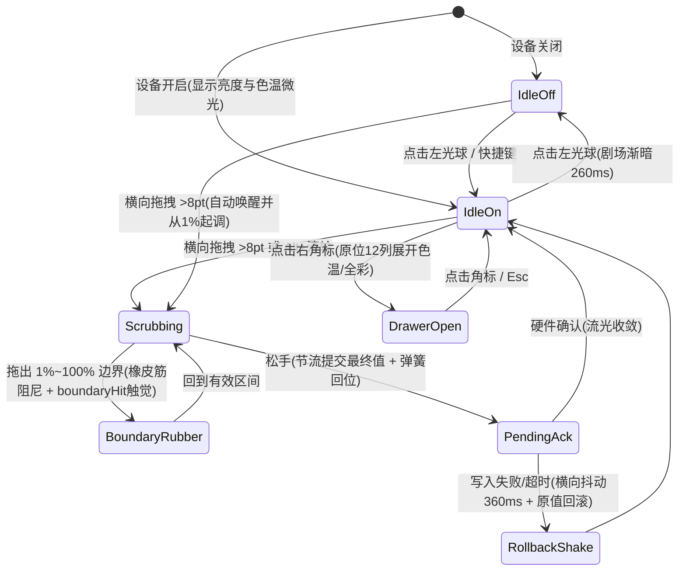
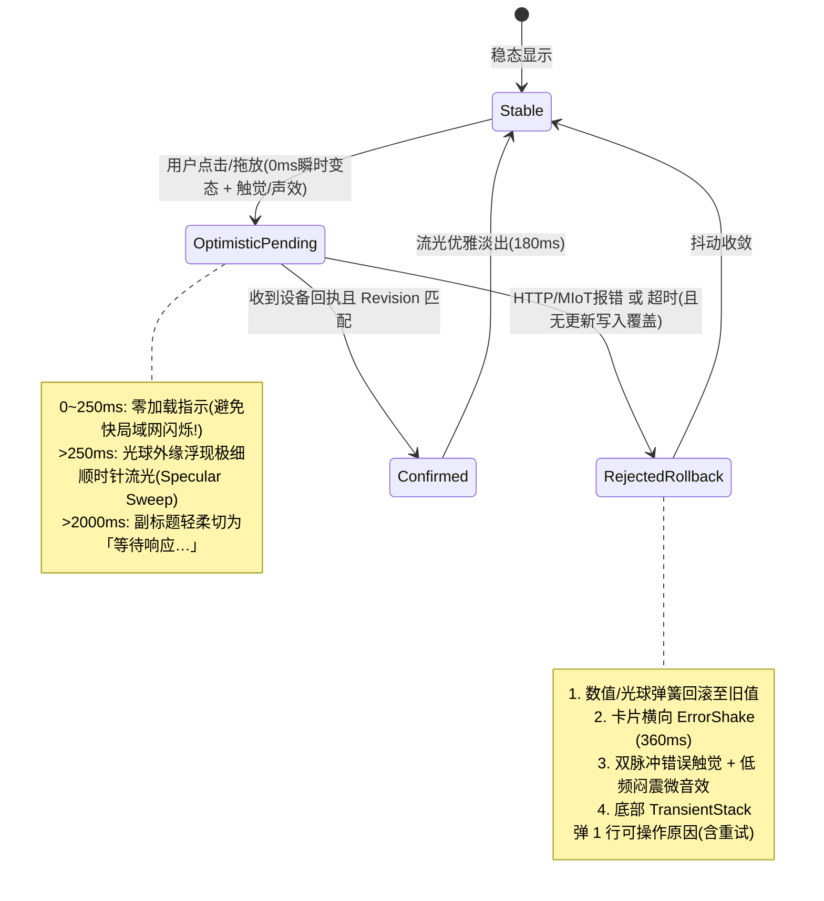

# MenuBarHome 下一代 UI/UX 工艺、动效工程与桌面智能家居产品范式深研报告

> **研究员角色**：UI/UX 工艺、动效工程与天马行空产品范式研究员 (`ui-ux-motion-lab`)  
> **锚定仓库**：`MenuBarHome`（macOS SwiftUI/AppKit + Windows Tauri/WebView2/TypeScript）  
> **配套参考原型代码**（本地调研草稿，未随纯文档入仓）：
> - macOS SwiftUI/AppKit 动效与微交互原型：`SwiftMotionAndControls.swift`（保留于调研本地临时目录）
> - Windows WebView2 120Hz 弹簧编译器与微声效合成器：`webMotionAndAudio.ts`（保留于调研本地临时目录）

---

## 执行摘要与现状锚定（事实核查，拒绝纸上谈兵）

在深入设计方案前，对 MenuBarHome 双端源码进行审计，确认项目**已拥有极高起点的工程底座**（以下均为源码实证）：

| 维度 | macOS 现状（源码实证） | Windows 现状（源码实证） | 距“顶级工艺天花板”的核心差距 |
|---|---|---|---|
| **材质与视觉骨架** | macOS 26 原生 `.glassEffect` + `GlassEffectContainer` + `SpecularRim` + `GlassHoverHighlight`（`ThemeAndMotion.swift:420-796`）；380pt 自适应高度列（`MenuBarPanelController.swift:46-48`） | 双主题：`fluent` 380px Dual-Island + `classic` 440px Unified Popover（`panelTheme.ts:29-58`）；DWM Acrylic 背景 | 材质骨架已达一流，但**控件密度与直觉操作力**仍偏“展开抽屉→再调滑块”两步流 |
| **动效与物理** | `AppleMotion` 13 个 Token（`ThemeAndMotion.swift:154-243`）；`LiquidGlassSlider` 零延迟跟手 + 10% 桶触觉（`L929-1028`）；`matchedGeometryEffect` 空调模式（`ClimatePanelModule.swift:277`） | `APPLE_SPRINGS` 17 帧采样关键帧 + WAAPI + Keyed DOM FLIP + Exit Ghost（`motionSpring.ts`, `reconciler.ts:579-657`） | 缺**速度继承与橡皮筋边界阻尼**、缺**乐观写入流光态 + 失败物理抖动回滚**；Windows 17 帧折线在 120Hz 下存在微弱分段感 |
| **感官反馈** | `NSHapticFeedbackManager` 仅覆盖滑块 10% 桶与全关确认；`SoundFeedback` 仅用系统 `Tink`/`Submarine`（`Feedback.swift:6-27`） | 无触觉替代，无轻量拟物微声效 | 缺**分级触觉矩阵**与**亚毫秒程序化微声效（Digital Crown / 物理按键手感）** |
| **核心家居控件** | `LightSpec` 仅亮度+色温（**无 RGB/HS 全彩**，`Models.swift:44-56`）；紧凑 2×1 胶囊**不能直接拖滑调光**；空调 `gauge` 只读；高危仅“全关”有长按填充（`PanelDesign.swift:266`），其余仍靠模态/文本二次确认 | 抽屉功能基本对齐，但缺窗帘动态视觉投影、缺摄像机桌面自由悬浮画中画（目前是面板内 modal sheet） | 高频控件缺少**零展开单手微调**与**物理化状态隐喻**；高危防误触手段单一 |
| **桌面传感器与智能** | `MacContextObserver.swift` 已支持摄像头(`CoreMediaIO`)、麦克风(`CoreAudio`)、外接显示器、电源/电量、Wi-Fi、Focus、日历、深夜 10s 轮询（`AutomationRule.swift:11-58`）；`UserHabitMemory` 有 5 时段+顺序转移 | `system_events.rs` 仅支持电源/电量/外接显示器/休眠/熄屏；**缺摄像头、麦克风、Focus、游戏/全屏、Wi-Fi 触发器** | `AutomationAction` **仅有开关/快捷动作/HA 场景**，**无参数级动作、无状态栈还原（散会恢复原光）**；缺屏幕采光同步、前台应用/游戏感知 |
| **菜单栏与命令中枢** | `MenuBarIconState` 仅 `house`/`house.fill` + 圆点 + 最多 2 项文字读数（`MenuBarStatusState.swift`）；`omnibar` 折叠于面板顶部（`ControlCenterPanel.swift:643`） | 托盘仅静态图标 + 120 字符 Tooltip（`desktop_shell.rs:229-260`） | 菜单栏缺少**活体图形化微状态表达**；命令面板尚未进化为 Raycast 级**独立瞬出空间中枢 + 差异预览卡 + MCP 审批流** |

---

## 第一部分：跨行业顶级视觉与微交互工艺拆解

面向 **320–420px 窄弹窗常驻工具** 场景，对 11 个行业标杆做“取其骨、弃其冗”的工艺转译：

| 标杆产品 | 核心绝技（可复用的设计基因） | 绝不盲抄的陷阱 | 转译到 MenuBarHome（380px 窄窗） |
|---|---|---|---|
| **Apple Control Center / macOS 26 Liquid Glass** | 实时折射透镜（Lensing）而非死板毛玻璃；`GlassEffectContainer` 融合相邻控件边缘；**只把玻璃用在控制层、绝不铺在长数据内容层**；满幅胶囊滑块（图标与数值嵌在轨道内） | 过度透明导致浅色/花哨壁纸下 WCAG 对比度崩塌（本仓 `CODING_STANDARDS §18` 已警惕） | 保留现有 `.glassEffect` + `SpecularRim`；将**全宽滑块能力下沉到 2×1 紧凑胶囊自身**，消除多余的独立滑动条占位 |
| **Apple Dynamic Island（及 Alcove / MediaMate）** | **形态变形（Morphing）而非窗口闪现**；单任务聚焦（Monotasking）；悬停防误触延迟（Hover-Intent）；围绕刘海/状态栏的“活体微态” | 把窄条变成塞满按钮的“小组件坟场”；全屏观影时抢视线 | 在菜单栏图标/MacBook 刘海区提供可选**超轻量活体微胶囊**：仅在“开会补光生效 / 扫地机清扫 / 门铃响起 / 定时最后 60s”时浮现 1 条状态，不打扰主屏 |
| **Linear** | **零延迟乐观 UI（Optimistic UI）**；键盘优先（`J/K`、`Cmd+K`、单键操作）；克制的微动效（无冗余弹跳、严格临界阻尼 `damping ~ 0.9`）；清晰的单行信息密度 | 纯平极简缺少“物理家电”温度感 | 强化键盘直达与**乐观写入三态反馈**（点击瞬间变态 + 极细流光边表示硬件回执中 + 失败横向弹簧抖动回弹） |
| **Raycast** | 毫秒级瞬出中枢（`Alt+Space` / `Cmd+K`）；**结构化动作预览与二级子命令（Action Panel）**；极清脆的物理点击微声效与零拖沓反馈 | 强迫所有控物都靠打字（家居场景 70% 是肌肉记忆点滑） | 将现有 `omnibar` 升级为**可独立呼出的浮动命令中枢**，支持自然语言执行前可视化“改动预览卡”与一键微调目标参数 |
| **Arc Browser** | 空间分层与侧边抽屉的物理惯性；**情境主题色随空间流动**；可中断的丝滑过渡（动画中途反向操作不瞬移、继承速度） | 过度花哨的非线性定制带来高学习成本 | 房间/时段切换时，背景折射微光随当前环境色温或活跃设备主色做 4% 极克制染晕；所有弹窗/抽屉过渡严格可中断 |
| **Teenage Engineering（OP-1 Field / TP-7）** | **功能型新拟物（Functional Skeuomorphism 2.0）**：极高精度微型仪器刻度、等宽点阵数字、音视触联觉；把抽象参数变成可触摸的精密仪器 | 炫技式复古字体降低中文可读性 | 空调温度标尺、窗帘开合比例、插座实时功率采用**微型精密刻度线 + 等宽跳动数字（`tabular-nums`）+ 可选旋钮声效** |
| **Nothing OS** | 极克制黑白灰基底 + **单一功能色点亮**（红=告警/高危）；有“重量感”的机械弹簧曲线（重质心、干脆落位）；实体光效联觉 | 强装饰性点阵牺牲信息密度 | 危险设备（阀门/热水器/车库门/告警）统一用高对比语义红点 + 机械级阻尼确认，日常设备保持中性玻璃基底，做到“一眼扫风险” |
| **Philips Hue** | **拖动拾色时画布实时跟随发色**（硬件还没响应，眼睛已先看到光感）；50%/100% 刻度微顿挫；关灯时的**剧场渐暗（Theatre Dimming）**动画 | 硕大占屏的圆形色盘不适合 380px 窄窗 | 灯光卡片内嵌**连续色温+精简全彩光带**，拖动时图标光球与卡片边缘实时呈真实光晕，开关伴随 260ms 渐亮/渐暗而非生硬跳变 |
| **Sonos** | 把“声场/设备联动”具象为可拖拽合并的物理介质（**Drag-to-Group**）；带转动惯性的音量控制；闲置时淡出次要控件 | 重媒体封面布局不适合纯 IoT 列表 | 引入**多灯/多音箱群控手势**：拖动灯组滑块时按比率同步缩放成员灯亮度（Relative Dimming），而非粗暴拉齐到同一数值 |
| **Tesla App** | **热力学语义色彩**（制冷冰蓝流、制热暖橙流）；温度步进如机械里程表滚动；边界重震（Heavy Haptic Thud）；乐观渲染 + 图标微脉动等待车端握手 | 3D 渲染耗电过高，违背常驻菜单栏 <25MB 内存红线 | 空调卡升级为**双向热力刻度轨**（标注当前室温针 + 目标温度滑块 + 两者间冷/暖温差光带），步进时数字垂直滚动（`.numericText`）+ 边界阻尼回弹 |
| **小米澎湃 HyperOS（融合设备中心）** | **原子化多态卡片**（点击主体开关、滑动直接调参、长按/点角标进深控）；HyperMind 按人在哪/几点动态重排优先级；手指跟随光影 | 手机竖屏全屏布局与桌面键鼠精度不同 | 吸收“点击/滑动/展开三层直觉”，但针对**键鼠/触控板**升级为：**左点开关 + 卡片横拖/悬停滚轮直接调参 + 右角标展开** |

---

## 第二部分：高频智能家居控件微交互深研（适配 320–420px 窄弹窗）

> **核心原则**：在 380px（macOS Liquid Glass / Windows Fluent）至 440px（Windows Classic）窄窗内，**80% 的高频微调必须在 0 次页面跳转、0 次抽屉展开内一指/一滑完成**；复杂参数留在原位展开抽屉，绝不破坏空间心智。

### 1. 灯光（Light）：零展开胶囊调光 × 双轨色温/全彩 × 相对比例群控

- **现状痛点**（源码实证）：
  - `DeviceCardView.swift:185` 仅在整行卡（`!isCompactTile`）展示内联滑块，高频使用的 2×1 紧凑胶囊只能开/关或展开抽屉。
  - `Models.swift:44-56` 的 `LightSpec` 尚无 `rgbColor` / `hsColor` 字段，RGB 灯带/氛围灯无法直接调色。
- **顶级微交互设计**：
  1. **紧凑胶囊内嵌渐变拖动调光（Inline Capsule Scrubbing）**（见原型 `SwiftMotionAndControls.swift:CompactLightCapsulePrototype`）：
     - **点击左光球（38–42pt）**：瞬时开关，伴随 260ms“灯丝渐亮/剧场渐暗”光晕动画（`brightness` 曲线插值）。
     - **横向拖拽胶囊任意主体（阈值 `> 8pt` 且 `|dx| > 1.2 * |dy|` 避免抢占列表纵滚）**：卡片内部玻璃折射填充区实时变为从左向右的**色温实景渐变光带**（随当前 `colorTempKelvin` 实时映射暖琥珀 2700K → 日光白 4500K → 冰蓝白 6500K），副标题原地翻转为加粗等宽数字 `68% · 4000K`；松手瞬间继承速度回弹并仅在 trailing 节流后发 1 次写入。
     - **桌面独享绝技 — 悬停滚轮旋钮（Scroll-Dial）**：鼠标悬停在任意灯光卡上按住 `Option/Alt` 滚动滚轮（或双指轻推），无需点击即可像拧物理旋钮一样以 5% 步进调光（底部浮现极简微数字指示，离开自动提交）。
  2. **零二级页：色温 + 全彩无缝拾色抽屉**：
     - 展开抽屉后，若灯支持全彩（未来 `LightSpec` 扩展 `hsColor: (hue: Double, saturation: Double)?`），在亮度条下方提供**“色温 / 全彩”双模玻璃胶囊切换**：
       - **色温态**：物理黑体辐射色谱轨（2700K–6500K），内置 3 个磁吸锚点（月光 2700K / 专注 4200K / 清醒 6000K），拖过锚点有轻微吸附（±120K 磁吸区）与一次 `.alignment` 触觉滴答。
       - **全彩态**：摒弃占高 200px 的大色轮，采用 **2D 紧凑矩形色相-饱和度光毯（320×64px）+ 6 颗高频自定义色珠（Swatch Dots）**。拖动取色准星时，准星上方 16pt 浮起**液态放大透镜（Magnifier Loupe）**，同时卡片光球与玻璃边泛出对应实色微光。
  3. **多灯联动群控手感（Relative Group Dimming）**：
     - 针对 `LightGroupFold`（米家灯组）与自定义分组，拖动群组主滑块采用**相对比例缩放算法**（如主灯 80% + 氛围灯 40% 组控，主滑块下调 50% 时，二者按比例降至 40% 与 20%，保留用户精心调好的明暗层次），双击主滑块则对齐所有成员灯。



---

### 2. 空调 / 暖通（Climate / HVAC）：热力学温差标尺 × 阻尼步进 × 一指模式切换

- **现状痛点**（源码实证）：
  - `ClimatePanelModule.swift:215-230` 的 `gauge` 是 6pt 不可交互静态条，且未将“当前室温”画在同一坐标系里，用户无法一眼看出“当前 28.5° 离目标 24° 还差多少”。
  - `stepButton` 仅支持单次点击，连续调 5°C 要点 5–10 下，无长按加速与边界阻尼反馈。
- **顶级微交互设计**：
  1. **热力学双向温差轨（Interactive Thermal Gauge）**：
     - 将 6pt 静态条升级为 **18pt 可拖拽精密刻度轨**（16°C–30°C）：
       - **白色空心竖针**：标出**当前实测室温**（如 `28.5°`）；
       - **实心液态滑钮**：标出**目标设定温度**（如 `24.0°`）；
       - **两者之间的动态温差光带**：目标低于室温时呈**冰蓝收缩流光**（制冷中），目标高于室温时呈**暖橙扩张流光**（制热中），相差 `≤ 0.5°C` 时光带安静转为柔和翠绿（已达恒温，省电安心感）。
  2. **温度步进阻尼与里程表数字**：
     - 大号主读数永远展示**目标温度**（24pt Rounded Semibold + `monospacedDigit` + SwiftUI `.contentTransition(.numericText(countsDown:))` / WebView2 垂直滚筒过渡），正下方用清晰的二级标签显示 `室温 28.5° · 制冷中`（拉开视觉层级，绝不混淆）。
     - **± 按钮按压体验**：短按步进 `0.5°C/1°C` + 一次 `.alignment` 触觉；**长按 > 350ms 进入阻尼加速连发**（每 120ms 步进 1 档，撞到 `minTemp`/`maxTemp` 时触发橡皮筋微位移 + `.levelChange` 重震触觉，提醒已到底）。
  3. **模式 / 风速一指切换**：
     - 卡片头部右侧或模式图标轻点支持快速轮换常用模式，展开后保留现有 `matchedGeometryEffect` 滑动透镜，并把**模式 + 风速**压缩在同一视觉节拍内：风速采用 4 阶等高微柱状条（自动 / 低 / 中 / 高），拖动即可划选，减少点击次数。

---

### 3. 窗帘 / 晾衣架 / 扫地机 / 音箱 / 摄像机：物理隐喻 × 悬停显控 × 悬浮预览

| 品类 | 紧凑态（一眼看懂） | 悬停 / 展开态（精细操控） | 关键差异化微交互 |
|---|---|---|---|
| **窗帘 & 晾衣架 (`CoverDevice`)** | 卡片底部嵌入 **3pt 微缩几何状态条**：双开窗帘显示“左右向中心收拢的两段光条”，晾衣架显示“垂直升降刻度小柱” | 拖动滑块时，滑块上方/背景呈现**极简半透明百叶/对开帷幕投影**，实时随百分比向两侧拉开或合拢；电机运动中显示方向流动微箭头（`opening`/`closing`），点击卡片任意处可“急停（Stop）” | 端点磁吸沿用现有 `<3%→0%` / `>97%→100%`（`detailDrawers.ts:54`），增加到点轻触觉 |
| **扫地机 (`VacuumSpec`)** | 光球外圈即**电量环形进度条**（绿>30%、橙≤30%、充电中呼吸脉动）；副标题一行显示 `清扫中 · 32m² · 78%` | 展开区为三枚高权重玻璃操作键（**清扫/暂停**合并为智能主按钮 + **回充** + **寻找/吸力档**）；运行中图标带缓慢低耗旋转微动效（Reduce Motion 下静止） | **“电脑开会一键暂停扫地机”**：当 `microphoneInUse` 触发时，扫地机卡片顶部浮现极细“会议静音暂停中”标签，会后可一键续扫 |
| **音箱 & 电视 (`Speaker` / `TV`)** | 播放中光球呈现 3 根极轻量波形条；副标题展示 `音量 42%` 或当前信源（`HDMI 1`） | 悬停即露**音量胶囊拖条**（支持滚轮微调）；小爱同学指令条支持 **“常用播报快捷芯片”**（如“喊家人吃饭”、“找手机”），不必每次敲字 | 静音切换采用图标动态划斜线（`symbolEffect(.replace)`）+ 音量轨道灰显但**保留原音量阴影刻度**，取消静音视觉可预期 |
| **摄像机 (`CameraSpec`)** | 卡片缩略图标 + 在线绿点 / 休眠月牙 + 最近事件时间（如 `门铃 3 分钟前`） | **桌面独享 — 悬停低延迟微缩窥视卡（Hover Peek, 350ms 延迟触发）**：悬停在摄像机卡上，在主面板旁侧优雅滑出 240×135px 玻璃浮窗展示最近事件静帧或热流预览（严禁冷启新 P2P 会话，仅复用热流或已有事件静帧，严守 `CameraLivePanelController.swift:296` 铁律）；点击即无缝放大过渡到常驻置顶小窗 / 系统 PiP | **Windows 补齐真·桌面悬浮小窗**：把 Windows 现有面板内 `.cc-camera-live-sheet` 升级为可独立拖出（Pop-out）的无边框置顶 Tauri 副窗口（Always-on-Top PiP），关掉主控面板后仍可边工作边盯门铃/宠物 |

---

### 4. 危险设备防误触：不破坏效率的三级安全微交互（替代死板弹窗！）

MenuBarHome 已有严格的安全底线（`ManualControlPolicy`、门锁/阀门/车库门/开窗器/热水器/全关确认），但目前除“全关”采用 `HoldToConfirmButton` 外，其余高危操作会打断心流弹出系统对话框或展开确认文字行。我们按风险等级设计**三级“零弹窗”防误触工艺**：

| 风险分级 | 适用设备 / 动作 | 推荐微交互范式 | 效率 & 防误触原理 | 无障碍 & 键盘兜底 |
|---|---|---|---|---|
| **L1：可逆批量动作** | 全屋关灯、场景触发、非危险设备批量开关 | **即点即发 + 底部倒计时撤销横幅**（沿用并增强 `TransientStackView`） | 效率最高；误点后 10–15s 内 `Cmd+Z` 或点“撤销”无损还原（卡片上同步加微弱撤销倒计时底边条） | `Cmd+Z` 全局快捷键 + 悬停暂停倒计时（已有） |
| **L2：高功率 / 物理位移中危** | 全关（`allOffTargets`）、热水器加热、电暖器、开窗器开启、晾衣架下降、按份投喂（`FeedAction`） | **原位环形长按充能（In-Place Circular Hold Ring, 0.65s）**（见原型 `HighRiskCircularHoldOrb`） | 无需弹窗！按住设备光球 0.65s，光球外缘顺时针扫出亮色液态进度环，同时卡片微缩至 `0.94` 并伴随渐强微声效；未满松手弹簧回退 + 轻提示“按住 0.65 秒确认” | VoiceOver 暴露显式命名操作；键盘聚焦后按住 `Space` 0.65s 充能，随时 `Esc`/失焦作废（严格遵守 `CODING_STANDARDS §16`） |
| **L3：安防 / 生命财产极高危** | 智能门锁解锁、车库门/大门开合、燃气阀/总水阀开启 | **抽屉内“物理滑动解锁轨道（Slide-to-Confirm Track）”** | 模拟物理机械插销，完全免疫双击/长按误触；拖到 92% 以上触发卡扣磁吸 + 重震触觉 + 变绿提交，松手未达标则橡皮筋平滑弹回起点 | 键盘支持聚焦后连续按 `→` 推进或 `Enter` 二次显式确认对话框 |

---

## 第三部分：双端动效、感官与 120Hz 低耗工程落地

### 1. 双端统一弹簧物理参数与 120Hz 映射规范

> **关键发现（源码诊断）**：Windows 端现有 `motionSpring.ts:20` 使用 `steps = 17` 的固定采样点生成 WAAPI 关键帧。在 280–420ms 时长下，120Hz 屏实际渲染 34–50 帧，17 个折点在慢速展开或拖拽回弹时容易出现肉眼可察的细微折线抖动；而现代 Chromium / WebView2（Edge WebView2 113+）原生支持 **CSS `linear()`**，能把解析解烘焙为 32–48 点零 JS 开销的合成器原生曲线（见原型 `webMotionAndAudio.ts:compileSpringToCssLinear`）。

| 语义场景 | Token | macOS SwiftUI / AppKit 参数 | Windows WebView2 (CSS `linear()` / WAAPI) 参数 | Reduce Motion 降级 |
|---|---|---|---|---|
| **微按压反馈** | `pressFeedback` | `.easeOut(duration: 0.12)`，`scale: 0.972` | `100ms cubic-bezier(0, 0, 0, 1)`，`scale(0.972)` | 无缩放，仅亮度/描边微变 |
| **开关/光球/滑块透镜** | `glassLens` / `control` | `.spring(response: 0.22, dampingFraction: 0.86)` | `compileSpringToCssLinear(0.22, 0.86)` (~310ms) | `none`（瞬时切换） |
| **滑块点击跳变 / 数值刷新** | `valueChange` | 拖动时 `nil`（零延迟），点轨 `.easeInOut(duration: 0.18)` | 拖动时 `transition: none`，点轨 `180ms ease-in-out` | `none` |
| **快捷切换/搜索展开** | `snappy` | `.spring(response: 0.26, dampingFraction: 0.94)`（临界阻尼零过冲） | `compileSpringToCssLinear(0.26, 0.94)` (~300ms) | `opacity 150ms ease-out` |
| **抽屉展开/网格重排** | `reveal` | `.spring(response: 0.34, dampingFraction: 0.88)` | FLIP `translate3d` + `interpolate-size: allow-keywords` / `contain: layout paint` | `opacity 200ms ease-out` |
| **通知/房间栈展开** | `stack` | `.spring(response: 0.38, dampingFraction: 0.84)` | `compileSpringToCssLinear(0.38, 0.84)` (~460ms) | `opacity 200ms ease-out` |
| **拖拽排序落位** | `reorder` | `.spring(response: 0.50, dampingFraction: 1.0)`（严格过/临界阻尼） | WAAPI FLIP `compileSpringToCssLinear(0.46, 1.0)` | 瞬时重排 |
| **弹窗入场 / 退场** | `panelEnter` / `panelExit` | macOS Liquid Glass：侧滑 `365ms (0.44,1,0.54,0.98)` / 退 `217ms (0.20,0,0.50,1)`（已有，保留）；Classic：顶部微缩下沉 `scale 0.97→1 + y -6→0` 220ms | 托盘上方浮出：`@starting-style` + `translate3d(0, 14px, 0) scale(0.975) → 0, scale(1)`，`240ms linear(...)`；退场 `150ms cubic-bezier(0.3, 0, 1, 1)` | 仅 `opacity` 交叉淡入淡出 `180ms` |
| **写入失败抖动回弹** | `errorReject` | `ErrorShakeEffect`（`stiffness: 720, damping: 18`, 振幅 `6.5pt`, 3 周期衰减） | WAAPI `playTileErrorShake`（360ms 6 段阻尼衰减 `translate3d`，纯合成器线程） | 禁用位移，改 380ms 红色内描边脉动闪现 |

### 2. 120Hz 高刷低耗工程守则（常驻托盘应用的功耗生命线）

1. **只动合成器属性，隔离重排半径**：
   - **macOS**：严禁在高频动画视图中对动态变化的阴影做每帧重算（本仓已有 `shadowIf` 佳作 `PanelDesign.swift:231`）；面板隐藏时立刻卸载重型视图树（已有 `dropPanelContent()`）并停止所有 `TimelineView` / 呼吸脉动动画，确保后台 CPU 归零、支持 App Nap。
   - **Windows WebView2**：
     - 动画严格限定在 `transform`（`translate3d`/`scale3d`）和 `opacity`，严禁逐帧改 `width`/`left`/`box-shadow`；
     - 为每张设备卡加 `contain: layout style;`（独立抽屉加 `contain: layout paint;`），防止展开单张卡片时引发整棵 30+ 设备 DOM 树回流；
     - `will-change: transform` **仅在 `pointerenter` 或手势开始时动态挂载、动画结束后 `animation.onfinish` 立即移除**，避免为几十张卡片常驻独立 GPU 合成层导致显存飙升；
     - 抽屉展开优先利用现代 WebView2 原生 `interpolate-size: allow-keywords` + `@starting-style`，减少 JS 读取 `getBoundingClientRect()` 触发的强制同步布局（Forced Reflow）。
2. **ProMotion / 120Hz 独立时钟驱动**：
   - 任何手势惯性或 JS 物理步进绝不写死 `16.6ms`，统一基于 `CADisplayLink` / `performance.now()` 的 `deltaTime` 积分，并夹紧 `dt <= 0.05s` 防后台唤醒时间跳变。

### 3. 乐观更新加载态与失败抖动回弹状态机（连接 `HomeStore+ControlWrite`）

MenuBarHome 底层已有极其严谨的 `optimisticFieldLocks` + `optimisticLockRevision`（`CODING_STANDARDS §14`）与 `SourceEpoch`（`windows/src/ui/sourceEpoch.ts`），只需在表现层配齐**四阶段微交互闭环**，就能把网络延迟彻底“隐身”：



> **精妙细节（250ms 静默窗 / Delay-Before-Spinner）**：局域网 HA / 本地 MiIO 通常 40–150ms 返回。前 250ms **绝不显示任何转圈或脉冲**，让快链路感觉像物理电灯开关一样干脆；只有超过 250ms（云端慢网）才渐入极克制的光球流光，兼顾“极速感”与“不死机感”。

### 4. 触觉反馈矩阵与可选程序化微声效（Synesthesia Craft）

- **macOS 触觉分层**（基于 `NSHapticFeedbackManager.defaultPerformer`，见原型 `SwiftMotionAndControls.swift:HapticCraft`）：
  - **`.alignment`（轻刻度）**：滑块每跨越 10% / 色温每跨越 3 个磁吸点 / 空调每步进 0.5°C / 悬停滚轮每格；
  - **`.generic`（清脆落位）**：普通开关切换、模式胶囊选中、拖拽重排交换槽位；
  - **`.levelChange`（深按确认）**：到达滑块最小/最大硬边界、0.65s 高危长按蓄满、滑动解锁卡扣锁合；
  - **双脉冲 `.generic`（间隔 75ms）**：指令失败回滚或锁屏拦截拒绝。
- **双端可选微拟物声效（默认关闭，Settings 可选「无 / 极轻机械 / 温润玻璃」）**：
  - **Windows / macOS 零音频文件方案**：采用 Web Audio API（Windows，见 `webMotionAndAudio.ts:TactileSoundSynth`）与 `AVAudioEngine` 短 PCM 缓冲区合成（macOS，取代当前生硬的系统提示音 `Tink`/`Submarine`），生成 **10–45ms 亚毫秒级短瞬态声波**（高频滤波白噪 + 三角波微降调模拟 Apple Watch 表冠滴答；420→680Hz 温润短音表开启，540→310Hz 表关闭），并在空闲 3 秒后自动挂起音频上下文（0% 后台能耗）。
- **无障碍刚性契约**：
  - `effectiveReduceMotion` / `prefers-reduced-motion: reduce`：一切弹簧位移/缩放/抖动切换为 ≤200ms 透明度交叉淡变或静默瞬变，保留线性长按进度环（功能必需）；
  - `effectiveReduceTransparency` / Windows 高对比度模式：自动切回实心 `well` 背景 + 1px 清晰描边，保证 WCAG AA ≥ 4.5:1 对比度。

---

## 第四部分：天马行空但工程可行的下一代桌面产品范式

> **战略核心**：手机 App 只能靠人“掏出来点”，语音音箱常被环境噪音和社死感限制；**而电脑（Mac / Windows）是当代知识工作者每天盯 8–12 小时的数字中枢——它天生知道你在开会、在写代码、在打游戏、在看电影、刚坐下、还是离开座位！** MenuBarHome 可以成为全球第一个把 **「桌面数字生活」与「物理居住空间」无缝缝合** 的桌面智能中枢。

### 范式一：桌面即传感器 2.0（Desktop-as-a-Sensor + 状态栈还原引擎）

在 macOS 现有 `MacContextObserver`（已支持摄像头/麦克风/显示器/电源/Wi-Fi/Focus/日历）基础上，做三次决定性跃迁：

1. **从“傻瓜开关”跃迁为“状态栈快照与无痕还原（Context Stack & Auto-Restore）”**：
   - **痛点**：现有 `AutomationAction` 只能配两条死规则：“摄像头开→开补光灯”、“摄像头关→关补光灯”。如果原本大晚上我就开着补光灯在写字，开完 5 分钟会它居然把我灯全关黑了！
   - **创新方案**：引入**情境栈（Context Stack）**。当「开会模式」激活时，引擎自动做三件事：① **拍下受影响设备的进入前快照**（书房主灯 35% 3200K、扫地机正在清扫）；② **叠加执行多参数复合编排**（补光灯→75% 4800K、门外氛围灯→柔和呼吸红光表示“On Air 勿扰”、扫地机→暂停、客厅音箱→音量降至 15%）；③ 摄像头/麦克风关闭并经 10s 防抖后，**弹出栈帧，精确恢复开会前的原始状态**（扫地机续扫、灯光平滑 1.5s 渐变回 35% 3200K、门外灯熄灭），如果用户中途手动改了某台灯，则将该设备从还原栈中剔除（尊重人工接管）。
2. **补全 Windows 零摩擦/低权探测矩阵（让双端同样聪明）**：
   - **摄像头 / 麦克风占用**：无需申请相机权限！监听注册表 `HKCU\SOFTWARE\Microsoft\Windows\CurrentVersion\CapabilityAccessManager\ConsentStore\{webcam,microphone}` 下子项的 `LastUsedTimeStop == 0`（搭配 `RegNotifyChangeKeyValue` 事件推送，**0 轮询 CPU**），辅以 WASAPI `IAudioSessionManager2` 精准区分麦克风录音态；
   - **全屏游戏 / 影院 / 演示态**：调用 Win32 `SHQueryUserNotificationState()`，毫秒识别 `QUNS_RUNNING_D3D_FULL_SCREEN`（3A 游戏启动）与 `QUNS_BUSY`（全屏观影/PPT 演示）；macOS 则用 `NSWorkspace.shared.frontmostApplication` + `CGWindowListCopyWindowInfo` 判断全屏媒体/游戏进程（用户白名单可控，零隐私采集）。
   - **离开/回位精细化**：结合锁屏、休眠、外接扩展坞插拔、Wi-Fi SSID 切换（回家 Wi-Fi 自动预冷空调+开玄关灯，连上公司/咖啡馆 Wi-Fi 自动隐藏家里部分高危控件或切“远程看家模式”）。
3. **屏幕光影同频 & 昼夜专注节律光（Ambient Screen Sync & Circadian Focus）**：
   - **低功耗屏幕拾色同步（Desktop Ambilight）**：利用 macOS **ScreenCaptureKit** + Metal Compute Shader / Windows **DXGI Desktop Duplication** + D3D11 Staging Texture，在 GPU 上将屏幕直接降采样成 3×3 主色块（**CPU 占用 < 1%，零内存拷贝**），以 10–25Hz 局域网 UDP/MIoT 协议同步到书桌灯带/显示器挂灯/氛围灯。看电影或打游戏时，物理桌面瞬间延伸屏幕光影！
   - **番茄钟 & 生物节律无感调光**：对接系统专注模式（Focus / Focus Sessions）或内置极简番茄钟——专注 25 分钟时台灯平滑切至清爽 `4800K 85%`，进入 5 分钟休息自动缓降至暖黄 `3000K 45%`，深夜 23:00 后启用防蓝光护眼斜坡，用物理环境光线自然引导人的工作心流，而无需吵闹弹窗提醒“该休息了”。

---

### 范式二：情境自适应主面板（Context-Aware "Now" Canvas）

- **现状局限**：虽然本仓已有 `PanelPrioritySnapshot`（按常用>习惯>开启排序），但它是**无解释的平面列表**；设备超过 15 台后，用户仍要在房间折叠栈里找当下真正想点的那 3 台设备。
- **天马行空但极度克制的解法 — “此刻焦点带（Now Stage, 动态 Top 3–5 卡片）”**：
  - 面板最顶部（摘要行之下、房间栈之上）增设一个可折叠的 **「此刻（Now）」动态聚焦区**，基于四维实时打分公式自动浮出 3–5 张最可能被点的卡片：
    $$\text{Score}(d) = w_1 \cdot \text{DesktopContext}(d) + w_2 \cdot \text{TimeHabit}(d, \text{bucket}, \text{dayType}) + w_3 \cdot \text{AnomalyOrActive}(d) + w_4 \cdot \text{EnvTrigger}(d)$$
  - **典型场景动态变形**：
    - *清晨 08:00 · 刚解锁电脑* → 自动浮出：窗帘（拉开）、咖啡机插座、卫生间暖风机、昨日室内外温差；
    - *下午 14:30 · 正在视频会议（摄像头占用）* → 自动浮出：桌面补光灯（带滑块）、书房空调、扫地机（静音暂停中）、“On Air 状态灯”；
    - *深夜 23:40 · 仍在用电脑* → 自动浮出：书房台灯（护眼提醒）、全屋尚亮着的其他灯（一眼防忘关）、一键「准备睡觉」场景胶囊；
    - *不在家 Wi-Fi（远程办公）* → 自动置顶：入户摄像机、扫地机、离家前忘关的高功率设备（空调/电暖器）。
  - **两条防烦人铁律**：
    1. **可解释微标签**：每张自动浮出的卡片右上角带 1 个 10pt 极浅微因标签（如 `开会中` / `晚间常用` / `已开 4h`），绝不让用户疑惑“它怎么跑上来了”；
    2. **会话冻结（沿用并扩展 `PanelPrioritySnapshot`）**：面板一旦打开，焦点带顺序立刻锁定，点击开关后绝不“瞬间飞走导致点错下一张”。

---

### 范式三：菜单栏活体信息徽章 & 桌面微态层（Living Menu Bar & Micro-HUD）

把菜单栏 / 任务栏托盘从“死图标入口”进化成**零点击即可感知全屋呼吸的活体微仪表盘**：

1. **macOS `NSStatusItem` 矢量微可视化（全自动适配明暗/毛玻璃）**：
   - **活体小房子微动画**：
     - 0 台活跃：空心线框屋；
     - 有灯开启：屋顶/窗户内点亮柔和光点，旁边紧凑等宽显示 `3灯 · 24.5°`（复用现有 `MenuBarWidthStabilizer` 防相邻图标抖动！）；
     - 节能/功率模式：用 **14×14pt 极简迷你柱状图（3 根实时微柱）**直观表示当前全屋实时功率段（<200W / 200–1000W / >1000W）或空气质量 AQI 等级；
     - **特殊情境活体态**：视频会议补光生效时显示微缩 `ON AIR` 小点；定时指令最后 60 秒进入倒计时胶囊（`关灯 0:42`）；门铃/水浸/烟感报警时图标进入高对比红脉冲（仅异常破例上色，平时 100% Template 黑白克制）。
   - **可选“刘海伴生微态条（Notch Live Micro-HUD）”**（受 Alcove / MediaMate 启发，纯可选开关，全屏自动隐藏）：
     - 当桌面传感器自动触发了某个动作（如“检测到开会，已开启补光灯并暂停扫地机”）或门铃响起时，从 MacBook 刘海/屏幕顶部中缘滑出 1 条极薄的液态玻璃微胶囊（持续 3.5s，悬停常驻，含「撤销」与「查看」微按钮），**彻底取代生硬占角的系统通知横幅**！
2. **Windows 活体托盘与任务栏微浮窗**：
   - 利用 Tauri Rust 动态生成 32×32 RGBA 矢量位图（`tray.set_icon`），让 Windows 托盘图标同样拥有**开灯微光点、实时温度迷你数字徽章、告警红盾**（打破 Windows 托盘万年静态图标的沉闷感）；
   - 提供可选的**轻量桌面边缘磁吸微胶囊（Desktop Mini-Pill）**：像悬浮网速球一样极简（仅 110×28px 磨砂玻璃，可吸顶/吸边），显示 `24.5° · 2灯开`，鼠标划过自动展开 3 个最常用快捷键。

---

### 范式四：瞬出自然语言命令中枢 + AI/MCP 双向协同（`Cmd+K / Alt+Space`）

将现有折叠在面板里的 `omnibar` 与伴生快照（`RaycastSnapshot` / `scripts/mijia-mcp`）融合，打造**真正符合桌面极客直觉的“家控 Spotlight”**：

1. **独立浮空瞬出中枢（Global Quick Command Overlay）**：
   - 按全局快捷键（默认 `Option+Space` / `Alt+Space`，或面板内 `Cmd+K`）在屏幕正中上方 22% 处以 `snappy` 弹簧瞬间弹出 520px 宽纯玻璃命令条（无需打开完整设备列表！），打完回车即走，全程手不离键盘。
2. **结构化意图“先看后发”安全预览卡（Diff Preview Card）**：
   - 输入自然语言如 *“把书房调暗一点、空调开 25 度，半小时后关掉加湿器”*，不再盲目黑盒执行，而是实时渲染一张**极简差异预览卡**：
     ```text
     ┌────────────────────────────────────────────────────────┐
     │ ✦ 意图预览（本地解析 · 12ms）              [Enter 执行] │
     ├────────────────────────────────────────────────────────┤
     │ ☀ 书房吸顶灯     亮度 80% → 30%      [微调 ▾]  [✓]     │
     │ ❄ 书房空调       关 → 制冷 25°C      [微调 ▾]  [✓]     │
     │ ⏱ 卧室加湿器     30 分钟后(22:15) 关闭 [改时 ▾] [✓]     │
     └────────────────────────────────────────────────────────┘
     ```
   - **低危单步指令**（如“关书房灯”）支持设置“直发免预览 + 撤销”，**多设备组合/高危/定时指令**默认展示差异预览卡，支持直接用方向键勾选/取消其中某一条，彻底消除 AI 误解控错设备的恐惧！
3. **条件型自然语言临时任务（Condition-Bound Ephemeral Timers）**：
   - 结合「桌面即传感器」，支持说出前所未有的桌面专属定时语句：
     - *“等我这场会开完后把书房灯关了”* → 自动绑定 `cameraNotInUse && microphoneNotInUse` 事件触发的一次性任务；
     - *“电脑锁屏 10 分钟后关全屋空调”* → 绑定 `screenLocked + 600s` 延时，中途解锁自动取消；
     - *“等室温降到 25 度自动关空调”* → 绑定本地温度读数阈值触发（一次性，执行完自动销毁）。
4. **AI Agent / MCP 双向协同微交互（安全审批胶囊）**：
   - 当用户的编程 Agent / 桌面 AI 助手（Antigravity / Claude Desktop / OpenCode）通过本地 MCP（`mijia-mcp`）请求查询状态或执行家居控制时：
     - **只读查询**：在菜单栏图标闪过一次极轻的 `✦` 光晕（透明可审计，不打扰）；
     - **写入控制**：若涉及高危设备或越权动作，MenuBarHome 面板/微胶囊即时弹出 **「Agent 请求审批卡」**（显示来源 Agent 名 + 差异清单 + `[允许一次]` / `[拒绝]`，默认超时自动拒绝），让 AI 控家既丝滑又牢牢握在人类手里。

---

### 范式五：两个破界“桌面独享”创意实验（辨识度拉满）

1. **空间微缩平面图与“光影拖拽抛送”（Spatial Room Radar & Drag-to-Throw）**：
   - 在 380px 面板顶部加一个极克制的切换钮（`列表 ⇄ 空间`）。**无需复杂 3D 建模**，用户用 30 秒拼出 3–6 个圆角矩形代表客厅/书房/卧室/玄关，系统实时把每个房间的**灯光色温晕染、冷暖空调色阶、扫地机移动光点、门窗开启缺口**映射到平面格子里——一眼看清“全屋热力与光影”。
   - **Sonos 式“抛送（Throw）”**：把一个音乐播放态、空调预设（如“26° 睡眠风”）或灯光氛围珠直接拖进另一个房间方块，释放即完成跨房流转！
2. **双指/滚轮物理旋钮模式（Direct Scroll-Dial Micro-Control）**：
   - 桌面鼠标滚轮和 MacBook 触控板是最被智能家居软件浪费的精密硬件！允许用户开启**“悬停即旋钮（按住 `Option/Alt` + 滚轮）”**：鼠标停在任意卡片上（哪怕是未展开的 2×1 紧凑胶囊！），滚动滚轮直接丝滑调节该设备的主维度（灯光→亮度，加按 `Shift`→色温；空调→温度；窗帘→开合度；音箱→音量），卡片中心瞬时浮现一个 Teenage Engineering 风格的半透明圆弧刻度 HUD，松开修饰键即刻提交并消隐——这是手机端永远做不到的**桌面级肌肉记忆快感**。

---

## 第五部分：分层落地路线图（契合 `AGENTS.md` 交付分流）

将上述调研成果拆解为**近期可落地（P0/P1）**与**中长期创新范式（P2/P3）**，严格对应本仓“快车道直推 `main` vs 高风险走 PR”规范：

| 阶段 | 优先级 | 交付模块 | 核心改动锚点（真实源码路径） | 风险分流 | 预期体验收益 |
|---|---|---|---|---|---|
| **近期可落地：UI 与动效工艺升级** | **P0** | **1. 双端动效精度与失败反馈闭环**：Windows `compileSpringToCssLinear` 取代 17 帧折线；双端接入 250ms 静默窗 + 乐观流光 + `ErrorShake` 回滚；双端补全触觉分级（macOS `HapticCraft`）与可选 Web Audio / AVAudioEngine 微声效 | `ThemeAndMotion.swift`, `Feedback.swift`, `motionSpring.ts`, `reconciler.ts`, `styles.css` | **快车道（直推 `main`）**（纯表现层，配单测与快照校验） | 120Hz 丝滑度对齐原生系统，网络抖动与写入失败手感质变 |
| **近期可落地：高频控件微交互** | **P0** | **2. 窄窗零展开直控升级**：2×1 灯光胶囊内嵌横拖调光 + `Alt+滚轮`旋钮微调；空调双向热力学温差轨 + ± 长按阻尼加速；窗帘对开/升降微缩投影；高危设备 L2 原位环形长按确认（替代打断式弹窗） | `DeviceCardView.swift`, `ClimatePanelModule.swift`, `CoverDetailDrawer.swift`, `PanelDesign.swift`, `deviceViews.ts`, `detailDrawers.ts` | L2 高危确认触及安全策略 → **必须走 PR**；其余样式交互 → **快车道** | 高频调光/调温/开窗操作路径缩短 50%–67% |
| **近期可落地：全彩与 Windows 补齐** | **P1** | **3. 灯光全彩拾色 + Windows 悬浮摄像机小窗**：`LightSpec` 扩展可选 `hsColor` 及 2D 紧凑光毯拾色；Windows 摄像机支持独立置顶 PiP 副窗口 + 悬停事件静帧窥视 | `Models.swift`, `MiotSynthesizer.swift`, `DeviceCardView.swift`, `windows/src-tauri/src/window.rs`, `cameraLive.ts` | 涉及跨端数据契约与黄金语料 → **必须走 PR** | 补齐灯带/氛围灯全彩短板，抹平 Windows 摄像机体验代差 |
| **中长期创新：情境与桌面传感** | **P2** | **4. 桌面即传感器 2.0（状态栈还原 + Windows 补全）**：`AutomationAction` 支持多参数调节与进入前快照自动还原；Windows 新增 `CapabilityAccessManager` 摄像头/麦克风与 `SHQueryUserNotificationState` 全屏/游戏探测；主面板新增「此刻（Now）」情境焦点带 | `AutomationRule.swift`, `AutomationEngine.swift`, `MacContextObserver.swift`, `ControlCenterPanelStacks.swift`, `system_events.rs`, `systemContextPoll.ts` | 涉及后台自动写入与系统策略 → **必须走 PR** | 打造“开会自动布光、散会无痕复原”的桌面杀手级护城河 |
| **中长期创新：活体入口与空间中枢** | **P2** | **5. 菜单栏活体徽章 + 独立瞬出 `Cmd+K` 差异预览中枢 + MCP 审批微胶囊**：macOS 矢量微柱/可选刘海微态条；Windows 动态托盘图标；独立浮空命令栏 + 差异预览卡 + 条件型临时定时 | `MenuBarStatusState.swift`, `MenuBarPanelController.swift`, `AssistantCommandBar.swift`, `desktop_shell.rs`, `companion.rs` | 涉及全局热键、定时与 MCP 写入安全边界 → **必须走 PR** | 让 MenuBarHome 成为“全屋状态的活体仪表盘”与 AI 时代家控中枢 |
| **中长期探索：破界体验实验** | **P3** | **6. 屏幕采光同步（GPU Ambilight）+ 空间微缩平面图**：ScreenCaptureKit/DXGI 低耗 GPU 采色同步氛围灯；380px 卡片式房间热力平面图与拖拽流转 | 新建独立可选模块（建议结合 ADR-0024 扩展/能力开关按需加载，默认零后台开销） | 新能力开关与底层采集权限 → **必须走 PR** | 极高社交传播力与极客辨识度，同时靠按需启停守住后台零功耗底线 |

---

## 验证与局限说明

- **事实核查范围**：本报告所有针对 MenuBarHome 现状的结论均直接阅读仓库源码核实（含 `ThemeAndMotion.swift`、`DesignTokens.swift`、`ControlCenterPanel*.swift`、`DeviceCardView.swift`、`ClimatePanelModule.swift`、`CoverDetailDrawer.swift`、`ApplianceDetailDrawer.swift`、`PanelDesign.swift`、`TransientStackView.swift`、`MenuBarStatusState.swift`、`MenuBarPanelController*.swift`、`AutomationRule.swift`、`MacContextObserver.swift`、`UserHabitMemory.swift`、`CameraLivePanelController.swift`、`AssistantCommandBar.swift`、`motionSpring.ts`、`liquidGlassSlider.ts`、`panelTheme.ts`、`reconciler.ts`、`deviceViews.ts`、`detailDrawers.ts`、`system_events.rs`、`systemContextPoll.ts`、`desktop_shell.rs`）。
- **未覆盖与待实测项**：
  1. 配套原型文件 `SwiftMotionAndControls.swift` 与 `webMotionAndAudio.ts` 为跨端架构参考草稿，未在当前 Windows 宿主机编译 Swift 或接入主仓构建（遵循严禁修改本仓文件约束）；落地时需在 macOS 26 实机与 Windows 120Hz WebView2 上校准 `rubberBand` 系数与 `ErrorShake` 振幅；
  2. Windows `CapabilityAccessManager` 注册表路径在部分第三方虚拟摄像头（如 OBS Virtual Camera）下可能存在延迟写入，落地时建议结合设备接口监控或允许用户测试校验。
