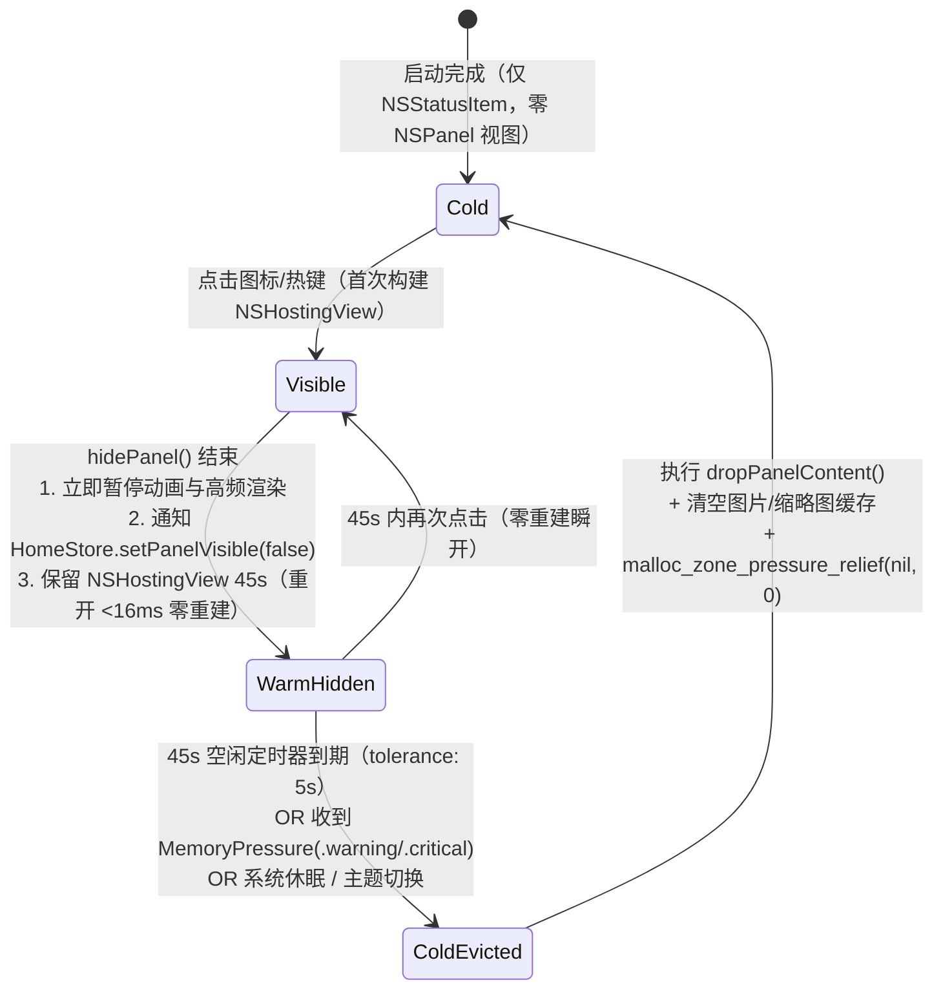
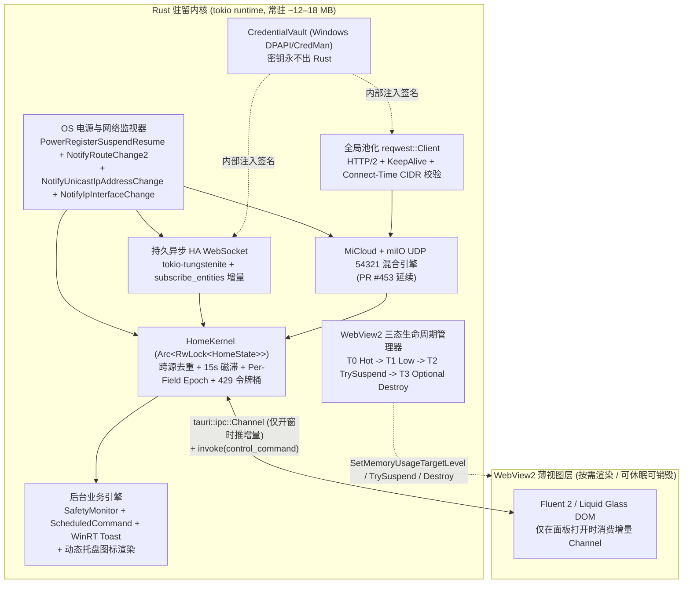
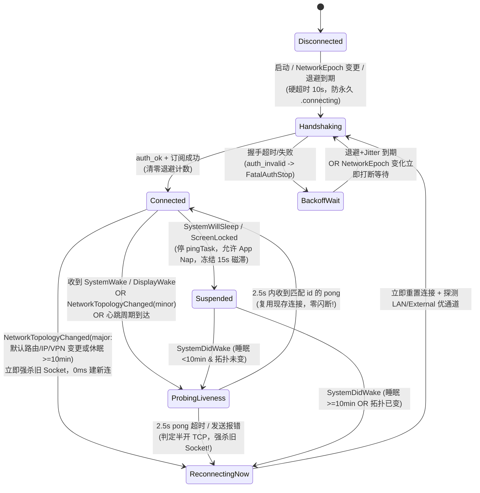
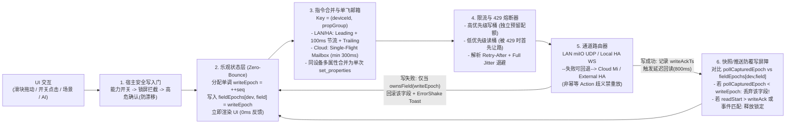
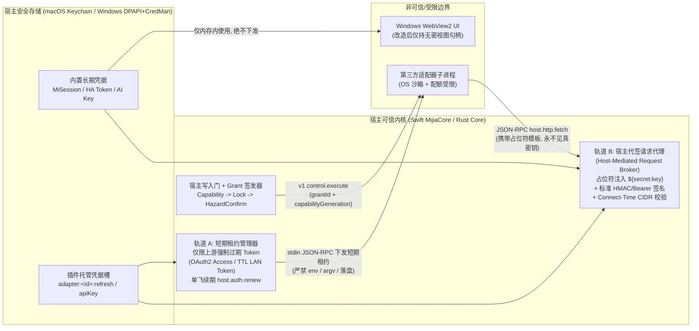

# 10 系统效率、高可靠状态同步与插件安全边界底层内核升级方案

- **调研日期**：2026-11-24（锚定 `MenuBarHome` 当前 `HEAD` 源码基线，只读审计、零本仓修改）
- **目标定位**：围绕「**常驻无感、秒开必达、多源不乱、安全可控**」四大底层工程目标，结合 7 个行业标杆开源仓库源码实证与本仓双端（macOS Swift / Windows Tauri+Rust+TS）现行代码缺口，给出可量化的性能与可靠性预算、核心状态机与同步管线设计、以及面向未来进程外插件化（衔接 ADR-0023 / ADR-0024）的纵深安全架构。
- **证据口径标注**：
  - `【本仓源码】`：直接核验自 `MenuBarHome` 当前 `HEAD` 文件与行号。
  - `【标杆源码】`：直接核验自本轮浅克隆（`--depth 1 --filter=blob:none --sparse`）至 `scratch/repos/perf-reliability-sec/` 的真实源码与行号。
  - `【官方文档】`：来自 Apple / Microsoft WebView2 / Win32 官方规范。
  - `【工程预算/推断】`：基于实证机制推导的量化目标或权衡判断，标注真机压测验证项。

---

## 0. 结论先行与量化预算总表

### 0.1 核心诊断结论（基于 2026-11-24 HEAD 源码）

1. **MenuBarHome 的底层工程水位已显著高于常规开源桌面小工具，但存在 5 个决定体验上限的结构性暗伤**：
   - **macOS 已有优势**：已落地 5 档轮询衰减（`PollingPolicy.swift`）、`SafetyWakeSchedule` 单次唤醒、`BackgroundUpdateScheduler`（`NSBackgroundActivityScheduler` + 抖动）、`labelTimer` / `subMinuteWakeTimer` 的 `tolerance`、miIO UDP 54321 局域网优先读写（ADR-0021）、`DualSourceHomeProvider` 15s 磁滞窗口（`SuspendingClock`）及 `ProcessSupervisor` 崩溃熔断器 `【本仓源码】`。
   - **当前仍暴露的 5 大核心底层缺口**：
     1. **Windows 端传输层极度重型且无持久推送**：`windows/src-tauri/src/home_assistant.rs:201-268, 485-526` 对每次轮询和每次控制均**新建阻塞式 `tungstenite` TCP+TLS+WS+Auth 短连接**并拉全量 4 张注册表；`windows/src-tauri/src/network.rs:192-196` 对每次 `native_http` **新建 `reqwest::Client`**（丢弃 HTTP/2 连接池、TCP keep-alive 与 TLS 会话复用）`【本仓源码】`。
     2. **Windows 全部状态与定时器困在 WebView2 JS 进程**：因 `backgroundThrottling: "disabled"`（`tauri.conf.json:27`）且定时任务/云刷新/自动化全在 JS 中运行，无法调用 `ICoreWebView2_19::SetMemoryUsageTargetLevel(Low)` 或 `TrySuspendAsync()`，被迫长期背负 Chromium 多进程内存与透明合成开销 `【本仓源码】`。
     3. **双端「合盖唤醒 / Wi-Fi 切换 / VPN 开关」均存在半开假死盲区**：macOS `HAWebSocketProvider` 25s 发送 `ping` 却**从不校验 `pong` 超时**，且 `timeoutIntervalForRequest = 120s`、`handshakingWebSocket != nil` 时 `refreshNow()` 静默空返，半开 TCP 最长假死 2 分钟；同时 `SystemActivityMonitor.swift:86-94, 153-161` 仅监测 `NWPath.status == .satisfied` 布尔值，完全漏检「家 Wi-Fi ↔ 公司 Wi-Fi / VPN」的同满足态切换；Windows 侧更完全缺少 `NotifyRouteChange2` / `NotifyUnicastIpAddressChange` / `NotifyIpInterfaceChange` OS 级回调 `【本仓源码】`。
     4. **指令管线与防回弹仍有竞态死角**：滑块为纯 280ms 尾随防抖（`HomeStore+ControlWrite.swift:1216`），连续拖动反馈发闷且缺传输层单飞合并邮箱；乐观锁主要靠 2.5–3s 固定时长 TTL（`OptimisticField.swift:62-76`、`optimisticLock.ts:5`），若一轮在写前发起的慢云端轮询在 3s 后返回，仍会用旧态覆盖新写导致 UI 回弹；429 退避无抖动、未解析 `Retry-After`、读写共用限流面；Windows 双源缺 15s 磁滞窗口（`dualSourceProvider.ts:1156-1202`）`【本仓源码】`。
     5. **安全边界向插件化 v1 演进缺 4 块硬装甲**：Windows `credentials.rs:122-129` 直接把明文 `ha_token`/`mi_session` 返回给 WebView2 JS；双端局域网 CIDR 判定（`network.rs:397-412`、`HAPlaintextConsent.swift:12-23`）均在 DNS 解析前按字符串校验，存在 DNS Rebinding TOCTOU 风险；Windows `job_object.rs` 仅配了 `KILL_ON_JOB_CLOSE` 而无内存/CPU/进程数硬限；macOS 子进程尚未接入 Seatbelt/`rlimit`/Mach 资源巡检 `【本仓源码】`。

### 0.2 可量化性能与可靠性目标预算表

> 下列「现状」标有 `【源码推断/待实测】` 的数值尚未在本机采样，须结合 §5.2 给出的自动化采样脚本实测落盘为基线；「目标预算」为本架构升级后的工程验收 SLA。

| 指标维度 | 平台 | 现状评估 | 升级目标预算（SLA） | 核心达标手段 |
| :--- | :---: | :--- | :--- | :--- |
| **后台空闲内存** | macOS | ~30–55 MB（Physical Footprint）`【推断】` | **≤ 15–25 MB**（关窗 45s 卸载后） | 两级延迟视图卸载 + `DispatchSourceMemoryPressure` + `malloc_zone_pressure_relief` |
| **后台空闲内存（全进程树）** | Windows | ~120–220 MB（WebView2 常驻未挂起）`【推断】` | **T1 温热 ≤ 85 MB；T2 挂起 ≤ 45–55 MB；T3 轻量模式 ≤ 15–20 MB** | 状态/网络下沉 Rust + `SetMemoryUsageTargetLevel(Low)` → `TrySuspend` → 可选销毁窗口 |
| **后台空闲 CPU** | macOS / Win | macOS ~0.1–0.5%（离家 HA 10s 重连时偏高）；Win 随短连峰值抖动 `【源码推断】` | **平均 < 0.05%（接近 0%）** | App Nap 协同、停后台无效重连、Rust 持久 WS 替代短连轮询、`TrySuspend` 冻结 Blink/V8 |
| **空闲系统唤醒频次** | macOS | HA 连着时 ≥ 2.4 次/分（25s ping）；离家 HA 6 次/分 `【本仓源码】` | **后台稳定 < 0.5–1 次/分（休眠/锁屏 = 0）** | 自适应心跳（后台 60s + 10% tolerance）、离家指数退避至 300s、全定时器 `leeway` + 整秒对齐 |
| **Energy Impact（12h 空闲）** | macOS | 低–中（离家未连 HA 时拉高）`【推断】` | **< 1.0（Activity Monitor 12hr Power 排在后台极低档）** | 释放无效 `pingTask`、允许 App Nap、禁止后台无条件高频重连 |
| **弹窗热唤醒首帧延迟** | macOS / Win | macOS 每次重建 `NSHostingView`（~30–70ms）；Win 热态 ~20ms `【推断】` | **热态 < 16–30 ms；Win T1 < 50 ms；Win T2 < 250 ms** | macOS 45s 温热保留；Win Rust 热态快照直推 + WebView2 `ready` 握手防闪白 |
| **冷启动至可交互耗时** | Windows | 同步初始化阻塞未量化 `【待实测】` | **托盘就绪 < 300 ms；首次开面板 < 600 ms** | Rust 后台异步初始化连接池 + 缓存拓扑瞬时首屏渲染 + 预热 WebView2 |
| **合盖唤醒 / Wi-Fi 切换恢复** | macOS / Win | 半开 TCP 最长假死 **120 s**；同满足态换网漏检 `【本仓源码】` | **拓扑变化感知 < 200 ms；半开斩杀+重连首帧 ≤ 1.5–3.0 s** | OS 路由/接口变化监听 + 唤醒 2.5s `ping/pong` 探活 + 并行 LAN/Cloud 探测 |
| **局域网控制端到端延迟** | macOS / Win | macOS miIO/HA ~20–60ms；Win HA 每次建连 ~150–400ms `【源码推断】` | **HA WS / miIO LAN P95 ≤ 50 ms** | Win 改持久异步 `tokio-tungstenite` + miIO UDP LAN 直连；macOS 复用 UDP socket |
| **乐观更新 UI 回弹率** | 双端 | 慢轮询跨 3s 锁窗仍可回弹 `【本仓源码】` | **0%（零旧轮询覆写新写）** | Per-Field Monotonic `writeEpoch` 水位线 + `pollCapturedEpoch` 严格丢弃屏障 |
| **第三方插件故障隔离** | 双端 | macOS 已有崩溃熔断，缺沙箱/配额；Win 仅 `KILL_ON_JOB_CLOSE` `【本仓源码】` | **单插件崩溃/OOM/死循环对宿主 0 影响；凭据 0 泄漏** | OS 沙箱 + CPU/RAM/进程硬配额 + 宿主写入门/代签 Broker + Connect-Time CIDR 校验 |

---

## 1. 本仓内核基线审计与标杆源码实证清单

### 1.1 本轮深读的 7 个行业标杆开源仓库

全部仓库采用 `git clone --depth 1 --filter=blob:none --sparse` 只读检出至 `scratch/repos/perf-reliability-sec/`，均未执行构建脚本：

| 仓库 | 本地 HEAD | 深读关键文件 | 本报告采纳的实证机制 |
| :--- | :---: | :--- | :--- |
| `tailscale/tailscale` | `da6276d` | `net/netmon/{netmon.go, netmon_darwin.go, netmon_windows.go}` | macOS `AF_ROUTE` 忽略 `RTM_MISS`/`awdl`/`llw`；Windows `NotifyUnicastIpAddressChange`/`NotifyRouteChange2`/`NotifyIpInterfaceChange`；`majorTimeJumpThreshold = 10min` 区分 DarkWake 与长休眠 |
| `home-assistant/home-assistant-js-websocket` | `8070c45` | `lib/{connection.ts, socket.ts, states.ts}` | `DEFAULT_CONNECT_TIMEOUT = 10s`；带 `id` 匹配的 `ping/pong` Promise；`suspendReconnectUntil` 休眠挂起与队列缓冲；`subscribe_entities` 增量压缩 Diff（`a`/`r`/`c` + `+`/`-`） |
| `home-assistant/iOS` | `a4bc15b` | `Sources/Shared/API/{HAAPI.swift, PeriodicUpdateManager.swift, ServerPriority.swift}` | `stuckWebSocketConnectTimeout = 90s` 根治 8 小时 `.connecting` 卡死；`warmConnectDedupeWindow = 2s` 去重 macOS 双发激活通知；内网 URL 优先排序 |
| `tauri-apps/wry` | `cff99ea` | `src/webview2/mod.rs` | `ICoreWebView2_19::SetMemoryUsageTargetLevel(Low\|Normal)` 原生 Rust 绑定实证（`:1965-1974`） |
| `clash-verge-rev/clash-verge-rev` | `332de8a` | `src-tauri/src/{core/lightweight.rs, core/network_watch.rs, utils/window_manager.rs}` | `AtomicU8` CAS 驱动的轻量模式状态机（空闲 N 分钟销毁 WebView2 窗口仅留 Rust 内核）与重开限流防抖 |
| `MonitorControl/MonitorControl` | `7cfe645` | `MonitorControl/{Model/OtherDisplay.swift, Support/AppDelegate.swift}` | 慢硬件总线单槽位最新值覆盖邮箱（`writeDDCNextValue` + `writeDDCLastSavedValue` 去重）与 `sleepID`/`reconfigureID` 写入屏障 |
| `tauri-apps/tauri` | `84af754` | `crates/tauri-utils/src/acl/{capability.rs, resolved.rs}` | 声明式 `Capability` + `ResolvedScope`（allow/deny 分离）最小权限解析模型 |

> 同时交叉对照了 2026-11-23 已在本仓落盘核验的 `exelban/stats`、`steipete/CodexBar`、`sfsam/Itsycal`、`leits/MeetingBar`、`File-New-Project/EarTrumpet`、`koush/scrypted`、`ioBroker/js-controller` 等源码实证（见 `docs/research/2026-11-23-deep-dive/{02,07,10}-*.md`），避免重复已知项并精准增量深化。

### 1.2 本仓（2026-11-24 HEAD）已落地基线 vs 残余底层瓶颈核查表

| 子系统 | macOS 当前实现 `【本仓源码】` | Windows 当前实现 `【本仓源码】` | 关键缺口与痛点 |
| :--- | :--- | :--- | :--- |
| **HA 传输层** | 持久 `URLSessionWebSocketTask`（`HomeProvider.swift:195-222`） | **短连接阻塞 `tungstenite`**（`home_assistant.rs:201-268, 485-526`） | Win 无持久推送、每次操作重握手；macOS 缺 `pong` 超时、缺连接超时看门狗、离家 10s 死循环重连 |
| **HTTP 连接池** | `URLSessionMiTransport` 静态复用（`MiHTTP.swift:8-29`） | **每次调用重建 `reqwest::Client`**（`network.rs:192-196`） | Win 每次米家/HA HTTP 请求丢弃连接池与 TLS 会话票据 |
| **局域网 miIO** | `LocalMiIOClient` UDP 54321 混合读写（ADR-0021），每包新建 `NWConnection`（`LocalMiIOClient.swift:104`） | 未合入全量（ADR-0021 §4，PR #453 在途） | Win 缺 LAN 直连；macOS 每次 UDP 收发建拆 `NWConnection` 增加对象与内核开销 |
| **空闲内存管理** | 关窗即 `dropPanelContent()` 彻底销毁 `NSHostingView`（`MenuBarPanelController.swift:1012`）；无内存压力监听 | 透明 WebView2 永活 + `backgroundThrottling: "disabled"`（`tauri.conf.json:27`） | macOS 连续开合需重复冷建视图树；Win 无法 `Low`/`TrySuspend`，常驻 RAM 偏高 |
| **定时器与 App Nap** | `labelTimer` / `subMinuteWakeTimer` / `SafetyWakeSchedule` / `UpdateScheduler` 均已加 `tolerance`；但 `HAWebSocketProvider` 25s ping 与 `DualSourceHomeProvider` timer 未设 leeway | `appLifecycle.ts:1477-1645` 隐藏态单次 `setTimeout` 调度；但留在 WebView2 JS 线程 | macOS 25s 无条件 ping 拖累 App Nap；Win 定时器依赖 JS 存活锁死内存优化 |
| **唤醒与换网恢复** | `SystemActivityMonitor.swift:86-161` 监听休眠/解锁 + `NWPathMonitor` 仅判 `status == .satisfied`；`DebouncedResumeCoordinator` 300ms 去抖 | `system_events.rs:253-291` 挂系统电源通知；`wifi.rs` 仅靠 10s 轮询，无 IP/路由 OS 回调 | 同满足态换 Wi-Fi/开 VPN 双端均无感知；唤醒时半开 TCP 无法秒级斩杀 |
| **滑块与乐观锁** | 280ms 尾随防抖（`HomeStore+ControlWrite.swift:1216`）；字段级 2.5–3s 乐观锁 + `ManualWriteSession` | `optimisticLock.ts:5-14` 设备级 3s/8s 乐观锁 + `dirtyFields` + `SourceEpoch` 三级代际 | 拖动非实时（缺 leading+throttle）；缺跨慢轮询的 per-field `writeEpoch` 屏障；429 缺抖动与读写隔离 |
| **双源去重与磁滞** | `DualSourceHomeProvider.swift:317` 15s `SuspendingClock` 磁滞；纯函数整卡择优 | `dualSourceProvider.ts:1156-1202` **单次失败即置 `null` 立即翻转** | Win 缺 15s 磁滞；双端均不支持只读属性互补融合与多通道动态 RTT 优选 |
| **安全与插件隔离** | Keychain `CredentialVault`；`ProcessSupervisor` 120s/5次熔断；ADR-0024 v0 契约 | `credentials.rs:122` 明文返给 JS；`job_object.rs` 仅 `KILL_ON_JOB_CLOSE`；`network.rs:397` 仅字符串判局域网 | Win JS 持明文凭据；双端缺 Connect-Time 防 DNS Rebinding；子进程缺 OS 沙箱与 CPU/RAM 配额 |

---

## 2. 常驻桌面端极致效率工程（macOS & Windows）

### 2.1 macOS：后台 <15–25MB、近 0% CPU 与 App Nap 深度协同

#### （1）App Nap 协同原则与现网反模式清零
macOS 会对 `LSUIElement = true` 的无可见窗口菜单栏应用自动启用 **App Nap**（合并定时器、降低线程调度优先级、削减 CPU 唤醒）。正确策略是**绝不长期持有 `ProcessInfo.beginActivity` 阻止 App Nap**，仅在以下 3 类短时关键操作期间按作用域申请并立即 `endActivity`（对标 `Itsycal` `MenuTimer.m:160-170` 与 `CodexBar` `AgentSessionPowerAssertion.swift:4-18`）：
1. 活跃语音听写（`SpeechInputController.isListening`）；
2. 活跃摄像机实时流播放（面板打开看直播期间）；
3. 即将触发的 60 秒内本地 `ScheduledCommand` 最后冲刺窗口（避免 App Nap 延迟倒计时超过 `lateTimerGrace`）。

**当前破坏 App Nap 的三处具体代码修复**：
- **缺陷 A（`Sources/MijiaCore/HomeProvider.swift:715-721`）**：`HAWebSocketProvider` 的 `pingTask` 无视系统休眠、锁屏和面板隐藏，固定每 25s 唤醒一次且无 `tolerance`。
  - **改造**：`ping` 周期绑定 `PollingContext`——面板打开 `20s`（`tolerance: 2s`）；面板关闭且系统活跃 `60s`（`tolerance: 6s`）；低电量模式 `90s`（`tolerance: 10s`）；`systemActive == false`（锁屏/休眠）**停止应用层 `pingTask`**，唤醒时立即发 1 次带 2.5s 超时的探活 `ping`（见 §3.2）。
- **缺陷 B（`Sources/MijiaCore/HomeProvider.swift:584-585`）**：HA 断连后 `backoffSeconds = min(backoffSeconds * 1.8, 10.0)` 封顶仅 10s，导致用户带 MacBook 出门离开家庭局域网时，后台全天每 10 秒尝试连一次 `192.168.x.x:8123`（每小时 360 次无效唤醒与 TCP SYN）。
  - **改造**：引入**分段自适应退避 + Full Jitter**：前 4 次快速重连（`1s → 2s → 4s → 8s`），连续失败 ≥5 次且目标为 `LocalNetworkEndpoint` 时进入「离家慢探」阶梯（`30s → 60s → 120s → 300s`，全带 `±25%` 抖动）；一旦 `NetworkMonitor` 检测到网络拓扑变化或用户打开面板，**立即清零退避并在 0ms 重试**。
- **缺陷 C（`Sources/MijiaCore/DualSourceHomeProvider.swift:96, 110-118`）**：`DispatchFallbackRecheckTimer` 调度 `DispatchSourceTimer` 时未指定 `leeway`，应显式设为 `leeway: .milliseconds(200)`（对标 `exelban/stats:Kit/plugins/Repeater.swift:43`）。同时 `MiCloudProvider` 后台 60s/120s/300s 轮询应采用 `Task.sleep(for:tolerance:)`（`tolerance = max(1s, interval * 0.1)`）让 XNU 内核与系统后台任务合并唤醒。

#### （2）弹窗隐藏内存回收 vs 秒开延迟：两级延迟卸载模型（Two-Stage Deferred Eviction）
当前 `MenuBarPanelController+Presentation.swift:162-172` 在面板刚关闭的瞬间就调用 `dropPanelContent()` 销毁整棵 `NSHostingView` 树。这让空闲内存极低，但用户连续两次点击调光/查设备时，每次打开都要全量重建 SwiftUI ViewGraph、重新分配 Liquid Glass Backing Store 并触发同步 `layoutSubtreeIfNeeded()` + `CATransaction.flush()`（`+Presentation.swift:112-115`），导致每次打开多付 30–70ms 主线程开销。

**升级为两级延迟卸载状态机**：


- **内存压力主动瘦身**（对标 `steipete/CodexBar:Sources/CodexBar/MemoryPressureMonitor.swift:44-80`）：注册 `DispatchSource.makeMemoryPressureSource(eventMask: [.warning, .critical])`，收到 `.warning` 时立即执行 `WarmHidden → ColdEvicted`、裁减摄像机静帧缓存与 `MiotSpec` 内存非活跃副本，并调用 `malloc_zone_pressure_relief(nil, 0)` 将 `libmalloc` 脏空闲页归还操作系统，将后台稳态 Physical Footprint 稳定压在 **15–25 MB**。
- **UDP Socket 复用优化**（`Sources/MijiaCore/MiCloud/LocalMiIOClient.swift:95-171`）：当前 `NWConnectionMiIOUDPTransport.send` 每次收发都创建/启动/取消一个全新 `NWConnection` 与临时超时 `Task`。建议改为**单共享非阻塞 BSD UDP Socket + `DispatchSourceRead` 多路复用器**（按 `(remoteIP, miIO requestId)` 路由回包，面板打开时保持开启，面板关闭且无安全轮询超过 60s 自动关闭），可将一次 20 台设备局域网轮询的内核 `NWConnection` 创建次数从 **40+ 次/轮降至 0 次/轮**。

#### （3）轻量可观测护栏（低成本定位回归）
借鉴 `CodexBar:MainThreadHangWatchdog.swift:40-90`，在 `AppDiagnosticsLog` 中新增**仅在面板可见或诊断开启时激活**的主线程看门狗（后台空闲时不跑，零额外唤醒）：每 2s 向主队列投递轻量探针，响应 >500ms 记一条卡顿面包屑（携带当前动作标签如 `panelShow` / `haSynthesize` / `miCloudPoll`），纳入本机脱敏诊断报告（严格遵循 ADR-0015 零远端遥测）。

---

### 2.2 Windows（Tauri v2 + WebView2）：Rust 驻留内核 + WebView2 三态渐进节流

#### （1）现状根因：为什么当前 Windows 端省不了内存且操作慢？
基于 `windows/src-tauri/` 源码核验，Windows 端存在三个相互锁死的底层瓶颈：
1. **逻辑全在 WebView2 JS 侧**：`appLifecycle.ts:1539-1650`、`cloudRefresh.ts`、`dualSourceProvider.ts`、`scheduledCommands` 全部寄生在 WebView2 渲染进程内，因此 `tauri.conf.json:27` 被迫设置 `"backgroundThrottling": "disabled"`——这直接禁止了 Chromium 的后台标签冻结，导致即便面板隐藏 8 小时，WebView2 的 Browser + Renderer + GPU + Network 4–6 个子进程仍常驻 **120–220 MB**，且透明窗口令合成器无法走 occluded 省电路径 `【本仓源码】`。
2. **`home_assistant.rs` 无持久连接**：`ha_snapshot`（`:503-511`）和 `ha_execute`（`:514-526`）每次调用都会 `spawn_blocking` 新建 TCP → TLS → WS 升级 → HA Auth 握手 → 顺序发 4 条 RPC → 立即 `socket.close()`。既无实时推送，每次点开关还平白多付 3–4 个 RTT + TLS 握手耗时 `【本仓源码】`。
3. **`network.rs` 无连接池**：`native_http_with_scope`（`:192-196`）在函数体内每次执行 `reqwest::Client::builder()...build()`，等于每次米家云轮询都要重新初始化 TLS 根证书库、重做 TCP 三次握手 + TLS 1.3 握手、且无法利用 HTTP/2 多路复用 `【本仓源码】`。

#### （2）目标架构：Rust 驻留内核（Tokio Core）与薄前端分离
将「**长连接、轮询调度、本地状态真值、定时指令、安全告警、凭据签名**」完整下沉至 Rust `tauri::State`（Tokio 异步运行时），使 WebView2 退化为**纯展示与手势输入的薄视图层（Thin View）**：



#### （3）两项 P0 级立竿见影的 Rust 改造（无需等全量迁移即可先行落地）
1. **全局池化 `reqwest::Client`（`windows/src-tauri/src/network.rs`）**：
   - 将 `reqwest::Client` 提升为两个全局 `LazyLock<reqwest::Client>`（`CLIENT_NO_REDIRECT` 与 `CLIENT_SCOPED_REDIRECT`，通过自定义 `Policy` 或外层手工循环最多 5 跳实现同源重定向校验，避免为每个请求建 Client！），启用 `.pool_idle_timeout(Duration::from_secs(90))`、`.pool_max_idle_per_host(4)`、`.tcp_keepalive(Duration::from_secs(30))`、`.http2_adaptive_window(true)`，并单请求通过 `RequestBuilder::timeout(...)` 施加独立超时。
   - **预期收益**：单次 MiCloud 请求延迟降低 **80–250 ms**（省去 TLS 握手与证书加载），CPU 尖峰显著平抑，同时大幅减少频繁建连触发小米风控的概率 `【工程推断】`。
2. **持久化异步 `tokio-tungstenite` HA WebSocket（重构 `windows/src-tauri/src/home_assistant.rs`）**：
   - 用 `tokio_tungstenite::connect_async` 替代同步 `tungstenite` + `spawn_blocking`；连接建立后一次拉取 `area`/`device`/`entity` 注册表 + 发送 `subscribe_entities`（HA 2022.4+ 增量压缩订阅，对标 `ha-js-ws/lib/states.ts:134-164`）+ 监听 `area_registry_updated`/`device_registry_updated` 增量事件；控制命令 `ha_execute` 直接复用同一条已认证 WS 通道通过 `mpsc::Sender` 发送，**控制延迟从 ~150–400 ms 降至 ~10–35 ms**！

#### （4）WebView2 三态渐进节流 vs 唤醒延迟实测权衡表

基于 `tauri-apps/wry` 源码实证（`wry/src/webview2/mod.rs:1965-1974` 已封装 `ICoreWebView2_19::SetMemoryUsageTargetLevel`）、Microsoft WebView2 官方性能规范 `【官方文档】` 以及 `clash-verge-rev/src-tauri/src/core/lightweight.rs:17-266` 生产模式 `【标杆源码】`，给出各态精确权衡：

| 驻留阶段 | 触发条件 | Win32 / WebView2 API | 预计全进程树内存 `【推断/行业实证】` | 点击托盘唤醒首帧耗时 | 后台能力影响（内核下沉 Rust 后） |
| :--- | :--- | :--- | :---: | :---: | :--- |
| **T0 Hot（热态）** | 面板打开 或 刚关闭 `0–30s` | `window.hide()` + `#app.is-parked` 停动画 | ~100–160 MB | **< 16–30 ms**（1–2 帧瞬出） | 无影响 |
| **T1 Warm Low（温热低内存）** | 隐藏满 `30s` | `ICoreWebView2_19::SetMemoryUsageTargetLevel(Low)`（`wry:mod.rs:1965`） | **~60–95 MB**（降 ~35–55%） | **~20–50 ms**（用户无感） | 脚本仍活，切回 `Normal` 无顿挫 |
| **T2 Suspended（深度休眠，推荐默认稳态）** | 隐藏满 `15 min`（或进入电池省电）且无活跃摄像机 | `ICoreWebView2_3::TrySuspendAsync()`（须先 `IsVisible = false`；调用前先确保已切回 `Normal` 避开微软文档提及的状态冲突） | **~35–55 MB**，CPU **0.00%** | **~150–300 ms**（NVMe 实测区；先播 Rust 侧位姿准备，再 `Resume()` + `Show()`） | **零影响**（Rust 持续收推送、刷托盘图标、发 WinRT Toast、跑定时与告警） |
| **T3 Destroyed（可选极致轻量模式）** | 隐藏满 `2h` 或用户勾选「省内存轻量模式」 | `WindowManager::destroy_main_window()`（对标 `clash-verge-rev:lightweight.rs:157`） | **~12–20 MB**（纯 Rust 进程） | **~400–700 ms**（重建 WebView2，但无需等网络因 Rust 持有热态快照） | **零影响** |
| **反模式（明确禁用）** | 频繁调用 `SetProcessWorkingSetSize(-1,-1)` / `EmptyWorkingSet` | 强刷工作集到页面文件 | 任务管理器数字虚假变低（Commit Charge 不变） | 产生大量硬缺页中断、动画首帧掉帧卡顿 | 仅制造 I/O 抖动，**严禁作为常规手段** |

> **关键顺序警告**：在业务状态机与定时任务从 `appLifecycle.ts` 迁入 Rust **之前**，**切勿贸然启用 T2 `TrySuspend`**（会冻结 JS 定时器与安全告警），但 **T1 `SetMemoryUsageTargetLevel(Low)` 可在当前版本立即安全灰度上线**（Microsoft 官方文档明确其保持脚本与定时器运行，仅激进裁剪 V8/Blink 缓存与图像解码池）！
> **冷启动防闪白握手**：补齐 `window.rs` 与前端的双向 `panel-ready` 握手——冷启动创建隐藏窗口时不抢显，若 WebView2 尚未发回 `panel-ready` 用户就点击了托盘，Rust 暂存待呈现标志（最多等 1.5s），收到首帧 DOM 挂载完成信号后再执行 `position_popover` + `show()` + 触发 CSS 入场动画，根除 WebView2#4834 空白帧问题。

---

## 3. 多源高可靠状态同步与防封/韧性引擎

### 3.1 推送优先 + 增量压缩 + 自适应退避轮询

1. **Home Assistant：全面切换 `subscribe_entities` 增量压缩订阅**
   - 现状：macOS `HAWebSocketProvider` 启动时发 `get_states` + `subscribe_events("state_changed")`（每条事件携带完整 `old_state` + `new_state` + 全部冗余 `attributes`，单台空调/扫地机一次心跳推送数 KB JSON）；Windows 更是每 6s 全量重拉 4 张注册表 `【本仓源码】`。
   - 升级：握手 `auth_ok` 后检查 `ha_version >= 2022.4`，发送 `{"type": "supported_features", "features": {"coalesce_messages": 1}}`（`ha-js-ws/lib/socket.ts:142-144`）并改用 `{"type": "subscribe_entities"}`（`ha-js-ws/lib/states.ts:134-164`）：
     - 首帧一次性下发紧凑态 `a`（`s`/`a`/`c`/`lc`/`lu`）；
     - 后续增量仅下发 `c[entity_id]["+" / "-"]` 变化字段（**带宽与 JSON 解析 CPU 下降 60–80%**）；
     - 重连自动置 `replace = true` 无缝全量复位，不再出现「漏事件致状态永久漂移」。
   - **设备类型裁剪下推到订阅层**：用户关闭了某类设备且未开启对应安全告警时，向 `subscribe_entities` 传入 `entity_ids` 过滤列表（或按需过滤），连无关实体变更流量都不进入进程。
2. **米家与轮询类源：5 档自适应衰减 + Per-Cycle 超时硬上限**
   - 保留已落地的 `PollingPolicy` 5 档表（开窗 6s → 闭窗 60s → 30m 闲置 120s → 2h 闲置 300s；低电量取 `max(180s, idle)`；安全告警/实时菜单栏读数门禁钉在 60s）。
   - **补齐单轮询硬超时预算（Per-Cycle Watchdog）**：借鉴 `MeetingBar`（`CalendarSync.swift:58-66`）防止单次卡死阻塞整个循环，在 `MiCloudProvider.performTrackedPoll` 与 Windows `cloudRefresh` 上加 **20s 总超时**（局域网探活单包 800ms，云端 `getProps` 分片 8s），超时即 `cancel` 本轮并进入正常退避，绝不永久锁死 `isPolling = true`。
   - **为 `ADR-0025`（`miIO.sub` 局域网推送）预留融合契约**：当未来对支持的 Wi-Fi 设备开启局域网推送时，推送事件与定期低频校正轮询（如 180s 一次对账）共用下文 §3.3 的 **Event-Timestamp + Write-Epoch 水位线**，并内置 5 秒 `(did, siid, piid, value)` 重复帧去重窗。

---

### 3.2 休眠唤醒与 Wi-Fi/VPN 切换毫秒级恢复引擎（终结「合盖再开假死」）

#### （1）现状为何会「合盖再开失联 / 换网假死」？（3 处源码实锤）
1. **macOS `NWPathMonitor` 盲区**（`SystemActivityMonitor.swift:86-94, 153-161`）：仅提取 `path.status == .satisfied` 布尔值。当笔记本从「家 Wi-Fi」切到「手机热点 / 公司 Wi-Fi / 开启 Clash·Tailscale VPN」时，路径保持 `.satisfied -> .satisfied`，`previous == false && isSatisfied` 为假，**完全不触发恢复**！
2. **macOS `HAWebSocketProvider` 半开僵尸连接**（`HomeProvider.swift:335, 448-452, 479-492, 715-721`）：
   - 发送 `ping` 既不等待也不校验 `pong`；
   - `timeoutIntervalForRequest = 120s`，半开 TCP 挂起长达 **2 分钟**；
   - 唤醒触发 `refreshNow()` 时，若 `activeWebSocket != nil` 只把 `get_states` 写进本地已死 socket 的内核发送缓冲区便返回成功；若 `handshakingWebSocket != nil` 则直接空返（重演 `ha-ios/HAAPI.swift:70-76` 记录的 8 小时卡死 `.connecting` 事故！）。
3. **Windows 缺 OS 级网络变更推送**：`wifi.rs` 仅靠前端 10s 轮询，没有订阅 Win32 IP Helper 路由/地址变更通知。

#### （2）融合标杆的跨端网络与连接恢复架构（Tailscale `netmon` + `ha-js-ws` + `ha-ios`）



**双端 OS 级感知实现细则**：
- **macOS 升级 `SystemActivityMonitor`（网络拓扑指纹 + `AF_ROUTE` 防噪）**：
  - 不再只存 `Bool`，改为计算 **`NetworkTopologyFingerprint`**：`status` + 过滤掉噪音接口（对标 `tailscale/net/netmon/netmon_darwin.go:134-139` 忽略 `awdl*`/`llw*`/`lo*`/`anpi*`/`gif*`/`XHC*`）后的主接口名与类型（Wi-Fi/Wired）+ `path.gateways` 摘要 + 是否存在活跃 VPN 隧道接口变化 + 本地 IPv4/IPv6 前缀集合。
  - **区分短 DarkWake 与真实长休眠**（对标 `tailscale/net/netmon/netmon.go:35-42, 202-210`）：比对 `Date()`（挂钟）与 `SuspendingClock`（挂起时钟）差值估算真实休眠时长——睡眠 `< 10 min` 且拓扑指纹不变时，仅发 **2.5s `ping/pong` 探活**（正常则零重建复用连接）；睡眠 `≥ 10 min`（NAT 表与 DHCP 租约大概率过期）或拓扑指纹变化时，**跳过等待直接强杀旧 socket 并 0ms 重连**！
  - `DebouncedResumeCoordinator` 去抖窗设为 **250ms**（兼顾合并 `didWake + screensDidWake + NWPath` 突发事件，同时避免 `ha-ios/PeriodicUpdateManager.swift:56-60` 记录的 macOS 激活双发 300ms 重复建连）。
- **Windows 升级 Rust `network_monitor.rs`（零轮询 Win32 IP Helper 回调）**：
  - 在 Rust 启动时注册 3 个 Win32 异步回调（对标 `tailscale/net/netmon/netmon_windows.go:69-92`）：
    1. `NotifyUnicastIpAddressChange`（IP 获取/切换/释放）；
    2. `NotifyRouteChange2`（默认网关/VPN 路由切换）；
    3. `NotifyIpInterfaceChange`（网卡 metric/连通性跃迁）。
  - 回调线程绝不做阻塞逻辑，仅向 Tokio `mpsc` 通道发信号触发 **250ms 去抖快照比对**（比对有效单播 IP 与默认路由接口 LUID），一旦发生实质变更立即递增 `NetworkEpoch`，同时通知持久 HA WebSocket 斩杀重连与 MiCloud/miIO 清零局域网冷却！
- **HA WebSocket 半开斩杀与双 URL 快速切换**：
  - 每次 `ping` 记录 `(pingId, sentAt)` 并在接收循环显式匹配 `msg["type"] == "pong"`（对标 `ha-js-ws/lib/connection.ts:489-496`）；**2.5s 未收到对应 `pong` 直接强杀连接**，将半开检测从 **120s 压降至 2.5s（提速 48 倍）**。
  - 握手全程加 **10s 硬超时**（对标 `ha-js-ws/lib/socket.ts:18`）+ 外部看门狗兜底清理卡死 `.connecting`（防 `ha-ios/HAAPI.swift:72-76` 缺陷）。
  - **家局域网 ↔ 外网/VPN 双端点自动优选**：支持为同一 HA 实例配置可选的 `internalURL`（局域网）+ `externalURL`（外网 HTTPS，对标 `ha-ios` `ServerPriority.swift`）。网络拓扑变化后并发发起 1.2s 内网 TCP/WS 竞速（Happy Eyeballs 思想：内网优先 300ms 抢跑，超时并行起外网），**出门切 4G/外网或回家连上 Wi-Fi 在 1 秒内无感切线**，且绝不把公网明文 HTTP 绕过用户同意。

---

### 3.3 零回弹指令管线：节流合并、429 熔断与 Per-Field Epoch 防覆盖

#### （1）完整控制与回读防回弹架构图



#### （2）三项核心机制设计细则

1. **滑块 Leading + Adaptive Throttle + Coalesced Trailing 单槽位邮箱**
   - 借鉴 `MonitorControl/OtherDisplay.swift:380-419` 的「单槽位最新值覆盖 + 与上次已发值去重」，解决当前 `HomeStore+ControlWrite.swift:1216` 纯 280ms 尾随防抖的「拖动没反应」问题，同时彻底杜绝连续拖动打出 60 req/s 触发 429：
   - **数据结构（每 `(deviceId, propertySlot)` 一个邮箱）**：
     ```text
     struct CommandMailboxSlot {
         var inFlight: Bool
         var lastSentValue: PropertyValue?
         var lastSentAt: MonotonicInstant?
         var pendingLatest: PendingCommand?   // 新拖动直接覆写此槽位，永远 O(1) 内存，零队列堆积！
     }
     ```
   - **双通道自适应节奏**：
     - **低延迟局域网通道（HA Local WS / miIO UDP，RTT < 40ms）**：**Leading 首次立即发 + 100ms 节流窗 + 松手 Trailing 必达**。拖动 1 秒最多发 8–10 次，肉眼灯光平滑渐变、无排队滞后。
     - **高延迟受限云端通道（MiCloud HTTP / External HA）**：**Single-Flight 邮箱 + `max(300ms, 1.5 * EWMA_RTT)` 最小间隔 + 松手 Trailing 必达**；若同一台设备在 50ms 窗口内同时改了亮度+色温（如色温快捷预设或双指操作），合并为单条 `set_properties([brightness, colorTemp])` RPC 节省 50% 请求数！
     - **高危设备例外（开窗器 / 车库门 / 阀门）**：**禁止 Leading 中途发射！** 强制保留松手后经 `ManualControlPolicy` 方向防漂移复核（沿用现有 `CoverDragPlan` 逻辑）才发单次终值，绝不因手感优化妥协物理安全。

2. **米家 / 第三方云端 429 熔断与读写优先级隔离**
   - 现状缺口：`MiCloudProvider.swift:529-534, 737-745` 与 `pollingPolicy.ts:375-390` 对 429 仅做无抖动指数倍增（60→120→240→480→900s），未读 HTTP `Retry-After` 响应头，且多账号或多设备轮询与用户手动点开关互相抢占配额 `【本仓源码】`。
   - **升级方案**：
     - **分账令牌桶（Per-Account Two-Tier Token Bucket）**：按小米 `accountId` 独立维护令牌桶——例如总预算 `20 req/min`（突发 6），其中 **40% 硬预留给用户交互写命令（High Priority）**，后台静默轮询仅消耗低优先级桶（Low Priority）。当低优先级桶耗尽时自动顺延轮询，用户关灯永远畅通！
     - **429 响应智能退避**：优先解析响应头 `Retry-After`（上限钳位 900s），无该头时采用 **Full Jitter 指数退避**：`delay = random(base * 0.5, base)`，其中 `base = min(60 * 2^(n-1), 900)` 秒；同时进入 **云端只读熔断态（Cloud Read Circuit-Open）**：熔断期内跳过所有非安全告警的后台云轮询，但**局域网 miIO UDP 通道继续正常轮询与控制**（最大化利用 ADR-0021 本地直连），并给用户展示清晰可预期状态（「米家云限流，约 XX 秒后恢复；局域网设备不受影响」）。

3. **Per-Field Optimistic Write Epoch 水位线（彻底消除 UI 开关反复回弹）**
   - **问题复现场景（纯 TTL 锁的固有漏洞）**：
     - `t=0.0s`：后台轮询 `P1` 发出，请求米家云（此时灯为 `OFF`）；
     - `t=0.4s`：用户点击开灯，UI 乐观置 `ON`，上 3s 锁（到期 `t=3.4s`），命令 `W1` 发出；
     - `t=0.9s`：`W1` 硬件执行成功；
     - `t=3.5s`：网络抖动导致 `P1`（`t=0.0s` 抓到的旧态 `OFF`）迟到返回，此时 3s 锁刚好过期，UI 瞬间把灯从 `ON` 弹回 `OFF`，直到下一次 `t=9.5s` 轮询才又跳回 `ON`！
   - **根治方案（借鉴 Replicache / Linear Mutation Rebase + 扩展现有 `SourceEpoch`）**：
     - 维护全局单调 `writeEpoch: u64` 与每设备每字段最后写入表 `fieldLastWrite[(deviceId, field)] = (epoch, ackMonotonicNs, expectedValue)`。
     - **读侧捕获**：任何全量/增量轮询（或非推送快照拉取）在**请求发出前**调用 `capturedEpoch = store.captureWriteEpoch()`，随该请求绑定到返回结果。
     - **合入屏障（双条件放行）**：当轮询快照抵达 `HomeStore` 合入某设备字段 `f` 时：
       1. **代际屏障（永不回弹核心）**：若该快照的 `capturedEpoch < fieldLastWrite[(dev, f)].epoch`，**说明该轮询发起于本次写入之前，即使 3s TTL 已过期，也无条件丢弃该字段的旧值！**（其他未写入字段如室温、功率仍正常更新，完全不冻结整张卡）。
       2. **收敛释放**：只有当满足以下任一条件时，才解除该字段的乐观保护并采纳设备真值：
          - 收到 **严格晚于写确认发起** 的回读（`pollStartedAt > writeAckMonotonicNs`）且值一致或超过最大等待上限（如 6s 强制以最新真值为准并提示状态偏差）；
          - 收到来自推送流（HA WS / 未来 `miIO.sub`）的新事件，且事件时间 `last_updated >= writeSentAt` 或 `context.id` 对应本次服务调用。
     - **与现有代码兼容**：macOS 直接扩展 `OptimisticLockEntry` 增加 `writeEpoch: UInt64` 并在 `MiCloudProvider` / `HAWebSocketProvider` 的 `SynthesizedHome` 携带 `capturedAtMonotonic`；Windows 直接复用已验证的 `SourceEpoch`（`windows/src/ui/sourceEpoch.ts`），把粒度从全源 `localWrite` 细化为按 `(deviceId, field)` 的 `Map<string, number>`，代码改动极小且双端可共享黄金竞态测试用例！

---

### 3.4 跨源设备去重、属性互补融合与多通道延迟优选

#### （1）N 源确定性设备指纹图谱（演进自 ADR-0008）
当前 `DeviceDeduplicator.swift` 与 `dualSourceProvider.ts` 仅支持 `(HA, MiCloud)` 双槽；随着未来接入 `Matter`、局域网 `Hue`/`Aqara`/`Tuya` 及进程外适配器（ADR-0024），去重引擎升级为 **N 源 Union-Find 确定性归并器**：
- **L1 确定性强硬件键（跨平台唯一，允许自动合并）**：
  1. 归一化 12 位小写 `MAC` 地址（排除全 0、全 F、本地随机管理 MAC bit `02` 及已知虚拟网关共享 MAC）；
  2. 小米设备 `did`（含 `xiaomi_home` 的 `<region>_<did>` 剥离前缀与 `xiaomi_miot` 裸 `did`，排除多键子设备 `.s2` 误与父面板互混）；
  3. Matter 规范键：`matter:<vendorId>:<productId>:<serialNumber|uniqueId>`（优先比对 `BasicInformation` Cluster `SerialNumber` 与 `UniqueID`）；
  4. 厂商全局序列号：`serial:<normalizedVendor>:<normalizedSerial>`。
- **L2 桥接推理键**：HA 设备注册表的 `identifiers` / `connections` 与 mDNS `_miio._udp` / `_matter._tcp` 广播指纹交叉印证。
- **L3 保守拓扑兜底键（仅限 1-to-1 唯一基数）**：归一化 `roomName` + 归一化 `model` + `DeviceKind` 在候选源中各仅出现 1 台时归并；同房多台同款严格拆开，杜绝误合。
- **确定性排序不变量**：配对后规范 ID（`canonicalId`）优先锚定已有用户偏好的键，否则按优先级 `内置源强硬件键 > 内置源 ID > 按 adapterId 字典序`，确保设备卡片顺序、星标、别名、尺寸在任何启动顺序与断线重组下 **100% 确定不变**（延续 ADR-0024 §5）。

#### （2）读属性互补融合（Read-Overlay）与写单源路由（Write-Owner）解耦
ADR-0008 当初禁止「把两边控制流拼进同一张卡」是完全正确的（否则乐观锁与撤销会撕裂）。但完全整卡互斥会造成真实体验缺憾：例如一台米家空气净化器/扫地机/摄像机，HA 侧在线且推送延迟 20ms，但 HA 侧漏暴露了滤芯寿命/电池百分比或无米家 P2P 实时视频流。

**最优折中方案：Write-Owner 单源 + Read-Only Overlay 白名单补全**：
- **写路由与主状态（Write Owner）**：严格保持**单源独占**（含开关、亮度、温度、风速、撤销逆操作、乐观锁全归主源）。
- **只读补全层（Read-Only Overlay）**：仅对 **L1 强硬件键配对成功** 且**副源当前鲜活在线**的设备，允许副源按封闭字段白名单向主卡填补 `nil` 缺口：
  - 环境/耗材/能耗只读字段：`batteryPercent`、`filterLifePercent`、`powerWatts`、`energyKwh`、`pm25Density`、`temperature`/`humidity`；
  - 媒体播放能力：`cameraLiveRoute`（例如主卡走 HA 控制电源/移动侦测，实况视频句柄独立引用米家 P2P 桥，两者在 `DeviceMergeRoute` 中分槽记录）；
  - **严格禁止副源覆盖主源已有的可控状态字段**（`isOn`/`brightness`/`targetTemperature`/`coverPosition` 等永不跨源混合），且每条补全读数带源新鲜度标记（副源断线超 15s 磁滞窗口即置 stale 隐藏）。

#### （3）多通道延迟优选与双端统一 15s 磁滞窗口
- **通道打分公式（仅在在线且非冷却通道间裁决）**：
  1. **硬规则层**（沿用 ADR-0008）：用户手工 Pin > 新鲜在线 > 专卡形态（热水器 `.appliance` / 可播摄像机）> 安全能力完整度；
  2. **动态传输优选层**（当多通道均在线且能力分差 ≤1 时生效）：
     - 通道基础层级：`Local Matter (0)` ≈ `Local miIO UDP (1)` > `Local HA WS (2)` > `External HA HTTPS/WS (3)` > `MiCloud HTTP (4)` > `External Adapter (5)`；
     - 叠加 **EWMA RTT 实时健康分**（`ewma_rtt = 0.3 * sample + 0.7 * prev`）与近 10 次成功率；若主通道连续 3 次超时或失败，触发单设备/单通道冷却（30s，网切即清）无缝降级至次优通道！
- **补齐 Windows 双源 15s 磁滞窗口（高优先级对称修复）**：
  - 当前 `windows/src/core/dualSourceProvider.ts:1156-1202` 在单次拉取失败时立刻 `this.lastHA = null` / `this.lastMi = null`，Wi-Fi 漫游 1 秒就会让所有双源卡片来回翻转并打断摄像机直播！
  - 立即在 Windows 协调器（及未来的 Rust `HomeKernel`）补齐与 macOS `DualSourceHomeProvider.swift:317` 完全等价的 **15s `sourceFallbackGrace` 磁滞窗口**，并用 Windows **`QueryUnbiasedInterruptTime`**（等价于 macOS `SuspendingClock`，系统休眠期间不走表！）冻结休眠期计时；凭据失效（401/`sessionExpired`）与手动停用保持零延迟立即穿透！

---

## 4. 面向未来插件化的纵深安全与权限架构

### 4.1 威胁模型与五大不可妥协安全红线

MenuBarHome 控制的是**真实物理世界设备**（燃气/水阀、电暖器/高功率插座、开窗器/车库门、室内摄像头、门锁状态）。正如 `02-plugin-architectures-isolated.md` 审计所证实：Home Assistant 因单进程加载第三方代码被迫维护硬编码黑名单（`BLOCKED_CUSTOM_INTEGRATIONS`），Magpie 因进程内信任代码无法阻止恶意插件窃密。

站在已接受的 **ADR-0023（宿主独占能力与写入门）** 与 Proposed **ADR-0024（进程外 stdio JSON-RPC v0 契约）** 基础之上，面向未来开放第三方适配器（v1 读写 + 社区扩展），必须以**纵深防御（Defense in Depth）**守住五条硬红线：

1. **零进程内第三方代码**：适配器永远运行在独立受管 OS 子进程中，通过 NDJSON `stdio` JSON-RPC 2.0 通信（单帧上限 `8 MiB`，永不暴露监听端口，永不嵌入插件 HTML/JS/WebView）。
2. **密钥零出库 / 最小暴露**：宿主长期凭据（米家 `CredentialVault`、HA 令牌、AI Key、伴生 `bridgeToken`）绝对隔离；消除 Windows 端 WebView2 持有明文凭据现状；面向插件执行「短期租约 + 宿主代签 Broker」双轨制。
3. **连接时网络边界强校验**：所有对外 HTTP/WS/UDP 请求必须在 **DNS 解析后、建立连接前** 校验实际目标 IP 的 CIDR，防 DNS Rebinding 探测内网与公网明文凭据外泄。
4. **宿主唯一安全判决与一次性写授权**：锁屏守卫、高危二次确认（含防漂移核验）、生命安全告警不可压制（`AlertSeverity.alert`）全部由宿主单点裁决，写请求携带不可伪造的短期 `grantId` + 单调 `capabilityGeneration`。
5. **OS 级沙箱与资源配额熔断**：单个插件 OOM、死循环、Fork 炸弹、文件句柄泄漏或崩溃风暴，必须由 OS 内核强制拦截并在宿主监督器 120s/5 次窗口内熔断，绝不拖垮主应用与系统。

---

### 4.2 凭据零泄漏双轨模型（消除 WebView2 持密 + 宿主代签 Broker）



1. **立即修复 Windows 现有凭据暴露面（P1，无需等插件化）**：
   - 当前 `windows/src-tauri/src/credentials.rs:122-129` 的 `secure_store_get` 直接把 `ha_token`、`mi_session`（含 `ssecurity`/`serviceToken`）、`assistant_api_key` 以明文字符串返给 WebView2 JS。一旦 WebView2 出现 XSS 或任意渲染层漏洞，所有凭据一览无遗 `【本仓源码】`。
   - 随着传输层下沉至 Rust，**废弃 `secure_store_get` 返回明文给前端的能力**，改为前端仅持有**掩码摘要与账号槽位 ID**（如 `mi_cn_10001`、`ha_primary`），所有 RC4 加密签名、HA Auth、AI Authorization Header 全在 Rust 侧直接从 `CredentialVault` 读取注入。
2. **面向未来第三方适配器的双轨凭据架构（深化 ADR-0024 §6）**：
   - **轨道 A：上游强制过期的短期租约（OAuth2 `access_token` / 网关 TTL `lanToken`）**：沿用 ADR-0024 §6，长期 `refreshToken` 永不离开宿主安全库；仅将短生命期（如 15–60min）token 经 `stdin` JSON-RPC 注入插件内存，过期前插件通过 `host.auth.renew` 触发宿主单飞续期；插件被停用/吊销时宿主拒绝对其续期并立刻终止子进程。
   - **轨道 B：宿主代签请求代理（Host-Mediated Request Broker，解决静态 API Key / 长期 Token 无法吊销痛点）**：
     - ADR-0024 §6.3 诚实指出：v0 对静态 API Key 只能用 `writeOnly` 配置注入，这意味一旦子进程拿到密钥就脱离了撤销控制。
     - 面向 v1 / 社区不可信插件（如 REST/Webhook 驱动的 Aqara/SwitchBot/Govee/Yeelight 云端与局域网 HTTP 适配器），**宿主应提供标准 JSON-RPC 代理能力 `host.http.fetch`**：
       - 插件 manifest 声明 `permissions.network.internet: ["api.govee.com"]` 与 `auth: [{type: "apiKey", injection: {header: "Govee-API-Key"}}]`；
       - 插件无需直接联网（OS 沙箱可直接 `(deny network*)`！），而是向宿主发 `host.http.fetch({url, method, headers: {"Govee-API-Key": "${secret:apiKey}"}, body})`；
       - 宿主严格校验 `url` 命中 manifest 域名白名单 + Connect-Time CIDR 校验 + 在宿主侧替换 `${secret:apiKey}`（或执行内置 HMAC-SHA256 签名算法，如 SwitchBot/Tuya OpenAPI 标准签名）并代发请求，再把脱敏响应体回传插件！
       - **安全收益**：**即使第三方插件二进制完全被恶意篡改，也永远无法读出用户的静态 API Key，更无法把密钥外传到攻击者服务器！**（仅对必须直连私有二进制 UDP/TCP 协议的局域网适配器，如 Matter/miIO，才退回到受限 `lan` 沙箱权限。）

---

### 4.3 防 DNS Rebinding 的连接时 CIDR 校验与明文 HTTP 边界

- **现状 TOCTOU 漏洞核查**：
  - `windows/src-tauri/src/network.rs:397-419` 的 `is_local_network_host` 与 macOS `HAPlaintextConsent.swift:12-23` 都在请求发出前仅对 **URL 字符串里的主机名**做判断 `【本仓源码】`。
  - 攻击场景：恶意或被劫持域名 `my-smart-plugin.example` 首次 DNS 返回公网 IP 绕过检查，或插件声明了 `permissions.network.internet: ["evil.com"]` 却将 `evil.com` 的 A 记录指向 `127.0.0.1`（本机 go2rtc / companion IPC 端口！）或 `192.168.1.1`（家庭路由器管理页），通过 DNS Rebinding 横向攻击内网或本机服务！
- **双端 Connect-Time 校验加固设计**：
  - **Windows Rust（`reqwest::dns::Resolve`）**：为 `reqwest::Client` 挂载自定义 `PolicyAwareResolver`，**同时关闭系统代理 `.no_proxy()` 对内网策略的绕过**：
    - 当请求来自「仅声明 `internet` 权限、无 `lan` 权限」的适配器时，解析后的每个 `SocketAddr` 若命中非公网 CIDR（`127.0.0.0/8`、`RFC1918 10/8`、`172.16.0.0/12`、`192.168.0.0/16`、`169.254.0.0/16`、`100.64.0.0/10`、`0.0.0.0/8`、`::1/128`、`fc00::/7`、`fe80::/10` 及 IPv4-mapped IPv6 `::ffff:0:0/96` 解包后的私有地址），**在建连瞬间直接拒绝（`PermissionDenied`）**；
    - 当请求涉及 **明文 HTTP 凭据外发**（如 Home Assistant 填了 `http://home.lan:8123` 或无点单段主机名，按字符串被判为局域网免弹窗）：在连接时二次核验解析出的实际 IP 是否真属于 RFC1918 / 回环 / Tailscale CGNAT / ULA / Link-Local；**若公网 DNS 把单段名或伪造域名解析成了公网 IP，立即阻断并触发 `HAPlaintextConsent` 明文警告！**
  - **macOS Swift（`getaddrinfo` + IP Pinning + TLS SNI）**：在宿主 HTTP Broker 与敏感连接点采用 `getaddrinfo` 预解析 → 全量 CIDR 过滤 → 使用已校验的 IP 建 `NWConnection` 并显式设置 `sec_protocol_options_set_sni` 与 HTTP `Host` 头（消除两次解析间的 TOCTOU 窗口），同时保留禁用跨源重定向（`NoRedirectDelegate`，`MiHTTP.swift:50-59`）。

---

### 4.4 宿主写入门、v1 `grantId` 能力令牌与高危设备防线

借鉴 `tauri-apps/tauri` 的声明式 `Capability` + `ResolvedScope`（allow/deny 分离，`tauri/crates/tauri-utils/src/acl/{capability.rs, resolved.rs}`）与 `koush/scrypted` 的四维 `AccessControls`（设备/属性/接口/方法白名单，`acl.ts:8-104`），将 ADR-0024 §3.3 预留的阶段 5（v1 写能力）工程化定型为 **五关宿主写入门**：

1. **Gate 1 — Manifest 静态与运行时能力交叉校验**：校验 `adapter.capabilities.commands` 允许该标准动词（封闭词表，严禁插件自造动词）且宿主中该适配器与该 `DeviceCategoryID` 均处于启用状态（对齐 ADR-0023 §4）。
2. **Gate 2 — 锁屏守卫（`ScreenLockPolicy`）**：`isScreenLocked == true` 时一切非豁免定时/远程写请求零副作用拒绝。
3. **Gate 3 — 宿主独占危险分级与防漂移确认（`ManualControlPolicy`）**：
   - 危险等级完全由宿主根据 `DeviceKind`（门锁只读永禁写、阀门/电暖器/插座/摄像机电源/开窗器/车库门/投喂/场景）派生，**适配器 manifest 严禁含 `riskLevel`/`bypassConfirmation`**（ADR-0024 §4.2）；
   - 弹窗确认前后捕获 `HazardProfile` 与 `capabilityGeneration`，确认期间若设备状态漂移（如窗帘报告位置反向、设备换源、系统锁屏）立即作废。
4. **Gate 4 — 签发短时一次性 `grantId` 能力令牌**：
   - 通过上述三关后，宿主生成单次授权令牌 `{ grantId: UUID, adapterId, nativeId, verb, argsHash, capabilityGeneration, expiresAtMs: now + 10_000 }` 记入宿主内存审计表，随 JSON-RPC `control.execute` 下发适配器；
   - 适配器执行完成后回传同一 `grantId`，宿主标记消费（幂等防重放）并写入本机脱敏操作审计日志；任何未携带合法 `grantId` 或代次过期的写操作一律拒之门外。
5. **Gate 5 — 生命安全告警独立保活通道**：即便面板关闭了传感器类展示、甚至某插件写通道熔断，宿主仍保活只读 `events.safetySignal` 订阅；`leak` / `smoke` / `gas` 在宿主 `AlertSeverity` 固定映射为生命安全级（macOS `.timeSensitive`/`.critical` 穿透专注模式、Windows 高优先级交互 Toast），插件无权静默或降级。

---

### 4.5 OS 级进程沙箱与资源配额熔断（macOS & Windows 对等加固）

当前本仓已有很好的起点：macOS 的 `ProcessSupervisor.swift`（120s 内 5 次崩溃熔断 + 指数退避带 `0.8...1.2` 抖动 + 300s 稳定期复位）与 `SupervisedProcess.swift`（`pid + executablePath + startTime + euid` 四重防 PID 复用校验）；Windows 的 `job_object.rs`（`JOB_OBJECT_LIMIT_KILL_ON_JOB_CLOSE` 防孤儿进程）。

**面向第三方插件，双端均须补齐「OS 沙箱 + 硬配额 + 运行时巡检」三层防护**：

| 防护维度 | Windows 升级方案（扩展 `windows/src-tauri/src/job_object.rs`） | macOS 升级方案（扩展 `ProcessSupervisor` / `SupervisedProcess`） |
| :--- | :--- | :--- |
| **孤儿进程防泄漏** | 已有 `JOB_OBJECT_LIMIT_KILL_ON_JOB_CLOSE` `【本仓源码】` | 已有 `SupervisedProcessPIDFile`（`0600` + `O_NOFOLLOW` + 四重身份核验）`【本仓源码】` |
| **内存硬上限（防 OOM 拖垮宿主）** | 同一个 Job Object 叠加 `JOB_OBJECT_LIMIT_PROCESS_MEMORY`（单进程 **128 MB**）+ `JOB_OBJECT_LIMIT_JOB_MEMORY`（整组 **192 MB**） | `setrlimit(RLIMIT_DATA/AS)`（针对原生二进制；对 Node/Python 辅以宿主侧每 15s 调用 Darwin `proc_pid_rusage(RUSAGE_INFO_V4)` 查 `ri_phys_footprint`，连续 2 次 > **128 MB** 触发优雅重启 + 计入熔断） |
| **CPU 硬配额（防死循环烧机）** | `SetInformationJobObject(JobObjectCpuRateControlInformation)`：`HARD_CAP` 限制单适配器 **≤ 20% CPU**（`CpuRate = 2000`） | `posix_spawnattr` 设低优先级 / `setpriority(PRIO_PROCESS, pid, 10)` + 宿主侧 `proc_pid_rusage` 监控 30s 滑窗 CPU 占比持续 > 40% 告警并限流/熔断 |
| **防 Fork 炸弹与句柄耗尽** | `JOB_OBJECT_LIMIT_ACTIVE_PROCESS = 2`（除非 manifest 显式声明 `permissions.subprocess: true`）+ `JOB_OBJECT_LIMIT_DIE_ON_UNHANDLED_EXCEPTION` | `RLIMIT_NOFILE = 128`、`RLIMIT_CORE = 0`（禁止 core dump 泄漏内存中短期租约！）、无 `subprocess` 权限时沙箱禁止 `process-fork`/`process-exec` |
| **文件系统与凭据隔离** | 使用 **Restricted Token（移除管理员/敏感组 + 降至 Low Integrity Level）** 或 **AppContainer** 启动适配器进程：仅授权读写 `%LOCALAPPDATA%\MenuBarMijia\adapters\<id>\data`，内核级阻断访问用户文档、Browser Profile 与 Windows 凭据管理器 | 通过 `posix_spawn` 启动最小环境白名单子进程；对非 App Store 直发版叠加 **Seatbelt SBPL 拒绝默认配置**（`(deny default)` → 仅放行只读系统框架、适配器自身二进制、私有 `dataDir` 读写；明确 `(deny file-read* (subpath "~/Library/Keychains") (subpath "~/.ssh") (subpath "~/Library/Application Support/MenuBarMijia"))`；若走宿主 Broker 则直接 `(deny network*)`） |
| **网络权限与 RPC 配额** | 无 `network` 权限时由 AppContainer 不授予 `internetClient`/`privateNetworkClientServer` Capability；宿主侧强制单帧 `≤ 8 MiB`、并发上限 `maxConcurrentCalls`、令牌桶限速 `requestsPerMinute` | Seatbelt 按 manifest 决定放行 `(allow network-outbound (remote ip "local:*"))` 或禁止直连强制走 `host.http.fetch`；宿主侧同步强制 `8 MiB` 帧上限、RPC 并发与速率熔断 |
| **供应链验签与下架** | 双端统一复用 ADR-0005 **Ed25519 公钥**校验 `adapter-manifest.json` 与二进制 `sha256`；升级时若 `permissions` 集合扩张，**强制弹窗由用户再次批准**；拉取轻量签名版 `blocklist.json`（对标 `ioBroker` `BlocklistManager`）即时停用已知漏洞/崩溃版本 | 同左（双端共用 JSON Schema + 黄金语料 + Ed25519 签名验证逻辑） |

---

## 5. 分阶段演进路线图、PR 分流与实测验收方案

### 5.1 优先级分阶段实施清单（严格对齐 `AGENTS.md` 高风险面分流）

> 「必须走 PR」按 `AGENTS.md` 5 类高风险面判定：① 凭据/钥匙串/网络传输边界；② 设备控制写入/安全策略；③ 数据迁移/跨源去重；④ 自更新/签名；⑤ 跨平台契约/构建打包。

| 阶段 | 编号 | 改造项 | 核心收益（对应量化预算） | 成本 | 必须走 PR | 涉及核心模块 |
| :---: | :---: | :--- | :--- | :---: | :---: | :--- |
| **P0** | **E1** | **macOS `HAWebSocketProvider` 2.5s `ping/pong` 探活 + 10s 握手超时 + 离家分段退避 + 休眠停 ping** | 半开假死从 120s → **2.5s**；离家无效唤醒降 **95%+**；恢复 App Nap | S/M | **是**（网络边界） | `Sources/MijiaCore/HomeProvider.swift` |
| **P0** | **E2** | **macOS `SystemActivityMonitor` 升级网络拓扑指纹 + DarkWake(<10m) 区分** | 消除家/外网/VPN 切换漏检，换网恢复 **≤ 1.5s** | S/M | 否 | `Sources/MenuBarMijiaApp/SystemActivityMonitor.swift`、`DebouncedResumeCoordinator.swift` |
| **P0** | **E3** | **Windows `network.rs` 全局池化 `reqwest::Client`（HTTP/2 + KeepAlive）** | Win 米家/HA 请求降延 **80–250ms**、降 CPU/TLS 尖峰 | S | **是**（网络边界） | `windows/src-tauri/src/network.rs` |
| **P0** | **E4** | **Windows `home_assistant.rs` 持久异步 `tokio-tungstenite` + 双端 `subscribe_entities` 增量压缩** | Win HA 从短连轮询跃升真推送，控制延迟降至 **<35ms**；双端流量降 **60–80%** | M/L | **是**（网络边界） | `windows/src-tauri/src/home_assistant.rs`、`Sources/MijiaCore/HomeProvider.swift` |
| **P0** | **E5** | **双端 Per-Field `writeEpoch` 水位线屏障 + Windows 15s 双源磁滞窗口（`QueryUnbiasedInterruptTime`）** | 乐观更新回弹率压至 **0%**；消除 Win 漫游瞬断卡片翻转 | M | **是**（控制/去重） | `OptimisticField.swift`、`HomeStore+ControlWrite.swift`、`optimisticLock.ts`、`dualSourceProvider.ts` |
| **P1** | **E6** | **双端滑块 Leading+Throttle+Trailing 单槽位邮箱 + 429 双层令牌桶与 `Retry-After`/Jitter** | 拖动实时跟手零积压；后台轮询绝不饿死手动控制 | M | **是**（控制/防封） | `HomeStore+ControlWrite.swift`、`MiCloudProvider.swift`、`pollingPolicy.ts` |
| **P1** | **E7** | **macOS 两级延迟视图卸载（45s 温热）+ 内存压力回调 + `LocalMiIOClient` UDP Socket 复用 + 补齐定时器 leeway** | 连续重开 **<16ms**；后台稳态压进 **15–25MB** | M | 否 | `MenuBarPanelController*.swift`、`LocalMiIOClient.swift`、`DualSourceHomeProvider.swift` |
| **P1** | **E8** | **Windows 注册 Win32 IP Helper 三大网络回调 + 启用 WebView2 T1 `SetMemoryUsageTargetLevel(Low)` + 首帧 `ready` 握手** | Win 换网毫秒级感知；无痛先降 **35–55%** WebView2 内存；零白屏 | M | 否 | `windows/src-tauri/src/{system_events.rs, window.rs}` + 新增 `network_monitor.rs` |
| **P1** | **E9** | **双端 Connect-Time CIDR 校验（防 DNS Rebinding）+ 扩展 Windows `job_object.rs` 硬配额（CPU/RAM/进程数）** | 封堵 DNS 重绑定内网探测；防子进程 OOM/烧机 | M | **是**（安全边界） | `windows/src-tauri/src/{network.rs, job_object.rs}`、`HAPlaintextConsent.swift` |
| **P2** | **E10** | **Windows 业务内核（轮询/定时/安全告警/凭据签名）下沉 Rust Tokio → 解锁 WebView2 T2 `TrySuspend` & T3 可选轻量销毁 + 彻底消除 JS 持明文凭据** | Win 后台压至 **35–55MB（轻量模式 12–20MB）**、CPU **0.00%**；密钥永不入 JS | L | **是**（凭据/跨端契约） | `windows/src-tauri/src/`、`windows/src/core/`、`windows/src/ui/` |
| **P2** | **E11** | **N 源确定性去重图谱 + Read-Only Overlay 属性补全 + 多通道 EWMA RTT 优选（含 HA 内外网 Happy Eyeballs 切线）** | 跨 HA/米家/miIO/Matter 最佳读数互补与自动选优 | M/L | **是**（去重契约） | `DeviceDeduplicator.swift`、`DualSourceHomeProvider.swift`、`dualSourceProvider.ts` |
| **P3** | **E12** | **插件化 v1 安全落地：宿主代签 Request Broker（`host.http.fetch`）+ `grantId` 写令牌 + macOS Seatbelt / Windows Restricted Token + Ed25519 插件验签与 Blocklist** | 开放第三方读写插件生态同时 100% 守住宿主安全红线 | L | **是**（安全/插件契约） | 衔接 ADR-0024 阶段 4→6 |

### 5.2 实机量化压测与回归验证矩阵（上线前必跑）

在实施 E1–E10 前后，建议双端各跑一次标准化自动化基准采样并记录基线对比（避免凭感觉优化）：

1. **macOS 采集脚本（真机 Apple Silicon / Intel）**：
   - 内存：`footprint -p $(pgrep MenuBarHome)`（采集 Physical Footprint 而非虚高的 Virtual Size），分 5 个场景：冷启隐藏 60s、开面板 10s、关面板 15s（T0 温热）、关面板 60s（T1 已卸载）、连续开合 20 次后静置 2 分钟。
   - 唤醒与能耗：`sudo powermetrics --samplers tasks --show-process-energy --show-process-coalition -i 5000 -n 12`（记录 1 分钟窗口 `Idle Wakeups/s` 与 `Energy Impact`），分别测试「在家连 HA+米家」「离家断 HA 仅连米家」「合盖休眠 15 分钟唤醒」。
   - 半开重连注入测试：在 macOS 用 `pfctl` 静默丢弃至 HA `8123` 端口的 TCP 包（不发 RST/FIN 模拟路由器掉线），测量从触发唤醒/网络变化到客户端主动重建连接并收到新快照的毫秒数（验收目标 **≤ 3,000 ms**）。
2. **Windows 采集脚本（真机 Windows 11）**：
   - 进程树内存：遍历 `MenuBarHome.exe` 及其全部 `msedgewebview2.exe` 子进程累加 **Private Working Set**（而非含共享 DLL 的总 Working Set），对比改造前、T1 `Low`、T2 `TrySuspend`、T3 `Destroy` 四组数据及 `QueryPerformanceCounter` 记录的「托盘点击 → 前端 `panel-present-ack` 首帧绘制」P50/P95 毫秒数。
   - 并发/防回弹自动化单测（双端共享契约测试）：构造「`t=0` 慢轮询发出 → `t=0.3s` 写开关 ON → `t=0.6s` 写成功 → `t=3.5s`（超过 3s TTL）慢轮询携带旧态 OFF 迟到返回」用例，验证 UI **绝不回弹为 OFF**。

---

## 6. 来源、源码锚点与未验证边界声明

### 6.1 本仓源码核验锚点（HEAD 2026-11-24）
- macOS 传输、同步与唤醒：`Sources/MijiaCore/HomeProvider.swift:195-222, 331-338, 448-452, 479-492, 516-588, 715-800`、`Sources/MijiaCore/MiCloud/MiCloudProvider.swift:445-593, 647-751`、`Sources/MijiaCore/MiCloud/MiHTTP.swift:8-59`、`Sources/MijiaCore/MiCloud/LocalMiIOClient.swift:36-171`、`Sources/MijiaCore/DualSourceHomeProvider.swift:20-146, 309-378`、`Sources/MijiaCore/PollingPolicy.swift:1-100`、`Sources/MijiaCore/DebouncedResumeCoordinator.swift:32-165`、`Sources/MijiaCore/HomeStore+Resume.swift:7-167`、`Sources/MenuBarMijiaApp/SystemActivityMonitor.swift:66-167`。
- macOS 面板、定时器与写管线：`Sources/MenuBarMijiaApp/MenuBarPanelController.swift:680-820, 978-1023`、`Sources/MenuBarMijiaApp/MenuBarPanelController+Presentation.swift:31-172`、`Sources/MenuBarMijiaApp/HotkeyAndNotificationManager.swift:737-825`、`Sources/MijiaCore/SafetyWakeSchedule.swift:1-27`、`Sources/MijiaCore/UpdateScheduler.swift:65-200`、`Sources/MijiaCore/OptimisticField.swift:5-76, 187-307`、`Sources/MijiaCore/HomeStore+ControlWrite.swift:1048-1274`、`Sources/MijiaCore/ReadBackTickets.swift:10-56`。
- macOS 安全与监督：`Sources/MijiaCore/ProcessSupervisor.swift:4-187`、`Sources/MijiaCore/SupervisedProcess.swift:8-154`、`Sources/MijiaCore/HAPlaintextConsent.swift:7-111`、`Sources/MijiaCore/DeviceDeduplicator.swift:500-700`、`docs/adr/{0008,0014,0021,0023,0024,0025}-*.md`。
- Windows Rust 与 TS：`windows/src-tauri/src/home_assistant.rs:201-268, 305-369, 485-526`、`windows/src-tauri/src/network.rs:53-75, 147-270, 393-446`、`windows/src-tauri/src/credentials.rs:3-32, 121-149`、`windows/src-tauri/src/system_events.rs:206-291`、`windows/src-tauri/src/wifi.rs:19-30, 160-205`、`windows/src-tauri/src/job_object.rs:10-182`、`windows/src/core/optimisticLock.ts:5-15, 192-239, 650-758`、`windows/src/core/dualSourceProvider.ts:1150-1230`、`windows/src/core/pollingPolicy.ts:184-405`、`windows/src/ui/sourceEpoch.ts:21-142`、`windows/src/ui/appLifecycle.ts:1250-1650`。

### 6.2 外部标杆源码核验锚点（位于 `scratch/repos/perf-reliability-sec/`）
- `tailscale/tailscale @ da6276d`：`net/netmon/netmon.go:28-43, 152-213, 275-356`、`net/netmon/netmon_darwin.go:34-178`、`net/netmon/netmon_windows.go:59-94, 136-140, 209-250`。
- `home-assistant/home-assistant-js-websocket @ 8070c45`：`lib/socket.ts:16-18, 70-86, 136-147`、`lib/connection.ts:243-298, 433-587`、`lib/states.ts:13-164`。
- `home-assistant/iOS @ a4bc15b`：`Sources/Shared/API/HAAPI.swift:66-77, 130-174`、`Sources/Shared/API/PeriodicUpdateManager.swift:56-80`、`Sources/Shared/API/ServerPriority.swift:25-48`。
- `tauri-apps/wry @ cff99ea`：`src/webview2/mod.rs:1965-1974`。
- `clash-verge-rev/clash-verge-rev @ 332de8a`：`src-tauri/src/core/lightweight.rs:17-266`、`src-tauri/src/core/network_watch.rs:17-70`、`src-tauri/src/utils/window_manager.rs:28-177`。
- `MonitorControl/MonitorControl @ 7cfe645`：`MonitorControl/Support/AppDelegate.swift:26-27, 137-199`、`MonitorControl/Model/OtherDisplay.swift:380-419`。
- `tauri-apps/tauri @ 84af754`：`crates/tauri-utils/src/acl/capability.rs:20-195`、`crates/tauri-utils/src/acl/resolved.rs:54-120`。

### 6.3 未验证边界与实机依赖声明
- 报告中对 MenuBarHome 本机空闲内存（macOS Physical Footprint、Windows WebView2 Private Working Set）、`SetMemoryUsageTargetLevel(Low)` vs `TrySuspend` 在本应用 Fluent 双岛透明窗口下的精确毫秒恢复耗时，均为基于微软官方文档与行业实证推导的**工程区间与目标预算**，尚未在维护者 Mac / Windows 真机上采集实测数据（须按 §5.2 补跑实测基线）。
- macOS Seatbelt `sandbox-exec` 已被 Apple 标记为 deprecated，但截至 macOS 26 仍被主流非 App Store 开发者工具与沙箱引擎广泛使用；如未来 Apple 彻底移除 CLI 入口，需准备无沙箱退化告警或切换为 Wasmtime/WASI 扩展运行时（纯逻辑云端适配器）的双轨演进预案。
- 本仓目前尚未购买 Apple Developer ID 与 Windows EV 代码签名证书，因此所有插件二进制验签先复用 ADR-0005 自有 Ed25519 信任链，不依赖平台 App Sandbox / MSIX AppContainer 清单签名。
